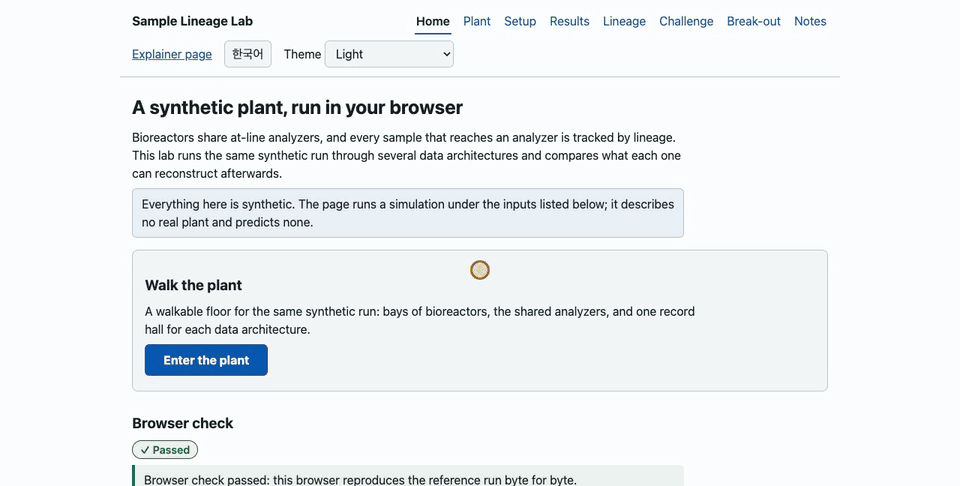
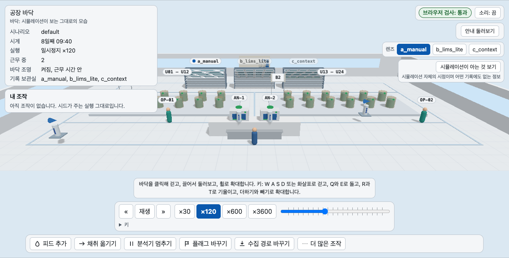
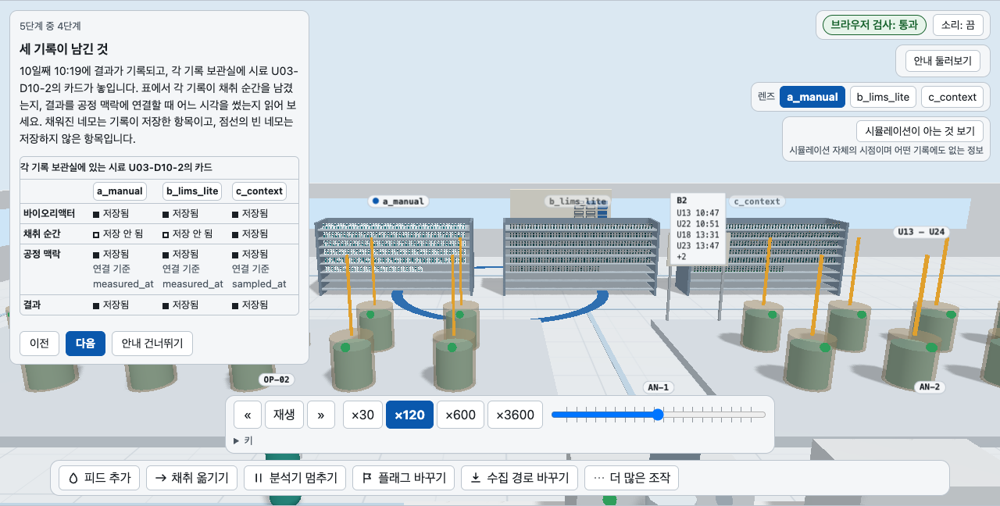
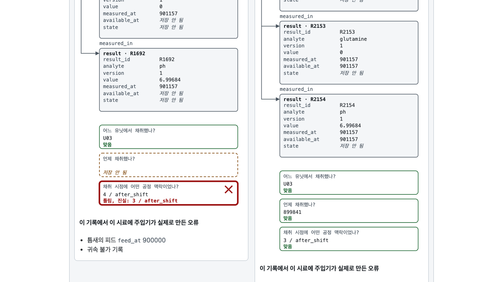
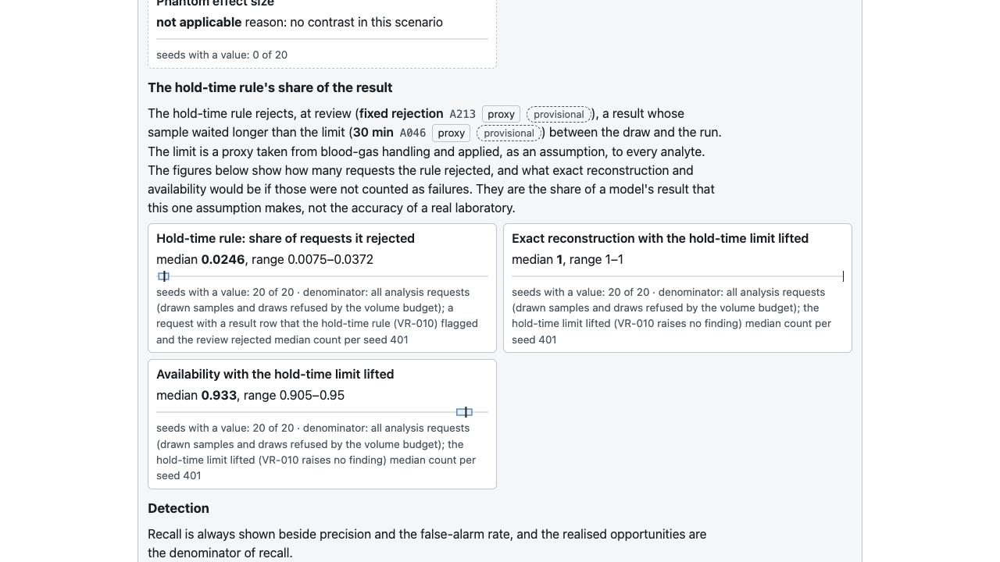
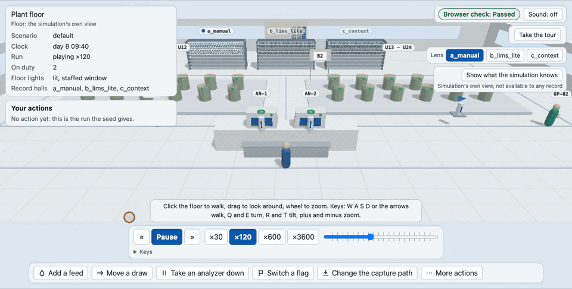
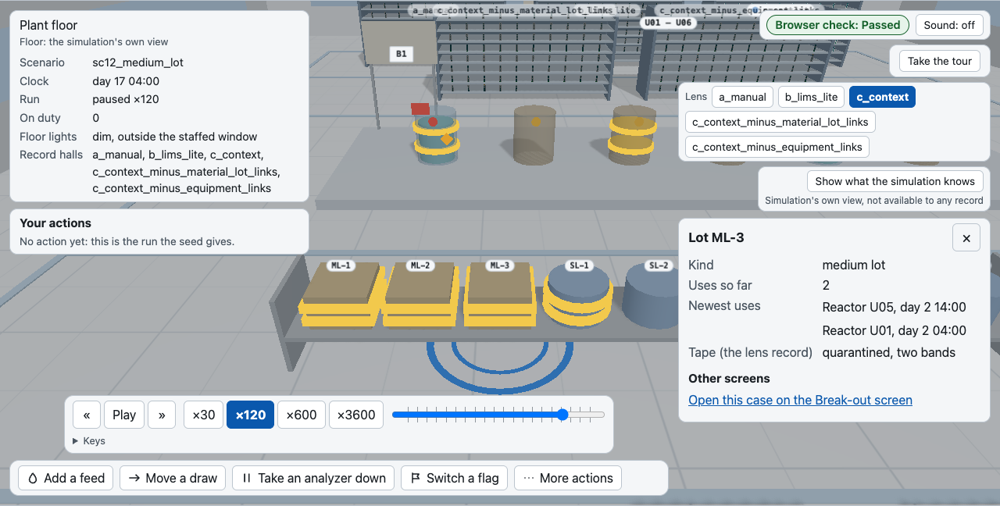
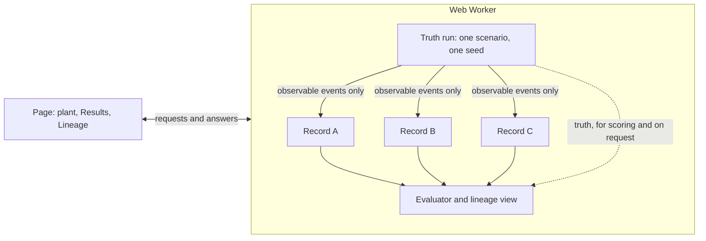

#  Sample Lineage Lab

서로 다른 데이터 아키텍처가 나중에 시료 하나에 대해 무엇을 알려 줄 수 있는지 보여 주는 시뮬레이터입니다.

[English](README.md) | **한국어**



합성 공장의 벤치 규모 바이오리액터 몇 대가 at-line 분석기 몇 대를 나눠 씁니다. 같은 실행을 여러 데이터 아키텍처로 기록하고, 각 기록이 나중에 무엇을 복원할 수 있는지(시료가 어느 리액터에서 왔는지, 어느 시각을 가리키는지, 어떤 장비 상태에서 측정되었는지) 비교합니다. 모든 데이터는 합성이며, 여기 있는 어떤 것도 실제 공장을 예측하지 않습니다(ADR-0001).

- [할 수 있는 것](#할-수-있는-것)
- [동작 방식](#동작-방식)
- [빠른 시작](#빠른-시작)
- [사용법](#사용법)
- [무엇을 비교하는가](#무엇을-비교하는가)
- [읽는 방법](#읽는-방법)
- [구성](#구성)
- [작업 방식](#작업-방식)
- [라이선스](#라이선스)

## 할 수 있는 것

| 기능 | 화면 |
|---|---|
| 합성 공장을 걸어 다니며 실행 하나가 재생되는 모습을 봅니다. 리액터, 분석기, 작업자가 있고 A, B, C 기록마다 기록 보관실이 하나씩 있습니다. |  |
| 피드 전에 채취되고 피드 후에 측정된 시료 하나를 짧게 둘러보며, 세 기록이 각각 무엇을 남겼는지 읽습니다. |  |
| 그 시료를 기록마다 따라갑니다. 왼쪽이 A, 오른쪽이 C이고, 세 가지 질문에 대한 답이 시뮬레이션의 진실과 대조되어 나옵니다. |  |
| 시드에 걸쳐 각 기록이 무엇을 복원할 수 있는지 비교하고, 다른 지표 옆에서 보관 시간 규칙이 결과에서 차지하는 몫도 봅니다. |  |
| 운영자가 되어 피드를 추가하고, 채취를 옮기고, 분석기를 멈춥니다. 실행이 처음부터 다시 계산되고 시계가 이어서 흐릅니다. |  |
| 공장 안에서 역추적 사례를 엽니다. 로트 선반과 격리된 로트에 붙은 띠가 보입니다. 로컬 빌드에서만 있으며 공개 빌드에는 없습니다. |  |

## 동작 방식



엔진은 시나리오 하나와 시드 하나로 합성 실행 하나를 만듭니다. 그 실행이 진실입니다. 모든 시료, 리액터, 장비 상태가 실제로 일어난 대로 들어 있고, 실제 현장에서는 아무도 볼 수 없는 값도 포함합니다. 데이터 아키텍처는 실행의 관찰 가능한 이벤트만 기록하므로, 기록에는 그 플래그가 허용하는 것만 담기고 진실은 들어가지 않습니다. 평가기는 진실과 기록을 읽어 점수를 매기고, 계보 화면은 시료 하나에 대해 각 기록이 가진 행을 보여 주며, 요청하면 그 옆에 진실도 놓습니다.

엔진은 Web Worker에서 돕니다. 페이지는 Worker에 요청을 보내고 답을 그립니다. 엔진 코드를 가져오지 않고 결과를 직접 계산하지도 않으며, 같은 시드는 언제나 같은 실행을 냅니다.

## 빠른 시작

두 페이지는 아래 주소에서 열립니다. 내 컴퓨터에서 직접 실행할 수도 있습니다(아래 참고).

- [해설 페이지](https://jin-wolee.github.io/LS_Bioprocess/): 문제를 설명하는 스크롤 페이지입니다. 측정 시각을 움직이는 슬라이더와, 어떤 플래그가 어떤 오류를 막는지 보여 주는 표가 있습니다.
- [랩](https://jin-wolee.github.io/LS_Bioprocess/lab/): 합성 공장을 브라우저에서 돌리고 각 아키텍처의 기록이 무엇을 복원할 수 있는지 보여 줍니다. 공장 안을 걸어 다닐 수 있고("사용법" 참고), 시료 하나를 기록마다 따라가 볼 수 있고, 기록에 심어 둔 오류를 찾는 챌린지도 있습니다.

실행하려면 `package.json`(`engines`)에 적힌 버전의 Node, `pyproject.toml`(`requires-python`)에 적힌 버전의 Python(`uv`가 찾거나 내려받습니다), `npm`, `uv`가 필요합니다.

```bash
npm ci                  # Node packages, exact versions from package-lock.json
uv sync --frozen        # Python packages, exact versions from uv.lock
npm run preview         # build dist/site/ and serve it on 127.0.0.1
```

해설 페이지는 `http://127.0.0.1:8000/`, 랩은 `http://127.0.0.1:8000/lab/`에서 엽니다. Ctrl+C로 서버를 멈춥니다. 명령에 쓰인 포트는 비어 있어야 합니다. 랩의 Worker가 파일 하나를 가져오기 때문에, 랩은 파일 주소로는 동작하지 않습니다.

### 역추적 사례를 로컬에서 보기

공개 빌드는 역추적 화면과 공장 안의 역추적 사례를 뺍니다("수치" 참고). 로컬 빌드에는 있습니다.

```bash
VITE_LAB_LOCAL=1 npm run build:lab    # the Break-out screen is marked not for publication
uv run python -m http.server --bind 127.0.0.1 --directory dist/lab 8000
```

그다음 `http://127.0.0.1:8000/`를 엽니다.

### 점검과 그림

브라우저 점검에는 Chromium(`uv run playwright install chromium`)이 필요하고, 스크린샷과 애니메이션을 만들 때는 `ffmpeg`도 필요합니다.

```bash
git config core.hooksPath scripts/git-hooks     # once per clone

uv run pytest -q                                # scripts, hooks, docs check, site
uv run --frozen python scripts/check_docs.py --all   # banned tokens, ADR format, ledgers, id references
npm run check                                   # lint, typecheck, Vitest, then the I12 budget alone
bash scripts/check_all.sh --manual              # the full gate; add --lab and --plant for the end-to-end checks of the lab and the plant

uv run python site/infographic/build.py         # rebuild the explainer page
uv run python scripts/qa/qa_infographic.py      # headless check of the explainer, output in qa_out/
uv run python scripts/assemble_site.py          # build dist/site/: the explainer at the root, the lab under lab/
uv run python scripts/qa/qa_site.py             # headless check of dist/site/, the plant route included
uv run python scripts/media/make_media.py       # make the pictures of this page again into docs/media/
```

Pages 워크플로는 저자가 직접 실행합니다. 위의 점검과 랩, 공장, 조립된 사이트의 브라우저 점검을 헤드리스 Chromium에서 돌린 뒤에야 배포할 수 있으므로, 점검이 하나라도 실패하면 배포가 막힙니다. CI 러너는 시간 예산을 잰 컴퓨터가 아니므로 거기서는 프레임 시간, 조작 왕복 시간, 엔진 실행 시간을 조건과 함께 출력만 하고 판정하지 않습니다(`--timing report`).

## 사용법

랩의 홈 화면에서 같은 합성 실행을 삼차원 장면으로 보여 주는 공장이 열립니다. WebGL이 없는 브라우저에서는 글로 된 판이 대신 나옵니다. 두 페이지는 영어로 열리고 한국어 전환 버튼이 있으며(ADR-0006), 한 페이지에서 고른 언어는 다른 페이지로 넘어가도 유지됩니다.

### 공장

| 입력 | 하는 일 |
|---|---|
| 바닥을 클릭하거나 `W` `A` `S` `D` 또는 화살표 키 | 통로를 따라 걷기 |
| 끌기, 또는 `Q` `E`와 `R` `T` | 둘러보기: 돌리기와 기울이기 |
| 휠, 또는 `+`와 `-` | 확대와 축소 |
| `Space` | 시계 재생과 일시정지 |
| `1`부터 `4`까지 | 속도 고르기 |
| `,`와 `.` | 이전 이벤트나 다음 이벤트로 건너뛰기 |
| `[` `]`와 `{` `}` | 시계를 한 시간 또는 하루 움직이기 |
| 객체를 클릭하거나 바닥 아래 목록의 버튼을 누르기 | 그 패널 열기, `Esc`로 닫기 |
| `F` | 고른 시료의 시험관 따라가기 |

데이터 아키텍처마다 기록 보관실이 있습니다. 선반에는 그 기록이 가진 시료마다 카드가 한 장씩 놓이고, 렌즈는 기록 패널이 읽을 보관실을 고릅니다. 카드를 누르면 그 카드가 가리키는 기록이 열립니다. 카드, 시료, 리액터, 분석기에서는 계보, 결과, 노트 화면으로도 갈 수 있고, 어느 링크든 같은 시점으로 돌아옵니다.

진실 오버레이는 요청하기 전까지 꺼져 있습니다. "시뮬레이션이 아는 것 보기"를 누르면 시뮬레이션은 알지만 어떤 기록도 가질 수 없는 정보가 나오고, 그것이 시뮬레이션 자체의 시점이라고 표시됩니다.

운영자 조작은 바닥 아래의 바에 있습니다. 피드 추가, 채취 옮기기, 분석기 멈추기, 플래그 바꾸기, 수집 경로 바꾸기, 그리고 "더 많은 조작" 아래의 세 가지입니다. 조작을 적용하면 공장을 처음부터 다시 돌리고, 조작 목록에서 하나씩 되돌릴 수 있으며, 리액터나 분석기를 지정한 조작은 결과 화면에도 이어집니다.

안내 장면은 "안내 둘러보기"로 시작합니다. 피드 전에 채취되고 피드 후에 측정된 시료 하나를 다섯 단계로 따라갑니다. 채취, 간격 안의 피드, 실행, A, B, C의 표, 그리고 오버레이를 켜는 선택 단계입니다. 화살표 키로 넘기고, `Esc`로 어느 단계에서든 건너뛸 수 있습니다.

역추적 사례의 공장(로트 선반, 장비 스테이션, 확인 검사)은 로컬 빌드에서만 있습니다. 공개 빌드는 역추적 화면과 그 사례를 거절합니다("수치" 참고).

### 다른 화면

| 화면 | 하는 일 |
|---|---|
| 홈 | 랩을 소개하고, 브라우저 점검을 돌리고, 공장으로 들어가게 합니다 |
| 설정 | 시나리오, 리액터와 분석기, 비교할 기록, 수집 경로, 시드를 고르고 실행합니다 |
| 결과 | 각 기록이 무엇을 복원할 수 있는지 시드에 걸친 분포로 보여 줍니다 |
| 계보 | 시료 하나를 각 아키텍처의 기록에서 따라갑니다 |
| 챌린지 | 기록에 심어 둔 오류를 찾게 합니다 |
| 역추적 | 오염 역추적이 각 기록에서 무엇을 찾아내는지 보여 줍니다(로컬 빌드에서만) |
| 노트 | 범위, 수치의 등급, 비교를 읽는 방법을 알려 줍니다 |

## 무엇을 비교하는가

기본 예시는 간격 안의 피드입니다. 시료를 08:40에 채취하고, 09:00에 볼루스 피드가 들어가고, 분석기가 09:25에 시료를 측정합니다(예시 시각, A102). 측정 시각만 저장하는 기록은 시료가 피드 전에 채취되었는데도 결과를 피드 후의 공정 상태에 붙입니다. 채취 시각도 저장하는 기록은 올바르게 붙입니다.

데이터 아키텍처는 플래그 열 개의 묶음이며, 플래그는 각각 기록의 속성 하나입니다. 프리셋은 플래그 묶음을 한꺼번에 켭니다(ADR-0005, ADR-0017, ADR-0020).

| 플래그 | 켜져 있으면 기록이 저장하는 것 |
|---|---|
| `system_issued_id` | 라벨을 만들 때 시스템이 발급한 시료 키 |
| `two_clocks` | 채취 시각과 측정 시각을 따로 |
| `available_at` | 행마다, 그 행이 알 수 있게 된 시각 |
| `instrument_state_snapshot` | 실행에서 장비, 그 보정, 그 시약 로트로 가는 연결 |
| `append_only_versions` | 정정, 재측정, 재처리를 새 버전으로 |
| `write_time_keys` | 기록할 때 고정되어 다시 바뀌지 않는 시료, 유닛, 배치 키 |
| `ingest_idempotency` | 중복되거나 다시 들어온 파일을 아무 일도 하지 않는 것으로 |
| `audit_trail` | 무엇이 언제 바뀌었는지(재측정의 이전 값과 새 값, 버전, 시각)와 채취한 작업자와 그 자격. 누가 결과를 바꾸었는지, 왜 바꾸었는지는 아님 |
| `material_lot_links` | 접종이나 첨가에 쓴 로트를 키로 |
| `equipment_links` | 배치가 쓴 장비를 키로 |

마지막 두 개는 오염 이벤트가 스크립트로 들어갈 때만 의미가 있습니다. 같은 로트나 장비를 나눠 쓴 다른 배치까지 조사가 닿을 수 있는지를 정합니다.

- A, 수작업 또는 엑셀: 켜진 플래그 없음.
- B, LIMS-lite: `system_issued_id`, `ingest_idempotency`, `audit_trail`, `equipment_links`. 단순한 실험실 시스템이 이미 하는 일을 본떴습니다.
- C, 맥락 보존: 열 개 모두. 플래그로 없앨 수 없는 것은 그대로 보고합니다. 예를 들어 보관 시간 규칙이 거절하는 결과가 그렇습니다("읽는 방법" 참고). 올바른 바코드가 엉뚱한 튜브에 붙는 경우는 모형화하지 않습니다. 여기서 라벨 오류는 손으로 입력하거나 적은 id이며, `system_issued_id`가 이를 막습니다.

C에서 플래그를 하나씩 끈 변형은 어느 플래그가 어떤 효과를 지니는지 보여 줍니다. 플래그와 무관한 설정이 둘 있습니다. 시료에 라벨을 붙이는 방식과, 결과가 기록이 되는 방식(장비 화면을 보고 입력하거나, 합성 장비 파일을 파싱하는 것)입니다(ADR-0005, ADR-0014).

플래그마다 강제 오류 사례가 있고, 그 기대 결과는 실행 전에 손으로 적어 둡니다. 랩은 시드에 걸쳐 지표마다 범위를 보여 줍니다. 종합 점수도 순위 열도 없으며, 최소 시드 수 이상일 때만 실행을 비교라고 부릅니다(A103). 플래그, 지표, 시나리오는 `docs/design/simulation_spec.md`에, 이름은 `docs/design/data_model.md`에 정의되어 있습니다.

## 읽는 방법

A와 B는 정확한 복원이 요구하는 채취 시각과, 실행에서 장비 상태로 가는 연결을 저장하지 않으므로, 어느 시드에서나 정확한 복원은 구성상 영입니다. 이 비교는 기록이 무엇을 보존하고 따라서 나중에 어떤 질문에 답할 수 있는지를 보여 주는 구성적 예시입니다. 실제 스프레드시트나 실험실 시스템의 품질, 효율, 도입 효과를 재는 척도가 아닙니다.

시드에 걸친 분포는 입력이 허용하는 운영과 측정의 변동입니다. 세포주의 상수는 시드에 따라 바뀌지 않으므로, 이 분포는 모형의 불확실성이 아닙니다. 최소 시드 수(A103)는 설계상의 문턱이며, 통계적 충분성의 증명이 아닙니다.

보관 시간 규칙(`VR-010`, A046과 A213은 둘 다 잠정이며 그 출처를 아직 다 다시 읽지 않았습니다)은 시료가 채취부터 실행까지 너무 오래 기다린 결과를 거절합니다. 이 한도는 혈액가스 취급에서 가져온 대리 기준이며, 가정으로서 모든 분석 항목에 적용합니다. 랩은 그 규칙이 요청을 몇 건 거절했는지, 그리고 그것을 실패로 세지 않았다면 정확한 복원과 가용성이 어떻게 되었을지 보여 줍니다. 이는 모형의 결과 중 가정 하나가 차지하는 몫이며, 실제 실험실의 정확도가 아닙니다.

역추적 화면에서 보류는 기록의 상태이며 배양을 멈추지 않습니다. 격리 수치는 추적과 보류가 기록에 미치는 효과이며, 배양 관리나 오염이 퍼지는 방식의 효과가 아닙니다. 확인 검사는 민감도가 아니라 포괄 범위로 판정합니다.

### 수치

페이지의 모든 수치에는 장부 항목의 id가 붙습니다. 출처는 `docs/research/sources.yaml`의 `S###`, 시뮬레이터 매개변수는 `docs/research/assumptions.yaml`의 `A###`입니다. 가정에는 등급(sourced, proxy, derived, assumed)이 있고 출처에는 검증 수준(snippet, agent-read, main-reread)이 있습니다. 공개 페이지의 수치는 main-reread 출처만 뒷받침합니다. 더 약한 출처에 기대는 수치는 점선 잠정 칩과 함께 보이고, 그 라벨 없이 인용한 공개 파일은 `scripts/check_docs.py`가 실패시킵니다. 등급은 `docs/research/README.md`에 설명되어 있습니다.

랩의 역추적 화면(오염 역추적)과 공장 안의 역추적 사례는 보류되어 있습니다. 입력이 아직 다시 읽지 않은 출처에 기대므로, 공개 빌드는 그 화면을 거절하고 사례를 내놓지 않습니다. 로컬 빌드는 공개 불가 표시가 붙은 화면과 공장 안의 사례를 보여 줍니다. 그 출처를 다시 읽을 때까지 공개 빌드에서 빠져 있습니다.

페이지는 결과를 싣고 있지 않습니다. 랩은 방문할 때마다 내 브라우저 안에서, 고른 시나리오와 시드로 결과를 계산합니다.

## 구성

| 폴더 | 들어 있는 것 |
|---|---|
| `.claude/` | CLAUDE.md, 훅 설정, 스킬, 에이전트, 저자 소유 경로 목록(ADR-0022 이후 비어 있음) |
| `.github/` | 손으로 실행하는 Pages 워크플로. 배포 전에 점검과 브라우저 QA를 돌립니다 |
| `data/` | 시나리오, 프로필, 아키텍처, 실험을 장부 참조가 붙은 데이터로 담았고, JSON 스키마도 있습니다 |
| `docs/` | `adr/` 결정, `design/` 명세, `research/` 장부, `reviews/`, `prompts/` 지시서, `media/` 스크린샷과 애니메이션, `progress.md` |
| `engine/` | TypeScript 시뮬레이션 엔진(시드 고정, `Math.random` 없음). 테스트는 옆에 있습니다 |
| `reference/` | 명세만 보고 AI가 쓴 두 번째 구현(ADR-0022): `sql/` DDL과 쿼리 세 개, `simpy/` 핵심 루프 |
| `scripts/` | 점검, 사이트 조립, Claude Code 훅, git 훅, `qa/` 헤드리스 페이지 QA, `media/` 스크린샷과 애니메이션을 만드는 스크립트(`scripts/README.md` 참고) |
| `site/` | 해설 페이지: `infographic/src/`를 `build.py`가 `index.html`로 빌드합니다 |
| `src/` | 랩 페이지(Preact), 그 Web Worker, 영어와 한국어 사전 |
| `tests/` | 스크립트, 훅, 문서 점검, Pages 워크플로, README에 대한 pytest |

루트에는 프로젝트 파일도 있습니다: `package.json`과 `package-lock.json`, `pyproject.toml`과 `uv.lock`, `tsconfig.json`, `eslint.config.js`, `vite.config.ts`(Vitest 설정), `LICENSE`.

## 작업 방식

저자는 이 랩이 던지는 질문을 정했고, `docs/prompts/PRINCIPLES.md`의 작업 규칙을 확정했으며, `docs/adr/`에 ADR로 남은 결정을 하나하나 내렸습니다. 코드, 명세, 테스트, 픽스처, 문서의 대부분은 AI 코딩 도구(Claude Code)가 `docs/prompts/`의 지시서를 따라 썼습니다. AI 도구는 ADR을 제안됨(Proposed) 상태로만 쓰고, 결정자의 메모와 수락됨(Accepted)으로의 변경은 저자가 직접 커밋합니다(ADR-0002).

스크립트와 테스트가 도구의 결과물을 점검합니다. 픽스처의 기댓값은 손계산 추적을 포함해 모두 각 사례 옆에 적어 둔 계산으로 도출하며, 검사 대상 코드에서 가져오지 않습니다. 골든 추적은 저자의 승인이 `docs/progress.md`에 기록될 때만 바뀝니다. 각 증분은 커밋 전에 `scripts/check_all.sh`(문서와 원장 점검, pytest, Node 점검, `Math.random` 검색)를 통과하고, 페이지는 배포 전에 헤드리스 브라우저 점검을 통과합니다. 저자는 정해진 관문에서 결정합니다. ADR 수락, 공개되는 모든 것, 저자 자신의 트랙, 릴리스입니다(`docs/prompts/PRINCIPLES.md`, section 1). 푸시와 공개는 저자만 하며, 훅이 도구가 둘 중 어느 것도 하지 못하게 막습니다.

엔진은 두 번째 구현과도 비교됩니다. 데이터베이스 스키마(`reference/sql/schema.sql`), SQL 쿼리 세 개(결과를 공정 맥락에 붙이는 as-of 조인, 재귀 계보 쿼리, 구간에 걸친 정정)와 SimPy 핵심 루프(`reference/simpy/sim_core.py`)는 ADR-0022에 따라 AI(Claude Code)가 명세만 보고 작성했습니다(clean-room). 이를 작성한 AI는 설계 문서, 스키마, 픽스처, 인수 테스트를 읽었고 엔진의 소스는 읽지 않았습니다. 읽은 파일의 목록은 `docs/progress.md`의 보고에 있습니다. 저자는 이 파일들을 쓰지 않았습니다. ADR-0022는 저자가 이 다섯 파일을 쓴다는 ADR-0010의 계획을, 이 다섯 파일에 한해서만 대체합니다. TypeScript 엔진과의 일치는 `tests/user_track/`(`uv run pytest -m user_track -q`)이 측정합니다. 이 테스트는 SimPy 루프를 손계산 추적과 엔진의 골든 추적에 돌려 정수 시각을 정확히 비교하고, 스키마와 쿼리를 SQL 픽스처와 그 기댓값에 돌립니다. 테스트는 모두 통과합니다. 이 파일들은 엔진의 코드를 베끼지 않은 두 번째 구현이지만, 명세를 쓴 모델 계열에서 독립적이지는 않습니다.

## 라이선스

코드는 MIT 라이선스입니다(`LICENSE`). `docs/`, `docs/prompts/`, 해설 페이지의 글, 그림, 데이터 표는 CC BY 4.0입니다(`docs/LICENSE-docs.md`). `docs/media/`의 스크린샷과 애니메이션은 `docs/`의 그림입니다. 장부에 인용한 출처는 각자의 조건을 따르며, 장부에는 짧은 인용과 링크만 담습니다(ADR-0008).

더 깊이 알고 싶다면 [설계 노트](docs/design/)와 [결정 기록](docs/adr/)을 읽으세요.
