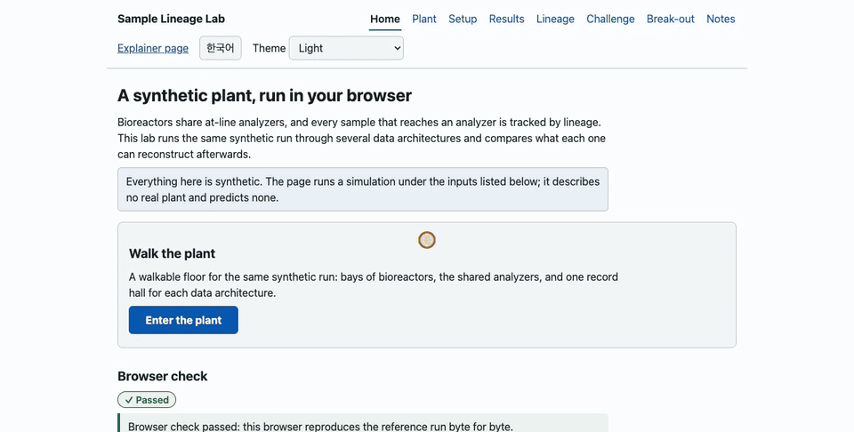
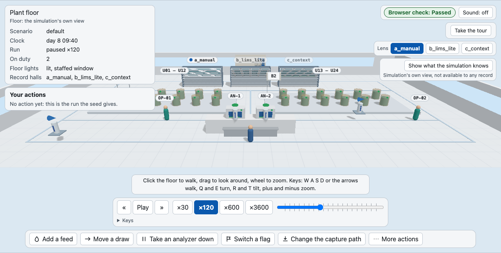
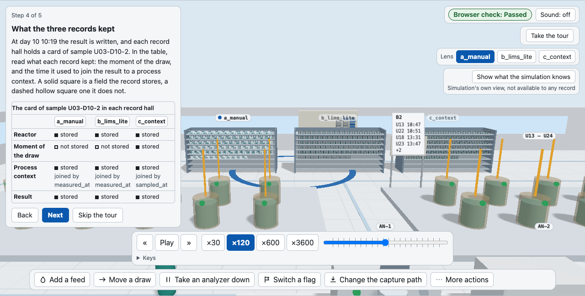
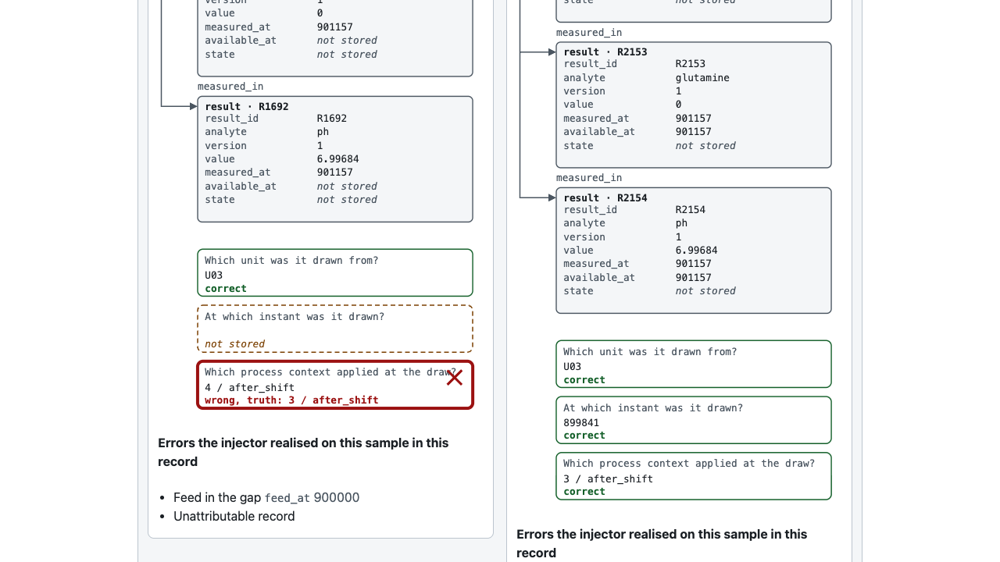
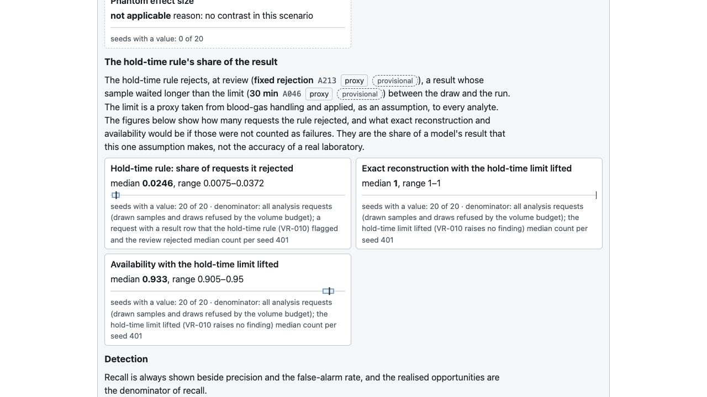
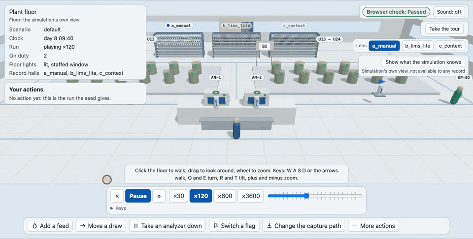
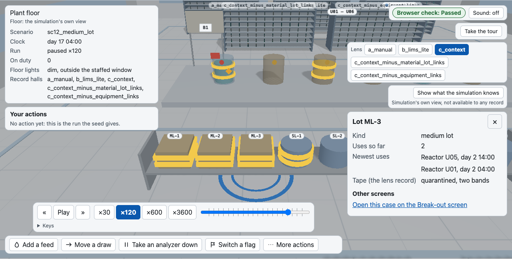
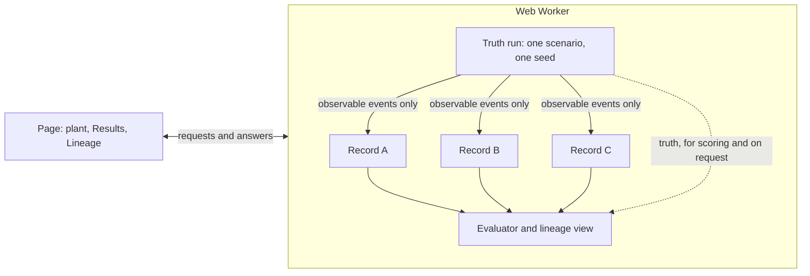

#  Sample Lineage Lab

A simulator that shows what different data architectures can still tell you about a sample afterwards.

**English** | [한국어](README.ko.md)



Bench-scale bioreactors in a synthetic plant share a few at-line analyzers. The same run is recorded under several data architectures, and each record is compared on what it can still reconstruct: which reactor a sample came from, which moment it describes, which instrument state measured it. All data are synthetic, and nothing here predicts a real plant (ADR-0001).

- [What you can do](#what-you-can-do)
- [How it works](#how-it-works)
- [Quick start](#quick-start)
- [Usage](#usage)
- [What it compares](#what-it-compares)
- [How to read it](#how-to-read-it)
- [Where things are](#where-things-are)
- [How the work is done](#how-the-work-is-done)
- [Licence](#licence)

## What you can do

| Feature | Screenshot |
|---|---|
| Walk through a synthetic plant while one run plays, with its reactors, analyzers and staff, and one record hall for each of A, B and C. |  |
| Take a short tour of one sample that was drawn before a feed and measured after it, and read what each of the three records kept. |  |
| Follow that sample through the records, A on the left and C on the right, and see three questions answered and judged against the simulation's truth. |  |
| Compare what each record can reconstruct across seeds, with the hold-time rule's share of the result beside the other metrics. |  |
| Act as the operator: add a feed, move a draw, take an analyzer down. The run is recomputed from its start and the clock plays on. |  |
| Open a Break-out case in the plant, with its lot rack and the tape on a quarantined lot. Local build only: the public build does not offer it. |  |

## How it works



The engine draws one synthetic run for a scenario and a seed. That run is the truth: every sample, reactor and instrument state as it happened, including quantities nobody on a real floor could see. Each data architecture records only the observable events of the run, so a record holds what its flags let it hold and nothing from the truth. The evaluator reads the truth and the records to score them, and the Lineage screen shows the rows each record keeps for one sample, with the truth beside them when you ask.

The engine runs in a Web Worker. The page sends it a request and draws the answer. It imports no engine code and computes no result itself, and the same seed gives the same run every time.

## Quick start

The two pages will be at these addresses. The site goes live when the author publishes it, and until then the addresses do not answer, so run the pages locally.

- [Explainer](https://jin-wolee.github.io/LS_Bioprocess/): a scroll page on the problem, with a slider that moves the measurement time and a matrix of which flag covers which error.
- [Lab](https://jin-wolee.github.io/LS_Bioprocess/lab/): runs the synthetic plant in the browser and shows what the record of each architecture can reconstruct. You can walk through that plant (see "Usage"), follow one sample through each record, and take a challenge: find the planted error in a record.

To run them you need Node at the version in `.nvmrc`, Python at the version in `.python-version` (`uv` finds or fetches it), `npm` and `uv`.

```bash
npm ci                  # Node packages, exact versions from package-lock.json
uv sync --frozen        # Python packages, exact versions from uv.lock
npm run preview         # build dist/site/ and serve it on 127.0.0.1
```

Open `http://127.0.0.1:8000/` for the explainer and `http://127.0.0.1:8000/lab/` for the lab. Stop the server with Ctrl+C. The port in the command has to be free. The lab does not work from a file URL, because its Worker fetches a file.

### Break-out cases locally

The public build leaves out the Break-out screen and the Break-out cases in the plant (see "Numbers"). A local build has them:

```bash
VITE_LAB_LOCAL=1 npm run build:lab    # the Break-out screen is marked not for publication
uv run python -m http.server --bind 127.0.0.1 --directory dist/lab 8000
```

Then open `http://127.0.0.1:8000/`.

### Checks and pictures

The browser checks need Chromium (`uv run playwright install chromium`), and making the screenshots and animations needs `ffmpeg` as well.

```bash
git config core.hooksPath scripts/git-hooks     # once per clone

uv run pytest -q                                # scripts, hooks, docs check, site
uv run --frozen python scripts/check_docs.py --all   # banned tokens, ADR format, ledgers, id references
npm run check                                   # lint, typecheck, Vitest, then the I12 budget alone
bash scripts/check_all.sh --manual              # the full gate; add --lab and --plant for the end-to-end checks of the lab and the plant

uv run python site/infographic/build.py         # rebuild the explainer page
uv run python scripts/qa/qa_infographic.py      # headless check of the explainer, output in qa_out/
uv run python scripts/assemble_site.py          # build dist/site/: the explainer at the root, the lab under lab/
uv run python scripts/qa/qa_site.py             # headless check of dist/site/, the plant route included
uv run python scripts/media/make_media.py       # make the pictures of this page again into docs/media/
```

The Pages workflow is started by the author by hand. It runs the checks above and the browser checks of the lab, the plant and the assembled site in headless Chromium before it can deploy, so a failed check blocks the deploy. A CI runner is not the machine the time budgets were measured on, so there the frame times, the action round trip and the engine run are printed with their conditions and not judged (`--timing report`).

## Usage

The Home screen of the lab opens the plant, a three-dimensional scene of the same synthetic run. A text version stands in where the browser has no WebGL. Both pages open in English and have a Korean toggle (ADR-0006), and the language chosen on one page is kept when you follow the link to the other.

### The plant

| Input | What it does |
|---|---|
| Click the floor, or `W` `A` `S` `D` or the arrow keys | Walk along the aisles |
| Drag, or `Q` `E` and `R` `T` | Look around: turn and tilt |
| Wheel, or `+` and `-` | Zoom |
| `Space` | Play or pause the clock |
| `1` to `4` | Pick a speed |
| `,` and `.` | Step to the previous or next event |
| `[` `]` and `{` `}` | Move the clock an hour or a day |
| Click an object, or its button in the list under the floor | Open its panel; `Esc` closes it |
| `F` | Follow the tube of the picked sample |

Each data architecture has a record hall. Its shelves hold a card for each sample that record keeps, and the lens picks the hall that the record panel reads. A card opens the record it stands for. A card, a sample, a reactor or an analyzer also links to the Lineage, Results and Notes screens, and each link brings you back to the same instant.

The truth overlay is off until you ask. "Show what the simulation knows" shows what the simulation knows and no record can hold, and labels it the simulation's own view.

Operator actions are in the bar under the floor: add a feed, move a draw, take an analyzer down, switch a flag, change the capture path, and three more under "More actions". These rerun the plant from its start with the action applied. The list of your actions can undo one, and the ones that name a reactor or an analyzer carry over to Results.

The guided scene starts from "Take the tour". It follows one sample that was drawn before a feed and measured after it, in five steps: the draw, the feed in the gap, the run, the table of A, B and C, and an optional step that switches the overlay on. The arrow keys step through it, and it can be skipped at any step with `Esc`.

The plant of a Break-out case (the lot rack, the equipment stations, the confirming tests) is in the local build only. The public build refuses the Break-out screen and the cases with it (see "Numbers").

### The other screens

| Screen | What it does |
|---|---|
| Home | Introduces the lab, runs the browser check and opens the plant |
| Setup | Picks the scenario, the reactors and analyzers, the records to compare, the capture path and the seeds, then runs them |
| Results | Shows what each record can reconstruct, as a spread over seeds |
| Lineage | Follows one sample through the record of each architecture |
| Challenge | Asks you to find the planted error in a record |
| Break-out | Shows what a contamination walk-back finds in each record (local build only) |
| Notes | Gives the scope, the grades of the figures and how to read the comparison |

## What it compares

The standing example is a feed in the gap. A sample is drawn at 08:40, a bolus feed happens at 09:00 and the analyzer measures the sample at 09:25 (example times, A102). A record that keeps only the time of measurement joins the result to the process state after the feed, although the sample was drawn before it. A record that also keeps the time of the draw joins it correctly.

A data architecture is a set of ten flags, each one a property of the record. Presets switch groups of them on (ADR-0005, ADR-0017, ADR-0020).

| Flag | When it is on, the record keeps |
|---|---|
| `system_issued_id` | the sample key, issued by the system when the label is made |
| `two_clocks` | the time of the draw and the time of the measurement, separately |
| `available_at` | for each row, when it became knowable |
| `instrument_state_snapshot` | the link from a run to the instrument, its calibration and its reagent lot |
| `append_only_versions` | corrections, reruns and reprocessing as new versions |
| `write_time_keys` | the sample, unit and batch keys, fixed when written and never re-keyed |
| `ingest_idempotency` | a duplicated or replayed file as a no-op |
| `audit_trail` | what changed and when (the old and the new value of a rerun, its version and its time), and the operator and qualification of the draw; not who changed a result or why |
| `material_lot_links` | the lot used in an inoculation or addition, as a key |
| `equipment_links` | the equipment item used by a batch, as a key |

The last two matter only when a contamination event is scripted. They decide whether an investigation can reach the other batches that shared a lot or an item.

- A, manual or Excel: no flag on.
- B, LIMS-lite: `system_issued_id`, `ingest_idempotency`, `audit_trail` and `equipment_links`. It is modelled on what simple laboratory systems already do.
- C, context-preserving: all ten. What the flags cannot remove is still reported, for example the results that the hold-time rule rejects (see "How to read it"). A correct barcode stuck on the wrong tube is not modelled: the label error here is an id typed or written by hand, which `system_issued_id` prevents.

C with one flag off, for each flag, shows which flag carries which effect. Two settings are independent of the flags: how a sample is labelled, and how a result becomes a record, by typing from the instrument screen or by parsing a synthetic device file (ADR-0005, ADR-0014).

Each flag has a forced-error case whose expected outcome is written by hand before any run. Across seeds the lab shows a range per metric. It gives no composite score and no ranking column, and it calls a run a comparison only when it has at least the minimum number of seeds (A103). The flags, the metrics and the scenarios are specified in `docs/design/simulation_spec.md`, and the names are in `docs/design/data_model.md`.

## How to read it

A and B do not store the draw time or the link from a run to the instrument state that exact reconstruction asks for, so their exact reconstruction is zero by construction, whatever the seed. The comparison is a constructive example of what a record keeps, and so of which question it can answer afterwards. It is not a measure of the quality, the efficiency or the return of real spreadsheets or laboratory systems.

The spread across seeds is the variation of operations and measurement that the inputs allow. The constants of the cell line do not change with the seed, so the spread is not the uncertainty of the model. The minimum number of seeds (A103) is a threshold of the design, not a proof of statistical sufficiency.

The hold-time rule (`VR-010`; A046 and A213, both provisional, since their sources are not re-read in full) rejects a result whose sample waited too long between the draw and the run. Its limit is a proxy taken from blood-gas handling and applied, as an assumption, to every analyte. The lab shows how many requests the rule rejected and what exact reconstruction and availability would be if those were not counted as failures. That is the share of a model's result that one assumption makes, not the accuracy of a real laboratory.

In the Break-out screen a hold is a state of the record and stops no culture. Its containment figures are the effect of tracking and holding on the record, not of a control of the culture or of how a contamination spreads, and its confirming tests are judged by coverage, not by a sensitivity.

### Numbers

Every number on the pages carries the id of a ledger entry: `S###` in `docs/research/sources.yaml` for a source, `A###` in `docs/research/assumptions.yaml` for a simulator parameter. An assumption has a grade (sourced, proxy, derived or assumed) and a source has a verification level (snippet, agent-read or main-reread). Only main-reread sources back a figure on a public page. A figure that rests on a weaker source is shown with a dashed provisional chip, and `scripts/check_docs.py` fails a public file that cites one without that label. `docs/research/README.md` explains the grades.

The lab's Break-out screen, a contamination walk-back, and the Break-out cases in the plant are held back. Their inputs rest on sources that have not been re-read, so the public build refuses the screen and offers no case; a local build shows the screen marked not for publication and the cases in the plant. They stay out of the public build until those sources are re-read.

The pages ship no result. The lab computes its results in your browser on each visit, from the scenario and the seeds you choose.

## Where things are

| Folder | What it holds |
|---|---|
| `.claude/` | CLAUDE.md, hook settings, skills, agents, and the list of author-owned paths (empty since ADR-0022) |
| `.github/` | the Pages workflow, started by hand; it checks and runs the browser QA before any deploy |
| `data/` | scenarios, profiles, architectures and experiments as data with ledger references, and the JSON schemas |
| `docs/` | `adr/` decisions, `design/` specifications, `research/` ledgers, `reviews/`, `prompts/` briefs, `media/` screenshots and animations, `progress.md` |
| `engine/` | the TypeScript simulation engine (seeded, no `Math.random`); its tests sit beside it |
| `reference/` | the second implementation, written by AI from the specification (ADR-0022): `sql/` the DDL and three queries, `simpy/` the core loop |
| `scripts/` | checks, site assembly, Claude Code hooks, git hooks, `qa/` the headless page QA, `media/` the script that makes the screenshots and animations (see `scripts/README.md`) |
| `site/` | the explainer: `infographic/src/` is built by `build.py` into `index.html` |
| `src/` | the lab page (Preact), its Web Worker, the English and Korean dictionaries |
| `tests/` | pytest for the scripts, the hooks, the docs check, the Pages workflow and the READMEs |

The root also holds the project files: `package.json` with `package-lock.json`, `pyproject.toml` with `uv.lock`, `tsconfig.json`, `eslint.config.js`, `vite.config.ts` (the Vitest settings), `.nvmrc`, `.python-version` and `LICENSE`.

## How the work is done

Decisions are written as ADRs in `docs/adr/`. The AI tools write them as Proposed; the decider's note and the change to Accepted are the author's own commits (ADR-0002).

Much of the engine, the lab and the documents were written with AI coding tools (Claude Code) working from written briefs in `docs/prompts/`. Scripts and tests check what they produce, and the author decides at set gates: accepting an ADR, anything published, the author's own track, and release (`docs/prompts/PRINCIPLES.md`, section 1). Pushing and publishing are the author's alone, and hooks stop the tools from doing either.

The database schema (`reference/sql/schema.sql`), three SQL queries (an as-of join of results to process context, a recursive lineage query and a bridging correction) and a SimPy core loop (`reference/simpy/sim_core.py`) were written by AI (Claude Code) under ADR-0022, clean-room from the specification: the writer read the design documents, the schemas, the fixtures and the acceptance tests, and did not read the engine's source. The author did not write them. ADR-0022 replaces ADR-0010's plan that the author writes these five files, for these five files only. Agreement with the TypeScript engine is measured by `tests/user_track/` (`uv run pytest -m user_track -q`), which runs the SimPy loop on the hand traces and the engine's golden traces and compares integer times exactly, and runs the schema and the queries against hand-typed fixtures; all of its tests pass. The files are a second implementation that does not copy the engine's code; they are not independent of the model family that wrote the specification.

## Licence

Code is under the MIT licence (`LICENSE`). Text, figures and data tables in `docs/`, `docs/prompts/` and the explainer are under CC BY 4.0 (`docs/LICENSE-docs.md`); the screenshots and animations in `docs/media/` are figures of `docs/`. Sources cited in the ledgers keep their own terms; the ledgers hold only short quotes and links (ADR-0008).

For more depth, read the [design notes](docs/design/) and the [decisions](docs/adr/).
