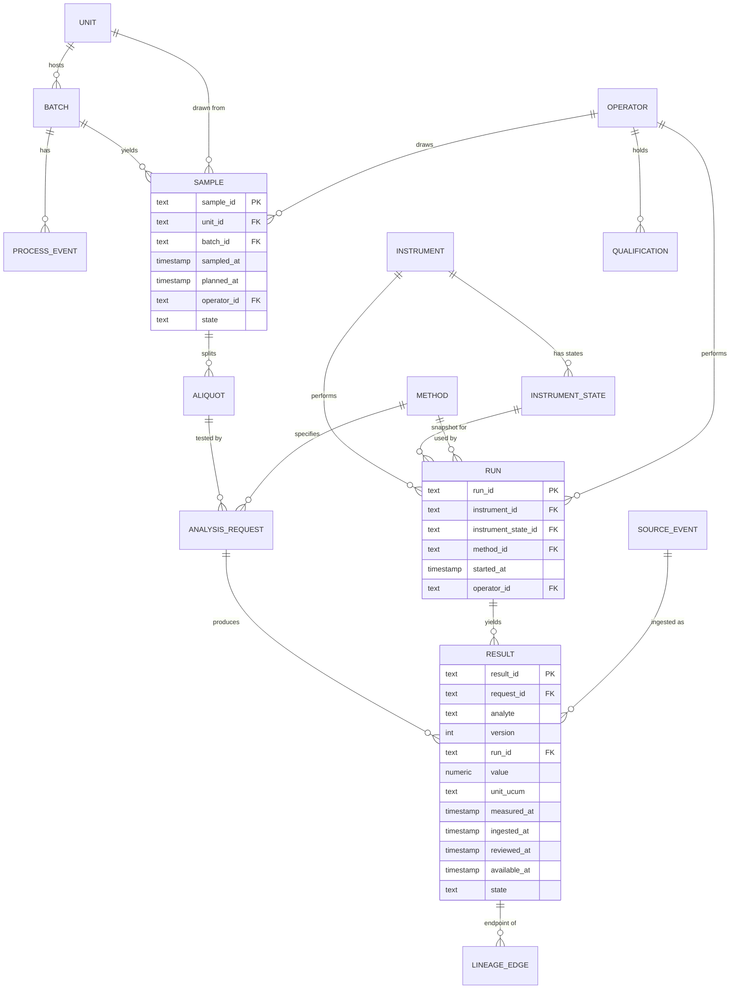
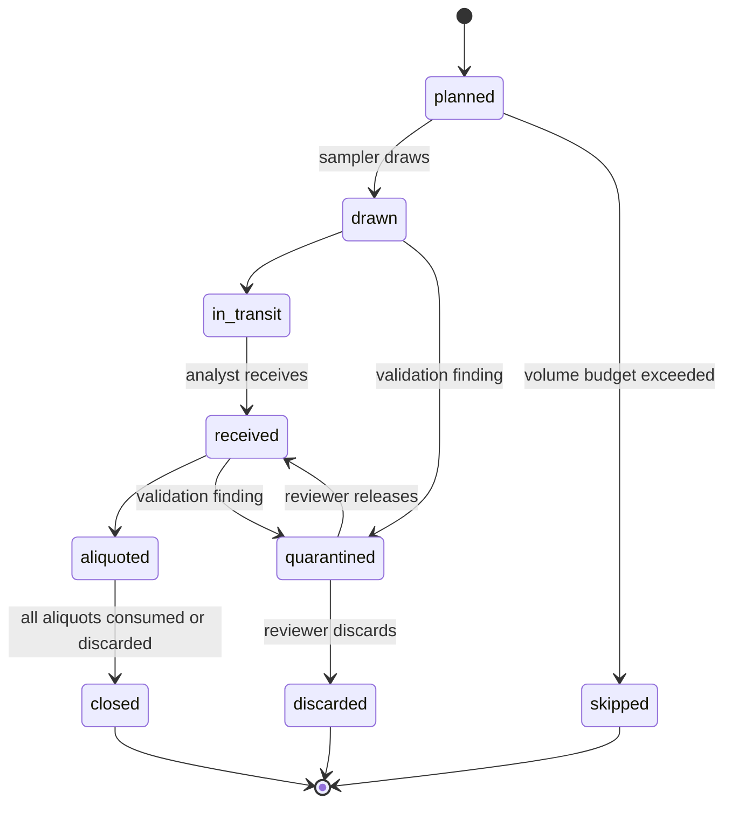
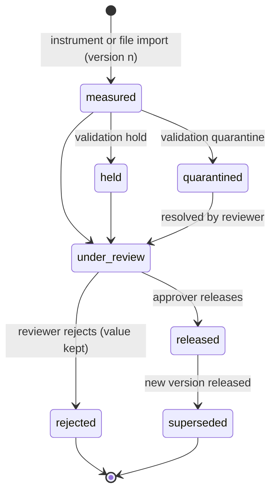
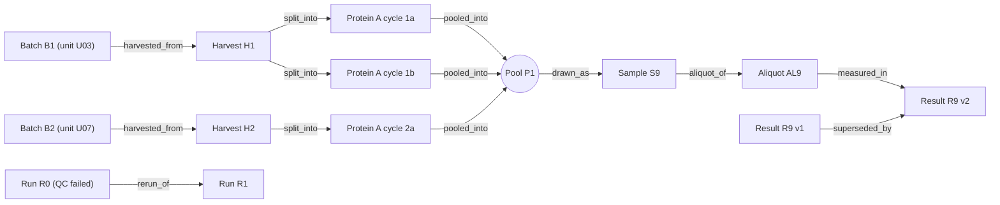

# Canonical data model

Status: design draft. This document is the specification and the basis for acceptance tests. **The DDL itself is the author's task** (`sql/schema.sql`, listed in `.claude/user_owned.txt`) and is deliberately not written here; neither are the three core SQL queries (an as-of window join of results to process context, a recursive lineage query, a bridging correction) under `sql/queries/` (ADR-0010). Synthetic data only; nothing here describes a real system.

Ledger ids (`S###`, `A###`) follow the conventions in `docs/design/simulation_spec.md`. A number without an id is a defect. This file is the canonical source for table, column and time-field names; prompts and schemas follow it.

## 1. Principles

1. The event record is the source of truth; current state is derived. Corrections create new versions, they never overwrite (flag `append_only_versions`).
2. Keys that give context (`sample_id`, `unit_id`, `batch_id`) are captured at write time and never re-keyed (flag `write_time_keys`). The draw time `sampled_at` is a separate field that belongs to flag `two_clocks`. Process context is a versioned, as-of projection, not a copy.
3. Time has several meanings, so several fields exist (section 5). A single "timestamp" column is the defect this model exists to expose.
4. Validation changes the state of a row, never its value: hold, quarantine or reject. Fixing a value is a new version with an author and a reason.
5. Who did it is recorded: operator id and a reference to the qualification in force (flag `audit_trail`).
6. Vocabulary is vendor-neutral. Physical model terms follow ISA-88 (Site, Area, Unit, Batch). Result files are mapped to this schema, borrowing from public Allotrope Simple Model ideas without claiming conformance (S031).
7. The canonical schema is what architecture C stores. Architectures A and B write subsets: columns they cannot know are null or free text. Whether those subsets are relaxed views over the canonical tables or separate demonstration schemas is an open question (section 14).

## 2. Entities

| Entity | Grain | Key | Main attributes | Notes |
|---|---|---|---|---|
| `unit` | one vessel (ISA-88 unit) | `unit_id` | area, bay, bioreactor profile reference, working volume with UCUM unit, `unit_tag` | master data; profile ids per A065 to A068; `unit_tag` is the historian tag prefix of the unit, and a historian tag is `unit_tag`, a dot and a signal name (for example `U03.pH`) |
| `batch` | one culture run on a unit | `batch_id` | `unit_id`, process mode (A003), inoculated and harvested times, seed-train parent via a lineage edge | at most one open batch per unit at a time |
| `process_event` | one event in a batch | `event_id` | `batch_id`, `unit_id`, type (feed, temperature shift, alarm, harvest), `occurred_at`, amount with unit, source | feeds are discrete (A010, S017) |
| `sample` | one physical draw | `sample_id` | `unit_id`, `batch_id`, `sampled_at`, `planned_at`, sampler `operator_id`, container, label method, state | `sampled_at` lives here and only here, and is stored only when `two_clocks` is on; `planned_at` is recorded only where a sampling plan issues the label (`system_issued_id`) |
| `aliquot` | one portion of a sample | `aliquot_id` | `sample_id`, storage condition (A021), volume, state | portions sum to at most the sample volume |
| `analysis_request` | one analyte panel asked of one aliquot | `request_id` | `aliquot_id`, analytes, `method_id`, `control_id`, priority or deadline, requested time, state | denominator unit for the metrics; `control_id` identifies the bridging or control sample: requests that share it measure the same material on different instruments or instrument states, and it is null for ordinary requests |
| `instrument` | one analyzer | `instrument_id` | class (A069 to A071), serial, interface (A036), configured time zone | |
| `instrument_state` | one versioned state of an instrument | `instrument_state_id` | `instrument_id`, `calibration_ref`, `reagent_lot`, `qc_lot`, `software_version`, `valid_from`, `valid_to` | linked from `run` when `instrument_state_snapshot` is on |
| `run` | one pass of a sample through an instrument | `run_id` | `instrument_id`, `instrument_state_id`, `method_id`, `started_at` (the instant written `run_started_at`), `ended_at`, `operator_id`, position or sequence, QC outcome | multi-visit samples have one run per visit |
| `method` | one versioned analytical method | `method_id` + version | analytes, expected units, dilution rule, effective dates | immutable once used |
| `result` | one analyte value for a request, one version | `result_id`; unique on (`request_id`, analyte, version) | `run_id`, value, original and canonical unit (UCUM), `measured_at`, `ingested_at`, `reviewed_at`, `available_at`, state, supersedes link, raw reference | |
| `process_context` (view) | one result or sample at one as-of time | derived | process state at `sampled_at` from the historian and events, as known at the as-of time | versioned projection, joined with an as-of join |
| `lineage_edge` | one derivation step between two items | `edge_id` | `from_item_id`, `to_item_id`, `relation`, `activity`, `occurred_at`, `available_at` | items are samples, aliquots, results or process materials; `relation` is one of the eight values of section 12 |

Supporting entities: `operator` (pseudonymous id, role, shift), `qualification` (operator, scope, level such as experienced or trainee per A072 and A073, valid from and to), `source_event` (ingestion envelope, section 7), `audit_event` (who, when, what changed, reason, old and new version), `validation_finding` (rule, target, severity, action, status), `historian_value` (`tag`, `ts`, `value`, `quality`, `ingested_at`; rows are not versioned, a late or corrected value arrives as a new row with a later `ingested_at`).

## 3. Entity-relationship sketch

`process_context` is a view over `process_event`, `historian_value` and `batch`, parameterised by an as-of time; it is not drawn as a table.

## 4. Key constraints

| # | Constraint |
|---|---|
| K1 | `result` is unique on (`request_id`, analyte, version). |
| K2 | `result.measured_at` and `result.run_id` are not null. A result cannot exist without a run. |
| K3 | `sampled_at` is stored on `sample` only, and only when `two_clocks` is on. Results reach it by join; `hold_time` and `turnaround` are derived (section 5). |
| K4 | `sampled_at <= run_started_at <= measured_at` is a truth-world invariant. In recorded data it is a validation rule (VR-002) because clocks and typing can violate it. |
| K5 | `sample.sample_id`, `sample.unit_id` and `sample.batch_id` are never re-keyed after write (flag `write_time_keys`, VR-018). `sampled_at` is never overwritten either; a correction is a new version (principle 4). |
| K6 | A unit has at most one open batch at any time. |
| K7 | An instrument does not process two runs at once. Checked by an acceptance query rather than a database constraint. |
| K8 | A released result is immutable. A change creates a new version that supersedes it. |
| K9 | (`source_system`, `source_event_id`) is unique in `source_event`, and so is `idempotency_key`. |
| K10 | `lineage_edge` is acyclic. Checked by an acceptance query. |
| K11 | A numeric result stores the original value and unit and a canonical value and unit, both as UCUM codes. |
| K12 | Aliquot volumes sum to at most the sample volume; this ties to the volume budget (A057). |
| K13 | A method version is immutable once a run has used it. |
| K14 | All instants are stored as UTC with the source's local offset or zone name beside them. |

## 5. Time fields

| Field | Meaning | On |
|---|---|---|
| `sampled_at` | instant the sample left the process; stored only when `two_clocks` is on | `sample` |
| `run_started_at` (column `run.started_at`) | instant the instrument began the run | `run` |
| `measured_at` | instant the instrument completed the measurement, the end of the run (`run.ended_at`); a truth event. With `two_clocks` off, the one time stored is this instant | `result` |
| `occurred_at`, `ts` | valid time of a process event, and of a historian value | `process_event`, `historian_value` |
| `ingested_at` | instant the system received the record | `result`, `process_event`, `historian_value`, `source_event` |
| `reviewed_at` | instant a reviewer or approver acted | `result` |
| `available_at` | instant this version of the row became knowable to a downstream reader | every versioned row |

Two derived quantities are defined here and nowhere else.

| Quantity | Definition | Used for |
|---|---|---|
| `hold_time` | `run_started_at` minus `sampled_at` (truth) | sample stability (A046, A039), the holding-time metric and rule VR-010; it is not the queue wait alone |
| `turnaround` | `available_at` minus `sampled_at` | whether a result could inform a decision; includes measurement, ingestion and review |

In the truth world both quantities use truth stamps. In recorded data they exist only where both clocks are stored (`two_clocks` on), and a recorded clock may be skewed in L4 (an instrument clock offset, A049), so a recorded value can differ from the truth value. Metrics compare recorded values with the truth value.

Expected order for a released result: `sampled_at` <= `run_started_at` <= `measured_at` <= `ingested_at` <= `reviewed_at` <= `available_at` (when release is gated by review; otherwise `available_at` follows `ingested_at`). Violations are findings, not exceptions.

**Bitemporal and as-of rule.** `sampled_at`, `run_started_at`, `measured_at`, `occurred_at` and `ts` are valid time: when something was true in the lab. `ingested_at` and `available_at` are transaction time: when the system knew it. A decision or query "as of t" uses, per logical key, the latest result version (greatest `available_at`) among those with `available_at` at or before t, and the historian rows and process events with `ingested_at` at or before t (for a repeated `tag` and `ts`, the latest ingested row). Process context for a result is then matched on valid time at `sampled_at`. With the flag `available_at` off, queries see everything as of now, which leaks late corrections into earlier decisions. With `two_clocks` off, only the measured time is stored; `sampled_at` is not stored and cannot be reconstructed.

**Clocks.** Timed records need controlled or synchronised clocks and a specified time zone (S029, sections 5.1 and 6.13); changing any clock used for recording timed events, including in process instrumentation, should be restricted (S030, 4.12); time-zone configuration is also covered second-hand (S052). How often a clock is wrong has no source (A049), so the wrong-clock scenario (SC6, example offset +5 h) is a stress case, not an estimate.

```mermaid
gantt
  title One sample, the times that matter (illustrative, A102 and A050)
  dateFormat HH:mm
  axisFormat %H:%M
  section Sample
  Draw to measurement (upper bound of hold_time) :active, hold, 08:40, 09:25
  section Process
  Bolus feed :milestone, feed, 09:00, 0m
  section Record
  measured_at :milestone, meas, 09:25, 0m
  Decision due :milestone, due, 10:00, 0m
```

The bar is the draw-to-measurement span (45 min, A102). `hold_time` ends when the run starts, so it is shorter than the bar by the run itself (A023).

## 6. State machines

Roles that may cause transitions: sampler, analyst, reviewer, approver, administrator (master data only). A role table is part of the data dictionary.

A label binding is an event, not a state, because its position depends on the labelling method: before the draw for a pre-printed barcode, at the draw when issued then, after it when handwritten.

| Entity | States (transitions in order) |
|---|---|
| `aliquot` | created, stored (condition per A021), in use, consumed or discarded; a frozen retain stays stored |
| `analysis_request` | requested, accepted, queued, in run, measured, under review, released; side states: rerun pending (returns to queued), rejected, cancelled |
| `run` | scheduled, setup, running, QC pending, QC passed or QC failed, closed; aborted at any point. A failed QC holds the results of the run and requests reruns |

## 7. Ingestion contract

Every record entering the system arrives in an envelope.

| Field | Meaning |
|---|---|
| `source_system` | which instrument, historian or form produced it |
| `source_event_id` | the source's own id for the event, unique within the source |
| `idempotency_key` | derived from source, event id and content version; the system's duplicate guard |
| `schema_version` | version of the envelope and payload schema |
| `raw_ref` | location and content hash of the raw file or message, kept immutable |
| `event_time` | the source's own timestamp, with its zone as sent |
| `received_at` | becomes `ingested_at` |
| `payload` | the content |

Rules, active when `ingest_idempotency` is on:

- Same key and same content: no-op, logged as information.
- Same key and different content: quarantine; the original is never overwritten.
- Out-of-order arrival: ordered by `event_time` and a sequence tie-break; a late arrival becomes a new version with a later `available_at`, so earlier as-of queries stay reproducible.
- Replay of a whole file: no-op row by row.
- With the flag off, duplicates double count (architecture A).

Fixtures: duplicate file, rows in reversed order, replayed file with one changed value, truncated file.

**Instrument file mapping (skeleton, specified in session S2).** The baseline is a result file dropped into a shared folder: a FLEX2-class analyzer exports CSV to a shared folder, and the file name carries an export time (S003, snippet). The vendor OPC server is a separately licensed add-on (S004, snippet) and connector guides treat these instruments as file-based (S038, S039, snippet). Vendor file formats are not copied verbatim; the mapping is by role.

| Source role | Canonical target | Transform | Rule |
|---|---|---|---|
| sample identifier text | `sample_id` via the label | trim, case rules | VR-014 |
| measurement timestamp (local, zone often unstated) | `measured_at` plus source zone | to UTC using the instrument's configured zone | VR-003, VR-004 |
| analyte name | analyte code | lookup in the method | VR-005 |
| value and unit text | `value`, `unit_ucum` | parse, convert to canonical unit | VR-005, VR-006 |
| dilution factor | `result.dilution_factor` (nullable) | numeric | VR-013 |
| operator | `operator_id` and qualification reference | lookup | VR-015 |
| instrument serial | `instrument_id` | lookup | VR-011 |
| file name and export time | `raw_ref`, `source_event_id` | hash of file and row | VR-008 |

## 8. Validation rule catalogue (draft)

Actions: **hold** (row stored, not available until reviewed), **quarantine** (row stored in a quarantine state, excluded from released views), **reject** (row not loaded; goes to a dead-letter list with reason and `raw_ref`). A rule never edits a value. The tolerances in VR-003 and VR-004 are scenario settings; this document fixes no value.

| Id | Check | Severity | Action |
|---|---|---|---|
| VR-001 | required context present: request, run, `measured_at` | error | reject |
| VR-002 | `sampled_at` <= `measured_at` | error | quarantine |
| VR-003 | `measured_at` not later than `ingested_at` beyond a tolerance | warning | hold |
| VR-004 | instrument clock offset or time-zone mismatch against the host clock exceeds a tolerance (S029, S030) | error | hold |
| VR-005 | unit is a known UCUM code and has the expected dimension for the analyte | error | quarantine |
| VR-006 | value is physically possible for the analyte (for example viability between 0 and 100 percent, pH on its scale) | error | quarantine |
| VR-007 | value is plausible against the batch trajectory (jump relative to neighbouring results) | warning | hold |
| VR-008 | same source event id and same content | info | no-op |
| VR-008b | same source event id, different content | error | quarantine |
| VR-009 | two samples on one unit with the same `sampled_at` and analyte but different ids (possible double label) | warning | hold |
| VR-010 | `hold_time` above the stability limit: 30 min as a blood-gas proxy (A046); a viability study covers holds only to 55 min (A039) | warning | hold |
| VR-011 | run has no instrument-state link while `instrument_state_snapshot` is on | warning | hold |
| VR-012 | run QC out of range | error | hold results of the run; request reruns |
| VR-013 | dilution factor missing or implausible where the method needs one (A048) | warning | hold |
| VR-014 | label does not match any open request | error | reject |
| VR-015 | operator or qualification missing, or qualification not valid on the date, while `audit_trail` is on | warning | hold |
| VR-016 | cumulative draw would exceed the volume budget (A057) | info | skip the draw, log it |
| VR-017 | lineage edge would create a cycle, or aliquot volumes exceed the sample | error | reject |
| VR-018 | attempt to change an immutable key | error | reject; write an audit event |
| VR-019 | result version n+1 arrives without version n | error | quarantine |
| VR-020 | sample on a unit with no open batch at `sampled_at` | error | hold |

Resolution is always a new version by a named reviewer with a reason; the finding keeps its history.

## 9. Data dictionary outline

`data_dictionary.yaml` has one entry per column:

- name, entity, type, nullable;
- unit as a UCUM code, for example `g/L`, `mmol/L`, `10*6/mL`, `%`, `[pH]`, `min`, `s`, `uL`;
- allowed values or range;
- time semantics: valid time, transaction time or neither;
- visibility: observable, or hidden truth (never given to recorders);
- default and its ledger id, if it carries a default;
- description.

**Units.** Store the original value and original unit as received, and a canonical value in the canonical unit for the analyte, both as UCUM codes. A conversion that is not defined is a finding, not a guess.

**Staff attribution.** When `audit_trail` is on, sample draw, run start, review, release and correction records carry `operator_id` (pseudonymous) and a `qualification_id` that was valid at that instant. When it is off, the operator is free text or absent. Qualification levels follow the staff profiles (A072, A073).

**Master data.** `unit_tag` (unit to historian tag prefix), analytes and their UCUM units, versioned methods, instruments with configured zones, operators and qualifications, areas and bays, shift calendar (A017, assumed). Role-permitted transitions are a table in the dictionary.

## 10. AI-ready export and data package

One row per (sample x analyte x released version). Columns: sample, unit, batch, analyte, value, canonical unit, `sampled_at`, `measured_at`, `hold_time`, `turnaround`, instrument state (calibration, lot), method version, operator and qualification references, process context as of the stated time, `available_at`, `context_as_of`. Because both clocks and `available_at` are present, a consumer can build features that use only what was knowable at a decision time, and avoid the leakage in section 5.

Each export ships as CSV plus a Frictionless-style `datapackage.json` carrying the table schema, units, the data dictionary, `schema_version`, `engine_version`, `seed`, the architecture preset and flags, and the ledger ids behind the defaults. The `licenses` field stays unset until the licence decision is accepted (ADR-0008).

## 11. System boundary note

- **Instruments.** The baseline is a result file dropped in a shared folder (A036). SiLA 2 adoption is described as slow and OPC UA LADS as early on installed fleets, by one vendor's map, not a survey (S040); public SiLA 2 documentation is at version 1.1 with a 1.2 tag, second-hand (S041); LADS mapped to Allotrope models was shown at a 2025 demonstration (S031). They are a future direction here, not the installed base.
- **MES/EBR versus LIMS.** Which system owns routine in-process results depends on the site, and vendor material disagrees (A056, S042, S043; S044 is a lead). The model treats it as a setting. ISA-95 Part 3 has a quality operations clause with quality test operations (S032, preview only), used here as vocabulary for the MES-to-LIMS boundary; B2MML conformance is not claimed (S051).
- **Historian.** Batches are commonly stored as event frames with equipment as assets (S048), and one talk reports that product genealogy needed custom linking code (S047), which is why lineage is an explicit edge table here.
- **Lineage vocabulary.** Job, run and dataset terms from OpenLineage (S050) inform the lineage view; the graph itself is a derivation graph.
- **Regulation.** EU Annex 11 on computerised systems: the Commission page lists the January 2011 revision as current (S027). A revised Annex 11, a revised Chapter 4 and a new draft Annex 22 on AI were put to consultation from 7 July to 7 October 2025 (S028); the revision is a draft and not final. The model describes controls and does not claim compliance with either text.

## 12. Lineage example with a cross-batch pool

One harvest split over several Protein A cycles and re-pooled keeps a single origin batch (A052). A many-to-many relation appears only when material from different batches is merged. In the example, pool P1 merges eluates from batch B1 and batch B2, so P1 has two origin batches, and each batch contributes to the pool.

Edge relations: `harvested_from`, `split_into`, `pooled_into`, `drawn_as`, `aliquot_of`, `measured_in`, `superseded_by`, `rerun_of`. Edges point in the direction of derivation. The origin batches of any item are found by walking edges backwards to batch nodes; the walk is a recursive query on the edge table and terminates because the graph is acyclic (K10). Pool hold limits are product-specific, and the public teaching case shows no hold data (A054, S017); downstream assay turnaround has no sourced value (A055). Writing the recursive query is the author's task.

## 13. Acceptance hooks for the author's DDL

Integrity rules are enforced by test queries, not by database triggers: DuckDB has no triggers. Declarative constraints (primary key, unique, not null, foreign key) cover K1, K2 and K9 where DuckDB supports them. The other rules (immutability K5, K8 and K13, one open batch K6, no double occupancy K7, acyclicity K10, volume conservation K12, and the validation rules of section 8) are queries over the tables that return no row on good data and at least one row on a bad-data fixture. State columns (the lists in section 6) and closed lists such as `lineage_edge.relation` (section 12) use `CHECK (column IN (...))` constraints, not ENUM types.

Acceptance tests (`tests/user_track/`, run with `pytest -m user_track`) are specified against section 4 and section 8: uniqueness (K1, K9), not-null (K2), immutability (K5, K8, K13), acyclicity and volume conservation (K10, K12), and fixture-based answers for the three queries. The tests are written by the AI path; the schema and queries are not.

## 14. Open questions

1. Are the A and B row shapes relaxed views over the canonical tables, or separate demonstration schemas?
2. How is `instrument_state` versioned (validity interval columns, or append-only snapshots)?
3. Is `process_context` materialised per as-of time, or computed on demand?
4. Surrogate keys or natural keys for the master data tables.
5. Representation of the source zone: offset, zone name, or both.
6. How `from_item_id` and `to_item_id` identify the kind of item they point to (a prefix in the id, or a kind column).
