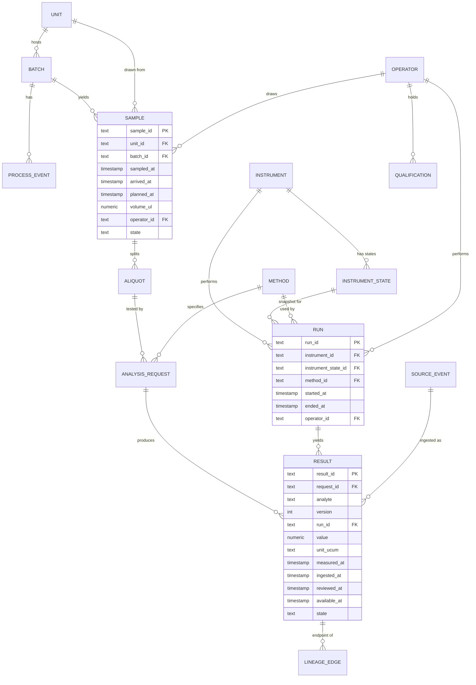
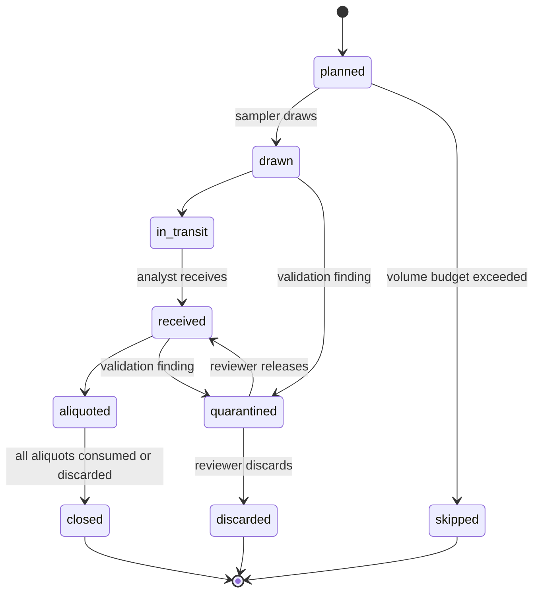
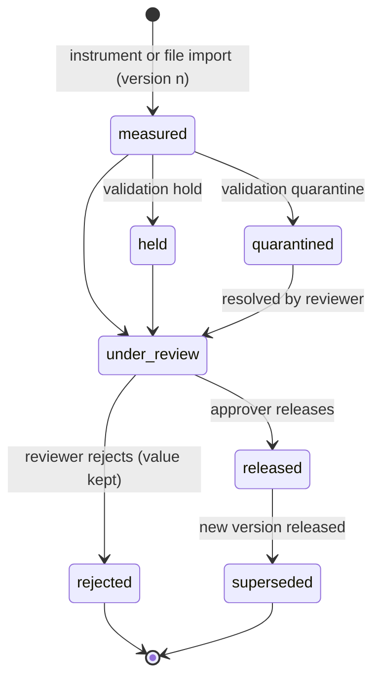
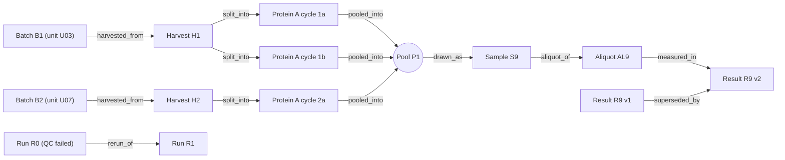
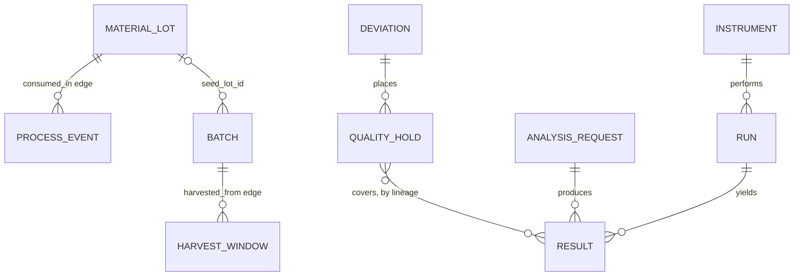
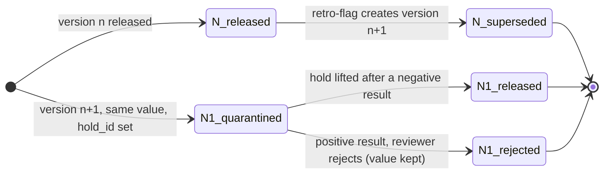
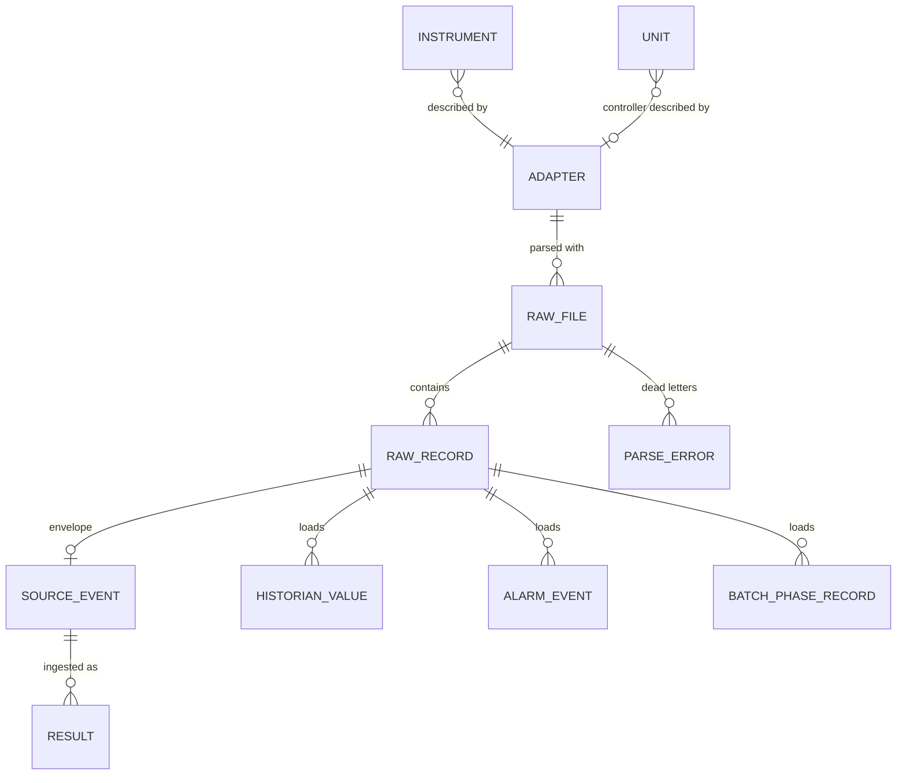
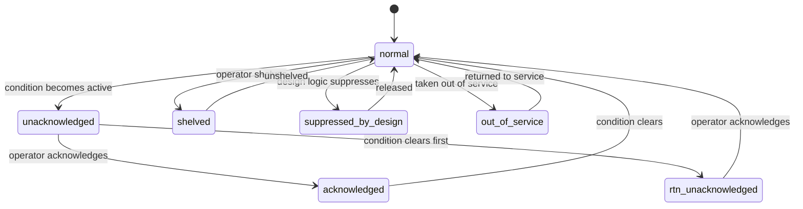
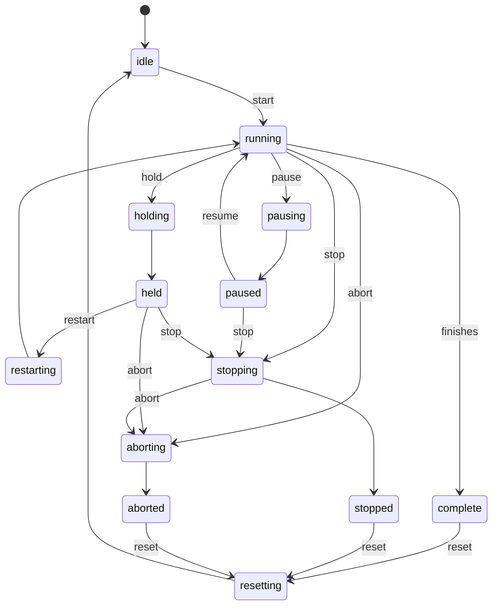

# Canonical data model

Status: design draft. This document is the specification and the basis for acceptance tests. **The DDL itself is the author's task** (`sql/schema.sql`, listed in `.claude/user_owned.txt`) and is deliberately not written here; neither are the three core SQL queries (an as-of window join of results to process context, a recursive lineage query, a bridging correction) under `sql/queries/` (ADR-0010). Synthetic data only; nothing here describes a real system. Extensions (material lots, quality holds, confirming tests, retro-flags) are specified in section 15 and are not built before S2. The raw device layer (raw files, adapters, alarm and batch-phase records; ADR-0014) is specified in section 16 and is a scope extension of S2.

Ledger ids (`S###`, `A###`) follow the conventions in `docs/design/simulation_spec.md`. A number without an id is a defect. This file is the canonical source for table, column and time-field names; prompts and schemas follow it.

## 1. Principles

1. The event record is the source of truth; current state is derived. Corrections create new versions, they never overwrite (flag `append_only_versions`).
2. Keys that give context (`sample_id`, `unit_id`, `batch_id`) are captured at write time and never re-keyed (flag `write_time_keys`). The draw time `sampled_at` is a separate field that belongs to flag `two_clocks`. Process context is a versioned, as-of projection, not a copy.
3. Time has several meanings, so several fields exist (section 5). A single "timestamp" column is the defect this model exists to expose.
4. Validation changes the state of a row, never its value: hold, quarantine or reject. Fixing a value is a new version with an author and a reason.
5. Who did it is recorded: operator id and a reference to the qualification in force (flag `audit_trail`).
6. Vocabulary is vendor-neutral. Physical model terms follow ISA-88 (Site, Area, Unit, Batch). Result files are mapped to this schema, borrowing from public Allotrope Simple Model ideas without claiming conformance (S031).
7. The canonical schema is what architecture C stores. Architectures A and B write subsets: columns they cannot know are null or free text. Whether those subsets are relaxed views over the canonical tables or separate demonstration schemas is an open question (section 14).

## 2. Entities

| Entity | Grain | Key | Main attributes | Notes |
|---|---|---|---|---|
| `unit` | one vessel (ISA-88 unit) | `unit_id` | area, bay, bioreactor profile reference, working volume with UCUM unit, `unit_tag` | master data; profile ids per A065 to A068; `unit_tag` is the historian tag prefix of the unit, and a historian tag is `unit_tag`, a dot and a signal name (for example `U03.pH`; with the raw layer on the signal name ends in a role, `U03.pH.PV`, section 16.4) |
| `batch` | one culture run on a unit | `batch_id` | `unit_id`, process mode (A003), `inoculated_at`, `harvested_at` (null while the batch is open), seed-train parent via a lineage edge | at most one open batch per unit at a time |
| `process_event` | one event in a batch | `event_id` | `batch_id`, `unit_id`, type (feed, temperature shift, alarm, harvest), `occurred_at`, amount with unit, source | feeds are discrete (A010, S017) |
| `sample` | one physical draw | `sample_id` | `unit_id`, `batch_id`, `sampled_at`, `arrived_at`, `planned_at`, `volume_ul`, sampler `operator_id`, container, label method, state | `sampled_at` lives here and only here, and is stored only when `two_clocks` is on; `planned_at` is recorded only where a sampling plan issues the label (`system_issued_id`); `arrived_at` is the receipt at the analyzer bench, the instant of the event `sample_received`; `volume_ul` is the volume drawn (UCUM `uL`) and is summed per unit against the volume budget (A057, cap A207) |
| `aliquot` | one portion of a sample | `aliquot_id` | `sample_id`, storage condition (A021), `volume_ul` (nullable), state | the non-null portions sum to at most `sample.volume_ul`; `volume_ul` is null where the volume is not known (a subset schema, principle 7) |
| `analysis_request` | one analyte panel asked of one aliquot | `request_id` | `aliquot_id`, analytes, `method_id`, `control_id`, priority or deadline, requested time, state | denominator unit for the metrics; `control_id` identifies the bridging or control sample: requests that share it measure the same material on different instruments or instrument states, and it is null for ordinary requests |
| `instrument` | one analyzer | `instrument_id` | class (A069 to A071), serial, interface (A036), configured time zone | |
| `instrument_state` | one versioned state of an instrument | `instrument_state_id` | `instrument_id`, `calibration_ref`, `reagent_lot`, `qc_lot`, `software_version`, `valid_from`, `valid_to` | linked from `run` when `instrument_state_snapshot` is on |
| `run` | one pass of a sample through an instrument | `run_id` | `instrument_id`, `instrument_state_id`, `method_id`, `started_at` (the instant written `run_started_at`), `ended_at`, `operator_id`, position or sequence, QC outcome | multi-visit samples have one run per visit |
| `method` | one versioned analytical method | `method_id` + version | analytes, expected units, dilution rule, effective dates | immutable once used |
| `result` | one analyte value for a request, one version | `result_id`; unique on (`request_id`, analyte, version) | `run_id`, value, original and canonical unit (UCUM), `measured_at`, `ingested_at`, `reviewed_at`, `available_at`, state, supersedes link, raw reference | |
| `process_context` (view) | one result or sample at one as-of time | derived | process state at `sampled_at` from the historian and events, as known at the as-of time | versioned projection, joined with an as-of join |
| `lineage_edge` | one derivation step between two items | `edge_id` | `from_item_id`, `to_item_id`, `relation`, `activity`, `occurred_at`, `available_at` | items are samples, aliquots, results or process materials; `relation` is one of the eight values of section 12, plus two in section 15.1 when extensions are on |

Supporting entities: `operator` (pseudonymous id, role, shift, `qualified`: the training status in the truth world, true for the `experienced` staff profile and false for `trainee`, A072, A073; the recorded counterpart is `qualification`), `qualification` (operator, scope, level such as experienced or trainee per A072 and A073, valid from and to), `source_event` (ingestion envelope, section 7), `audit_event` (who, when, what changed, reason, old and new version), `validation_finding` (rule, target, severity, action, status), `historian_value` (`tag`, `ts`, `value`, `quality`, `ingested_at`; rows are not versioned, a late or corrected value arrives as a new row with a later `ingested_at`). With the raw layer on, section 16 adds `adapter`, `raw_file`, `raw_record`, `parse_error`, `alarm_event` and `batch_phase_record`.

## 3. Entity-relationship sketch

`process_context` is a view over `process_event`, `historian_value` and `batch`, parameterised by an as-of time; it is not drawn as a table.

## 4. Key constraints

| # | Constraint |
|---|---|
| K1 | `result` is unique on (`request_id`, analyte, version). |
| K2 | `result.measured_at` and `result.run_id` are not null. A result cannot exist without a run. |
| K3 | `sampled_at` is stored on `sample` only, and only when `two_clocks` is on. Results reach it by join; `hold_time` and `turnaround` are derived (section 5). |
| K4 | `sampled_at <= arrived_at <= run_started_at <= measured_at` is a truth-world invariant. In recorded data it is a validation rule (VR-002) because clocks and typing can violate it. |
| K5 | `sample.sample_id`, `sample.unit_id` and `sample.batch_id` are never re-keyed after write (flag `write_time_keys`, VR-018). `sampled_at` is never overwritten either; a correction is a new version (principle 4). |
| K6 | A unit has at most one open batch at any time. |
| K7 | An instrument does not process two runs at once. Checked by an acceptance query rather than a database constraint. |
| K8 | A released result is immutable. A change creates a new version that supersedes it. |
| K9 | (`source_system`, `source_event_id`) is unique in `source_event`, and so is `idempotency_key`. |
| K10 | `lineage_edge` is acyclic. Checked by an acceptance query. |
| K11 | A numeric result stores the original value and unit and a canonical value and unit, both as UCUM codes. |
| K12 | The non-null `aliquot.volume_ul` of a sample sum to at most `sample.volume_ul`; this ties to the volume budget (A057, cap A207). |
| K13 | A method version is immutable once a run has used it. |
| K14 | All instants are stored as UTC with the source's local offset or zone name beside them. |

## 5. Time fields

| Field | Meaning | On |
|---|---|---|
| `sampled_at` | instant the sample left the process; stored only when `two_clocks` is on | `sample` |
| `arrived_at` (column `sample.arrived_at`) | instant the sample was received at the analyzer bench, the instant of the event `sample_received` | `sample` |
| `run_started_at` (column `run.started_at`) | instant the instrument began the run, after any setup; the instant of the event `run_started` | `run` |
| `ended_at` (column `run.ended_at`) | instant the instrument run ended and the analyzer was freed (event `visit_finished`) | `run` |
| `measured_at` | instant the instrument completed the measurement, the end of the run (`run.ended_at`); a truth event. With `two_clocks` off, the one time stored is this instant | `result` |
| `occurred_at`, `ts` | valid time of a process event, and of a historian value | `process_event`, `historian_value` |
| `ingested_at` | instant the system received the record | `result`, `process_event`, `historian_value`, `source_event` |
| `reviewed_at` | instant a reviewer or approver acted | `result` |
| `available_at` | instant this version of the row became knowable to a downstream reader | every versioned row |

Two derived quantities are defined here and nowhere else.

| Quantity | Definition | Used for |
|---|---|---|
| `hold_time` | `run_started_at` minus `sampled_at` (truth) | sample stability (A046, A039), the holding-time metric and rule VR-010; it is not the queue wait alone: it spans transport to the analyzer bench (`arrived_at`), the queue wait and any setup |
| `turnaround` | `available_at` minus `sampled_at` | whether a result could inform a decision; includes measurement, ingestion and review |

In the truth world both quantities use truth stamps. In recorded data they exist only where both clocks are stored (`two_clocks` on), and a recorded clock may be skewed in L4 (an instrument clock offset, A049), so a recorded value can differ from the truth value. Metrics compare recorded values with the truth value.

**Engine events and trace fields.** The engine names one visit of a sample on an analyzer as follows (spec section 2.3); the time fields above are their instants.

| Name | Kind | Meaning |
|---|---|---|
| `sample_received` | event | the sample arrives at the analyzer bench; its instant is `sample.arrived_at` |
| `visit_started` | event | the sample is loaded on an instrument; setup, if any, follows |
| `run_started` | event | the instrument run begins, after any setup; its instant is `run.started_at` |
| `visit_finished` | event | the run ends at `run.ended_at` and the analyzer is freed |
| `qc_window_started`, `qc_window_ended` | events | the daily QC window of an analyzer opens and closes; the analyzer is unavailable inside it; windows are half-open, `[start, end)`; maintenance has the same pair, `maintenance_started` and `maintenance_ended` |
| `log_header` | event | the first line of every event log, at t = 0; carries `schema_version`, `engine_version` and `seed` (spec section 3, rule 4) so the log hash depends on them; not a lab event, and visible to recorders |
| `setup_s` | trace field, per run | seconds of setup applied immediately before the run (0 if none), so the visit began at `run_started_at` minus `setup_s` |
| `transfer_s` | trace field, per visit | seconds of transfer between instruments before a visit that is not the first (A106 for the split profile); 0 or absent on the first visit |

**S1b engine events and truth-side fields.** The L1 and L2 events of spec section 2 and the instrument calibration record carry these names; hidden fields are the ones annotated `"x-visibility": "hidden"` in `schemas/event.schema.json` and never reach a recorder.

| Name | Kind | Meaning |
|---|---|---|
| `inoculation` | event | a batch starts on a unit: `unit_id`, `batch_id`, inoculation density (A007) |
| `process_event` | event | `kind` is feed, temperature_shift, alarm or harvest on a unit; `source` is rule (the glucose or viability rule), scheduled (the shift, the day-limit harvest) or scripted (a scenario event); optional `amount` with `amount_unit` (a bolus in litres, a set point in degrees) |
| `sensor_tick` | event | one online value of pH, DO or temperature (A100, A198); the process value is visible, `true_value` is hidden. The engine keeps the ticks as columnar series for the span from inoculation to harvest and expands them to events only on export |
| `sample_planned`, `sample_drawn`, `label_bound`, `sample_received`, `aliquot_created`, `draw_skipped_volume_budget` | events | the L2 steps of spec section 2.2. `sample_drawn` carries the sampler's `operator_id` (visible) and `true_state`, the culture's values at the draw (hidden). `label_bound` carries the labelling method; its instant is the planned time for a pre-printed barcode, the draw for a label issued at the draw and a handwritten one, and the log order puts it before or after `sample_drawn` as section 6 describes. `draw_skipped_volume_budget` carries the volume refused and the cumulative volume drawn so far (A207) |
| `calibration_recorded` | event | an analyzer calibration (A091): `lot_id` is visible, `drift_before_pct` (the drift the reset removed) is hidden |
| `stability_kind`, `stability_delta`, `extrapolated` | hidden fields of `result_measured` | the stability effect applied between `sampled_at` and `run_started_at`, and `extrapolated` set when the hold exceeds the range its source covers (A039, A046); absent when no effect moved the value |
| `operator.qualified` | truth-side attribute | the training status of an operator from the staff profile (A072, A073); the engine returns the operators beside the log, not as events |
| sample `closed`, `skipped` | engine states | a sample whose every visit has passed is `closed`; a draw refused by the volume budget is `skipped`; `discarded` and `quarantined` do not occur before S2 |

Expected order for a released result: `sampled_at` <= `arrived_at` <= `run_started_at` <= `measured_at` <= `ingested_at` <= `reviewed_at` <= `available_at` (when release is gated by review; otherwise `available_at` follows `ingested_at`). Violations are findings, not exceptions.

**Bitemporal and as-of rule.** `sampled_at`, `run_started_at`, `measured_at`, `occurred_at` and `ts` are valid time: when something was true in the lab. `ingested_at` and `available_at` are transaction time: when the system knew it. A decision or query "as of t" uses, per logical key, the latest result version (the highest version, then the greatest `available_at`) among those with `available_at` at or before t and not held, quarantined or rejected, and the historian rows and process events with `ingested_at` at or before t (for a repeated `tag` and `ts`, the latest ingested row). Process context for a result is then matched on valid time at `sampled_at`. With the flag `available_at` off, queries see everything as of now, which leaks late corrections into earlier decisions. With `two_clocks` off, only the measured time is stored; `sampled_at` is not stored and cannot be reconstructed. A tag logged by deadband has rows only where the value moved or the maximum log interval passed, so the value at a time is the last row at or before it (section 16.4).

**Clocks.** Timed records need controlled or synchronised clocks and a specified time zone (S029, sections 5.1 and 6.13); changing any clock used for recording timed events, including in process instrumentation, should be restricted (S030, 4.12); time-zone configuration is also covered second-hand (S052). How often a clock is wrong has no source (A049), so the wrong-clock scenario (SC6, example offset +5 h) is a stress case, not an estimate.

```mermaid
gantt
  title One sample, the times that matter (illustrative, A102 and A050)
  dateFormat HH:mm
  axisFormat %H:%M
  section Sample
  Draw to measurement (upper bound of hold_time) :active, hold, 08:40, 09:25
  section Process
  Bolus feed :milestone, feed, 09:00, 0m
  section Record
  measured_at :milestone, meas, 09:25, 0m
  Decision due :milestone, due, 10:00, 0m
```

The bar is the draw-to-measurement span (45 min, A102). `hold_time` ends when the run starts, so it is shorter than the bar by the run itself (A023). The 09:00 bolus is a scripted event of SC3 (A102); routine operation decides the bolus at 10:00 (A050, A194), the time marked "Decision due".

## 6. State machines

Roles that may cause transitions: sampler, analyst, reviewer, approver, administrator (master data only). A role table is part of the data dictionary.

A label binding is an event, not a state, because its position depends on the labelling method: before the draw for a pre-printed barcode, at the draw when issued then, after it when handwritten.

| Entity | States (transitions in order) |
|---|---|
| `aliquot` | created, stored (condition per A021), in use, consumed or discarded; a frozen retain stays stored |
| `analysis_request` | requested, accepted, queued, in run, measured, under review, released; side states: rerun pending (returns to queued), rejected, cancelled |
| `run` | scheduled, setup, running, QC pending, QC passed or QC failed, closed; aborted at any point. A failed QC holds the results of the run and requests reruns. In the S1 engine `qc_failed` is a run-level failure that leads to a rerun with probability A088; holding the results of the run (VR-012) is implemented in the S2 review step (section 7) and the analyzer hold after a failed scheduled QC run (A087) belongs to S2 (SC7) |

In the simulator `under_review` has no duration: a held or quarantined row is reviewed at a review point and is `released` or `rejected` there (section 7, "Review step and VR-012 decided in the S2 review step").

The recorder also performs `measured` to `rejected`, caused by a rule: VR-014 rejects a row at ingest and the row is final and not reviewed (section 7, "Result state"). The diagram reaches `rejected` only from `under_review`; this edge is a clarification of S2d (orchestrator ruling 2), listed in the data dictionary with the actor `rule`. The same section 7 table, "State machines, roles, the dictionary, the export and the trace decided in S2d", gives the roles of the steps the diagram draws without a person.

## 7. Ingestion contract

Every record entering the system arrives in an envelope.

| Field | Meaning |
|---|---|
| `source_system` | which instrument, historian or form produced it |
| `source_event_id` | the source's own id for the event, unique within the source |
| `idempotency_key` | derived from source, event id and content version; the system's duplicate guard |
| `schema_version` | version of the envelope and payload schema |
| `raw_ref` | location and content hash of the raw file or message, kept immutable |
| `event_time` | the source's own timestamp, with its zone as sent |
| `received_at` | becomes `ingested_at` |
| `payload` | the content |

Rules, active when `ingest_idempotency` is on:

- Same key and same content: no-op, logged as information.
- Same key and different content: quarantine; the original is never overwritten.
- Out-of-order arrival: ordered by `event_time` and a sequence tie-break; a late arrival becomes a new version with a later `available_at`, so earlier as-of queries stay reproducible.
- Replay of a whole file: no-op row by row.
- With the flag off, duplicates double count (architecture A).

Fixtures: duplicate file, rows in reversed order, replayed file with one changed value, truncated file.

**Instrument file mapping (skeleton, specified in session S2; the adapters, dialects and field-level mapping are in section 16).** The baseline is a result file dropped into a shared folder: a FLEX2-class analyzer exports CSV to a shared folder, and the file name carries an export time (S003, snippet). The vendor OPC server is a separately licensed add-on (S004, snippet) and connector guides treat these instruments as file-based (S038, S039, snippet). Vendor file formats are not copied verbatim; the mapping is by role.

| Source role | Canonical target | Transform | Rule |
|---|---|---|---|
| sample identifier text | `sample_id` via the label | trim, case rules | VR-014 |
| measurement timestamp (local, zone often unstated) | `measured_at` plus source zone | to UTC using the instrument's configured zone | VR-003, VR-004 |
| analyte name | analyte code | lookup in the method | VR-005 |
| value and unit text | `value`, `unit_ucum` | parse, convert to canonical unit | VR-005, VR-006 |
| dilution factor | `result.dilution_factor` (nullable) | numeric | VR-013 |
| operator | `operator_id` and qualification reference | lookup | VR-015 |
| instrument serial | `instrument_id` | lookup | VR-011 |
| file name and export time | `raw_ref`, `source_event_id` | hash of file and row | VR-008 |

### Recorder rules decided in S2a

The recorder (`engine/src/record/`) turns the observable events and the observable sensor stream into the recorded rows of one architecture. The rules below were not decided by sections 2 to 7 and are fixed here; they are the reading the S2a tests are typed from. A column that an architecture cannot know is null, not absent (principle 7).

| Rule | Decision |
|---|---|
| Keys (`write_time_keys`) | On: `sample_id`, `unit_id` and `batch_id` are fixed at write. Off: `sample_id` and `unit_id` are stored (the unit comes from the label as carried by the stream) and `batch_id` is null at write; it is derived at read by a time join, the batch of that unit open at the stored time (`inoculated_at` <= t < `harvested_at`). The stored time is `sampled_at` when `two_clocks` is on, else `measured_at`. No open batch gives null. `keys_fixed_at_write` says which case a row is in. |
| Join basis (two flags are independent) | The time that the key join and the process-context join use is `sampled_at` whenever the architecture stores it, else `measured_at`, whatever `write_time_keys` says. |
| Idempotency (`ingest_idempotency`) | The key is source, source event id and content version; the value is not in it (the observable stream carries one content version, 1). On: same key and same content is a no-op, logged as a VR-008 information finding; same key and other content is not loaded, the original stays, and the incoming row is kept in the dataset's conflict list (`ingest_conflict`) for the rule VR-008b of S2b. Off: duplicates and conflicting rows are all rows (double count). A replay is an insert in every architecture; only the flag makes it a no-op. |
| Skipped draw (spec section 2.2) | Where the architecture issues the label from a plan (`system_issued_id` on), a skipped draw is a `sample` row with `state` `skipped`, its `planned_at`, no `sampled_at`, operator, label or result. Without a plan there is no row, because nobody wrote anything. A skipped draw still counts in every metric denominator, which the evaluator reads from the truth log. |
| Overwrite (`append_only_versions` off) | A rerun (an attempt not seen before for the request and analyte) replaces the existing rows of that key in place, including `available_at`. An as-of read before the rerun's `available_at` therefore finds nothing of that key: the earlier version no longer exists. |
| Planned time | `planned_at` is stored if and only if `system_issued_id` is on, whatever the labelling method; preset C stores both `planned_at` and `sampled_at`. The recorder stores the method that the `label_bound` event reports; the architecture's `labelling` is applied to the scenario by the assembly. |
| Process context | `feed_epoch` is the number of feeds of the batch with `occurred_at` at or before the join time; `batch_phase` is `harvested` after a harvest event, else `after_shift` after a temperature-shift event, else `before_shift`; `pv` is the last historian value of each signal of the unit at or before the join time. Process events and historian rows count when their `ingested_at` is at or before the as-of time, and only with `available_at` on. |
| `ingested_at` and `available_at` | Decided in S2b (orchestrator, open question 7 of section 14): architecture A stores no row-creation stamp, so `ingested_at` is null and the rules that read it (VR-003, VR-004) are not evaluable for A; B and C store the instant the system writes the row, which in layer-off runs equals the stamp of the observable event (no ingestion delay is modelled before the raw layer). The rule is flag-generic: a row-creation stamp is stored whenever a system writes the rows, that is whenever at least one of the eight flags is on, and the all-off configuration (A, the spreadsheet) stores none. B, C and every single-flag ablation of C therefore store it, so that ablating `ingest_idempotency` from C does not also remove clock detection (VR-003, VR-004). The stored value is the envelope's `received_at` (section 7). When an instrument clock is wrong the injector hands the recorder the host's receipt time of the result (plain data, by source event id) and `ingested_at` is that time, while `measured_at` is the wrong stamp. With `available_at` on, a result's `available_at` is the stamp of its observable event, except for a row released at review, whose `available_at` is its review point ("Review step and VR-012 decided in the S2 review step" below). Historian and process-event rows from the stream are ingested at their own stamp. |
| Attribution | With `audit_trail` on, `sample.operator_id` is the sampler (visible in the stream), the sample row carries `qualification_id`, the qualification record of the sampler valid at the draw (`valid_from` <= draw < `valid_to`), and each change of a result is an `audit_event` with old and new value and version. The qualification records are plain data from the assembly (the truth world holds `operator.qualified`; the recorded level of A072 and A073 is carried as the same boolean `qualified`, so that the engine names no profile id); without a valid record the reference is null and VR-015 fires. The analyst who reran a result and the reason of a rerun are not in the stream and are not stored. |
| Instrument state (limitation) | A state comes from each `calibration_recorded` event (`lot_id` is the reagent lot; `qc_lot` and `software_version` are not observable). A reagent lot change between two calibrations is invisible to the record; the default scenario has none. |
| Findings | `validation_finding` rows have the columns of section 2: `rule`, `target`, `severity`, `action` and `status`. `target` is `result:<result_id>`, `sample:<sample_id>` or `source_event:<source_event_id>`. `status` is the state of the finding itself: `open` until the review step resolves it ("Review step and VR-012" below), `resolved` for a no-op. The action changes the state of the rows the finding concerns, never a value: see "Rules, injector and evaluator decided in S2b" below. |

New names introduced by the recorder (the table and column names follow section 2 otherwise):

| Name | Meaning |
|---|---|
| `keys_fixed_at_write` | `sample` column, boolean: the keys were fixed at write time (`write_time_keys` on). |
| `analyzer_name` | `run` column: the analyzer as free text, as seen on the event; stored whatever `instrument_state_snapshot` says. |
| `join_basis`, `join_time` | Of a process context: the stored time that its join used (`sampled_at` or `measured_at`) and its value. |
| `feed_epoch`, `batch_phase` | Of a process context: the feed count and the phase defined above; values of `batch_phase`: `before_shift`, `after_shift`, `harvested`. |
| `pv` | The process value of an online sensor series in the observable stream (the series carries no truth array); in a process context, the map of the last value per signal. |
| `ingest_conflict` | Table of the dataset: incoming rows kept aside by the idempotency rule (columns of `source_event` plus request, analyte, run, value and `measured_at`). |
| `state` of `sample` | `skipped` for a refused draw, null otherwise (S2d put the sample machine in the dictionary and the guard; the recorder still emits only `skipped`, see "State machines, roles, the dictionary, the export and the trace decided in S2d"). |
| `source_of_record` | Optional setting of the architecture config, `lims` or `mes_ebr` (spec section 5, A056); nothing reads it in S2a. |

### Rules, injector and evaluator decided in S2b

S2b adds the error injector (`engine/src/inject/`), the detection rules (`engine/src/record/validate.ts`) and the metrics evaluator (`engine/src/evaluate/`). Sections 2 to 8 and the simulation spec did not decide the points below; they are fixed here and are the reading the S2b tests are typed from.

| Rule | Decision |
|---|---|
| Result state | A `result` row has a `state`, null from the recorder. A rule that fires sets it to `held`, `quarantined` or `rejected` (hold, quarantine, reject); with several findings on a row the most severe wins (reject over quarantine over hold). A finding on a sample (VR-015, VR-020) sets the state of every result of that request. A held, quarantined or rejected row stays in the table with its value and is not available to an as-of read (`resultsAsOf`). VR-008b changes no row: the original stays and the incoming row is in `ingest_conflict`. The review step (below) turns `held` and `quarantined` into `released` or `rejected`; `rejected` from a rule (VR-014) is final and is not reviewed. |
| Evaluability | A rule that needs a field the architecture does not store, or a limit that is not configured, is not evaluable. It is listed with its reason beside the findings and never counted as passed. The tolerances of VR-003 and VR-004 are scenario settings with no ledger entry yet, so a production run lists both as not evaluable. |
| Rules implemented | VR-002, VR-003, VR-004, VR-008b, VR-009, VR-010, VR-011, VR-012 (added in the S2 review step), VR-014, VR-015, VR-019 and VR-020. VR-004 compares `measured_at` with `ingested_at`; the zone part (the instrument's configured zone) waits for the raw layer. The registry of VR-014 is the sample rows that are not skipped (the keys the plan issued for draws that happened). Not implemented, with the reason: VR-001, VR-005, VR-006, VR-007, VR-013 and VR-016 to VR-018 need units, ranges, a trajectory, a dilution rule or lineage, and no hypothesis-matrix row of S2b reads them. |
| Flags of a type | The rules whose findings count as flags of an error type (the "Detected by" column of the spec section 5 matrix): label error VR-009 and VR-014; feed in the gap VR-010; unit or batch re-key VR-020; clock error VR-003 and VR-004; duplicate or replayed file VR-008b; unattributable record VR-015. Lost rerun, planned-versus-actual time, instrument effect, late correction and technique error have no rule: their detectors are mechanisms (audit review, a bridging study, an as-of query) and detection is reported as not evaluable for them. |
| Error types and where the mechanism cannot exist | Drawn types: label error (prevented by `system_issued_id`), unit re-key (`write_time_keys`), replayed file (`ingest_idempotency`; a replay is an event of the source and is in the stream of every architecture, the flag decides its effect: with it on the replay is a no-op logged as VR-008 information, which is the prevented case, with it off the rows double count, which is the invisible case). Structural types, with no draw: feed in the gap (a feed on the sample's unit after the draw and up to the first measurement; prevented by `two_clocks`), lost rerun (a second attempt overwritten; `append_only_versions`), unattributable record (`audit_trail`), planned-versus-actual time (the plan's time stored and the draw time not: `system_issued_id` on and `two_clocks` off). Clock error: a per-analyzer offset given as scenario data (A049), never prevented. Not injected: instrument effect and technique error (truth-side) and late correction (no source in the layer-off stream). |
| Forced mode | A forced error is materialised wherever its mechanism exists and reads no rate; where the mechanism cannot exist it is prevented and the stream is untouched, except for a replayed file (see above). Production runs read the rate of a label error from the staff profile (A047, times the trainee multiplier A062) and report the other drawn types as not modelled, because no ledger entry gives their rate. The content of a production label error is the neighbouring tube (the next draw, else the previous one); a forced one names the id. |
| Metrics: the instants | Hold time is measured to the first run (attempt 1, visit 1). The truth release (`available_at` of the truth world) is the instant of the last passing QC result over the visits of the route. Reconstruction and alignment queries run after the end of the run; availability alone uses the decision time of the request (A050). Utilisation counts completed visits, from `visit_started` with setup and from `run_started` without it, over analyzers x days x the staffed window and over analyzers x days x 24 h. |
| Metrics: the answer | The analyst's answer for a request is read under the id the record holds its results by (the answer key says which: a realised label error moves it). Process context in the exact-reconstruction rate is the feed epoch and the batch phase at the true draw time; the instrument state is the reagent lot of the run that produced the answered result. Phantom effect needs a contrast named by the scenario (two analyzers on one analyte); the evaluator reports the true effect it finds and does not check that it is zero. |
| Metrics: reruns | A rerun is traceable when version 1 still holds the value the first attempt reported and each later version supersedes the one before. The reason of a rerun is recorded by no architecture of S2 and is not scored. |
| Seed aggregate | The table gives, per metric, the median and the 5th and 95th percentile (nearest rank) across seeds with the seed count and whether the minimum seed count of A103 is met. The percentiles are a spread across seeds, not a confidence interval. |

### Recorder inputs and evidence checks decided in S2c1

S2c1 adds the forced-error cells (spec section 6). Two of the matrix rows read facts that the observable event stream does not carry, and the non-rule entries of the "Detected by" column need a named check of the record. The points below were not decided by sections 2 to 8 and are fixed here; they are the reading the S2c1 tests are typed from.

| Rule | Decision |
|---|---|
| Plan input | The recorder takes optional plain data `plan` from the assembly: the `control_id` of the bridging requests and the container of each sample. Both come from the sampling plan and the SOP, not from an instrument or a person at the bench, so the event stream has neither. Absent means the plan names none, and the columns are null. |
| `sample.container` | The container the plan records for the sample (`open` or `closed`, an L2 setting). No flag owns it: every architecture that records the sample stores it when the plan names it (orchestrator ruling, S2c1), so the technique-error row turns on `hold_time`, which needs `two_clocks`. A skipped draw has none. |
| `analysis_request` | One row per request seen in the event stream (`request_queued`, first occurrence), with `request_id` and `control_id` (null for an ordinary request). No flag owns the `control_id` of the plan or the analyzer name of a run: the eight flags are the only differences between architectures (ADR-0005), so every architecture holds both. The other columns of section 2 are not modelled yet. |
| Evidence checks | Functions of a recorded dataset that answer "does the record show this error?" for the matrix entries that are not rules (`engine/src/record/evidence.ts`). They set no state and write no finding. `audit_event`: the audit event of a result key with the old and the new value and version. `bridging_study` (an effect between analyzers, author decision of 2026-10-29: ADR-0005 read literally, "only a bridging study (`control_id`) detects it"): two requests that share a `control_id` were measured on different analyzers, told apart by the analyzer name of the run (free text suffices); the offset is the value of the second minus the first. It needs no link to the instrument state. `lot_link` (an effect within one analyzer, a reagent lot step): two requests that share a `control_id` were measured on the same instrument under different reagent lots, and the lot is known only through the link from the run to the instrument state (`instrument_state_snapshot`); without the link the step cannot be attributed. `container_hold`: the container and the hold time (first run start minus `sampled_at`) of a sample are both stored. |
| Idempotency log and as-of query | These two entries are not functions. The idempotency log is the VR-008 information no-op finding of section 7. The as-of query is `resultsAsOf` at the decision time (section 5). |
| Cell | The outcome of one forced error in one configuration is `prevented` (the error does not arise), `detected:<evidence>` (it arises and the named rule or evidence check shows it in the record) or `invisible` (it arises and nothing shows it). |

New names introduced by S2c1: `plan`, `container` (a column already listed for `sample` in section 2), `analysis_request` (an entity of section 2), and the evidence names `audit_event`, `bridging_study`, `lot_link` and `container_hold`.

### Experiment 1, evidence in detection and the stochastic report decided in S2c2

S2c2 runs experiment 1 (spec section 6.1) and writes its stochastic report (spec section 8). Sections 2 to 8 did not decide the points below; they are fixed here and are the reading the S2c2 tests are typed from. Nothing in this table states a result.

| Rule | Decision |
|---|---|
| Experiment config | `scenarios/experiments/<id>.json` names the scenario, the architecture presets, the preset whose ablations are run (one flag off at a time, spec section 5) and the seed list. The list is written before any run. The parser refuses fewer seeds than the seed minimum of the evaluation settings (A103), a repeated seed, a seed that is not a non-negative integer and a date-shaped seed (year 19xx or 20xx as YYYYMMDD). |
| Open loop | For each seed the truth is run once and shared by every architecture. Its log hash is taken before the first architecture and again after the last; a difference stops the run with an error, because only a step that re-drew or re-measured could cause it, and detection never does (spec section 6.1). One answer key is written per seed for all architectures. The opportunities are keyed by seed and sample, never by architecture; where the mechanism of an error exists the realised errors are therefore the same samples, with the same content, in every architecture. |
| Flags of a type | A flag of an error type is a finding of a rule of the type that is not a no-op. Recall, precision and false-alarm rate keep their definitions of spec section 8 and count rule flags only. A VR-008 no-op is the harmless replay, the prevention and not a flag; counting it would turn every neutralised replay into a false alarm. |
| Evidence on a type of the key (orchestrator ruling, 2026-10-29) | Evidence raises no alarm. A type whose only detector is an evidence check has a recall, the share of its realised errors whose request carries the evidence, and no precision and no false-alarm rate: the two read "not applicable", never a number, so the schema fixes them to that text for the type. Only the audit event sits on an injector type: lost rerun, evidence `audit_event` (an audit event of the result key, holding the overwritten old value and the new value), flag `audit_trail`; it is evaluable if and only if `audit_trail` is on. The audit trail records every change, so an architecture that keeps versions also holds an audit event for each ordinary rerun; that event is on a request with no realised lost rerun and is counted nowhere, neither as a flag nor as a false alarm. The bridging study, the lot link and the container and hold context read truth-side effects (instrument effect, lot step, technique error) that the injector does not materialise, so the key has no realised set to score them against (the default scenario has no bias, no lot change and injects no technique error): they are not in the metrics, the key and `by_type` are not grown for them, and they stay as the named cells of the forced-error tests. |
| `evaluable` and `reason` | A type is evaluable when at least one of its rules or evidence checks could run on the architecture. When none could, `reason` names each: a rule with its unmet condition, an evidence check with the flag it needs. A type with neither a rule nor an evidence check reads "no rule or evidence check of the catalogue detects this type". |
| `by_detector` | Per detector that could run, by rule id or evidence name: for a rule the flags it raised, for an evidence check the realised opportunities whose request carries the evidence. A detector that could not run is not listed, so a zero means it looked and raised nothing. |
| Spread | The median and the 5th and 95th percentile across seeds, nearest rank, as in the seed aggregate of S2b; the report says it is not a confidence interval. |
| Types without a ledger rate (orchestrator ruling, 2026-10-29) | A type with no ledger rate reads "not modelled" in a production run, never "realised 0"; "realised 0" is for a type that has a rate and drew no error. They are the drawn types without a rate (unit or batch re-key, replayed file) and the clock error: A049 gives an example offset and no frequency, so a production run injects a clock error only where the scenario names an offset for an analyzer, and reports it as not modelled otherwise. The answer key lists them under `not_modelled`, and every row of the type in the report reads `not_modelled` with no number and no denominator. In forced mode (the fixtures) the list is empty. |
| Report rows | One row per number of the metrics document and architecture, except the four numbers that repeat a setting (analyzers, days, staffed window, SLA threshold). A row carries `status`: `reported` (at least one seed defines it), `none_occurred` (the denominator is zero in every seed), `not_evaluable` (no detector of the type could run), `not_modelled` (the type has no ledger rate in a production run) and `not_applicable` (the precision or false-alarm rate of an evidence detector). The last three carry no number and give the `reason` in words. A row names its denominator and gives its count per seed (minimum, median, maximum); a median or p90 in seconds takes the denominator of the share printed beside it. |
| Orderings | `ranks` lists, per metric, the architectures with a reported median ordered by it (1 is the smallest, equal medians share the lowest rank). They are data. No test asserts an order, a sign or an interval that includes or excludes zero. |
| Phantom effect | It needs a group contrast named by the scenario (section 7, S2b). The default scenario names none, so every architecture has one `phantom_effect` row that reads "not applicable: no contrast in this scenario", never 0 and never a missing row. |

New names introduced by S2c2: `by_detector` (a field of the detection of a type), the report fields `status`, `den`, `ranks` and `truth_log_hashes` (`schemas/experiment_report.schema.json`).

### Review step and VR-012 decided in the S2 review step

Until S2c2 a held row stayed held for ever, so the architecture that can see a long hold (`two_clocks`) lost those requests in availability and reconstruction. Author decision of 2026-10-29: model the review of section 6 (held or quarantined, then released or rejected) instead of a permanent hold. Sections 2 to 8 did not decide the points below; they are fixed here and are the reading the tests of the review step are typed from. Nothing in this table states a result.

| Rule | Decision |
|---|---|
| Place in the pipeline | recorder, then the validation rules (section 8), then the review. The review reads findings, states and stamps of the recorded dataset and nothing else (`engine/src/record/review.ts`): the reviewer sees the record only (invariant 1). It writes no finding, edits no value, no stamp of measurement and no id. |
| Outcomes | Only `released` or `rejected`. Detection never triggers a re-draw or a re-measure (spec section 8, anti-gaming rule 4), so recollection and a re-measure on request are not modelled; the reruns that exist are those of the S1 engine. A rejected row keeps its value (section 6, "value kept"), is never available (`state` `rejected`, `available_at` null) and is still counted in every denominator. |
| Policy per rule id (A213, A214) | The outcome is a fixed policy of the rule, never a judgement from the value or a truth state. Rejected (grade P): VR-010 hold time above the limit, VR-012 run QC failed, VR-009 possible double label. Released (grade A, no source for the outcome), the finding kept and no timestamp corrected: VR-015, VR-011, VR-020, VR-003, VR-004 and the quarantine rules VR-002 and VR-019. A rule with no entry in the policy is an error, so a new rule cannot reach the review without an outcome. |
| Several rules on one row | Any rejecting rule wins. A sample-level finding (VR-015, VR-020) concerns every result of its request, each row on its own stamps. A row that a rule already rejected at ingest (VR-014, section 8: the dead-letter) is final and is not reviewed. A row that the ingest stage held or quarantined and that VR-014 also rejects (an open reject finding on the result or its request) is reviewed and ends `rejected`, never released (S2f). |
| Review time (A215) | A row that carries a hold or a quarantine is reviewed at the first staffed review point at or after its `ingested_at`, or at its `measured_at` where no row-creation stamp is stored (architecture A, whose one stored time is the measured time). The review points are the shift starts of the roster of A201: weekdays 08:00 and 13:00, weekends 08:00, day 0 a Monday; a stamp exactly on a point is reviewed at that point; a stamp after 13:00 on a weekday waits for 08:00 of the next day, and a Saturday or Sunday stamp for the next 08:00 (a weekend day has one shift). A released row has `reviewed_at` and, with `available_at` on, `available_at` equal to that point. A rejected row has `reviewed_at` and no `available_at`. `reviewed_at` is stored in every architecture: it is the instant a person acted, not a system stamp. A row without a hold is not reviewed: `reviewed_at` is null and `available_at` is unchanged (review by exception). |
| Capacity | Reviewer capacity is not modelled: any number of held rows is reviewed at once at the review point. This is a favourable assumption (it shortens the wait of every held row and ignores a queue of reviews); the roster size of A098 is not used. |
| Findings | A finding keeps its row in `validation_finding`; its `status` becomes `resolved` when a result it concerns has been reviewed. The finding of a row that was never reviewed (VR-008b, or a request with no result) stays `open`. Section 8 says a resolution is a new version by a named reviewer with a reason; here the review sets `state`, `reviewed_at` and `available_at` on the held row itself and writes no new version, and the reviewer's name and reason are not modelled. |
| As-of read | A released row is read like an unheld one: with `available_at` on from `available_at` (the review point), with it off as of now. Between versions of one key the later version wins even when an earlier one is released after it: the version number decides before `available_at` (the earlier text said greatest `available_at`; the two orders were equal until a release could come later than the next version). |
| Sensitivity variants (reported, never gated) | Review timing: next shift start (the default), the end of the next shift (weekdays 13:00 and 18:00, weekends 14:00) and 08:00 of the next day. Outcome: VR-015 and VR-020 rejected instead of released. They are design choices of grade A, not data; a report says which was used. |
| Run QC outcome | `run.qc_outcome` (section 2, "QC outcome") is the outcome of the `qc_result` event of the run: `qc_passed`, `qc_failed` or `over_range`; null while no `qc_result` has been seen. No flag owns it: the eight flags are the only differences between architectures (ADR-0005), and the run table, like the analyzer name and the `control_id` of S2c1, is held by every architecture. VR-012 is therefore evaluable in every architecture. |
| VR-012 | The results of a run whose recorded outcome is `qc_failed` are held (severity error, action hold, target `result:<id>`) and, at review, rejected. The rerun is another run with its own results and its own outcome, so its results stand on their own; a request whose failed run has no rerun at the end of the horizon has no result. `over_range` is a measurement outside the range of the method, answered by a diluted rerun in the S1 engine, not a QC failure: no rule reads it (VR-006 and VR-013 stay parked). The rule asks for no rerun: that request is already in the stream (spec section 8, anti-gaming rule 4). With the rule on, a request whose rerun is held for a long hold (VR-010) no longer falls back to the failed first attempt (22 requests in the experiment-1 diagnosis of S2c2): both attempts are rejected and the request has no result. |

New names introduced by the review step: `reviewed_at` (a column of `result`, section 2, now stored by the recorded row, null until a review), the `released` value of the result `state`, `qc_outcome` (a column of `run`, the "QC outcome" of section 2), the review timings `next_shift_start`, `shift_end` and `next_day_start`.

### Experiment 2, the pH loop decided in S2c3

Sections 2 to 8 and spec section 6.2 did not decide how the closed loop is stepped, what the oracle reads or how an architecture's context reaches the decision. The points below are fixed here and are the reading the tests of experiment 2 are typed from. The loop is a model-internal construct under the assumptions it names; nothing here states a result.

| Point | Decision |
|---|---|
| Where the loop sits | The lab of a seed is run once, open loop, and shared by every arm: nothing in the lab (sampling times, queue, runs, analyzer noise) depends on the pH of the culture, so the truth log of the lab is the truth log of experiment 1 for the same scenario and seed. The pH of the culture is the output of each arm's loop and enters nowhere else. The plain run (`runScenario`) still refuses `feedback: true`; the closed-loop assembly (`engine/src/experiments/assembly/closed_loop*.ts`) runs the lab with `feedback` switched off and the loop beside it, only for a scenario that sets `feedback: true` (SC8). |
| Tick order | At the sensor cadence (A100) from inoculation to harvest: the true pH starts at the set point (A198) and the probe offset at 0 (a simulator choice, grade A: no ledger value for the offset at inoculation). At tick j: (1) at a readjustment tick (j > 0, a multiple of the interval A108, readjustment on, A051) the arm may set the offset so that the probe reads the reference, offset = reference - true pH; (2) reading = true pH + offset + the noise of the online reading (A199, the draw of the open-loop series); (3) the controller moves the true pH by `set point - reading` when `abs(reading - set point)` exceeds the deadband (A095), else by 0 (the move that returns the reading to the set point, as in S110: base or CO2 towards the target); (4) the offset drifts by `sign x drift x cadence` (A094). The direction of the drift is one keyed draw per reactor (key `(seed, unit, -, 0, probe_drift)`), a simulator choice (grade A). |
| Offline value | Of a sample, per pH result: the true pH of the culture at the draw (the loop value of the tick that contains the draw), moved by the stability effect of its container and hold (A041 to A043, `stability.ts`; hold = first run start of that attempt minus the draw), plus the analyzer noise of the lab run (A078). The container is the profile's (A037: closed for pH) unless a technique error (A064) leaves it open: one keyed draw per sample, key `(seed, sample, -, 0, error:technique_error)`, open when the draw is below the probability. The technique error is thus a truth-side effect of the sample itself, as `inject/types.ts` says. |
| Who decides what | At a readjustment tick an arm decides whether to readjust and onto what; the physics (item 1 of the tick) is not the arm's. The oracle (`experiments/oracle/closed_loop.ts`, the one place that reads truth for a decision) takes the true pH at the draw of the newest sample whose first pH result exists and has not been used. A, B and C (`experiments/arms/closed_loop.ts`, recorded data only) take the newest pH row of their recorded dataset that is available at the tick (`resultsAsOf`, not held, quarantined or rejected, and measured at or before the tick) and has not been used. A value is used once. |
| Arm rule (context and exclusion) | One rule serves A, B and C, each applying it to the fields its record holds (orchestrator ruling R1, 2026-10-30). The recorded container is stored by every architecture (S2c1: no flag owns it); the recorded hold time (the first run's start minus `sampled_at`, the definition of `holdContext`) exists only where `two_clocks` stores `sampled_at`. The arm excludes the newest value when its container is open (A041 applies) or when its hold time is stored and above A046, and skips that readjustment (it does not fall back to an older value). A field the record lacks marks nothing, so A and B apply the container half only and C applies both. A value that the review step has rejected (VR-010 on a hold above A046, VR-012) is not in the record the arm reads at all, so in C the hold half acts only on a row that stayed available. The sensitivity variant (reported only) subtracts the open-sample offset of A041 from an open-container value in every arm instead of excluding it; a hold above A046 is still excluded. Both are simulator choices (grade A). |
| Structure of the recorded dataset | The recorder, the validation rules and the review are run once per architecture on the lab run, with the open-loop pH values as placeholders. They read times, keys, versions and QC outcomes and never a pH value, so the structure of every pH row (states, `available_at`, container, hold context) holds for every arm's values; each arm reads those rows with the values of its own world substituted (a test shifts every pH value and compares all other columns). An architecture that overwrites on a rerun (A, B) shows the rerun's row from the rerun's measurement; the earlier attempt's value cannot be recovered from the final table. |
| Common random numbers | The lab run, the online reading noise, the analyzer noise, the technique draws and the drift directions are drawn from the canonical keys of spec section 3 with no arm in any key; every arm of a seed asks for the same keyed streams (a test lists them per arm). With readjustment off the arms' worlds are identical. |
| Zero bias | With no stability effect (A041 and A043 at 0), no analyzer noise, no rerun, no open container and a hold limit no hold reaches, every arm's world equals the oracle's and every paired difference is exactly 0 (a test, with a probe that drifts, a controller that acts and readjustments that happen, so the identity is not vacuous). |
| Outputs | Per reactor over its run: the mean absolute probe offset, the mean absolute control excursion (true pH minus the set point) and the largest absolute excursion. Per arm and seed, the mean over reactors; per arm, the median and the 5th to 95th percentile across seeds; the paired difference against the oracle is the mean over seeds of the per-seed mean over reactors of (arm minus oracle), with a percentile bootstrap interval across seeds (resampling seeds; 95 percent; the stream is keyed `(bootstrap seed of the config, arm, metric, 0, bootstrap)`). Denominator: reactors over the seeds, at least 20 seeds (A103). Counts: every readjustment slot of an arm is readjusted, skipped for a known bias, or without a new value; the offline values held and those extrapolated beyond the validity of their stability effect (A046) are counted, and the report carries them as the warning of spec section 8, rule 7. |

New names introduced by experiment 2: the settings `ph_probe_drift_per_d`, `ph_controller_deadband`, `ph_probe_readjust_on`, `ph_probe_readjust_interval_h` and `technique_error_probability` (A094, A095, A051, A108, A064) of the scenario SC8; the purposes `probe_drift` and `error:technique_error`; the report `schemas/closed_loop_report.schema.json`.

### State machines, roles, the dictionary, the export and the trace decided in S2d

S2d writes the data dictionary (`docs/design/data_dictionary.yaml`), the state-machine guard (`engine/src/record/transitions.ts`), the single-sample trace (`docs/design/single_sample_trace.md`) and the FAIR export (`engine/src/export/`). Sections 2 to 10 did not decide the points below; they are fixed here and are the reading the S2d tests are typed from. Nothing in this table states a result.

| Point | Decision |
|---|---|
| Roles | The five roles of section 6, plus one actor kind, `rule`, for a step that no person causes: the import of an instrument result, a validation rule (section 8) and the volume budget (VR-016). The diagram's own labels give the role of: planned to drawn (sampler), in_transit to received (analyst), quarantined to received, to discarded and to under_review (reviewer), under_review to released (approver) and to rejected (reviewer); the dictionary marks them `basis: diagram`. The other steps (validation hold and quarantine, the budget skip, and the edges drawn without a label) take `rule` or the role of the neighbouring labelled step and are marked `basis: default`. Orchestrator ruling 1 of S2d. |
| `measured` to `rejected` | The recorder performs it (VR-014 rejects at ingest, "Result state" in S2b above), so the table lists it with the actor `rule`. The diagram of section 6 reaches `rejected` only from `under_review`; S2d adds the edge (orchestrator ruling 2), also stated under the state diagram of section 6. |
| The review passes through `under_review` | `under_review` has no duration (section 6), but the review performs both steps of the diagram: held or quarantined to `under_review` (reviewer), then to `released` (approver) or `rejected` (reviewer). A transition is performed only through the guard, which refuses one that the table does not list and a role that may not cause it; the dictionary holds the same table and a test compares the two. Both steps are performed at the review point, and the outputs of the review are the same as before the explicit step (orchestrator ruling 3; `engine/tests/record/review.test.ts` and `engine/tests/assembly/review_pipeline.test.ts` are unchanged and green, and `engine/tests/record/transitions.test.ts` shows the datasets equal with and without the transition log). |
| State null | A result row with `state` null is in `measured`, the initial state: no transition has acted. A sample row with `state` null is a state that the recorder does not model: only `skipped` is emitted, and the other states of the sample machine are in the dictionary and in the guard, not yet in any recorded row. Provisional (question 4). |
| Time class of three columns | `reviewed_at`, the `at` of an `audit_event` and `context_as_of` are transaction time (when the system knew that a reviewer acted, that a change was recorded, and the as-of bound of a read). Section 5 does not classify them; this is the reading of S2d. |
| Released version (export) | A result row whose `state` is null or `released`, all versions of it: the rows that the as-of read treats as available (`record/asof.ts`). Held, quarantined and rejected rows are not exported. |
| Export columns | The columns of section 10, flat: `hold_time` is `run.started_at` of the run of that version minus `sampled_at` (as VR-010 reads it) and `turnaround` is `available_at` minus `sampled_at`, both null without the clocks they need; the process context is `ctx_join_basis`, `ctx_join_time`, `ctx_feed_epoch`, `ctx_batch_phase` and one `ctx_pv_<signal>` column per online signal; `method_version` is null in every row (no method entity is recorded in S2). Times are integer seconds of the scenario. |
| `context_as_of` | The stated time of the process context, an option of the export (default: the end of the horizon), the same value on every row; the context is what the as-of read of section 5 knows at that second. The data package metadata names how the time was chosen: `context_as_of_basis` is `stated`, or `end_of_horizon` for the default. |
| Canonical unit | The master data `analytes` of the dictionary: the UCUM code of each analyte, from the units of the profile settings. An analyte without an entry is an error, not a guess (section 9). The engine works in the canonical units, so original and canonical value are the same until the raw layer keeps an original unit (K11). |
| Licence | ADR-0008 (Accepted, option 1: MIT for code, CC BY 4.0 for documents and exported synthetic data): the data package carries CC BY 4.0. |
| Single-sample trace | The sample is the lowest `sample_id` of SC3 whose interval from `sampled_at` to the first `run.started_at`, both ends counting, contains a feed of its own unit and batch. The three questions are answered as the evaluator's analyst query reads the record after the end of the run, and judged against the truth. The fixture is created once by a recorded command and its checksum is in `tests/fixtures/trace/CHECKSUMS.txt`; the S1b goldens and their checksums are not touched. |
| Integration checks of the author's SQL | The wide export has no historian rows or aliquots, so the checks of Card B1 and B3 on engine data load a test-only dump of the canonical tables (`engine/tests/support/sql_tables_cli.ts`), anchored at the synthetic Monday of the fixtures, with released rows only, one aliquot per sample (the link from the `aliquot_created` events), and no claim about the handling of a held row. |

### Raw device layer, analyzer side, decided in S2e1

S2e1 builds the emitter, the generic parser, the capture path and the transcription step (spec section 2.4, section 5 "Capture path", prompts/20 Steps 5 and 6). Sections 2.4 and 16 did not decide the points below; they are fixed here and are the reading the S2e1 tests are typed from. The files are synthetic formats modeled on public documentation, never a claim about a real instrument. Nothing in this table states a result.

| Point | Decision |
|---|---|
| Settings | Scenario: `raw_layer` (default false), an optional `capture_path` that overrides every preset, `calendar_anchor` (the date of scenario second 0, a Monday) and the setting `device_zone_h` (the zone the instruments are configured with, A161: a scenario input, no default). `capture_path` or `calendar_anchor` with the layer off fails validation and the message names the setting and `raw_layer`. Architecture: `capture_path` beside `labelling` (A manual_transcription, B and C adapter_ingest); optional, inert while the layer is off. The analyzer profile names the dialect of each visit (`route[].dialect`). |
| Files | One file per instrument, dialect and export instant. The export schedule is a scenario setting, `export_schedule` (A216; the staffed window itself is A098): `window_end`, the default of spec 2.4.2, sends the file at the end of each staffed window (a result after the window end goes out at once); `per_run` sends each result at the host instant it is produced. A scenario that sets it with the layer off fails validation, the message naming the setting and `raw_layer`, as for `capture_path`. The instants use the host clock of the result (the receipt time that the injector hands over for an instrument with a wrong clock). `received_at` of the file is that instant. File name: vendor-neutral prefix, instrument, export time (A159). The banner is line 1. A scripted replay drops the same bytes twice (RQ4); a counter in append mode repeats all earlier rows. A file has one row per analysis, keyed by analyzer, label text, attempt, visit and the instant of the result event (S2f), so two analyses that a label error gave one label stay two rows; the manifest carries the instant. |
| Quirk draws | Row level `raw:RQ4` keyed (seed, sample, visit, attempt) and file level keyed by the export id; the entry draw `error:result_entry` keyed (seed, sample, analyte, attempt), drawn for every result row on both paths. A quirk materialises when its draw is below a rate given as plain data, or when forced. Rates without a ledger entry are absent in a production run, which then reports the class as not modelled (`raw_rq4_overlap`, `raw_rq4_replay`, `entry_value`, `entry_unit`, `entry_dilution`). A quirk is realised on a row only where it changes what the row says: RQ2 where the stamp is ambiguous under the device's format, RQ3 where the minute truncation lost seconds, RQ4 on a repeat, RQ5 on a reanalysis row, RQ6 on a blank with a note, RQ7 where the device's unit differs from the dialect's. RQ1 and RQ8 are properties of the dialect and the template, not row quirks. |
| Stamp | A stamp is ambiguous when the year is last and the day and the month are both 12 or less and differ, or when a 12 h clock has no day-part marker. With the entry order unknown, a day above 12 in the same row or in another row of the file pins the order; no pin leaves the row unresolved (VR-024, quarantine, no instant stored). A stamp with a day or month above 12 under a wrong pin is malformed (VR-023, reject); a wrong pin that parses is a valid wrong instant. A missing zone in the entry leaves the stamp unresolved. With `stamp_means` start the measured instant is the stamp plus the nominal run time of the visit (A023, A025, A028); the run times of the recorder still come from the observable events (`started_at_derived` is not emitted). |
| Units and bounds | The unit text comes from the units row, the header cell, or the entry (RQ7). The expected unit and dimension per analyte are the unit of the dialect's own column. VR-005 compares dimensions (a unit text of another dimension is quarantined, the value unchanged); VR-006 uses the definitional bound of the quantity (no negative amount, a percent from 0 to 100, a pH from 0 to 14), not a domain parameter. A unit text the entry's unit map lacks rejects the line (VR-023, `unknown_unit`). |
| Idempotency and versions | The parser's store is passed in. The key is instrument, the natural key of the line (row stamp text and sample id, or injection id and result id) and the analyte, with content version 1; same key and content is a no-op (VR-008 information, finding resolved), same key and other value is quarantined (VR-008b) and kept in the conflict list, the original stays. A reanalysis row (the sample time differs from the row time; for a data system, a new result id) is version n+1 with the original instant and supersedes version n; without version n it is quarantined (VR-019); with `append_only_versions` off it keeps version 1 and supersedes nothing. |
| Raw tables | A rejected file has a `raw_file` row (state rejected) and file-level `parse_error` rows and no `raw_record`; a rejected line has its `raw_record` (state rejected) and exactly one `parse_error` (K20). An unknown column is a VR-023 information finding with target `file:<raw_file_id>`. |
| From parse to recorder | On adapter_ingest the result rows of the recorder come from the parsed records: value, instant, sample-id text, analyte and instrument are the parser's. The attempt and the visit, which a file cannot carry, come from the manifest the assembly keeps beside each file (line to run); every other observable event passes unchanged. A record with no value (an analytical-range breach or a blank required cell) or no instant has no result row; it stays a `raw_record`, and its hold or quarantine is a finding on `source_event:<id>`. A held or quarantined record becomes a result row in that state with its finding. A row the parser did not load (no-op, conflict) is not given to the recorder; the conflict goes to `ingest_conflict`. With `append_only_versions` off a later attempt overwrites the row in place (section 1, rule 1): the row takes the state and the findings of the version it now holds and drops those of the version it replaced (S2f). |
| Provenance and times | `capture_path`, `entered_by`, `raw_ref`, `unit_original`, `unit_ucum`, `dilution_factor` and `time_resolution_s` are columns of a result only with the layer on. `entered_by` is set only on manual_transcription and only with `audit_trail` on (K23); the typist is the operator of the draw (a stand-in: the analyst is not observable). With the layer on, `ingested_at` stays the flag rule of S2b and `available_at` (with the flag on) is the instant the system received the row: the file's `received_at`, or on manual_transcription the entry time, which is the host receipt time of the result (no entry delay is modelled: spec 2.4.8). Orchestrator ruling, 2026-10-30: `available_at` stays the received instant, because section 5 makes `available_at` follow `ingested_at` where there is no review and section 16.3 makes the file's `received_at` the `ingested_at`. What the export schedule does to it is a timing setting and not a property of the path (next row). |
| Transcription step | On manual_transcription the observable results are typed after the entry-error opportunities have materialised: a transposed digit pair, a unit text of the entry form, a dilution factor. A production run materialises none (no ledger rate; spec 2.4.8); forced mode names them. VR-005, VR-006 and VR-013 run at the recorder stage on typed rows only; the parser applies VR-005 and VR-006 to a file. VR-013 reads the dilution ratios of the analyzer profile (A090) for the analytes of the stages that have them. |
| Review outcomes | `REVIEW_OUTCOME` (A213, A214) has no entry for VR-005, VR-006, VR-013, VR-024 and VR-026, and no ledger entry can give one. A run in which one of them holds or quarantines a row therefore stops at the review with the error of S2 ("no outcome is defined for rule"); the default raw-layer scenario triggers none of them. Blocked for the research role. |
| Raw metrics | `evaluate/raw_metrics.ts` implements spec 2.4.7 with the denominators written in the functions. Parse failure: rows rejected, a rejected file counting every row, over all rows written. Ambiguous stamps: resolved correctly (the parsed instant equals the intended instant truncated to the dialect's resolution), wrongly (another instant) or unresolved (no instant stored, VR-024 or a reject), over the rows ambiguous by the key. Duplicates: repeats that were no-ops, loaded again or quarantined, over repeats written. Stage: rows quarantined and rows held over all rows, and the clean rows (no quirk, no repeat, not ambiguous) that were held or quarantined over all clean rows. A class that did not occur prints `none_occurred`; manual_transcription prints `not_applicable` and never forms a difference. |
| Raw quirk key | `schemas/raw_quirk_key.schema.json` (hidden) is written per (scenario, seed, architecture) because the path and the adapter's belief can differ per architecture: the written rows with the intended instant, the entry errors with the intended and typed value, the draws and the classes reported as not modelled. Only `evaluate/` reads it. |
| Dilution factor (SC7) | Spec 2.4.8, last bullet, governs (orchestrator ruling, 2026-10-30; A048). The dilution factor of the copy step is typed from the screen or printout only on manual_transcription; on adapter_ingest the parser reads it. The pre-dilution multiplier that an operator types at the analyzer (A090 notes; preset B's limit "dilution factor typed by hand") is typed by hand on both paths, so an error in it enters the value before any file or printout exists: it is in both paths alike and does not depend on the path. It is not modelled: there is no rate (A048), and whether the export carries the field is unsettled (A165 lists it as a screen field). No cell is asserted for it. |
| Contrast timing | Spec section 5 asks that one setting change in a capture-path contrast. The path decides how a result becomes a record; the export schedule (A216) decides when a file arrives, and the manual path has no entry delay (spec 2.4.8), so a contrast with `window_end` on the adapter side changes two settings at once. The headline block of the contrast therefore runs `per_run` on both paths (each result reaches the host at the instant it is produced, so the adapter `ingested_at` equals the manual one for every result key: tested), and a second block with `window_end` is reported under the label "timing sensitivity: export at window end (A216) against an entry delay that is not modelled; not linkage alone". The schedule of each block is named in `scenarios/experiments/capture_contrast.json` before any run, and each block carries its seed count and spread. SC1 and SC6 with the layer on keep `window_end`, the default. |
| Parked | Before any scenario switches RQ6 on: the recorder carries a null value and `range_flag`, so that a first attempt that went over range keeps its version 1 on the adapter path (today a record with no value has no result row; orchestrator ruling, 2026-10-30). Also: `run.started_at_derived` from the file stamp, and reanalysis rows through the bridge (scripted only). |

New names introduced by S2e1: `raw_layer`, `capture_path`, `calendar_anchor`, `device_zone_h`, `export_schedule` (`window_end`, `per_run`), `raw/key.ts`, `route[].dialect`, the manifest, the entry-error type `result_entry` (purpose `error:result_entry`), the not-modelled classes named above, `none_occurred` and `not_applicable` in the raw metrics, and the optional result columns listed above.

### Raw device layer, controller side, decided in S2e2

S2e2 builds the controller emitter, the controller parser (historian values, alarm events, batch phase records), the controller log cut and the controller side of the capture path (spec section 2.4, section 5 "Capture path", rule 3; prompts/20 Step 7). Sections 2.4 and 16 did not decide the points below; they are fixed here and are the reading the S2e2 tests are typed from. The files are synthetic formats modeled on public documentation, never a claim about a real controller. Nothing in this table states a result.

| Point | Decision |
|---|---|
| Settings | Scenario, layer on only (the message names the setting and `raw_layer`, as for `export_schedule`): `controller_log_cut` (A217), `daily` (default) or `per_row`, and `bay_controllers`, the controller profile of each bay, bay 1 first. A layer-on scenario that names no bay controller emits no controller log and stays analyzer-side only. The default raw-layer scenario puts `ctrl_neutral` on bay 1 and `ctrl_bench` on bay 2 (spec 2.4.2, a design choice); it is scenario data in the capture-contrast config and the test helper, and no base scenario file is changed. The scenario's set points (A198) are read from its settings. |
| Controllers and files | One controller per bay, `CTRL-<bay>`; one adapter per controller, `AD-<family>-<controller>`, device class `controller`, and the controller is the `instrument_id` of its files. Controller logs are machine files, so they are emitted and parsed on `adapter_ingest` only (spec section 5, rule 3): on `manual_transcription` no controller file is emitted, no raw table exists and the historian values reach the recorder as observable events. Controller files are `CF<n>` in the raw tables, in the order they arrived. File name: prefix, controller, UTC date (`ctrl_tags_CTRL-1_2030-01-07.csv`); a one-row file adds the time of day and a counter. A record type with no row has no file: an empty log carries no information, so the banner-and-header-only variant is not written. The bench family's user-event and error exports have no source (no user action or controller error is modelled) and are never written; the generic parser refuses such a file with `unknown_dialect_or_template`. |
| Cut and `received_at` | `daily`: one file per record type per controller per day, the day being 86400 s of the scenario clock from second 0 (UTC; day 0 starts at midnight of the calendar anchor), and `received_at` is the end of that day, (day + 1) x 86400 s, the instant the file is cut. `per_row`: each row is a file of its own and `received_at` is its stamp on the host clock (a controller clock error is not modelled, so the host and the controller agree). A historian value reaches the manual path as an observable event at its own stamp and no entry delay is modelled (spec 2.4.8), so with `per_row` the adapter-side `ingested_at` equals the manual-side one for every historian key (tested on SC1 seed 1, B and C), and `daily` is a timing setting, not a property of the path. The capture-path contrast names the cut per block: `per_row` in the linkage-alone block, `daily` in the timing-sensitivity block. |
| Tags logged | The process value of pH, DO and temperature (the observable series, A100, 60 s) and their set points (the scenario's A198; the temperature set point is the set point of the observable shift event, A195, from the first tick at or after the shift, as the engine's series). A tag is logged when it has moved by its deadband from the last logged value, or when the maximum log interval has passed since the last logged row; a limit counts at equality; the first value is always logged (RQ9). Deadbands: A178 for PV and SP (and A172 for agitation), maximum interval 60 min (A179), all profile data; a flat tag therefore writes a row an hour. Not modelled, and listed as `ctrl_out` and `ctrl_extra_signals` in the raw quirk key: OUT (the generic controller rule has no ledger entry) and the L1 signals of spec 2.4.4 beyond A100. A tag with no deadband parameter makes the logger fail naming A178, and no number is invented. |
| Stamps and names | `ctrl_neutral` writes an ISO UTC instant with its offset (`2030-01-07T08:00:00+00:00`); `ctrl_bench` writes local wall-clock text, year first, a dash, 24 h, to the second, no zone (RQ1, assumed), resolved with the entry's zone (default 0 h, a scenario input, A161; a missing zone leaves the stamp unresolved, VR-024, quarantine, no record). The tag is `signal.role` with the unit in its own column (neutral) or in parentheses after the name (bench: variable, alarm and step names, A171); the adapter rewrites both to `unit_tag.signal.role`. A tag, alarm or phase name, or a state, that the adapter's maps do not know is rejected with the new parse-error code `unknown_name` (VR-023). The columns are read by the role named in the profile (`logs[].roles`), never by position or label. |
| Phases (RQ11) | One recipe, procedure, unit procedure and operation per profile (`phase_model`, A170) and two phases per batch, named like the batch phases of the process context: `before_shift` goes idle to running at the inoculation and running to complete at the temperature shift, or at the harvest when there is none; `after_shift` goes idle to running at the shift and running to complete at the harvest. A feed is a bolus at an instant and a scripted alarm is an alarm: neither starts a phase. A batch open at the end of the horizon has no end transition. Hold, pause and abort have no source (no operator command is modelled): a production run writes none; they are tested on hand-given rows. |
| Alarms (RQ10) | A production run emits no alarm log: the scheduled `alarm` events of A197 are known, but no acknowledge or return-to-normal time has a ledger entry (spec 2.4.8), and the key lists `ctrl_alarm_log` as not modelled. The alarm emitter, the parser and VR-025 are built and tested on hand-given transitions (test-only values). The assembly takes hand-given transitions as `forced` input, like the other forced modes, and the class is then no longer listed as not modelled. |
| VR-025 | Applied to an alarm or a phase row when its instance has an earlier accepted record: the previous accepted `to_state` to the row's `to_state` must be a transition of the table of `record/transitions.ts` (the same table as the dictionary). The instance is the controller, unit and alarm id, or the controller, unit, batch, recipe, procedure, unit procedure, operation and phase. The first row seen is accepted, whatever its states; a held row is stored but does not advance the instance, so the next row is judged against the last accepted state; a skipped or lost row makes the rows after it look illegal until a legal move. `from_state` is the From column where the family writes one, else the previous state of the instance, else the initial state of the machine (`normal`, `idle`). The row is stored (`alarm_event` or `batch_phase_record`), its `raw_record` is `held` with rule VR-025 and a finding targets `alarm_event:<id>` or `batch_phase_record:<id>`; the rows have no `state` column of their own. |
| Review | A VR-025 hold does not reach the S2 review step: `review()` reads the findings of result and sample targets only, so a controller finding stays `open`, nothing throws "no outcome is defined", and nothing is released or rejected. No outcome is invented: the review outcome of VR-025 (and with it the fate of a held controller row) is for the research role, as for VR-005, VR-006, VR-013, VR-024 and VR-026. A production run holds nothing on the controller side: its transitions are legal by construction. |
| Idempotency | The natural keys of data_model 16.3: tag log, the canonical tag and the stamp text; alarm, unit, alarm, new state and stamp; phase, unit, batch, phase, new state and stamp. The idempotency key is the controller, the natural key and content version 1; the store is the S2e1 store. Same key and same content is a no-op (VR-008, `raw_record` state `no_op`) where `ingest_idempotency` is on; same key and other content is quarantined (VR-008b) with a finding on `source_event:<id>` and no `ingest_conflict` row (that list holds result rows); with the flag off every copy loads, and a repeated alarm or phase row then fails VR-025 as a self-transition. `append_only_versions` does not apply: a tag, alarm or phase row has no reanalysis. |
| Dataset | On `adapter_ingest` with a controller on the bay: `historian.late` holds the parsed rows, tag `unit_tag.signal.role`, `ingested_at` the file's `received_at`, `raw_ref` file and line; the engine's columnar series is not kept (the controller wrote only the logged rows, and as late as its files arrived). `raw.alarm_event` and `raw.batch_phase_record` hold the records, `raw.adapter`, `raw_file`, `raw_record` and `parse_error` the controller files beside the analyzer files. On `manual_transcription` the historian is the columnar series as with the layer off and no controller row exists. The as-of read takes a process value from `unit.signal` (the layer-off tag) or `unit.signal.PV`; a set point or an output is not a process value. A late-row index keeps a read to a binary search (a parsed controller log has about fifty thousand rows in SC1). Orchestrator ruling, S2e2 rework round 1: on `adapter_ingest` the export's `ctx_pv_*` columns are the step-held logged values (RQ9), not the 60 s series (spec section 5, rule 3 and the RQ9 row of the path table make it so); no section 8 metric reads a historian value, so the capture-path contrast is unaffected; a later metric that reads one must report the effect of RQ9 apart from linkage. |
| Canonical targets | The controller targets of `canonical_record.schema.json` are widened where the second family's log carries less: an alarm `tag` and a phase `batch_id`, `procedure`, `unit_procedure` and `operation` may be null. `ctrl_bench` writes the alarm, the new state and the user, and the recipe, the step with the unit in parentheses and the new state. |
| Roles | The diagrams of 16.5 label no role among the five of section 6. A step the process causes (a condition becoming active or clearing, a state that follows from the previous one) takes `rule`; a step an operator causes (acknowledge, shelve, start, hold, restart, stop, abort, reset) takes `analyst`, the person at the bench, a stand-in because no operator role exists (orchestrator ruling, S2e2 rework round 1: kept; no production run causes an operator step, and an operator role is Parked). Every step is basis `default` in the dictionary. |
| Raw metrics | The controller rows are raw data rows of spec 2.4.7 (all rows the emitters wrote): they enter the denominators of the parse failure rate and of the ingest-stage rows, and the clean-row guard as clean rows (a production run realises no controller quirk), a rejected file counting every row it holds. A VR-025 hold counts among the rows held at ingest. Rework round 1 (orchestrator ruling): the controller rows are about 99 percent of the rows of a run, so every metric is also reported per device class, `analyzer` and `controller`, each over the rows of that class only (`by_class` of `RawMetrics`; the total keeps the denominators of spec 2.4.7 unchanged). The classes partition the rows. The clean-row guard is per class too: with 4 clean analyzer rows all quarantined among 96 clean controller rows the analyzer guard reads 4 of 4 and the total 4 of 100. A class of which no row was written reads not applicable (`NO_ROWS`), never zero, and the shares inside a class follow the rules above (none occurred, never 100 percent). The contrast carries the per-class values on the adapter side; the manual side stays not applicable. |
| Parked | Controller clock error and zone drift; a historian exception stage (A173, off by default); a limit-based alarm rule (A175, parked in spec 2.4.3); the L1 signals beyond A100; the OUT rule; user events and errors of the second family; ordering of late controller files (the previous record is the previous one received); an operator role in data_model section 6, when a scenario models an acknowledge, a hold or another operator step. |

New names introduced by S2e2: `controller_log_cut` (`daily`, `per_row`), `bay_controllers`, `RawSettings.controller_log_cut`, `bay_controllers` and `set_points`, the profile fields `stamp`, `phase_model` and `logs[].roles`, the parse-error code `unknown_name`, the record kinds `tag_value`, `alarm_transition` and `phase_transition`, `raw/controller_*.ts`, `ingest/controller_*.ts`, `record/tag_read.ts`, `experiments/assembly/raw_controller.ts`, the raw tables `alarm_event` and `batch_phase_record` in `RawTables`, the key entries `ctrl_out`, `ctrl_alarm_log` and `ctrl_extra_signals`, the contrast fields `controller_log_cut` per block and `bay_controllers`, and the ids `CTRL-<bay>`, `CF<n>`, `before_shift` and `after_shift` as phase ids.

## 8. Validation rule catalogue (draft)

Actions: **hold** (row stored, not available until reviewed), **quarantine** (row stored in a quarantine state, excluded from released views), **reject** (row not loaded; goes to a dead-letter list with reason and `raw_ref`). A rule never edits a value. The tolerances in VR-003 and VR-004 are scenario settings; this document fixes no value.

| Id | Check | Severity | Action |
|---|---|---|---|
| VR-001 | required context present: request, run, `measured_at` | error | reject |
| VR-002 | `sampled_at` <= `measured_at` | error | quarantine |
| VR-003 | `measured_at` not later than `ingested_at` beyond a tolerance | warning | hold |
| VR-004 | instrument clock offset or time-zone mismatch against the host clock exceeds a tolerance (S029, S030) | error | hold |
| VR-005 | unit is a known UCUM code and has the expected dimension for the analyte | error | quarantine |
| VR-006 | value is physically possible for the analyte (for example viability between 0 and 100 percent, pH on its scale) | error | quarantine |
| VR-007 | value is plausible against the batch trajectory (jump relative to neighbouring results) | warning | hold |
| VR-008 | same source event id and same content | info | no-op |
| VR-008b | same source event id, different content | error | quarantine |
| VR-009 | two samples on one unit with the same `sampled_at` and analyte but different ids (possible double label) | warning | hold |
| VR-010 | `hold_time` above the stability limit: 30 min as a blood-gas proxy (A046); a viability study covers holds only to 55 min (A039) | warning | hold |
| VR-011 | run has no instrument-state link while `instrument_state_snapshot` is on | warning | hold |
| VR-012 | run QC out of range (implemented for the outcome `qc_failed` of the run) | error | hold results of the run; request reruns (the rerun is already in the stream of the S1 engine; the rule asks for none) |
| VR-013 | dilution factor missing or implausible where the method needs one (A048) | warning | hold |
| VR-014 | label does not match any open request | error | reject |
| VR-015 | operator or qualification missing, or qualification not valid on the date, while `audit_trail` is on | warning | hold |
| VR-016 | cumulative draw would exceed the volume budget (A057) | info | skip the draw, log it |
| VR-017 | lineage edge would create a cycle, or aliquot volumes exceed the sample | error | reject |
| VR-018 | attempt to change an immutable key | error | reject; write an audit event |
| VR-019 | result version n+1 arrives without version n | error | quarantine |
| VR-020 | sample on a unit with no open batch at `sampled_at` | error | hold |

Resolution is by a named reviewer with a reason; the finding keeps its history. The simulator models the outcome and its time, not the reviewer: see "Review step and VR-012 decided in the S2 review step" in section 7. Four rules for the raw device layer (VR-023 to VR-026) are in section 16.6.

## 9. Data dictionary outline

`data_dictionary.yaml` (S2d, `docs/design/data_dictionary.yaml`) has one entry per column:

- name, entity, type, nullable;
- unit as a UCUM code, for example `g/L`, `mmol/L`, `10*6/mL`, `%`, `[pH]`, `min`, `s`, `uL`;
- allowed values or range;
- time semantics: valid time, transaction time or neither;
- visibility: observable, or hidden truth (never given to recorders);
- default and its ledger id, if it carries a default;
- description.

**Units.** Store the original value and original unit as received, and a canonical value in the canonical unit for the analyte, both as UCUM codes. A conversion that is not defined is a finding, not a guess.

**Staff attribution.** When `audit_trail` is on, sample draw, run start, review, release and correction records carry `operator_id` (pseudonymous) and a `qualification_id` that was valid at that instant. When it is off, the operator is free text or absent. Qualification levels follow the staff profiles (A072, A073).

**Master data.** `unit_tag` (unit to historian tag prefix), analytes and their UCUM units, versioned methods, instruments with configured zones, operators and qualifications, areas and bays, shift calendar (A017, assumed). Role-permitted transitions are a table in the dictionary.

## 10. AI-ready export and data package

One row per (sample x analyte x released version). Columns: sample, unit, batch, analyte, value, canonical unit, `sampled_at`, `measured_at`, `hold_time`, `turnaround`, instrument state (calibration, lot), method version, operator and qualification references, process context as of the stated time, `available_at`, `context_as_of`. Because both clocks and `available_at` are present, a consumer can build features that use only what was knowable at a decision time, and avoid the leakage in section 5.

Each export ships as CSV plus a Frictionless-style `datapackage.json` carrying the table schema, units, the data dictionary, `schema_version`, `engine_version`, `seed`, the architecture preset and flags, and the ledger ids behind the defaults. The `licenses` field carries CC BY 4.0 now that ADR-0008 is Accepted (option 1: exported synthetic data is under CC BY 4.0).

## 11. System boundary note

- **Instruments.** The baseline is a result file dropped in a shared folder (A036). SiLA 2 adoption is described as slow and OPC UA LADS as early on installed fleets, by one vendor's map, not a survey (S040); public SiLA 2 documentation is at version 1.1 with a 1.2 tag, second-hand (S041); LADS mapped to Allotrope models was shown at a 2025 demonstration (S031). They are a future direction here, not the installed base.
- **MES/EBR versus LIMS.** Which system owns routine in-process results depends on the site, and vendor material disagrees (A056, S042, S043; S044 is a lead). The model treats it as a setting. ISA-95 Part 3 has a quality operations clause with quality test operations (S032, preview only), used here as vocabulary for the MES-to-LIMS boundary; B2MML conformance is not claimed (S051).
- **Historian.** Batches are commonly stored as event frames with equipment as assets (S048), and one talk reports that product genealogy needed custom linking code (S047), which is why lineage is an explicit edge table here.
- **Lineage vocabulary.** Job, run and dataset terms from OpenLineage (S050) inform the lineage view; the graph itself is a derivation graph.
- **Regulation.** EU Annex 11 on computerised systems: the Commission page lists the January 2011 revision as current (S027). A revised Annex 11, a revised Chapter 4 and a new draft Annex 22 on AI were put to consultation from 7 July to 7 October 2025 (S028); the revision is a draft and not final. The model describes controls and does not claim compliance with either text.

## 12. Lineage example with a cross-batch pool

One harvest split over several Protein A cycles and re-pooled keeps a single origin batch (A052). A many-to-many relation appears only when material from different batches is merged. In the example, pool P1 merges eluates from batch B1 and batch B2, so P1 has two origin batches, and each batch contributes to the pool.

Edge relations: `harvested_from`, `split_into`, `pooled_into`, `drawn_as`, `aliquot_of`, `measured_in`, `superseded_by`, `rerun_of`. Two more relations (`consumed_in`, `seeded_from`) exist when extensions are on (section 15.1). Edges point in the direction of derivation. The origin batches of any item are found by walking edges backwards to batch nodes; the walk is a recursive query on the edge table and terminates because the graph is acyclic (K10). Pool hold limits are product-specific, and the public teaching case shows no hold data (A054, S017); downstream assay turnaround has no sourced value (A055). Writing the recursive query is the author's task.

## 13. Acceptance hooks for the author's DDL

Integrity rules are enforced by test queries, not by database triggers: DuckDB has no triggers. Declarative constraints (primary key, unique, not null, foreign key) cover K1, K2 and K9 where DuckDB supports them. The other rules (immutability K5, K8 and K13, one open batch K6, no double occupancy K7, acyclicity K10, volume conservation K12, and the validation rules of section 8) are queries over the tables that return no row on good data and at least one row on a bad-data fixture. State columns (the lists in section 6) and closed lists such as `lineage_edge.relation` (sections 12 and 15.1) use `CHECK (column IN (...))` constraints, not ENUM types.

Acceptance tests (`tests/user_track/`, run with `pytest -m user_track`) are specified against section 4 and section 8: uniqueness (K1, K9), not-null (K2), immutability (K5, K8, K13), acyclicity and volume conservation (K10, K12), and fixture-based answers for the three queries. The tests are written by the AI path; the schema and queries are not.

## 14. Open questions

1. Are the A and B row shapes relaxed views over the canonical tables, or separate demonstration schemas?
2. How is `instrument_state` versioned (validity interval columns, or append-only snapshots)?
3. Is `process_context` materialised per as-of time, or computed on demand?
4. Surrogate keys or natural keys for the master data tables.
5. Representation of the source zone: offset, zone name, or both.
6. How `from_item_id` and `to_item_id` identify the kind of item they point to (a prefix in the id, or a kind column). The target of a `quality_hold` (section 15.1) has the same question.
7. Do architectures A and B store a row-creation stamp (`ingested_at`)? VR-003, VR-004 and the rule table of the simulation spec section 5 read it. Decided in S2b (section 7, "Recorder rules decided in S2a", row `ingested_at` and `available_at`): a row-creation stamp is stored whenever at least one flag is on, so A (all off) stores none and B, C and the ablations of C store the envelope's `received_at`. With the raw layer on, B and C store the envelope's `received_at` as `ingested_at` (section 16.3) as before.
8. Lot and derivation links (section 15): do the eight flags cover them, or do A and B keep lots as free text and only C stores the edges, or is a ninth flag needed (an amendment to ADR-0005, see ADR-0013)?
9. What an analyzer row stamp means (start or end of the run) is not in the ledger; the adapter entry declares it (`stamp_means`) and the default, end of run, is an assumption (A161, A166, S003).
10. With the raw layer on the canonical tag carries a role (`U03.pH.PV`); with it off the L1 series keeps the plain form (`U03.pH`). Whether the plain form is renamed everywhere is deferred until the layer is built.

## 15. Extensions: material lots, holds, confirming tests and retro-flags (designed, not built)

Status: designed under ADR-0013 (Proposed). Break-out events come in S3, so the entities for material lots, quality holds and deviations (section 15.1), with the changes to existing entities they rely on, are needed by S3; only the cell-line attribute of the seed lot (`material_lot.cell_line_id`) waits for the cell-line profiles in S4. The ledger ids cited are provisional (none of S057 to S083 is `main-reread`). Names here are canonical for prompts and schemas; the DDL and the walk-back SQL stay the author's task (ADR-0010). With no extension selected, the earlier schema is unchanged and none of the entities below exists.

### 15.1 Entities and changes

New entities.

| Entity | Grain | Key | Main attributes | Notes |
|---|---|---|---|---|
| `material_lot` | one prepared or received lot of seed, medium or feed | `lot_id` | `kind` (seed, medium, feed; a closed list), `cell_line_id` (seed only), `prepared_at`, quantity with UCUM unit, `parent_lot_id` (nullable), state | the seed lot of a production batch is a cell-bank expansion or an N-1 culture (A155); `cell_line_id` is where the clone of A150 to A152 is recorded |
| `harvest_window` | one interval of a continuous harvest | `window_id` | `batch_id`, `window_start`, `window_end`, stream (permeate or bleed) | the context unit of perfusion (A132, A133); the target of `harvested_from` for continuous modes; batch modes have one harvest item without a window |
| `deviation` | one written record of an unplanned event | `deviation_id` | `opened_at`, `opened_by`, trigger (signal or test result), estimated onset, assumed lag, scope note, state, conclusion, `closed_at`, `closed_by` | the written deviation record of A149; one per event |
| `quality_hold` | one hold or quarantine placed on one item | `hold_id` | `deviation_id`, target kind and `target_id` (batch, harvest window, pool, material lot, result or sample), `kind` (hold or quarantine), `placed_at` (valid time), `placed_by`, `reason`, `released_at`, `released_by`, `outcome` (released or rejected), `available_at` | named `quality_hold` so it does not clash with the validation action "hold" of section 8 |

Changes to existing entities.

| Entity | Change |
|---|---|
| `process_event` | types gain `inoculation` (consumes a seed lot), `medium_addition` (consumes a medium or feed lot), `unit_stopped` and `port_change` (a new sampling-port connection, A134) |
| `batch` | `seed_lot_id`, at most one per batch; the cell line is read through the seed lot and not stored twice; process mode ids follow A124 |
| `instrument` | class gains `external_lab` for confirming tests that run outside the analyzers |
| `analysis_request` | `purpose` (routine or confirmatory). The existing metrics and rules count routine requests only; confirming requests enter the extension metrics through their effects |
| `method` | `kind` gains the confirming tests: bioburden, sterility, mycoplasma culture, mycoplasma indicator cells, nucleic-acid test, adventitious-virus in-vitro assay (A142 to A147) |
| `result` | `outcome` (not detected, detected or invalid; null for routine results) and `hold_id` (nullable); `value` is null when `outcome` is set |
| `lineage_edge` | `relation` gains two values: `consumed_in` (edge from a material lot to the `process_event` that used it; one edge per lot and batch with the first use and the quantity for continuous feeds) and `seeded_from` (edge from the N-1 batch or seed lot to the production batch, named from the target's side as `harvested_from` is) |

### 15.2 States

| Entity | States (transitions in order) |
|---|---|
| `material_lot` | prepared, available, in use, consumed or discarded; side states on hold and quarantined while a `quality_hold` covers it |
| `quality_hold` | placed, under test (confirming requests open), then released or converted to quarantine and rejected; closed with its deviation |
| `deviation` | opened, contained (the holds of the investigation are placed), concluded (all confirming results are in), closed |

### 15.3 Confirming results with long turnaround, and the retro-flag

A confirming test is an `analysis_request` with `purpose` confirmatory on an aliquot of a confirming sample (random-draw purpose `confirm`, section 3 rule 3 of the spec). It runs on an instrument of class `external_lab`: `run.started_at` is the start of the test or incubation and `ended_at`, `measured_at` are the read-out, so K2 still holds. The request stays in state `in run` for the whole incubation (no new state). Turnaround (`available_at` minus `sampled_at`) is days to weeks (A142 to A147). The hold-time rule VR-010 and the holding-time metric apply to routine requests only. The result carries `outcome` instead of a value.

The retro-flag is the creation of result version n+1 for a result whose version n is already `released`.

1. **Trigger.** A `quality_hold` is placed whose coverage, by lineage, includes a released result, or a positive confirming result arrives. Both are routine events of an investigation, so the rule is general and not tied to contamination.
2. **Effect.** Version n+1 has the same value and units as n (K16), state `quarantined`, `supersedes` pointing at n, `hold_id` set, and `available_at` at the instant of the flag. Version n is not modified; it is superseded by the existence of n+1 (K8).
3. **Who, when, why.** An `audit_event` records the person (`placed_by` of the hold), the time, the reason (`reason` of the hold) and the old and new version.
4. **Reversal.** A negative confirming result lifts the hold; version n+1 goes through `under_review` and is released again with the same value. A positive result leads the reviewer to reject it (the value is kept, section 6).
5. **As-of.** A query as of a time before the flag still sees version n as released (section 5 rule). With `available_at` off, queries see the flag as of now and leak it backwards; with `append_only_versions` off the flag overwrites in place and the fact that n had been released and used is lost; with `audit_trail` off the person and the reason are missing. This is a design hypothesis per flag, tested in S5.

### 15.4 The walk-back query (described, not written)

Inputs: the signalling `batch_id`, the signal time, an assumed lag, and an as-of time. The graph is the `lineage_edge` rows with `available_at` at or before the as-of time; it is acyclic (K10), so the traversal terminates.

1. **Direction 1, the reactor.** Take the samples of the batch whose `sampled_at` is at or after the estimated onset (signal time minus the assumed lag; the measured time where `sampled_at` is not stored), follow `aliquot_of` and `measured_in` forward to their results, and take the latest version per key as of the as-of time.
2. **Direction 2, downstream.** From the batch (or its harvest windows) follow the derivation relations forward as a recursive closure: `harvested_from`, `split_into`, `pooled_into`, `drawn_as`, `aliquot_of`, `measured_in`, and the `rerun_of` and `superseded_by` links of what it reaches. The closure never walks backward, so a pool that merges the affected batch with a clean one is reached, but the clean batch is not implicated by it.
3. **Direction 3, siblings.** From the batch walk backward exactly one step along `consumed_in` and `seeded_from` to its lots and its seed parent. From each of those walk forward along `consumed_in` and `seeded_from` to the other batches, then run the direction 2 closure from each of them. The backward step is one hop on purpose: an unbounded walk back through a pool would implicate every batch that ever shared anything.
4. **Output.** The set of items, each labelled with its direction and the path that reached it. These are the candidates for `quality_hold` rows. The recursion is the forward counterpart of the origin query of section 12 (ADR-0010); writing it is the author's task if it is built.

### 15.5 New constraints and rules

| # | Constraint |
|---|---|
| K15 | Every `quality_hold` references a `deviation`. |
| K16 | A retro-flag version keeps the value and the original and canonical units of the version it supersedes. |
| K17 | A batch has at most one `seed_lot_id`; `consumed_in` and `seeded_from` edges point at existing items. |
| K18 | `result.outcome` is not null exactly when the request `purpose` is confirmatory, and `value` is null then. |

| Id | Check | Severity | Action |
|---|---|---|---|
| VR-021 | a `process_event` of type `inoculation` or `medium_addition` names a lot but no `consumed_in` edge from that lot exists | warning | hold |
| VR-022 | a result version in state `released` at time t is covered by a `quality_hold` placed at or before t and no later version exists | error | quarantine (creates the retro-flag version of section 15.3) |

VR-022 fires late by design: the hold is placed after the release, and the finding is the retro-flag. Like every rule it changes a state and never a value (principle 4). Acceptance hooks follow section 13: K15 to K18 and the two rules are test queries that return no row on good data and at least one on a bad-data fixture (a lot used without an edge, a released result under a hold, a retro-flag version with a changed value).

## 16. Raw device layer: raw files, adapters and controller records (designed for S2)

Status: designed under ADR-0014 (Proposed) as a scope extension of S2. The entities below exist only when the scenario setting `raw_layer` is on; with it off the earlier schema is unchanged. The raw-side entities of section 16.1 and the controller records of section 16.4 are stored only by an architecture whose capture path is `adapter_ingest` (`docs/design/simulation_spec.md` section 5, "Capture path"); an architecture on `manual_transcription` stores none of them and records its provenance on the `result` row (section 16.2). The files are synthetic formats modeled on public documentation, not real instrument files. The ledger ids cited are provisional (none of S084 to S103 is `main-reread`). The emitters, quirks (RQ1 to RQ11) and metrics are in `docs/design/simulation_spec.md` section 2.4. Names here are canonical for prompts and schemas; the DDL stays the author's task (ADR-0010).

### 16.1 Raw-side entities

| Entity | Grain | Key | Main attributes | Notes |
|---|---|---|---|---|
| `adapter` | one adapter version: a dialect plus what the parser believes about one device | `adapter_id` + `adapter_version` | `dialect_id`, device class (analyzer or controller), `date_order` (year-first, day-first, month-first or unknown), `date_separator`, `clock_style` (24 h, 12 h or unknown), `source_zone`, `stamp_means` (start or end of run), `time_resolution_s`, unit map (unit text per column role to a UCUM code), template map (header text per column role), note map (error text to `range_flag`), `modeled_on` (list of `S###`), banner line | master data, the adapter registry; immutable once a file was parsed with it (K21); a belief, not the truth: the device's real settings are scenario data, and a mismatch is the origin of RQ2 and RQ7 |
| `raw_file` | one received file | `raw_file_id` | `adapter_id` and `adapter_version`, `file_name`, `content_hash`, `row_count`, `received_at` (host clock; the `ingested_at` of everything loaded from it), the source `instrument_id` or `unit_id`, state (received, parsed or rejected) | append-only; the same content received twice is two rows with one `content_hash`; the content is kept immutable (`raw_ref`, section 7) |
| `raw_record` | one data line of a raw file | `raw_record_id` | `raw_file_id`, `line_no`, `record_kind` (analysis, injection, peak, tag_value, alarm_transition, phase_transition), `raw_text` (the line as received), `source_event_id`, state | states: loaded, no_op (exact duplicate), held, quarantined, rejected |
| `parse_error` | one dead-lettered line or file | `parse_error_id` | `raw_file_id`, `line_no` (null for a file-level error), `column_role`, `code`, `rule_id`, `reason`, `raised_at` | the dead-letter list of section 8 for the action reject; `code` is one of `unknown_dialect_or_template`, `required_column_missing`, `bad_row_width`, `malformed_stamp`, `non_numeric_value`, `unknown_unit`, `unknown_name` (S2e2: a tag, alarm or phase name, or a state, that the adapter's maps do not know). Findings on loaded rows (hold, quarantine) stay in `validation_finding` |

### 16.2 Changes to existing entities

| Entity | Change |
|---|---|
| `instrument` | `adapter_id` and `adapter_version`; the configured time zone (section 2) is the zone the adapter applies |
| `unit` | `controller_adapter_id` and version (the controller family of the vessel) |
| `run` | `started_at_derived` (true when the file gave one stamp and the start was computed from the nominal service time of the analyzer profile, A023, A025, A028) |
| `result` | `range_flag` (nullable; `above_analytical`, `below_analytical`, `above_process`, `below_process`; `value` is null for the two analytical values, A163) and `time_resolution_s` (nullable; one minute for the counter dialect, A166); the existing raw reference is `raw_file_id` and `line_no`. Two columns record the capture path: `capture_path` (`manual_transcription` or `adapter_ingest`; null when the layer is off) and `entered_by` (nullable; set only on `manual_transcription`: the operator who typed the result, with the qualification reference while `audit_trail` is on and free text or absent otherwise, as in section 9). The entry time of a typed result is its `ingested_at`, so no second time column exists. The adapter that produced a parsed result is reached through its `raw_file` (`adapter_id`, `adapter_version`, `file_name`), not copied onto the row |
| `historian_value` | `raw_ref` (nullable) |

### 16.3 From raw roles to canonical targets

The role-level skeleton of section 7 stays; this table adds the dialect specifics. A dialect names each column by a role in its adapter entry's template map, so mapping never depends on position (RQ8).

| Raw role | Canonical target | Transform | Rule |
|---|---|---|---|
| sample identifier text | `sample_id` through the label | trim and case rules as section 7; passed through unchanged | VR-014 |
| row stamp (analysis, injection) | `run.ended_at` and `result.measured_at`, or `run.started_at` for a data-system injection; the other end of the run is derived | parse with the entry's order, separator and clock style; apply `source_zone`; store UTC beside the source zone (K14); the other end of the run is the stamp minus the nominal service time (A023, A025) or plus the method run time (A028), with `started_at_derived` | VR-003, VR-004, VR-024 |
| original sample time and row time (reanalysis) | `result.measured_at` of version n+1 equals the original sample time; the row time is the envelope `event_time` | link to version n by instrument, sample id and original sample time (`superseded_by`, section 12) | VR-019 |
| analyte value cell | `result.value`, one `result` per analyte | parse the number; a blank is null | VR-006, VR-023, VR-026 |
| unit (row, header or entry) | `unit_original`, `unit_ucum`, canonical value and unit (K11) | the entry's unit map; units absent from the file come from the entry (RQ7) | VR-005, VR-023 |
| error or range note | `result.range_flag` | the entry's note map | VR-026 |
| dilution ratios | `result.dilution_factor` | numeric (A165, A090) | VR-013 |
| operator | `operator_id` and qualification reference | lookup | VR-015 |
| instrument serial or name | `instrument_id` | lookup through the adapter entry | VR-011 |
| peak amount (data system) | `result.value` for the titer analyte (the amount column is assumed, A168) | convert to the canonical unit; an undefined conversion is a finding | VR-005 |
| result id (data system) | part of `source_event_id`; `supersedes` for a reprocessed result | a new id per processing run (A169) | VR-019 |
| tag value | `historian_value` | tag name parsed into unit tag, signal and role (section 16.4); `ingested_at` is the file's `received_at` | none new |
| alarm transition | `alarm_event` | section 16.4 | VR-025 |
| phase transition | `batch_phase_record` | section 16.4 | VR-025 |

Envelope (section 7) for a parsed line: `source_system` is the instrument or controller; `source_event_id` is the dialect's natural key (analyzers: instrument, row stamp text and sample id; data system: injection id and result id; tag log: tag and stamp text; alarm: alarm instance, new state and stamp; phase: batch, phase instance, new state and stamp); `idempotency_key` is derived from source, event id and content version as in section 7; `raw_ref` is file and line; `event_time` is the stamp text as sent with the format used; `received_at` is the file's `received_at` and becomes `ingested_at`.

Envelope for a typed row (`manual_transcription`): `source_system` is the entry form or spreadsheet, not an instrument; `raw_ref` and `source_event_id` are null, because no file is parsed and the printout is not kept; `idempotency_key` is null, because a typed row has no source event id for `ingest_idempotency` to compare (entering a result twice is not modelled); `event_time` and `received_at` are both the entry time. Provenance therefore reads off the `result` row: `capture_path` says which path produced it, `entered_by` and `ingested_at` say who typed it and when, and a parsed row instead points to its `raw_file` and line, whose `adapter_id` and `adapter_version` name the parser.

### 16.4 Controller-side entities and tag naming

**Tag naming convention.** A canonical tag is `unit_tag`, a dot, a signal and a dot, then a role: `<unit_tag>.<signal>.<role>`, with role one of `PV`, `SP`, `OUT` (A171). Examples: `U03.pH.PV`, `U03.pH.SP`, `U03.pH.OUT`. The signal list is in the simulation spec section 2.4.4 and the data dictionary. The family `ctrl_neutral` writes this form with the unit in its own column; `ctrl_bench` writes the unit in parentheses inside the variable name (A171), and the adapter rewrites it to the canonical form. A `historian_value` holds the canonical tag.

**Reading a deadband-logged series.** Rows exist only where the value moved by its deadband or the maximum log interval passed (A172). The value of a tag at time t is the last row with `ts` at or before t (step-hold), with its age `t - ts`. Rows are never interpolated, and a late row is a new row with a later `ingested_at` as in section 5.

| Entity | Grain | Key | Main attributes | Notes |
|---|---|---|---|---|
| `alarm_event` | one state transition of one alarm instance | `alarm_event_id` | `alarm_id` (the instance), `unit_id`, `tag` (the process tag it watches; null where the family's log has none), `severity` (OPC UA scale, S097), `from_state`, `to_state`, `ts` (valid time), `ingested_at`, `actor` (the acknowledging user, where the family records one, S099), `comment` | append-only; fields follow the OPC UA names (A174); acknowledge and return-to-normal are separate events |
| `batch_phase_record` | one state transition of one phase instance | `phase_record_id` | `batch_id`, `unit_id`, `recipe_id`, `procedure`, `unit_procedure`, `operation`, `phase` (the ISA-88 hierarchy as ids; batch, procedure, unit procedure and operation are null where the family's log carries none), `from_state`, `to_state`, `ts` (valid time), `ingested_at`, `actor` (nullable), `command` (nullable) | append-only; at most one open unit procedure per unit (S093); the batch times of section 2 stay the batch master data, and the phase log is checked against them, never used to overwrite them |

### 16.5 State models

Alarm states are the ISA-18.2 states of A174.

Phase states are the 13 states of A170. The ledger lists the states only; the standard is paywalled, so these transitions are a design choice that follows common practice (S093, S094), not a quotation.

### 16.6 New constraints and rules

| # | Constraint |
|---|---|
| K19 | `raw_file` and `raw_record` are append-only and their content is immutable; the same content may be received twice. |
| K20 | Every row loaded from a file has a `raw_ref` to an existing `raw_record`, and every `raw_record` in state rejected has exactly one `parse_error`. |
| K21 | An `adapter` version is immutable once a file was parsed with it. |
| K22 | An alarm or phase instance changes state only along the transitions of section 16.5, and its log is append-only. In recorded data a violation is the finding VR-025. |
| K23 | With the raw layer on, every `result` has a `capture_path`. A row on `adapter_ingest` has a `raw_ref` to an existing `raw_record` and no `entered_by`; a row on `manual_transcription` has no `raw_ref` and, while `audit_trail` is on, an `entered_by`. A scenario sets one path for all analyzer results of an architecture. |

| Id | Check | Severity | Action |
|---|---|---|---|
| VR-023 | a raw line or file cannot be read into the canonical fields: malformed stamp, non-numeric value where one is required, unmappable unit text, wrong row width, required column missing, unknown dialect or template | error | reject (writes a `parse_error`) |
| VR-024 | a stamp is ambiguous and cannot be resolved: the entry's date order is unknown and no row of the file forces it, or a 12 h clock has no day-part marker | error | quarantine |
| VR-025 | an `alarm_event` or `batch_phase_record` transition is not allowed by the state models of section 16.5, and the instance has an earlier record | warning | hold |
| VR-026 | a blank value for an analyte the method requires, with no range or error note | warning | hold |

These rules read what the adapter stage knows, so they fire in every architecture whose capture path is `adapter_ingest` (B and C by default; on `manual_transcription` they read "not applicable"). Like every rule they change a state and never a value. Acceptance hooks follow section 13: K19 to K23 and the four rules are test queries that return no row on good data and at least one on a bad-data fixture (a file replayed with a changed row, a stamp read under the wrong order, a transition from `held` straight to `running`, a blank cell without a note).
