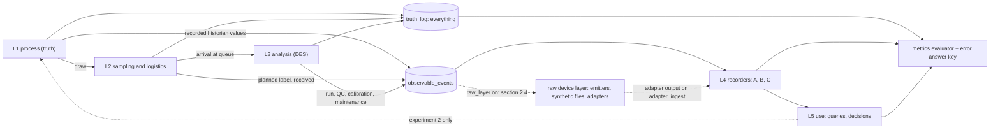
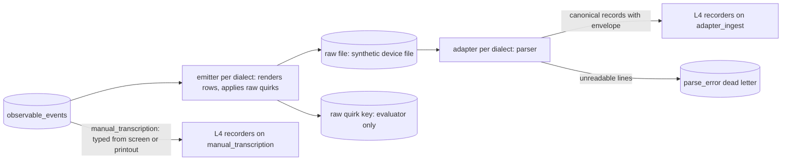
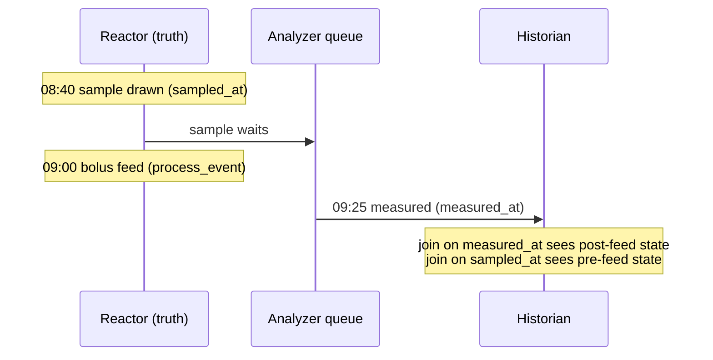
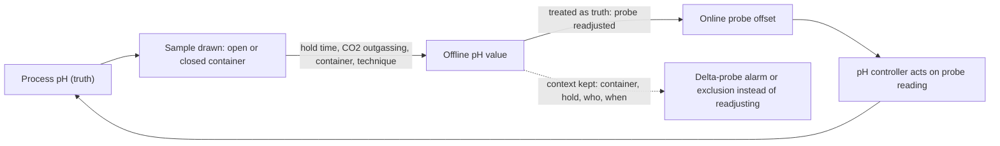
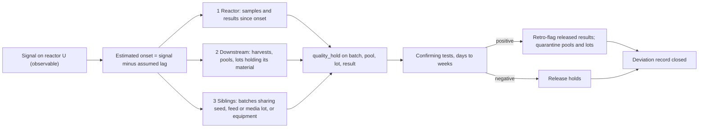

# Simulation specification

Status: design draft, no simulation result exists yet. Synthetic scenario built from public sources and labelled assumptions (ADR-0001). Nothing here predicts a real laboratory. Extensions (cell-line profiles, operating modes, break-out events such as contamination) are designed in section 11 under ADR-0013 and are not built before S2. The raw device layer (synthetic equipment output files and their adapters, section 2.4, ADR-0014) is a scope extension of S2 itself.

How to read the numbers: every number carries a ledger id (`S###` source, `A###` assumption; grades S, P, D, A are explained in `docs/research/README.md`). A number without an id is a defect, not a placeholder. Figures that rest on a source below `main-reread` are provisional and may not appear on the public README or infographic. Table, column and time-field names, and the derived quantities `hold_time` and `turnaround`, are defined once in `docs/design/data_model.md` (sections 2 and 5); this file uses them and does not redefine them.

## 1. Purpose

N bench-scale bioreactors in a process-development (PD) laboratory send in-process samples to M shared at-line analyzers. One synthetic "truth" run is recorded under several data architectures, so the only thing that changes is how data is captured and stored. The simulator shows how an analysis result loses its process context (which reactor, which moment, which instrument state) and what each architecture preserves.

Default: 24 reactors in two bays of 12, 2 analyzers; N from 5 to 100 and M from 1 to 6 (A001, A022; ADR-0009). Average load is low, so waiting comes from bursts, not capacity: 12.6 to 14.4 percent of two analyzers per 10 h staffed window (the default window, A098), 5.2 to 6.0 percent per 24 h clock (A074, grade A). Utilisation is always stated for both windows; a weekend day has a shorter staffed window (A201), which raises the share for the same load (A074).

## 2. Five layers

| Layer | Contents | Events emitted | Entities |
|---|---|---|---|
| L1 process (truth) | staggered inoculation in cohorts (A188), simple kinetics for cells, metabolites and titer (A011), online sensor series of pH, DO and temperature at a 60 s cadence (A100, A198), scheduled events | `inoculation`, `process_event` (feed, temperature shift, alarm, harvest), `sensor_tick` | Site/Area/Unit, Batch, ProcessEvent, historian tag |
| L2 sampling and logistics | planned window, actual draw, label, transport, aliquot by storage condition, stability effects while waiting | `sample_planned`, `sample_drawn` (carries `operator_id`), `label_bound`, `sample_received` (its instant is `sample.arrived_at`), `aliquot_created`, `draw_skipped_volume_budget` | Operator, Sample, Aliquot, label method |
| L3 analysis (discrete-event) | queue policy, QC and maintenance windows, reruns, dilution, instrument state, multi-visit routing, setup time | `request_queued`, `visit_started`, `visit_finished`, `run_started`, `qc_result`, `calibration_recorded`, `qc_window_started`, `qc_window_ended`, `maintenance_started`, `maintenance_ended`, `result_measured`, `rerun_requested`, `dilution_applied` | Analyzer, InstrumentState, Run, Method |
| L4 recording (the comparison axis) | one recorder per architecture, error injector, event log | `record_written`, `record_corrected`, `flag_raised`, `ingest_received` | Recorder, ErrorInjector |
| L5 use | feed decision, batch comparison, analyst queries, optional model; truth-oracle arm | `query_answered`, `feed_decision`, `probe_restandardised` (experiment 2) | DecisionRule, AnalystQuery |



Between L3 and L4 sits the raw device layer (section 2.4). It is not a numbered layer, so L4 and L5 keep their names. It is off by default.

Time is an integer number of seconds everywhere in the engine. ISA-88 vocabulary is used for the physical model (Site, Area, Unit, Batch).

### 2.1 L1 process

Fed-batch is the default mode (A003): production culture 13 to 17 d (A004, S017; default 14, and the ledger range's 12 d low end comes from a different study, S019), preceded by an N-1 seed of 2 to 5 d (A005), inoculated at 0.5 to 1.5 million cells/mL (A007). A feed rule aims to keep glucose above 1.0 g/L with discrete feeds (A010, S017, A050), so a feed can fall between a draw and its measurement. Peak viable cell density in fed-batch is typically 10 to 30 million cells/mL (A008, S053; the default is a pick inside that range); the perfusion default of 60 million cells/mL rests on one published worked illustration, not a measured run, and is graded P with an unsourced lower range end (A009, S080, S079; provisional). Harvest follows a simulator rule (A013; S114 harvests on day 14 or below 60 percent viability, and S119 reports 90.3 percent viability on day 14 for its standard fed-batch). Perfusion (A006, only one duration sourced) is deferred to session S4.

Kinetics are nutrient-limited growth under a logistic ceiling, with death coupled to the limitation of growth, nutrient use proportional to viable cells and product proportional to integrated viable cells (A011). With X the viable density, g the glucose, Ks the half-saturation constant (A109), Xmax the carrying capacity (the default of A008, which S053 fits with logistic curves) and m_T the temperature multipliers of A196 (1 without a shift), one integration step uses

- limitation: phi = g / (Ks + g) x max(0, 1 - X / Xmax), with no temperature factor;
- growth: mu = mu_max x m_T,mu x phi (A080);
- death: kd = (kd_min + (kd_late - kd_min) x (1 - phi)) x m_T,kd, with kd_min the early-phase rate (A212, S118) and kd_late the rate when growth is fully limited (A081; S053's fitted parameter a2 is "analogous to the maximum death (kd max)" rate of a logistic fit to viable cell density, and the engine uses it as the death rate when growth is fully limited, a simulator choice).

A culture that grows freely therefore dies at the early rate, and one whose growth is limited, by glucose or by the ceiling, dies at the late rate. The coupling is linear in phi; that form is a simulator choice (grade A, A011): its form is unsourced: S118 (section 3.3) reports that the rise of the death rate after 120 h correlated with the declining growth rate and gives no function, and its lysis-corrected rate (section 3.2) stays approximately constant up to 180 h. Lysis of dead cells is not modelled.

Mass balance. In one step the glucose and glutamine taken up never exceed what is present, so neither goes negative. Glucose uptake is the exponential-phase value of A082 per viable cell throughout, because A011 has one rate; the stationary-phase values of A082, A083 and A084 are not used, and the temperature multipliers of A196 leave the per-cell glucose and glutamine rates unchanged. While lactate is produced, a step adds A084 x X x (mu / mu_max), that is A084 x X x m_T,mu x phi: production follows the growth rate that is in effect, the temperature multiplier included (S056: production practically proportional to the rate of growth; S054: net accumulation ceased when growth stopped). It is therefore zero when no glucose is taken up, and a step after the shift with the growth multiplier 0.5 produces half the lactate of the same state before it.

Lactate switch (A085), on by default. From culture day 7, counted from inoculation like the shift day (A195), the net lactate rate is -0.15 pmol/cell/d x X: it replaces the production rule and is not added to it, it does not depend on glucose, and lactate never goes below zero. The age is taken at the start of the step, like the temperature multipliers. A scenario can switch it off (setting `lactate_switch_on` at 0); the production rule then holds for the whole culture. The other two settings are `lactate_switch_day` and `lactate_net_rate_pmol_per_cell_d`, all three with the id A085. The day-7 onset and the rate come from S054 (engineered PYC2 clone: net consumption after 7 days; -0.15 pmol/cell/d in fed-batch shake flasks, -0.17 in the 2 L stationary phase). Applying an engineered clone's switch to the platform default is a simulator choice (grade A). Most opened sources show net consumption starting on culture days 3 to 7: S054 (PYC2 clone, after 7 days), S121 (both control cultures, around day 5), S110 (cell line 1, days 5 to 7; indirect: it reports no lactate concentrations or rates, the evidence is the CO2 and base demand of pH control, and cell line 1 produced lactate again after day 7, which the engine does not model) and S114 (a decrease after 3 to 4 days, except BC-P with Actifeed A or B, where lactate kept rising; what the 3 to 4 days count from is not stated). The counter-cases are the parent line of S054 (+0.24 pmol/cell/d in the 2 L stationary phase) and high pCO2 in S121 (lactate produced throughout the process).

Known limitation of the growth course. The default culture peaks at about culture day 12, while sources put the peak of viable cell density at culture days 7.5 to 9.6 (S053: tmax 8.4 and 9.6 d; S121: between day 7.5 and day 8.5). No source gives a quantitative rule for the end of growth. The candidates that would move the peak (an age stop at a tmax, growth x 0.2, a different Xmax) would be values picked to hit the range, not sourced values, and were not used. The lactate of the default culture is reported against the source ranges, not tuned to them (docs/progress.md).

The remaining constants are the per-cell uptake and production rates (A082, A083, A084), specific productivity (A086) and the glucose half-saturation constant (A109). They come from a few CHO studies and are provisional.

Scenario inputs of L1. Day 0 is a Monday, and reactors are inoculated in cohorts on successive days, one reactor after another inside a cohort, so on any day they sit in different phases of feed, temperature shift and harvest (A188). The horizon is a scenario input printed with every result (A189). The initial glucose and glutamine of the medium are A190 and A191; the inoculum carries none of its own (A190) and ammonium is not modelled (A191). The online sensors are pH, DO and temperature, each with set point, process value and output roles; the set points are scenario data (A198), the process value carries noise, and the temperature follows a changed set point with a lag (A199). The engine's integration step is A200, which is the same fact as the sensor cadence of A100: the ledger keeps one value under two names, this section cites the step here only, and a scenario that splits them sets both.

Scheduled events come from the scenario, at whole minutes (A200). A feed is a bolus that adds a share of the current culture volume (A192) with the glucose and glutamine concentrations of A193 and A208, and dilutes cells and analytes (A192). Routine operation decides the bolus once a day, at the decision time inside the feed window (A194, A050): it feeds the smallest bolus of the feed of A193 and A208 that brings the predicted glucose at the next decision, 24 h later, to at least the floor of A010, and feeds nothing when the prediction already meets the floor. The 24 h consumption is predicted from the current viable density and the glucose uptake of A082, with no growth projection, in the manner of S114 (the daily feed volume from the glucose at feeding and the anticipated consumption of the next 24 h, to keep glucose at 10 mM by the next sample point). Let g be the true glucose, C the glucose of the feed, D the predicted consumption of the next 24 h in g/L (the uptake of A082 times X times the glucose molar mass) and f the bolus as a share of the culture volume. The bolus dilutes cells and analytes by 1 / (1 + f), so the predicted glucose is (g + f x C - D) / (1 + f) and the rule feeds f = max(0, (floor + D - g) / (C - floor)). Because no growth is projected, glucose can still fall below the floor, or to zero, before the next decision in the growth phase. The truth run is open loop (section 6.1) and cannot wait for an analyzer result, so the engine evaluates the rule on the true glucose; the "newest result available" of A194 is what the human decision maker sees, and it is what L5 and the availability metric of section 8 use. A scripted feed is a different event: the feed at 09:00 of the central case is a scripted event of SC3 (A102), not a decision of the rule (section 6.1), and it keeps the fixed bolus of A192. The temperature shift is a step of the set point on a culture day counted from inoculation (A195) with the effect multipliers of A196 (growth, death and productivity; lactate takes the growth multiplier through the growth rate, see Mass balance); a scenario without a shift sets them to 1 (A196). Alarm events exist only when a scenario adds them, and their limits follow the set point (A197, A184). In S1 L1 takes no input from L3, L4 or L5 (`feedback` is false, section 6.2).

### 2.2 L2 sampling and logistics

- Sampling pattern: one sample per reactor per day, a second in the feed window on a share of reactor-days (A014, A015). Planned times: the shift-start burst (A016) applies to the first samples, the rest of them are planned uniformly over the staffed window, and the second sample uniformly inside the feed window (A194); the draw delay spread (A063) is added to every planned time and a draw is clipped to the staffed window (A202). The staffed window, the operators per shift and the weekend rule (no second sample on a weekend day) are the roster (A201, A017, A098); sampling and analysis happen only inside it. Transport and preparation time (A018) is an assumption; it ends at `sample.arrived_at`, the receipt at the analyzer bench (event `sample_received`). The staggered arm of SC2 replaces the burst by one window per bay (A203).
- Scripted move of a draw (`move_draw`; scenario `scripted_events[]` `{ type, sample_id, at, to }`, ADR-0021): at the instant `at` an operator moves the planned instant of one named sample to `to`. The sample must not be planned yet at `at` (its planned instant is later than `at`), `to` is not earlier than `at`, falls on the same day as the original planned instant, inside the staffed window (A201, A202), and is a whole minute (A200); a move that breaks one of these, or that names a sample the run does not draw, is refused by the run with a message that names the sample, and a sample is moved at most once. `to` replaces the planned instant only: every keyed draw of the sample (whether it exists, its delay, its transport, its operator; each keyed by the sample id alone, section 3 rule 3) is unchanged, so the draw delay (A063) is still added to the new planned instant and the draw is still clipped to the staffed window. `at` and `to` are scenario inputs chosen by the reader, ledger entry A228, printed as assumed. With no `move_draw` in the scenario every event log is byte-identical to the log of the engine without this clause (regression rule, section 11.1).
- Labelling method (handwritten, pre-printed barcode, issued at draw) is an L2 setting, independent of the L4 flags.
- Container model: closed syringe for pH and gases, open cup for cell count and metabolites (A037, proxy). A held-sample effect is applied only as a scenario knob: viability slope default 0 for neat samples (A040), with the observed value kept separately and valid only to 55 min (A038, A039, S012); open-sample pH offset (A041) and relaxation (A042) and closed-sample drift (A043) follow their ledger grades; the settling bias of a cup that waits unmixed (A044) and the in-tube glucose and lactate change (A045) are switches of the same kind as A040: graded A, off in the base scenarios and applied only when a scenario switches them on; the 30 min maximum hold is a blood-gas proxy (A046).
- Volume budget: each draw has a volume, `sample.volume_ul`, a share of the culture (A057, derived), and its aliquots split it (`aliquot.volume_ul`, nullable; data_model sections 2 and 4). The budget is a cap on the cumulative sampled volume per reactor (A207). An over-budget draw is skipped (state `skipped`, event `draw_skipped_volume_budget`) and logged, and still counts in every metric denominator.
- Aliquot storage policy by analyte class (A021, assumption).

### 2.3 L3 analysis

Queue policy defaults to first-in-first-out, with priority, earliest-deadline-first and SLA variants (A035); the earliest-deadline-first deadline of a request is the next decision time after its draw, and the SLA variant uses the draw time plus the holding limit (A206, A097). QC time per analyzer per day and maintenance windows are scenario settings (A031): the daily QC window has a clock time and a length (A204), the maintenance window length is A096 and its start in SC5 is A205. A window opens with `qc_window_started` or `maintenance_started` and closes with `qc_window_ended` or `maintenance_ended`. In S1 each run ends with a QC outcome, `qc_passed` or `qc_failed` (event `qc_result`). `qc_failed` is a run-level failure: with probability A088, for reasons other than range, the measurement is repeated as a rerun of the same physical sample with `attempt` + 1, and the failed attempt stays in the truth log. A result above the over-range limit (A089) is repeated at a higher dilution (A090). The failure probability of a scheduled QC run (A087) and the analyzer hold that follows a failed QC run belong to SC7 and S2; S1 holds no results and never blocks an analyzer after a failed run. Instrument behaviour is assumed and switched on per scenario (A033): the analyzer recalibrates on a fixed interval (A091), a drift random walk accumulates between recalibrations and resets at each one (A092), and a reagent lot change adds a step (A093); inter-instrument bias and habitual assignment are A032 and A034. Result noise follows the analyzer's specification limits for within-run and day-to-day precision (A077, A078) and the counter's repeatability (A079); these are limits, not typical performance. Service times come from the analyzer profile (section 4). A run may not overlap a QC or maintenance window; windows are half-open, `[start, end)`, and a window is checked over the whole run including its setup, not only at its start.

**Visit and run.** A sample is received at the analyzer bench at `sample.arrived_at` (event `sample_received`) and joins the queue (`request_queued`). `visit_started` is the sample loaded on an instrument; `run_started` is the instrument run beginning, after any setup, and its instant is `run_started_at` (data_model section 5). A visit therefore begins `setup_s` before its run, with `setup_s` the setup applied immediately before the run (0 if none; a trace field, per run). The run ends at `run.ended_at`, when `visit_finished` frees the analyzer, and that instant is the `measured_at` of its result. A sample with several visits (the split profile, A070) has one run per visit, and `transfer_s`, the transfer between instruments before a later visit (A106 for the split profile), separates `run.ended_at` of one visit from the arrival at the next. `hold_time` ends at `run_started_at`, so it contains transport, queue wait and setup (data_model section 5).

### 2.4 Raw device layer (between L3 and L4)

Status: scope extension of S2 under ADR-0014 (Proposed). Off by default (scenario setting `raw_layer`): with it off, recorders consume `observable_events` as before and every earlier scenario keeps a byte-identical event log. It is not a ninth flag (ADR-0005 stays at eight). The raw files are synthetic formats modeled on public documentation; the project does not claim to read any real instrument's files. Every figure here rests on S084 to S103, none of which is `main-reread`, so all of it is provisional. Entities and the field-level mapping are in `data_model.md` section 16; this section owns the emitters, the quirks, the error classes and the metrics.

#### 2.4.1 Path and rules



1. **Emitters read observable data only.** They consume `observable_events` and plain data supplied by the assembly (an instrument's clock offset, its date order, quirk opportunities). They never read truth. The calendar anchor (a synthetic start date) and each instrument's zone offset are scenario data; the engine's integer seconds become wall-clock text only inside an emitter.
2. **Belief and actual are separate.** What the device writes (its date order, units, zone) is scenario data used by the emitter. What the parser assumes is the adapter entry (`data_model.md` section 16.1). A mismatch between them is an injected error, not a parser fault.
3. **Round trip.** With every quirk switch off, parsing an emitted file returns the events it was rendered from, on the mapped fields and within the dialect's time resolution. This is an EDD fixture typed by hand.
4. **Fair by construction.** Quirk opportunities are drawn once per row or file with the canonical key tuple of section 3 and purpose `raw:<quirk id>` (a file-level draw uses the export id in place of the sample). They do not depend on the architecture or on detection. The same raw files reach every architecture; detection only raises flags.
5. **Capture path.** What happens to a file is the `capture_path` setting (section 5, "Capture path"), not a property of a preset. On `adapter_ingest` (the default of B and C) the adapters parse the files. On `manual_transcription` (the default of A) a person types the result from the instrument screen or printout, no adapter runs, and the raw-layer metrics read "not applicable". Any preset may take either path. The files are emitted either way, from the same draws.
6. **Raw quirk key.** The emitters return the realised quirks as plain data (file, row, quirk id, intended value or instant); the assembly writes them to the answer-key file, and only the evaluator reads it (section 3, rule 2).
7. **ADR-0014 rules.** Every emitted file starts with the line "synthetic, modeled on public documentation; not a real instrument file". A dialect lists the `S###` ids it is modeled on, uses its own short field names, and copies no manual text. Dialect, profile and file-name prefixes are vendor-neutral.

#### 2.4.2 Dialects

Dialects are profile data (ADR-0012): analyzer dialects under `scenarios/profiles/dialect/`, controller families under `scenarios/profiles/controller/`. There is one generic emitter and one generic parser; the engine never branches on a dialect id. No ledger bundle exists yet for a dialect, so the grade shown is the weakest of the entries cited, and parts that no source shows are marked assumed.

| Dialect | Used by | Shape of the synthetic file | Modeled on | Weakest cited grade |
|---|---|---|---|---|
| `allinone_csv` | `allinone_atline`; the chemistry side of `split_cellcounter_metabolite` (the stand-in of A070) | one CSV per operator export, named with a neutral prefix and the export time (A159); quoted header row, optional units row, one row per analysis, trailing comma, blank cell where a value is absent (A160); local stamp with no zone, date order, separator and 12 or 24 h per instrument (A161); units per analyte (A162); record fields (A165); the over-range note form is assumed (A163) | S003, S038, S086 | A (A161 default and A163 form are assumed) |
| `counter_csv` | the counter side of `split_cellcounter_metabolite` | one CSV per sample set; units in the column headers; stamp month, day, year, 24 h, to the minute, no zone (A166); optional append mode that repeats earlier rows (A167) | S084, S085, S086 | P |
| `cds_table` | `hplc` | a user-designed result table: columns and their order come from a template (A168); one row per injection or per peak; retention time in seconds and area in mAU*s (A168); the titer amount column is assumed (A168); a new result id per processing run (A169) | S088, S089, S090, S091 | P |
| `ctrl_neutral` | controller family 1 | three logs: tag log (UTC stamp with offset, tag, value, quality), alarm log, batch-phase log; tag name is unit tag, signal and role (A171); ISA-88 hierarchy and phase states (A170); ISA-18.2 alarm states (A174) | S093, S094, S095, S097, S101 | P |
| `ctrl_bench` | controller family 2 | five record types as separate CSV exports: process data, user events, alarms, recipe steps, errors; each variable logged by deadband and maximum log interval (A172); the unit sits in parentheses in the variable name (A171); alarm rows carry the acknowledging user and time (A174, S099); the CSV column layout is not in the text read, so it is assumed | S099 | P (layout assumed) |

| Analyzer profile (section 4.2) | Dialect or dialects |
|---|---|
| `allinone_atline` | `allinone_csv` |
| `split_cellcounter_metabolite` | `counter_csv` for the counter visit and `allinone_csv`, chemistry columns only, for the metabolite visit (A070) |
| `hplc` | `cds_table` |

A bay uses one controller profile. The default raw-layer scenario puts one bay on each family, which is a design choice and no claim about any site. Analyzer exports reach the host by the scenario setting `export_schedule` (A216; the staffed window itself is A098): once per instrument at the end of each staffed window (`window_end`, the default) or at the instant each result is produced (`per_run`). Controller logs are cut one file per record type per day (A217; the scenario setting `controller_log_cut` takes `daily`, the default, or `per_row`, each row as written). Neither schedule has a source. The OPC-style tag records of the all-in-one analyzer (UTC stamp and a separate local offset, A165, S004) are not emitted; they are the contrast case for the stamp without a zone and are parked (YAGNI).

#### 2.4.3 Raw quirks

Each quirk is a behaviour of the raw file that a parser must handle. The test of each is a Given-When-Then in the S2 brief named after its id.

| Id | Quirk | Emitted by | What the adapter does | Ids |
|---|---|---|---|---|
| RQ1 | Stamp with no zone: local wall-clock text, no offset | `allinone_csv`, `counter_csv`; `cds_table` and `ctrl_bench` by assumption | the zone comes from the adapter entry (the instrument's configured zone); the UTC instant is stored beside the source zone (K14); a missing zone in the entry makes the stamp unresolved (VR-024) | A161, A166, A168, S099, S029 |
| RQ2 | Date order, separator and clock style are user settings: 3 orders, 3 separators, 12 or 24 h; default year first, '-', 24 h. A day of 12 or less reads validly under two orders; a 12 h clock without a day-part marker is ambiguous | `allinone_csv`, `ctrl_bench` | the entry pins the order. If it says unknown, one row with a day above 12 pins it for the whole file (resolved); if none does, the stamp is unresolved and the row is quarantined (VR-024). If the entry pins the wrong order, the stamp is read as a valid but wrong instant (resolved wrongly) and the adapter cannot know | A161 |
| RQ3 | Stamp truncated to the minute | `counter_csv` | `measured_at` carries a resolution of one minute (`time_resolution_s`); rows in one minute keep file order | A166 |
| RQ4 | Repeated rows: append mode repeats earlier rows; overlapping operator exports repeat selected rows; a transfer retry drops a file twice (scenario switch, any dialect) | `counter_csv` (append), `allinone_csv` (overlap), any dialect (replay) | `source_event_id` is the dialect's natural key (instrument, row stamp, sample id); same key and content is a no-op where `ingest_idempotency` is on (VR-008), same key and different content is quarantined (VR-008b), and with the flag off every copy loads | A167, A159 |
| RQ5 | Reanalysis: a new row with a new row time while the original sample time stays in its own field; a processing run in the data system gets a new result id. Scenario-scripted, no random rate (no source) | `allinone_csv`, `cds_table` | result version n+1 of the same measurement: `measured_at` keeps the original sample time and the new row time is the envelope's `event_time`; version n absent from the store is VR-019 | A164, A169 |
| RQ6 | Range and error marking: an analytical-range breach is a blank value plus an error note naming analyte and direction; a process-range breach is a status only; a blank cell also means an analyte not measured | `allinone_csv` | blank value with a range note becomes a null value with a `range_flag`; a blank value for an analyte the method requires, with no note, is held (VR-026). The CSV form of the note is assumed | A163, A160 |
| RQ7 | Units row absent: units are implied by the instrument's settings | `allinone_csv` (optional row); `counter_csv` and `cds_table` state units in the header and do not emit it | units come from the adapter entry; if the instrument's setting differs, the value is read in the wrong unit without notice; only VR-005 (dimension) or VR-006 (implausible value) can catch it | A160, A162 |
| RQ8 | Template-defined columns: the user chooses the column set and order | `cds_table` | columns are mapped by role through the template map in the entry, never by position; an unknown column is an information finding; a required role missing rejects the file (VR-023) | A168 |
| RQ9 | Deadband and maximum-interval logging: a value is logged when it moves by its deadband or the maximum log interval has passed; the series is irregular. An optional historian exception stage is off by default | `ctrl_neutral`, `ctrl_bench` | rows load as received, never interpolated; context at a time uses the last row at or before it (`data_model.md` section 16.4) | A172, A173 |
| RQ10 | Alarm state changes: one row per transition, acknowledge and return-to-normal as separate events; the bench family records the acknowledging user and time | `ctrl_neutral`, `ctrl_bench` | one `alarm_event` per row, never merged; a transition the state model does not allow is held (VR-025) | A174, S099 |
| RQ11 | Batch phase transitions: ISA-88 procedure, unit procedure, operation and phase, with the 13 phase states | `ctrl_neutral`, `ctrl_bench` (recipe steps) | one `batch_phase_record` per row; a transition the model does not allow is VR-025 | A170, S099 |

The clock offset of an instrument (A049, example +5 h) is not a quirk but an injected error: the emitter shifts every stamp of that instrument, and RQ1 makes the shift undetectable from the file alone. Alarm limits with a deadband and an on-delay (A175) are kept for a later limit-based alarm rule; S2 renders the scenario's scheduled `alarm` events only (YAGNI).

Events emitted by the layer. Observable: `export_written` (file name, export instant on the instrument clock, row count), `reanalysis_done` (L3, scenario-scripted), `raw_file_received` (host clock), `record_parsed`, `parse_error_raised`. Nothing here adds a truth event.

#### 2.4.4 Controller signals

| Signal (canonical name) | Roles logged | Series in L1 today | Note |
|---|---|---|---|
| `pH` | PV, SP, OUT | yes (A100) | control deadband around the set point is A095 |
| `DO` | PV, SP, OUT | yes (A100) | |
| `temperature` | PV, SP, OUT | yes (A100) | the set point changes at the scheduled temperature shift |
| `agitation` | PV, SP | no | the default log deadband of the agitation PV is 0.5 rpm (A172) |
| `gas_flow_<gas>` | PV, OUT | no | gas names are scenario data |
| `feed_pump`, `base_pump` | OUT | no | the feed pump follows the scheduled feed events (A010) |
| `offgas_CO2` | PV | no | |

L1 produces the series named in A100 only. The other signals must come from L1 as new `sensor_tick` signals when `raw_layer` is on (they depend on hidden process state, which an emitter may not read) and are absent otherwise, so layer-off logs stay byte-identical. SP and OUT are computed by a generic controller rule from the observable PV and the scenario's set points; they add no truth quantity. No ledger parameters exist yet for these signals (section 2.4.8).

#### 2.4.5 Adapter output

Entity-level mapping; the field-level mapping, keys and states are in `data_model.md` section 16.

| Dialect | Raw record | Becomes |
|---|---|---|
| `allinone_csv` | one analysis row | a `run` and one `result` per analyte; a reanalysis row is result version n+1 |
| `counter_csv` | one analysis row | a `run` and the `result` rows for count, viability and size |
| `cds_table` | one injection or peak row | a `run` per injection and a titer `result` from the amount column |
| tag log or process data | one tag value | a `historian_value` |
| alarm log | one transition | an `alarm_event` |
| phase log or recipe steps | one transition | a `batch_phase_record` |

Every file becomes a `raw_file`, every data line a `raw_record`, every unreadable line a `parse_error`, and every loaded row carries the ingestion envelope of `data_model.md` section 7 with `raw_ref` pointing at its line.

#### 2.4.6 Error classes that now start in the raw file

| Existing error class (section 5 matrix) | Raw-level origin |
|---|---|
| label or transcription error | the sample-id text the operator typed at the analyzer; the file carries it unchanged and the adapter passes it through (VR-014 still applies). This holds on both capture paths; the copy step of `manual_transcription` adds result transcription errors (section 5, "Capture path") |
| clock or time-zone error (A049) | the instrument's clock offset in every stamp (RQ1), plus the unpinned or wrong date order (RQ2) |
| duplicate or replayed file | repeated rows and replayed files (RQ4) |
| lost rerun or silent overwrite | reanalysis rows (RQ5): with `append_only_versions` off, version n+1 overwrites version n |

Two classes are new and appear as rows of the section 5 matrix: timestamp misread (RQ2, RQ3) and a unit implied by instrument settings that changed (RQ7). The other classes (feed in the gap, unit or batch re-keyed, instrument or lot effect, late correction, unattributable record, sampling technique) do not arise in a file and are unchanged.

#### 2.4.7 Metrics

Same rules as section 8: reported with the seed count and spread, never gated, no composite score. They read the raw quirk key and are reported for every run whose capture path is `adapter_ingest` (by default B, C and the ablations of C). A run on `manual_transcription` shows "not applicable", never zero. Denominators are fixed. Each metric is also reported per device class (analyzer, controller) over the rows of that class only; the total keeps the denominators above.

| Metric | Definition | Denominator |
|---|---|---|
| Parse failure rate | raw data rows rejected as unreadable (VR-023); every row of a rejected file counts | all raw data rows the emitters wrote, including repeated rows and rows of replayed files |
| Ambiguous timestamps | three shares: resolved correctly (the parsed instant equals the intended instant in the key), resolved wrongly (another valid instant), unresolved (quarantined, VR-024) | all raw rows whose stamp text is ambiguous under the formats in play, by the key; if none, "none occurred" is printed and no share |
| Duplicate rows suppressed | repeated rows (second and later copies) that were no-ops (VR-008); the share loaded twice and the share quarantined (VR-008b) are printed beside it | all repeated rows written; if none, "none occurred" |
| Records quarantined or held at ingest | rows with action quarantine and rows with action hold from the ingest-stage rules (VR-005, VR-006, VR-008b, VR-019, VR-024, VR-025, VR-026), counted separately | all raw data rows received. Always shown with the share of clean rows (no realised quirk or error in the key) that were quarantined or held, over all clean rows, and with the exact reconstruction rate of section 8, so that quarantining everything cannot look good |

#### 2.4.8 Gaps to close before building

The research role adds these ledger entries (graded A where unsourced) before the step that needs them starts; an executor never invents a number.

- Log deadband and maximum interval for tags other than the agitation PV (A172 gives one default and one worked example only).
- Signal parameters for gas flows, pumps and off-gas CO2 (A100 covers pH, DO and temperature) and the controller rule that computes OUT.
- Acknowledge and return-to-normal times of a scheduled alarm (A174 has no timing); alarm deadband and delay for pH and DO (A175).
- The meaning of an analyzer row stamp (start or end of the run) is not in the ledger; the dialect declares it and the default, end of run, is an assumption (A161, A166, S003).
- The CSV form of the over-range note (A163), the titer amount column (A168), the column layout of the bench controller (S099) and the zone convention of the data system (A168) are assumed and printed as assumed.
- Summer-time changes in device stamps and any random reanalysis rate have no source and are not modelled.
- Manual-path entry errors: a typed result value, a unit slip and the delay between a result and its entry have no ledger entry of their own. A047 and A061 are labelling entries (a clinical proxy), and whether A047 may also stand for a typed value is a judgement for the research role; A048 covers the manual dilution factor. Until entries exist, a manual-path run reports these classes as "not modelled" and builds the sample-id, clock and dilution classes only.
- Whether a dialect's dilution field carries a manual pre-dilution factor (A165, A090, A048) is not settled. Until it is, that factor is typed by hand on both capture paths, and the limit "dilution factor typed by hand" of preset B stands.

#### 2.4.9 Where it sits in S2

It is built after the flags, the injector, the evaluator and the structural gate (Steps 1 to 4 of `prompts/20_S2_capture_metrics.md`), as Steps 5 to 8 of that brief. Its gate is structural: the round-trip fixture, one Given-When-Then test per quirk (RQ1 to RQ11), idempotent re-ingest, the forced-error cells of the matrix rows that depend on the raw layer or on the capture path, one cell per path, and the three-rules checklist. No scenario id is added; SC1 and SC6 are re-run with the layer on, each preset on its default capture path, and SC6's clock offset then lives in the file stamps (on `manual_transcription`, in the stamp read from the printout). The capture-path contrast of section 5 runs on SC1 with the layer on. Stochastic raw-layer metrics are reported over at least 20 seeds (A103) and are never gated.

## 3. Truth, recorded world and the observation contract

The engine emits two streams.

- `truth_log`: everything, including hidden quantities (true analyte values at draw, true pH, true instrument bias) and the true time of every event.
- `observable_events`: what a person or an instrument could see: sample drawn with its planned label, received, run started with instrument and QC lot, QC result, calibration record, maintenance log, recorded historian values. Times here are recorded stamps. The error injector can skew an instrument clock (A049, example offset +5 h), so a recorded `measured_at` can differ from the truth event.

Rules (invariants, tested):

1. Recorders (L4) consume `observable_events` only (with the raw layer on, a run on `adapter_ingest` consumes the adapter output, which is `observable_events` rendered through a synthetic device file, section 2.4, and a run on `manual_transcription` consumes the typed results, which are `observable_events` after the transcription step of section 5) and never read truth. Hidden fields are annotated `"x-visibility": "hidden"` in the schemas. Test: change hidden-only fields and the recorder output must be byte-identical.
2. Who may read truth. The metrics evaluator reads truth, because it must in order to score, and it is the only reader of the error answer key (the record of which errors the injector materialised where). Experiment assembly (drawing the shared truth run and the error opportunities) and the oracle arm of experiment 2 may also read truth. Recorders and L5 (analyst queries and decisions) never do.
3. Same `(scenario, seed, engine_version)` gives a byte-identical event log. Randomness comes from one keyed integer generator with one canonical key, the 5-tuple `(run_seed, physical_sample_id, analyte, attempt, purpose)`, where `run_seed` is the `seed` of rule 4. The transcendental functions of the draws (the logarithm and cosine of the Gaussian and exponential draws) and of the rest of the engine come from the engine's own deterministic module (`engine/src/xmath.ts`, ADR-0019), so a seed gives the same bytes in every JavaScript engine. A draw that belongs to a unit, an instrument or a generator puts that entity's id in the second slot and `-` and `0` in the next two (the reactor-level draws of experiment 2 do this with the reactor id). No other tuple shape exists, the M/M/c validation mode included (`purpose` is `arrival` or `service`, with the request index as the id). A rerun or an added sample never changes another sample's draws.
4. Every export and shareable URL carries `schema_version`, `engine_version` and `seed`; in an event log they ride on its first line, the event `log_header` (data_model section 5).
5. As-of: a decision or query at time t uses, per logical key, the latest result version with `available_at` at or before t, and historian rows with `ingested_at` at or before t (data_model section 5). An architecture without the flag `available_at` sees rows as of now instead.

## 4. Profiles

Scenarios pick profiles, and may name one per bay and one per analyzer (section 4.5). Profiles are data under `scenarios/profiles/{bioreactor,analyzer,staff}/`; each numeric parameter is `{value, unit, ref}` with `ref` resolving to a ledger id (ADR-0012). A bundle takes the grade of its weakest component, in the order S, P, D, A, so a bundle with a derived part is D, not S, and one with an unsourced part is A. The bundle grades in the tables below are those of the ledger bundles A065 to A073.

### 4.1 Bioreactor

| Profile (default first) | How samples are taken | Sample as share of culture | Bundle grade | Ids |
|---|---|---|---|---|
| `bench_manual`: 2 to 5 L glass or single-use | operator draws into a closed container or syringe | 0.014 percent | D (volume share derived, A057; the closed-container model is a proxy, A037) | A067, A002, A057 |
| `micro_mini_parallel`: micro-scale 10 to 15 mL, 24 or 48 vessels; mini-scale 100 to 250 mL, 12 or 24 vessels | automated liquid handler into a cup | micro 4.8 percent; mini 0.31 percent (0.16 to 0.7) | D (volume share derived, A057) | A065, A066, A057, S009, S011 |
| `pilot`: 50 to 250 L single-use (class boundary assumed, A104) | sterile syringe from a sampling line | 0.00055 percent, analyzer volume only | A (boundary and purge volumes unsourced) | A068, A057, A104, S036 |

On micro-scale systems the number of samples consumes the culture: 14 daily samples would draw 67 percent of the vessel (A057, derived), which is why the source calls sampling a burden there (S011). Pilot line purge and discard volumes are not sourced and are not modelled (A105). Automation also changes who creates the label, whether an operator is present, whether draws burst at shift start, and the delivery order (a vessel-order autosampler makes high-numbered vessels wait longest).

### 4.2 Analyzer

| Profile (default first) | Service and volume | Consequence | Bundle grade | Ids |
|---|---|---|---|---|
| `allinone_atline` (FLEX2 class) | 4.5 min stand-alone (270 s on the distributor page, 275 s in manual mode per the instruction manual), 6 to 8 min coupled to a parallel system; 275 uL on the distributor page against 265 to 350 uL in the manual, or 400 to 700 uL coupled; ceiling about 13.3 samples/h | one queue, one file, one clock | D (the capacity ceiling is derived) | A069 (its components include A019, A020, A023, A075), S001, S003, S007 |
| `split_cellcounter_metabolite` | 130 s plus 120 s = 250 s (4.2 min) of instrument time over two visits, plus a hand-off between them (A106); 200 + 135 = 335 uL | two queues; the two results can be measured at different times and carry different clocks | A (hand-off unsourced) | A070 (its components include A025, A026, A106, A107), S005, S006 |
| `hplc` (titer) | 1 min run, 5 to 50 uL injection; column changeover and system-suitability time is assumed | shared column is the contested resource | A | A071, A028, A029, A030, S026 |

The 250 s and 335 uL figures are sums of stand-alone sourced numbers (derived). On the same analyte scope (cells, viability, metabolites, electrolytes) the all-in-one panel takes 235 s and 135 to 220 uL, so the split path needs about 1.06 times the instrument time and 52 to 148 percent more sample (A107, derived). The full 16-analyte menu (A116) is a different scope and is not compared. The metabolite side uses the FLEX2 chemistry module as a stand-in (A070). Interface: shared-folder CSV drop by default; a vendor OPC server is a separately licensed alternative (A036). With the raw layer on, each profile writes a synthetic file in the dialect of section 2.4.2. Calibration behaviour (drift, resets, lot change) is assumed (A033).

### 4.3 Staff

| Profile | Count variability | Label errors | Delay and technique | Bundle grade | Ids |
|---|---|---|---|---|---|
| `experienced` | manual 2.81 percent CV between operators, automated 0.46 percent (bead study); counting-statistics floor 5 percent (range 3.3 to 7.1) | 6.1 per 1000 (clinical proxy) | delay spread 5 min, technique error 0.02 (assumed) | A | A072, A058, A059, A060, A047, A063, A064 |
| `trainee` | manual CV times 2 (assumed), automated unchanged | 6.1 per 1000 times 2 (assumed) | delay spread 12 min, technique error 0.10 (assumed) | A | A073, A076, A062, A063, A064 |

What is sourced is narrow (A058, A059, A060, A047). The effect of training on label errors could not be established, and standardised labelling protocols are the lever with evidence (A061, S024, proxy). Roster and fatigue are assumptions: the staffed window is 10 h per day with two operators per shift and a trainee share of zero as a scenario knob (A098; shift pattern A017; shift clock times and the weekend rule A201), and the fatigue multiplier on delay spread and technique error late in a shift is off by default (A099). Operator hands-on time per sample at the analyzer is A101. Operator id and qualification reference ride on the `audit_trail` flag. In the truth world every operator also carries `operator.qualified`, the training status that the staff profile gives (true for `experienced`, false for `trainee`; A072, A073), and `sample_drawn` carries the sampler's `operator_id`; both are truth-side facts that S2 reads, and the recorded `qualification` rows are their counterpart.

### 4.4 Generic engine mechanisms

Multi-visit routing, sequence-dependent setup, volume budget, rate multipliers and delivery order. Setup time per run (`setup_s`) and the transfer between visits (`transfer_s`) are profile data; the HPLC changeover is assumed in section 4.2 and has no citable ledger value yet, so a profile without a stated setup has `setup_s` 0. The extensions add a per-reactor parameter draw, material-lot consumption and an event script (section 11.1). Nothing in the engine branches on a profile id, scenario id or architecture id.

### 4.5 Mixed fleets (ADR-0015)

Status: the fields, the load-time checks and the regression rule follow ADR-0015 as accepted. The routing rule, the open line of that ADR, was proposed in S3c part 1 and **ruled by the author on 2026-10-30: rule B** (4.5.4). Built in S3c part 2. No result is stated here.

#### 4.5.1 What the engine does today

- One analyzer profile per scenario (`profiles.analyzer`). Its `route` lists stages; a stage has a `group` (a pool of instruments) and the analytes it measures. An analyzer is one instrument per stage, and `analyzer_count` counts analyzers (A022): M analyzers of the split profile are M counters and M metabolite analyzers. Instruments are numbered `AN-1`, `AN-2`, ... stage by stage (`engine/src/run.ts`).
- Every drawn sample is one L3 request with one visit per stage, in route order. A request has no analyte list of its own: its analytes are those of the stages it visits.
- L3 keeps one queue per group (first in first out or earliest deadline first, section 2.3) with strict head of line, and gives the head to the lowest-index idle, available analyzer of the group (the S1a contract; fixtures F4 and F6). A visit names one group. Service time, method and transfer time sit on the visit, not on the instrument, and a later visit joins the queue of its group after its transfer time. The core reads no profile.
- The one analyzer profile is read in four places outside the core: the instruments and visits of a run (`buildL3Input`), what a run measures (`makeMeasure` takes the stage by visit number), the storage condition of the aliquot (the first stage) and the raw layer (`rawSetupFor`, `entryConfigFor`). The one bioreactor profile is read in three: the working volume (L1), the sample volume and its cap per reactor (A057, A207; L2) and the container per analyte (A037; `makeMeasure`).
- Bays are the reactors in bays of `bay_size`: their number is `reactor_count` over `bay_size`, rounded up, and the last bay may be smaller (A001).

So the case "two profiles can both measure an analyte" cannot arise today.

#### 4.5.2 Scenario fields

| Field | Shape | When absent | Length |
|---|---|---|---|
| `bay_profiles` | bioreactor profile ids, bay 1 first | every bay takes `profiles.bioreactor` | the number of bays (4.5.1) |
| `analyzer_profiles` | analyzer profile ids, analyzer 1 first | every analyzer takes `profiles.analyzer` | `analyzer_count` (A022) |

Both are top-level, optional and additive in `scenario.schema.json` (an array of non-empty strings, at least one), like `bay_controllers`, and need no `raw_layer`. They carry the names of the `RunSpec` fields of `lab_ui.md` section 4. `profiles.bioreactor` and `profiles.analyzer` stay required and are the defaults; `profiles.analyzer` is also the standing menu of 4.5.3. `profiles.staff` stays one per scenario (A201). `bay_profiles` and `bay_controllers` (section 2.4.2) are independent and may be crossed, as labelling and the flags are. A bay profile applies to the reactors of its bay in the three places above; `bay_size` stays one number for every bay (a size per bay is parked, YAGNI).

Instruments are numbered stage by stage and, inside a stage, in the list order of the analyzers that have that stage. A list that repeats one profile gives today's ids, so the `AN-1` of SC5 and the ids in the goldens stay.

#### 4.5.3 Load-time validation

Each check is an error at load, in the style of the `bay_controllers` check (S2f); the lab shows the message verbatim (`lab_ui.md` section 4, rule 4). A scenario with neither field is checked as today. In the two length messages a count of 1 is written in the singular (`1 bioreactor profile`, `1 bay`, `1 analyzer profile`) and any other count in the plural, as `plural` in `engine/src/fleet.ts` prints them.

| Check | Message |
|---|---|
| length of `bay_profiles` | `scenario <id>: bay_profiles names <n> bioreactor profiles but the scenario has <b> bays (reactor_count <N> in bays of <S>); name one bioreactor profile per bay, bay 1 first (spec section 4.5)` |
| length of `analyzer_profiles` | `scenario <id>: analyzer_profiles names <n> analyzer profiles but analyzer_count is <M>; name one analyzer profile per analyzer, analyzer 1 first (spec section 4.5)` |
| unknown id | `scenario <id>: <field>[<i>] names the <kind> profile "<x>", which is not in the profile set`; a profile of the wrong kind keeps the message of `loadProfile` |
| two profiles, one group | `scenario <id>: analyzer profiles <p> and <q> both name the group <g>; a group is the pool of one stage of one profile, so the names must differ` (service time sits on the visit, so one pool cannot serve two profiles) |
| requested analyte, no analyzer | `scenario <id>: the analyte <a> is requested (it is in the route of profiles.analyzer, <p>) but no analyzer profile in analyzer_profiles measures it; list an analyzer with a profile that does, or change profiles.analyzer (spec section 4.5)` |
| one analyte, two profiles | rule B: `scenario <id>: the analyte <a> is measured by both <p> (analyzer <i>) and <q> (analyzer <j>); in this build an analyte has one profile (spec section 4.5, routing rule B)` |
| pH loop with bay profiles | `scenario <id>: bay_profiles cannot be combined with the pH loop of experiment 2, which reads one container for every bay (spec section 4.5)` |

The checks on `analyzer_profiles` run only when the field is present. An analyte is requested when it is in the route of `profiles.analyzer` (the whole request today). This is the reading of the ADR-0015 rule "a scenario in which some requested analyte has no analyzer is rejected at load": the request is met when any listed analyzer measures the analyte. An analyte that a listed profile measures beyond the request (the titer of an HPLC beside an all-in-one) is simply measured. The analytes that a `stability` entry names are not checked, as today: a scenario whose only profile is the HPLC (`profiles.analyzer`) keeps its entries for viability and pH, which then do nothing. The pH loop check is there because experiment 2 reads the container of one bioreactor profile (`closed_loop_shared.ts`); a per-bay reading is not built.

#### 4.5.4 Routing of a request: rule B (ruled)

The table is the record of the options that were put to the author. Two cases arise only in a mixed fleet. (i) Different profiles measure different analytes: an all-in-one for the routine panel and an HPLC for titer (A069, A071; the HPLC contention of S4 is this case). (ii) The same analyte can be measured by more than one profile: an all-in-one beside the split pair (A069, A070). Case (ii) is the open line of ADR-0015. No scenario of sections 7 and 11.5 needs it.

| | A. Pooled: lowest-index idle, whole route | B. Split by analyte: one profile per analyte | C. Fixed per bay before L3 (habitual analyzer) |
|---|---|---|---|
| Rule | a sample takes the complete route of one profile; its first visit goes to the lowest-index idle, available analyzer among those whose profile measures the whole menu (the S1a rule over the fleet); later visits stay in that profile | a sample visits each distinct listed profile once, in the order of first appearance in the list, stage by stage; every analyte has exactly one profile, and an analyte measured by two is refused at load | each bay is bound to one profile; its samples take that profile's complete route, and the S1a rule applies inside the profile's pool |
| Serves | (ii); (i) cannot be expressed, because a sample takes the route of one profile and so never reaches the second | (i); (ii) is refused at load | (ii); (i) cannot be expressed, because a sample is bound to one profile |
| Asks of the engine | a visit with alternative groups, and service time, setup and method per instrument instead of per visit; a profile on each analyzer in the trace; a hand fixture first; the trace schema grows, so the parity of the author's `reference/sim_core.py` must follow (author-owned) | a plan (the stage list of the fleet) built at load and used where the one route is used today: `buildL3Input`, `makeMeasure`, the aliquot storage, `rawSetupFor`, `entryConfigFor`; L3 core, trace schema and parity traces untouched | a bay-to-profile map (a new field or a rule), the route per request in `makeMeasure` and in the closed-state check, group names unique per profile (4.5.3); L3 core and trace untouched |
| Numbers | none | none. No hand-off between profiles is modelled: A106 is the hand-off inside the split profile and none is sourced between an all-in-one and an HPLC, so the transfer between profiles is none; a non-zero one is blocked until the research role adds an entry | none for a fixed bay. The habit share and wait of A034 (85 percent to the habitual analyzer, a wait of up to 10 min; grade A, no source) are not built; any other share is blocked (no id), and the wait needs the dynamic choice of A |
| Changes in a mixed fleet | utilisation by instrument depends on list order (the first-listed profile fills first); one queue spans the profiles, so no sample waits for one profile while another that can serve it is idle | a sample has one visit per stage of every distinct listed profile, so release waits for the last; the list order is the visit order, so it sets which profile's analytes are measured later after the draw (`hold_time`, data_model section 5) | the load of a profile follows bay sizes, not capacity, so one profile can queue while another idles |

With both fields absent all three leave every output as it is (4.5.5).

**Ruling: B** (author, chat, 2026-10-30: "B: 분석 항목별 분할"). Reasons, as put to the author: it builds the fleets ADR-0015 names (bench vessels beside a mini-scale bay, an all-in-one beside an HPLC) and the fleet shape of the S4 HPLC contention; it leaves the L3 core, the trace schema, the parity traces and the author's SimPy track alone, which A does not; it needs no number; and it keeps one result per request, analyte and version (data_model section 2) and the noise keys of section 3, rule 3 apart, because the key names the analyte and one analyte on two stages of a sample would draw the same noise twice. It does not serve case (ii): it refuses it with the message of 4.5.3 until a scenario needs it (YAGNI). A remains the faithful extension of the S1a rule if two profiles should later compete for one analyte; C is cheap but arbitrary. Every result table states the rule (ADR-0015, Consequences). The hand fixture F8 (`tests/fixtures/mixed_fleet/F8_mixed_fleet.json`, typed from the profile files before the code) holds the all-in-one beside an HPLC: its instruments, its two visits, the analytes of each and the absence of a transfer.

Under B a sample is, for now, one request and one aliquot: the aliquot takes the storage condition of the first stage, as before (author, 2026-10-30: one aliquot first, later one aliquot per storage condition). A later stage of another condition (the HPLC profile names `frozen`) has no effect yet, because nothing in the engine reads the storage condition. One aliquot, and one request, per condition is planned for later; it would change the request count behind every denominator of section 8, so it comes with its own design step.

#### 4.5.5 Regression rule

With both fields absent the effective lists are `profiles.bioreactor` once per bay and `profiles.analyzer` once per analyzer, the plan is today's route, and instrument ids, group names, request and visit ids, aliquot ids and draws are today's. The default scenario's event log stays byte-identical to `tests/golden/default_seed{1,2,3}.trace.jsonl` (ADR-0015; section 11.1, rule 1); the other bundled scenarios have no golden file and are compared by log hash taken before the change. A second, testable form: a scenario that writes both lists out with its own default in every position gives the same log as the scenario without them. Neither the lists nor rule B add a draw or a purpose to the key tuple of section 3, rule 3. `engine_version` is part of the log header (section 3, rule 4): part 2 leaves it as it is, because a bump changes the first line of every golden, and that is a golden change which needs the author's recorded approval (section 8, anti-gaming rule 5). The goldens are checked, never regenerated.

#### 4.5.6 What the lab needs

- **Setup.** The `RunSpec` fields `bay_profiles` and `analyzer_profiles` (`lab_ui.md` section 4) take the shapes of 4.5.2 and replace the scenario's own when present. Their lengths follow N, the bay size and M, which `settings` can change in the same spec: the page rebuilds both lists when one of those changes, keeps picks by position and gives new positions the scenario default. The Worker checks each id against the bundled profiles of the right kind (`invalid_spec` otherwise); the lengths and the checks of 4.5.3 are the engine's and arrive as `engine_error` with the message verbatim. `ready` must offer a profile catalogue (id, kind, bundle A065 to A071 with its grade, and for an analyzer profile its stages and analytes), so that the pickers and the grade chips come from the files. Each profile file names its bundle (A065 to A073) in the additive `bundle` field of `profile.schema.json`, so the page needs no table of its own. The lists join the shareable link and the printed inputs of a result.
- **Results.** Utilisation (section 8) is also stated per analyzer profile, in both windows (A098, A074) and with and without setup: the busy time of the profile's instruments over their number times the days times the window, with the profile's bundle grade beside it (A069, A070, A071). The pooled figure stays and, for a fleet of one profile, equals that profile's. It needs a map from instrument to profile (plain data from the assembly, beside `truth.analyzers`) and an additive `by_profile` list in the `utilisation` metric of `schemas/metrics.schema.json`. Utilisation is read from the shared truth run, so it is the same for every architecture and the screen shows it once. A profile with several stages pools its instruments, as the pooled figure does today; no per-instrument figure is shown, because the lowest-index rule loads the first instrument of a group first. For a mixed fleet the page prints the routing rule of the build in words beside the table. No bay-side metric is added (a count of skipped draws per bay profile is the obvious one and is parked).

## 5. Data architecture = feature flags

The flag definitions and the expected outcome per flag are owned by ADR-0005 (the first eight), ADR-0017 (`material_lot_links`) and ADR-0020 (`equipment_links`); this section repeats the table so the spec reads on its own and must say the same.

| Flag | On | Off | Error it targets |
|---|---|---|---|
| `system_issued_id` | key issued by the system at label creation | key typed or handwritten | label and transcription errors (A047, A061) |
| `two_clocks` | `sampled_at` and `measured_at` stored separately | one time stored, the measured time; `sampled_at` is not stored | alignment error, feed-in-the-gap mis-join |
| `available_at` | each row carries when it became knowable | queries see rows as of now | time-travel leakage |
| `instrument_state_snapshot` | run links instrument, calibration, reagent lot | free-text analyzer name at most | instrument effect read as process effect (A032, A033) |
| `append_only_versions` | correction, rerun, reprocess create versions | overwrite in place | lost reruns, silent edits |
| `write_time_keys` | `sample_id`, `unit_id`, `batch_id` fixed at write time and never re-keyed; it does not own `sampled_at` | unit and batch attached later by a time join against the historian and batch record, using the stored time | misattribution, mis-joined context |
| `ingest_idempotency` | source event id and key; duplicates and replays are no-ops | duplicates double count | duplicate or replayed files |
| `audit_trail` | who, when, what changed; operator id and qualification | no history | unattributable records |
| `material_lot_links` | an inoculation or a medium or feed addition stores the lot id as a key, and the recorder writes the `consumed_in` and `seeded_from` edges | no edge; at most a free-text lot name in the batch record, which a query cannot join | the sibling walk-back through a shared lot (ext; ADR-0017) |
| `equipment_links` | an `equipment_use` event stores the equipment id as a key, and the recorder writes the `used_in` edge from the item to the use | no edge; at most a free-text equipment name in the batch record, which a query cannot join | the sibling walk-back through shared equipment (ext; ADR-0020) |

Planned time is separate from `two_clocks`. A sampling plan that issues the label (`system_issued_id`) gives the sample a `planned_at`; keeping it, and not the actual draw time, is a limit of preset B that comes from the L2 labelling setting and the L4 recorder, not from the definition of `two_clocks` off. With `two_clocks` off the single stored time is always the measured time.

| Preset | Flags on | Labelling default | Capture path default (layer on) | Realistic limits kept |
|---|---|---|---|---|
| A manual/Excel | none | handwritten | `manual_transcription` | transcription, one stored time (the measured time), overwrite, no instrument id |
| B LIMS-lite | `system_issued_id`, `ingest_idempotency`, `audit_trail`, `equipment_links` | pre-printed barcode | `adapter_ingest` | records the planned time (from the plan that issues the label), not the actual draw time; reagent lot and calibration not linked; dilution factor typed by hand; joined to the historian by the one stored time, the measured time; logs which equipment item a batch used (`equipment_links`, ADR-0020) but keeps the lots a reactor consumed unlinked (`material_lot_links` off, ADR-0017). B is not a straw man: barcodes, automatic capture and an audit trail exist |
| C context-preserving | all ten | issued at draw | `adapter_ingest` | keys fixed at write time; process context as a versioned as-of projection joined with `AS OF`; residual error remains, such as a correct barcode stuck on the wrong tube |

- Labelling method is set independently of the flags; scenarios may cross them.
- Capture path is a second setting, also independent of the flags and the labelling method: any preset may override its default (A with `adapter_ingest`, C with `manual_transcription`). It is defined under "Capture path" below.
- Ablation: C with exactly one flag off, for each flag (ten runs). The expected outcome per flag is stated in ADR-0005, ADR-0017 and ADR-0020. The two flags of the break-out extension are read only where lots and equipment items exist (section 11.8, with a `breakout` block): with none, nothing reads them, no recorded value changes, and the ablation of either flag equals C.
- The system of record for routine in-process results (MES/EBR or LIMS) differs by site and is a setting (A056, SC11); only release-relevant tests get state-machine and Part 11-grade control.

Hypothesis matrix (a design hypothesis to be tested in session S2 by forced-error fixtures, section 6; not a result). Rule ids are in data_model section 8.

| Error type | Prevented by | Detected by | Invisible when |
|---|---|---|---|
| label or transcription error | `system_issued_id` | duplicate and plausibility rules (VR-009, VR-014) | handwritten, no checks |
| feed in the gap (wrong time for the join) | `two_clocks` (the join uses `sampled_at`) | hold-time rule on `hold_time` (VR-010), which needs both clocks | one time stored, joined by measured time |
| unit or batch re-keyed or mis-joined after write | `write_time_keys` | no-open-batch rule for gross cases (VR-020) | keys attached later by a time join |
| clock or time-zone error (A049) | none | `two_clocks` plus clock rule (VR-004; S029, S030) | one time stored |
| duplicate or replayed file | `ingest_idempotency` | idempotency log | no keys |
| lost rerun or silent overwrite | `append_only_versions` | `audit_trail` | overwrite in place, no history |
| instrument or lot effect | none | `instrument_state_snapshot` with a bridging study (`control_id`) | no instrument link |
| late correction leaking into an earlier decision | `available_at` | as-of query (section 3, rule 5) | queries see rows as of now |
| unattributable record | `audit_trail` | qualification check (VR-015) | operator free text or absent |
| sampling technique error (A064) | none | recorded container and hold context | context not recorded |
| timestamp misread (date order or 12/24 h, RQ2; minute-truncated stamp, RQ3) (raw) | none; the adapter entry's setting is not an architecture flag | VR-024 when the order cannot be pinned; VR-003 when the misread instant lies later than receipt; VR-002 with `two_clocks` when it lies before `sampled_at` | the misread instant still lies between the draw and receipt; it then shows only as alignment error |
| unit implied by instrument settings, changed (RQ7) (raw) | none | VR-005 on a dimension mismatch; VR-006 on an implausible value | same dimension and a plausible magnitude |
| result transcription error: a wrong digit, unit or dilution factor typed from the screen or printout (manual) | none among the flags; `adapter_ingest` removes the copy step, which is a path and not a flag | VR-005 on a dimension mismatch; VR-006 on an impossible value; VR-013 on a missing or implausible dilution factor | the typed value is plausible, in the right dimension, with a plausible dilution factor |
| contamination of a batch carried to a sibling batch through a shared material lot (ext) | none; the plant carries it, not the record | the sibling walk-back (direction 3, data_model 15.4) reaches the other batches through `consumed_in` and `seeded_from`; VR-021 flags a lot recorded as used with no edge | `material_lot_links` off: the lot is free text, no edge a query can join, so the other batches that used it are not reached |
| contamination of a batch carried to a sibling batch through shared equipment (ext) | none; the plant carries it, not the record | the sibling walk-back (direction 3) reaches the other batches through `used_in`; VR-021 flags an equipment use with no edge | `equipment_links` off: the item is free text, no edge a query can join, so the other batches that used it are not reached |

Rows marked (raw) exist only with `raw_layer` on and `capture_path` `adapter_ingest`, because they arise in a file. Rows marked (manual) exist only with the layer on and `manual_transcription`. Rows marked (ext) exist only in a scenario with a `breakout` block (section 11.8). On the other path, or without the block, such a row reads "not applicable", never zero. The origin of four earlier rows moves into the raw file with the layer on (section 2.4.6), and "duplicate or replayed file" then also needs a file to parse, so it arises only on `adapter_ingest`.

**Notes from S2b.** With the current rule definitions VR-014 cannot detect an injected label error in any architecture: a system-issued id prevents the typo, and without it no list of open requests exists before the sample arrives. The label row's cells therefore read prevented or invisible, unless VR-009 applies. The non-rule entries of the "Detected by" column (the idempotency log, the audit trail, the bridging study, the as-of query, the recorded container and hold context) are scored in S2c by named evidence in the record, not by a rule id.

**Notes from S2c1.** The forced-error cells (`engine/tests/record/forced_cells*.test.ts`, expected cells typed by hand in `engine/tests/support/cell_tables.ts`) read each row of the matrix across A, B, C and the eight ablations of C.

- Four rows have their detector behind the flag that prevents the error: feed in the gap (VR-010 needs `two_clocks`), a replayed file (the idempotency log is the no-op that makes the replay harmless), late correction (the as-of query needs `available_at`) and an unattributable record (VR-015 needs `audit_trail`). For these no configuration can read `detected`: with the flag the error does not arise, without it the detector cannot run. The detector's evidence is asserted inside the prevented cells instead (orchestrator ruling).
- Clock row (author decision of 2026-10-29). B and C minus `two_clocks` read `detected` by VR-004: the instrument clock is compared with the host clock through the stored ingestion stamp, and since S2b that stamp is stored whenever a system writes the rows (any flag on). Only A, which stores none, is invisible. The expectation of ADR-0005 for C minus `two_clocks` ("a clock offset is invisible") is a design hypothesis that the forced fixture refutes; the ADR text is not changed, and the "two_clocks plus clock rule" and "one time stored" wording of the matrix row and the VR-004 row of the rule table below are superseded for this case.
- Instrument row (author decision of 2026-10-29). ADR-0005 is read literally: "only a bridging study (`control_id`) detects it". An effect between analyzers is detected by a bridging study when the record holds a `control_id` pair measured on both analyzers and the analyzer identity (free text suffices); no flag owns either, so every architecture detects it, and the instrument-state link is not needed. The link (`instrument_state_snapshot`) is needed only for an effect within one analyzer, a reagent lot step, because only the link names the lot a run used (the lot step must be observable through a calibration record carrying the new lot, S2a limitation); the lot variant of the row is `detected` with the flag and `invisible` without it. The "Bridging comparison" row of the rule table below is superseded accordingly for the between-analyzer case.
- Technique row (orchestrator ruling). The container is recorded by every architecture that records the sample and no flag owns it, so the row turns on `hold_time`, which needs `two_clocks`.
- SC3 counts the gap from the draw to the first measurement (draw < feed <= measurement), as section 6.1 says ("between draw and measurement"); a feed during the run itself also changes the joined context, so an interval that stopped at the run start would not give the samples whose context changes (orchestrator ruling).
- SC7, "dilution-factor errors occur only on manual paths", is pending S2e (the capture path): with the raw layer off no architecture setting says who types the dilution factor (this section names B, and A transcribes; nothing is said for C), and no dilution-entry error exists before the raw layer (section 2.4.8).

**Notes from S2c2.** Experiment 1 and its stochastic report are defined in section 6.1 and section 8; the points the earlier text left open are in `data_model.md` section 7, "Experiment 1, evidence in detection and the stochastic report decided in S2c2".

- Of the non-rule entries of the "Detected by" column, only the audit review sits on a type that the injector materialises (lost rerun). The bridging study, the lot link and the container and hold context read truth-side effects that have no realised set in the answer key, so the detection metrics do not score them; the forced-error cells above remain their test.
- Evidence raises no alarm (orchestrator ruling, 2026-10-29). The detection of a lost rerun by its audit event has a recall, the share of realised lost reruns whose request carries the audit event, and no precision and no false-alarm rate ("not applicable"). The audit trail records every change of a result, so in an architecture that keeps versions the audit event of an ordinary rerun is counted nowhere.
- A type with no ledger rate (unit re-key, replayed file, and the clock error, for which A049 is an example offset and no frequency) reads "not modelled" in a production run, never "realised 0". A report row for a type with no ledger rate reads "not modelled", for a rate whose detector could not run "not evaluable", for a rate with no opportunity in any seed "none occurred", and for a precision or false-alarm rate of an evidence detector "not applicable". None of the four is a number. The phantom effect size, which needs a contrast named by the scenario, reads "not applicable: no contrast in this scenario" when the scenario names none.

**Notes from the S2 review step.** The review of a held or quarantined result (data_model section 6) is modelled, with the points of `data_model.md` section 7, "Review step and VR-012 decided in the S2 review step". Nothing here states a result.

- The reviewer sees the record only (section 3, rule 1). The outcome is a fixed policy per rule id (A213, A214), `released` or `rejected`, never a judgement from the value or from truth; detection still never triggers a re-draw or a re-measure (section 8, anti-gaming rule 4), so recollection is not modelled. A rejected row keeps its value and is never available.
- Rejected: VR-010 (hold time above the limit), VR-012 (run QC failed), VR-009 (possible double label), grade P (A213); VR-005 (unit of the wrong dimension), VR-006 (physically impossible value), VR-013 (dilution factor missing or implausible), grade A (A218). Released with the finding kept and no timestamp corrected: VR-015, VR-011, VR-020, VR-003, VR-004 and the quarantine rules VR-002 and VR-019, grade A.
- Review time (A215, grade A): the first staffed review point at or after `ingested_at`, the shift starts of the roster of A201 (weekdays 08:00 and 13:00, weekends 08:00). Reviewer capacity is not modelled: this is a favourable assumption, because it shortens every wait and removes a queue of reviews.
- Choices that lower the cost of a hold, and so favour an architecture that stores more fields and therefore runs more rules: releasing VR-015, VR-011 and VR-020, no reviewer queue and a short wait. Not done, because it would improve the alignment error directly: correcting a timestamp at review. Sensitivity variants, reported and never gated: review at the end of the next shift, at 08:00 of the next day, and VR-015 and VR-020 rejected.
- VR-012 closes the finding of S2c2: with a held rerun the reads fell back to a failed first attempt (22 requests). The failed run is held and rejected; the rerun's results stand on their own.

### Detection rules and the flags they need

A rule can only fire on fields that are stored. For every detection mechanism named in the matrix above, the table lists the flags that must be on for the rule to have the fields it reads, the other data it reads, and when it cannot fire. It is derived from the rule definitions in `data_model.md` sections 5 and 8, and it is a design hypothesis for the forced-error fixtures of section 6, not a result. Flag names are exactly those of the flag table above. Rows marked (ext) belong to the extensions (section 11) and are checked from S5; the break-out rows (the sibling walk-back, VR-021, VR-022) are checked from S3 (section 11.8). The VR-004 and bridging rows were revised after the S2c1 forced fixtures by the author's decisions of 2026-10-29; "Notes from S2c1" above keeps the original hypothesis and the reasons.

| Rule or mechanism | Flags that must be on | Other data it reads | Cannot fire when | Matrix row |
|---|---|---|---|---|
| VR-009 possible double label | `two_clocks` | `unit_id`, `sample_id` and analyte of two samples | `sampled_at` is not stored (only the measured time is kept) | label or transcription error |
| VR-014 label matches no open request | `system_issued_id` | the list of open `analysis_request` rows (the registry of issued keys) | keys are typed or handwritten, so there is no registry to compare with; a typo that matches another open request passes | label or transcription error |
| VR-010 hold time above the limit (A046, A039) | `two_clocks` | `run_started_at` | only the measured time is stored; unreliable while an instrument clock is skewed | feed in the gap |
| VR-020 no open batch at sampling time | `two_clocks` | `unit_id` and the batch open interval | `sampled_at` is not stored; a mis-key onto another unit that has an open batch passes (gross cases only) | unit or batch re-keyed or mis-joined |
| VR-004 clock or time-zone mismatch (S029, S030) | any one flag (a system writes the rows and stores `ingested_at`, data_model section 7) | the instrument's configured zone (master data); `ingested_at` against `measured_at`; with `two_clocks` on the skew also shows against `sampled_at` | no flag is on (A): no ingestion stamp | clock or time-zone error |
| Idempotency log (VR-008, VR-008b) | `ingest_idempotency` | `source_system`, `source_event_id`, `idempotency_key`, content | the flag is off: no keys, duplicates double count | duplicate or replayed file |
| Audit review (the `audit_event` history) | `audit_trail` | who, when, what changed, old and new version | the flag is off: no history of the change | lost rerun or silent overwrite |
| Bridging comparison (requests sharing a `control_id`) | none for an effect between analyzers; `instrument_state_snapshot` for a lot effect within one analyzer | `control_id` pair measured on both analyzers and the analyzer identity (free text suffices); for a lot effect, `instrument_state_id` on `run` | no bridging samples planned; for a lot effect, no instrument link | instrument or lot effect |
| As-of query (section 3, rule 5) | `available_at`, `append_only_versions` | `available_at` of each result version; `ingested_at` of historian rows | `available_at` off: queries see rows as of now; `append_only_versions` off: the earlier version no longer exists | late correction leaking into an earlier decision |
| VR-012 run QC failed (S2 review step) | none: the run's QC outcome is held by every architecture | `run.qc_outcome` (the outcome of the `qc_result` event); `result.run_id` | the stream carries no `qc_result` for the run; an `over_range` outcome is not a QC failure | not in the matrix (feeds exact reconstruction and availability) |
| VR-015 qualification check | `audit_trail` | `operator_id`, qualification validity dates | the operator is free text or absent | unattributable record |
| Container and hold context check | `two_clocks` (for the hold part) | recorded container (L2 setting), `hold_time` | the container is not recorded; one time stored | sampling technique error |
| VR-023 (raw) line or file cannot be read into the canonical fields | none; adapter stage, every parsing architecture | the dialect and the adapter entry (template map, unit map); the raw text | the run is on `manual_transcription` (no adapter) | not in the matrix (a load failure; the line goes to `parse_error`) |
| VR-024 (raw) stamp ambiguous and not resolvable | none; adapter stage | the entry's date-order setting (unknown) or a 12 h clock without a day-part marker; the other rows of the file | the entry pins an order, right or wrong: the stamp is then never ambiguous to the adapter (a wrong pin is the invisible case of the matrix row) | timestamp misread |
| VR-025 (raw) alarm or phase transition not allowed by the state model | none; adapter stage | the previous `alarm_event` or `batch_phase_record` of the same instance | the log starts mid-instance (the first row seen is accepted); a skipped intermediate state in a truncated log looks like an illegal transition | not in the matrix |
| VR-026 (raw) blank value with no range or error note | none; adapter stage | the method's list of required analytes; the note column | the method lists the analyte as optional | not in the matrix (feeds the exact reconstruction rate) |
| VR-005, VR-006, VR-013 (manual) on a typed entry | none; recorder stage, every architecture on `manual_transcription` | the method's expected unit and dimension, the plausible range of the analyte, the dilution rule (data_model section 8) | the typed value is plausible, in the right dimension, with a plausible dilution factor | result transcription error |
| VR-021 (ext) lot or equipment item recorded as used, no edge | `material_lot_links` for the lot and seed checks (`consumed_in`, `seeded_from`); `equipment_links` for the equipment check (`used_in`) | `process_event` lot or equipment reference and `batch.seed_lot_id` against the `lineage_edge` relations `consumed_in`, `seeded_from` and `used_in` | the flag of that edge is off: the lot or item is free text only and nothing is stored to compare (subset schemas) | the two sibling walk-back rows (ext) |
| VR-022 (ext) result still released under an open hold | `available_at`, `append_only_versions`, `audit_trail` | `quality_hold` target and placement time, lineage from the target to the result | no lineage edge from the held target to the result; it fires late by design, after the release | not in the matrix |

### Capture path (a setting, not a flag)

`capture_path` says how a result that an instrument has produced becomes a record in the architecture's store. It is a scenario setting like the labelling method: independent of the ten flags, never an eleventh flag (ADR-0005 has eight; ADR-0017 and ADR-0020 add two), with a default per preset (preset table above). It records the author's decision of 2026-10-29 (ADR-0014, Proposed): start from the primitive method, results copied by hand, and offer automatic linkage as an option.

| Value | What happens |
|---|---|
| `manual_transcription` | A person reads the instrument's screen or printout and types the result into a spreadsheet or form. No adapter runs and nothing parses the raw file. |
| `adapter_ingest` | The raw file of the device dialect (section 2.4.2) is parsed into canonical records with the ingestion envelope (section 2.4.5). |

1. **Scope.** The setting is read only with `raw_layer` on. With the layer off no device file exists, neither path is modelled, recorders consume `observable_events` as before and every earlier scenario keeps a byte-identical event log. A scenario that sets `capture_path` with the layer off fails validation, because a silent no-op would mislead.
2. **Independence.** The path decides which error classes can arise at capture (table below). The flags decide what the recorder keeps and what it can detect, as in the flag table; for example `ingest_idempotency` acts on a source event id of a parsed file, and a typed row has none (`data_model.md` section 16.3). Runs of C minus one flag keep C's default path.
3. **Analyzer results only.** A person can copy a result but not a tag log. Controller logs are machine files: on `adapter_ingest` they are parsed (RQ9 to RQ11); on `manual_transcription` the historian values reach the recorder as observable events, as with the layer off, and no alarm or phase records exist.
4. **The transcription step.** On `manual_transcription` the typed value is the observable result after the error injector has materialised the entry-error opportunities (S2 Step 2). No emitter or adapter is involved, and the raw files are still emitted from the same draws, as what the person reads.
5. **Fair by construction.** Entry-error opportunities (purpose `error:<type>`) and raw quirk opportunities (purpose `raw:<quirk id>`) are drawn once per sample or row from the canonical key tuple of section 3, independent of the path, the architecture and detection. The path only decides which of them materialise, with the monotone coupling of S2 Step 2. The truth-log hash is identical across paths.

| Item | `manual_transcription` | `adapter_ingest` |
|---|---|---|
| Result value, unit, dilution factor and sample id as copied | typed from the screen or printout: result transcription error, unit slip, dilution slip, wrong row or sample (rates and gaps: section 2.4.8) | read by the parser; there is no copy step, so none of these |
| Late entry | the row is typed after the result was produced; `ingested_at` is the entry time, and so is `available_at` where that flag is on | `ingested_at` is the file's `received_at` |
| Sample-id text typed at the analyzer (section 2.4.6) | present | present, passed through |
| Instrument clock offset (A049) | present: the printout carries the wrong stamp | present: in the file stamps (RQ1) |
| File quirks RQ1 to RQ8 | none; no file is parsed | present |
| Controller quirks RQ9 to RQ11, alarm and phase records | none; no log is parsed | present |
| Ingest metrics of section 2.4.7 | "not applicable" | reported |
| Raw tables of `data_model.md` section 16 | not stored | stored for any architecture on this path; the flags still decide what the recorder keeps |
| Provenance of a result | `capture_path`, `entered_by`, entry time as `ingested_at` | `capture_path`, `raw_file_id` and line, adapter id and version through the raw file |

**Automatic linkage alone (capture-path contrast).** For one scenario and one seed list, run a preset on each path with the truth run, the flags and the labelling method unchanged. A on `manual_transcription` against A on `adapter_ingest` shows what automatic linkage does by itself, ablation-style: one setting changes, as in the runs of C minus one flag. C on `manual_transcription` against C shows what the flags cannot repair when capture is by hand; B likewise. Pair by seed (common random numbers), and report per section 8 metric the median and interval of the paired difference with the seed count (at least 20, A103) and the section 8 denominators. The ingest metrics of section 2.4.7 exist on one side only, so they are shown as "not applicable" on the other and never as a difference. The contrast is a stochastic comparison: it is reported and never gated, and no test asserts a sign, a size or an ordering of the two paths.

**Notes from S2e1.** The points the text above left open are in `data_model.md` section 7, "Raw device layer, analyzer side, decided in S2e1". Rulings of the orchestrator, 2026-10-30: with the layer on, `available_at` stays the instant the system received the row (data_model section 5 makes it follow `ingested_at` where there is no review, section 16.3 makes the file's `received_at` the `ingested_at`); what an export schedule does to it is a timing setting and not a property of the path, so a capture-path contrast holds the schedule fixed (`per_run`) and reports `window_end` as a labelled timing sensitivity (spec section 5 asks that one setting change); the pre-dilution multiplier typed at the analyzer is typed by hand on both paths (A090), is therefore in both alike, and is not modelled (no rate, A048). The synthetic formats are modeled on public documentation; the project makes no claim to read any real instrument's files.

**Notes from S2e2.** The points the text above left open for the controller side are in `data_model.md` section 7, "Raw device layer, controller side, decided in S2e2". The controller cut is the scenario setting `controller_log_cut` (A217), and the capture-path contrast holds it fixed like the export schedule: `per_row` in the linkage-alone block, where a historian value reaches the host at its own stamp on both paths, and `daily` in the timing-sensitivity block. The parts that need a ledger entry that does not exist (spec 2.4.8) are built where the ledger covers them and reported as not modelled where it does not: a production run logs the process value and the set point of pH, DO and temperature (A100, A198, A178, A179), writes no alarm log (no acknowledge or return-to-normal time), no OUT (no controller rule) and none of the L1 signals beyond A100; the alarm emitter, the parser and VR-025 are tested on hand-given transitions. The controller logs are machine files, so they exist only on `adapter_ingest` (rule 3 above). The synthetic formats are modeled on public documentation; the project makes no claim to read any real controller's files.

**Notes from S2g.** A VR-008b conflict cannot tell a replayed file from two analyses that a label error gave one label, and VR-009 looks for two different ids (`data_model.md` section 8), so in C without `system_issued_id` a label error is not detected and shows as `duplicate_replay` false alarms. The page states this next to the detection metric and the numbers stay as they are. S3 builds the page; this paragraph is the design note.

**What is gated is structural.** For each matrix row and rule that depends on the path ("(raw)" and "(manual)" above), one forced-error cell per path with the expected outcome (prevented, detected, invisible or "not applicable") typed by hand, and one hand-built sample taken through both paths with the expected record under each typed by hand. The fixtures and tests are in `prompts/20_S2_capture_metrics.md`.

## 6. Experiments

**How experiments are judged.** The gate for the recorders (session S2) is structural. Each flag has a forced-error fixture: one hand-built sample with one forced error of a known type, recorded under C, under C with that flag off, and under A and B. The expected outcome of every case (prevented, detected or invisible) is typed by hand before any run, from the matrix in section 5 and ADR-0005; the engine does not produce it. Stochastic comparisons between architectures run over at least 20 seeds (A103) and are reported with intervals. They are never gated, and no test requires an ordering such as "C must win" or "recall higher on every seed". Residual failures of C are reported.

### 6.1 Experiment 1 (primary, open loop)

One truth run per `(scenario, seed)` is shared by every architecture. Step durations are identical across architectures. Error opportunities (label error, dilution transcription, clock misconfiguration, technique error and similar) are drawn once per sample, independent of architecture, then materialised per architecture. Detection only raises flags; it never triggers a re-draw or a re-measure. The truth-log hash is identical across architectures. With the raw layer on, the entry-error opportunities of the manual path are drawn the same way, once per sample, and materialise only on `manual_transcription`; the capture-path contrast is defined in section 5.

**Flagship 1: feed in the gap (SC3).** Illustrative times (A102): a sample is drawn at 08:40 (`sampled_at`), a bolus feed happens at 09:00, and the sample is measured at 09:25 (`measured_at`). The 09:00 feed is a scripted event of SC3 (A102), placed inside the feed window (A194); it is not the output of the feed rule. Routine operation decides the bolus at 10:00 (A050, A194), so the central case and the routine decision are two events in one window. The draw-to-measurement span is 45 min (A102, derived). `hold_time` ends when the run starts, so it is the span minus the run itself: if the run takes the full panel cycle of 4.5 min (A023), it is 40.5 min, which still exceeds the 30 min blood-gas rule (A046, proxy; SLA threshold A097). Joining to the historian by `measured_at` pairs a pre-feed value with post-feed process state, which contaminates anything trained on it. Joining by `sampled_at` pairs it correctly.



Same family: an autosampler that loads in vessel order makes the high-numbered vessels wait longest.

### 6.2 Experiment 2 (closed loop, SC8)

**Flagship 2: offline pH used to re-standardise the online probe.** The practice exists (S013, A051): the offline value is treated as the source of truth, and sampling, hold time, temperature and CO2 degassing add offsets. Offsets depend on equipment and local procedure (S013). The ledger default (A041) is a cell-free, liquid-handler case, so scenarios sweep its range and report sensitivity; no single offset is presented as general.



The context-preserving story follows the alternative described in the same source: avoid readjusting onto offline values, using a CO2-based reference and delta-probe alarms (S013; the exhaust-CO2 note S045 is snippet-level). A record that keeps how the sample was taken and held lets the offset be modelled or excluded.

Design: arms are an oracle that decides with truth (experiment assembly may read truth, section 3), versus A, B and C. Common random numbers come from the canonical key of section 3: `run_seed` in the first slot, the sample id (or, for a reactor-level draw, the reactor id with `-` and `0`) in the next, and the purpose. Paired difference against the oracle over at least 20 seeds (A103) with intervals, reported and never gated. The probe model uses in-line probe drift (A094), the controller deadband around the set point (A095) and readjustment onto the offline value at a set interval when A051 is on (A108). Outputs: probe offset, control excursion, paired difference. Wording is always "model-internal effect under assumptions A###, not a prediction". Feedback is off in every other scenario (default `feedback: false`, tested).

**Notes from S2c3.** The closed loop is built as `engine/src/experiments/assembly/closed_loop*.ts`, with the decision code of A, B and C in `experiments/arms/closed_loop.ts` (recorded data only) and the oracle in `experiments/oracle/closed_loop.ts`. The points the text above left open (tick order, what the offline value contains, what the oracle reads, how the context of an architecture reaches the decision, common random numbers, zero bias, the outputs) are in `data_model.md` section 7, "Experiment 2, the pH loop decided in S2c3".

- Container of a pH sample (A037). The container is closed (the profile's `containers.ph`, a syringe) unless a technique error (A064) leaves it open; the open-sample offset (A041, A042) then applies to that sample and the closed-sample drift (A043) does not.
- The arm rule, "modelled or excluded" (orchestrator rulings, 2026-10-30). One rule serves every non-oracle arm, each applying it to the fields its record holds. A value taken in an open container is excluded, because A041 applies; the container is recorded by every architecture (S2c1: no flag owns it), so A, B and C all apply this half. A value whose recorded hold time exceeds A046 is excluded where the hold time is stored (`two_clocks` on, that is C); A and B store no hold time and cannot apply that half. An excluded value skips that readjustment. A modelled variant, a sensitivity reported only, subtracts the A041 default from an open-container value in every arm instead of excluding it; a hold above A046 is still excluded, because no correction is modelled for it. Both are simulator choices, grade A.
- The oracle readjusts onto the true pH at the draw of the newest sample whose first pH result exists, on the lab timing every other arm has (same draws, same queue). The paired difference against it is therefore the effect of the error of the offline value, of what an architecture holds (a rejected or overwritten row, a missing context) and of its rule, not of a different sampling schedule.
- First reading of the run (a model-internal effect under the assumptions named in the result text, not a prediction). In SC8 as configured, the difference between C and A or B comes mostly from the review step and not from the arm rule: C's VR-010 rejects a pH value whose hold exceeds A046 (A213), so the long-hold values, which carry the closed-sample drift of A043 beyond the range its source covers (A046), never reach C's decision. With the hold limit disabled C is close to A and B. The report counts the offline values held and those extrapolated beyond that range (spec section 8, rule 7).
- Results are reported with the wording "model-internal effect under assumptions A041, A051, A094, A095, A108 (and the others used), not a prediction". No test asserts a sign, a size or an ordering of the arms.

## 7. Scenario catalogue

Each scenario asks one question. Scenarios live in `scenarios/*.json`.

| ID | Question | Settings (ids) | Main metrics | Session |
|---|---|---|---|---|
| SC1 Ordinary Tuesday | What disappears on an ordinary day? | the default scenario below (A001, A014, A015, A016 and the inputs of sections 2.1 to 2.3), architecture toggle | exact reconstruction, misattribution, alignment error | S2 |
| SC2 Shift-start burst | Why wait when mean utilisation is low? | shift burst (A016, rest of the first samples A202) versus the staggered sampling window, one window per bay (A203) | `hold_time` median and p90, SLA exceedance (A097), utilisation (both windows stated, A074) | S1 |
| SC3 Feed in the gap | Which timestamp should the join use? | a scripted feed between draw and measurement (A010; times A102, inside the feed window A194); the routine decision stays at 10:00 (A050, A194) | alignment error with context mismatch, phantom effect size | S2 |
| SC4 New lot on AN-2 | When does an instrument effect look like a process effect? | inter-instrument bias on (A032), habitual assignment (A034), lot-change step (A033, A093), drift (A092), bridging samples (`control_id`) | phantom effect size, detection precision and recall | S2 |
| SC5 One analyzer down | Whom does the priority rule hand the cost? | maintenance window (length A096, start A205, schedule A031) beside the daily QC window (A204), FIFO versus earliest-deadline-first (A035, deadline A206) | `hold_time` p90, SLA exceedance, availability before decision deadline (A050), delay by bay | S1 |
| SC6 Wrong clock | What if one clock is wrong? | one analyzer with a clock offset, example +5 h (A049; control need in S029, S030) | alignment error, detection recall, false-alarm rate | S2 |
| SC7 Re-run and dilution | How are reruns and dilutions recorded? | QC failure probability of a scheduled QC run and the analyzer hold after it (A087; S2 only), run-level rerun probability (A088; drawn from S1), over-range limits and dilution factors (A089, A090), manual dilution factor (A048, A031) | rerun traceability, exact reconstruction | S2 |
| SC8 pH re-standardisation | How does a record error reach control? | experiment 2 (A051, A041, A042, A043, A064, A037; probe A094, A095, A108) | probe offset, control excursion, paired difference | S2 |
| SC9 Perfusion campaign | What if the context unit is not the batch? | long perfusion with harvest intervals (A006, A003, A009) | exact reconstruction by harvest interval | S4 |
| SC10 Pool genealogy | What happens at merges across batch boundaries? | cross-batch pool (A052, A053, A054; turnaround unset, A055) | lineage-query exact reconstruction | S4 |
| SC11 GMP preset | Same model, different control strength? | source-of-record setting (A056); clock and audit expectations (S029, S030) | attributable rate, exact reconstruction, availability | S4 (moved from S3 by the author, 2026-10-31: what `source_of_record` changes is designed first) |

**Default scenario.** `scenarios/default.json` is the scenario of SC1 and the base of the others: 24 reactors in two bays of 12 and 2 analyzers (A001, A022; ADR-0009), every other setting at the ledger default of the id the spec cites. `scenarios/sc02_shift_burst.json` and `scenarios/sc05_one_analyzer_down.json` change only the settings of their rows. Three fixed neutral seeds, 1, 2 and 3, generate the golden event logs of the default scenario; they are regression fixtures, not an experiment, so the seed minimum of A103 does not apply.

**Scripted and routine feeds.** In the central case the feed at 09:00 (A102) is a scripted event of SC3 "Feed in the gap"; routine operation decides the bolus at 10:00 (A050, A194). The two are different events, and a scenario says which of them it uses.

Scenarios SC12 to SC14 belong to the extensions and are catalogued with the same columns in section 11.5; they are built after S2, SC12 in S3 and SC13 and SC14 in S4.

No numeric claim is made for any scenario until its session has produced results.

## 8. Metrics

No composite score. Every table reports the seed count and the spread across seeds. A metric without a stated denominator is a defect. Metrics are reported, not gated; the only gates are the structural fixtures of section 6. The extension metrics (containment, identification, re-flagging) are defined in section 11.6 under the same rules; the raw-layer metrics (parse failures, ambiguous timestamps, duplicate rows suppressed, records quarantined or held at ingest) are defined in section 2.4.7. `hold_time` and `turnaround` are defined in data_model section 5, and metrics use their truth values.

| Metric | Definition | Denominator |
|---|---|---|
| Holding time | `hold_time` (`run_started_at` minus true `sampled_at`); median, p90, SLA exceedance share (threshold A097) | all analysis requests; requests never started count as SLA exceedances; median and p90 are over started requests with the started share printed beside them |
| Turnaround | `turnaround` (`available_at` minus true `sampled_at`); median, p90 | all analysis requests; requests never released count as not available; median and p90 are over released requests with the released share printed beside them |
| Utilisation | analyzer busy time over available time, stated twice: per staffed window (default 10 h, A098; a weekend day is shorter, A201) and per 24 h (A074); state whether setup counts | analyzer-time in the stated window |
| Availability before a decision deadline | share of requests whose result `available_at` is at or before the decision time (A050), by the as-of rule of section 3 | all analysis requests |
| Misattribution rate | recorded reactor or batch differs from truth; unattributed reported separately | all analysis requests |
| Detection recall | per error type e: flagged realised opportunities of type e over all realised opportunities of type e | realised opportunities of type e |
| Detection precision | per error type e: raised flags of type e that sit on a realised opportunity of type e over all raised flags of type e | raised flags of type e |
| False-alarm rate | per error type e: requests with no realised opportunity of type e that carry a flag of type e over all requests with no realised opportunity of type e. Unlike precision it does not depend on how common errors are | requests clean for type e |
| Exact reconstruction rate | share of requests whose analyst-query answer equals truth on reactor, batch, `sampled_at`, process context as of (the rule of section 3), and instrument state; unanswerable counts as wrong | all analysis requests |
| Alignment error | seconds between the time the join used and true `sampled_at` (median, p90), plus the resulting context mismatch | all analysis requests |
| Phantom effect size | absolute difference between recorded and true group effect, over the pooled truth SD, for a group contrast whose true effect is zero | requests in the contrast |
| Rerun traceability rate | reruns whose original, reason and link are recoverable | all rerun requests |
| Attributable rate | operator and qualification present and correct | all analysis requests |
| Experiment 2 | probe offset, control excursion, paired difference versus oracle with intervals | reactors over the seeds (at least 20, A103) |

Anti-gaming rules:

1. The denominator is fixed to all analysis requests, including missing, rejected, skipped (volume budget) and delayed ones; no metric may improve by dropping a hard request.
2. Only the evaluator reads the error answer key.
3. Detection metrics are always shown together: recall with precision, detection with false-alarm rate.
4. Detection never causes a re-draw or re-measure, so it cannot improve operational metrics.
5. Golden files are never regenerated by a script or a test; a change needs the author's recorded approval.
6. Each metric is shown as a distribution over seeds, with sensitivity to grade-A inputs; residual failures of the best architecture are shown, not hidden.
7. No result is stated for a stage that has not run, and extrapolation beyond a source's range (for example holds beyond 55 min, A039) carries a warning.
8. No gate on a stochastic comparison: a test never requires an ordering between architectures across seeds (section 6).

## 9. Verification ladder

1. **Invariants** (property-style loops over many seeds): no double occupancy of an analyzer, sample conservation, results immutable once released, time monotone, truth never visible to recorders, no run overlapping a window, queue discipline.
2. **M/M/c-only mode** (engine unit test only). Input: Poisson arrivals, exponential service times and identical servers, first-in-first-out, with transport, windows, shifts, noise and reruns off. The analytic Erlang C values are calculated by hand and fixed before the run, never taken from the engine. The analytic mean waiting time must lie inside the 99 percent confidence interval of the simulated mean over independent replications. If it does not, stop and escalate to the orchestrator: do not tune the engine, the seeds or the tolerances until the check passes, because the fault may be in the engine, the target or the test. The real scenarios are closer to deterministic service with bursty arrivals, so this mode explains them and does not validate them.
3. **Hand-calculated fixtures:** arrival reversal (queue admission must follow arrival at the analyzer, not draw order, because transport can reverse them), window boundary (a run must not straddle a QC or maintenance window), rerun, tandem visit, setup change, rack burst, earliest-deadline-first.
4. **SimPy trace-driven parity:** same input file, integer seconds, exact equality on event times; golden files read-only (the author's gate, ADR-0010).
5. **Scenario sanity:** qualitative relations only (sign, ordering, structural zero), not magnitudes.
6. **Performance budget (I12).** The engine run of the default scenario (section 7), with one seed, from the call that starts it to the complete in-memory truth log and observable events, takes at most 1 s in a Web Worker. Sensor-tick serialisation and log hashing are not part of the measurement. The default scenario draws 24 units x 3 signals x 1,440 ticks per day over 21 d, about 2.2 million process values with the raw layer off (derived from A198, A189 and A100), so sensor ticks may be downsampled for display. The 1 s is an engineering budget of the build, not a domain parameter, so it has no ledger id.

The recorders' gate in S2 is separate from this ladder: the forced-error fixtures of section 6.

## 10. Deliberately out of scope

- Predicting any real laboratory; compliance claims (Part 11, Annex 11, ASM, SiLA, OPC UA) — describe, never claim.
- Real data, verbatim vendor file formats, any LIMS or MES product. The raw device layer (section 2.4) emits synthetic formats modeled on public documentation; it reads no real instrument's files and never claims to, and it adds no vendor OPC server, SiLA 2 or OPC UA LADS interface, no summer-time handling and no Allotrope schema file (ADR-0014).
- A single summary score; a server, accounts or a database service.
- A PAT or soft-sensor model (optional, only on explicit request); downstream processing and perfusion before session S4.
- Pyodide; DuckDB-WASM in the default bundle (ADR-0003).
- Making architecture C win by construction.
- Viability loss in a held neat sample as a central effect (A040 default 0).
- Pilot-scale purge and discard volume (A105), downstream assay turnaround (A055), instrument-to-instrument bias magnitudes (A032) — unsourced, so not modelled.
- CFD, mechanistic mixing or transport, and organism growth beyond the signal curve (ADR-0013); events other than contamination; assay sensitivity (confirming tests report the truth).
- Any extension before S2 ends (section 11).

## 11. Extensions (designed, not built)

Status: designed in ADR-0013 (Accepted); built after S2 (break-out events in S3 together with the lab UI, cell lines and modes in S4). Section 11.8 fixes what S3 builds and in which batches; the ninth and tenth flags are ADR-0017 (Accepted) and ADR-0020 (accepted by the author in chat on 2026-10-30, "B도 켜고 수락"; its status line is the author's). Nothing here changes S0 to S2. Every figure in this section rests on sources S057 to S083, none of which is `main-reread`, so every figure here is provisional and may not appear on a public page. Table, column and state names for the new entities are defined once in `data_model.md` section 15.

### 11.1 Scope and invariants

| Extension | Layers touched | Built in | Ledger bundles |
|---|---|---|---|
| Cell-line profiles | L1 (per-reactor kinetics); batch master data (seed lot) | S4 | A150, A151, A152 |
| Operating-mode profiles | L1 (duration, feeds, streams), L2 (cadence, context unit) | S4 | A153, A154, A155, A156 |
| Break-out events | L1 (hidden onset and signature), L2 (confirming draws), L3 (long-turnaround tests), L4 (holds, deviation, retro-flag), L5 (investigation walk-back) | S3 | A157, A158 |

1. **Off by default.** With no extension selected, every S0 to S2 scenario produces the same event log as before. This is a regression check against the existing goldens and never regenerates them.
2. **Data, not code.** Cell lines, modes and event types are data under `scenarios/`, each numeric parameter `{value, unit, ref}` with `ref` resolving to a ledger id (ADR-0012). The engine gains generic mechanisms only: a per-reactor parameter draw, material-lot consumption, and an event script with onset, signal and test times. Nothing branches on a profile, mode or event id.
3. **Truth and recorded world.** The onset time, the origin and the organism are hidden truth (`"x-visibility": "hidden"`). Recorders see signals in the historian, confirming-test results, deviation records and holds. Only the evaluator reads the set of truly affected items (section 3, rule 2).
4. **Open loop.** Break-out events run as a variant of experiment 1 (section 6.1). The truth run, including the scripted response (unit stopped, confirming samples drawn), is shared by all architectures, and holds change recorded-world state only. Detection never causes a re-draw or re-measure of a routine sample (section 8, rule 4).
5. **Determinism.** New random draws use the canonical key of section 3 with new purposes (clone, event type, event onset); a draw never shifts another sample's draws.
6. **Grades stay visible.** The UI shows the bundle grade and the unsourced parts, as for the ADR-0012 profiles. A bundle takes the weakest component grade.

### 11.2 Cell-line profiles

Each reactor draws a clone at inoculation. The clone changes these L1 parameters and no others.

| Parameter varied | Platform value | Per-reactor spread | Ids | Grade |
|---|---|---|---|---|
| Maximum growth rate | A080 | SD 6.5 percent of the mean (3 to 15 percent) | A119 | D (range ends A) |
| Specific productivity | A086 | highest over lowest clone 2.5 (2.4 to 15.5) | A120 | A (range D) |
| Peak viable cell density | A008 (fed-batch), A009 (perfusion) | highest over lowest clone 2.5 (1.6 to 5.3) | A121 | A (range D) |
| Lactate production rate | A084 | multiplier 1.0 (0.44 to 1.25) | A122 | P |
| Lactate consumption | global switch on (A085): net -0.15 pmol/cell/d from culture day 7, so the platform already turns to net consumption on day 7 | only clones flagged as consumers; they differ from the platform by onset and rate, not by switching on; net consumption starts when glucose falls below about 0.6 g/L (A123) | A085, A123 | A |

Not varied, for lack of a spread source: death rate (A081), glucose half-saturation (A109), per-cell glucose and glutamine uptake (A082, A083). Well-scale productivity and density spreads (A120, A121) are applied to bioreactors as an assumption.

| Profile (default first) | Meaning | Bundle | Grade |
|---|---|---|---|
| `platform` | every reactor uses the platform kinetics, spread zero; the S0 to S2 behaviour | existing defaults A080, A084, A086 | as those entries |
| `clone_panel` | per-reactor clone drawn around the platform kinetics | A150 | A |
| `lactate_consumer` | clone that turns to net lactate consumption late in the run | A151 | A |
| `high_lactate_producer` | clone at the upper lactate multiplier (1.25 times A084) | A152 | P |

The clone is a property of the seed lot (`material_lot.cell_line_id`, data_model section 15). The process context of a result therefore contains the cell line only where the batch-to-seed-lot link is recorded; where it is not, a lactate difference between reactors can only be explained by the analyst's guess (SC13). A scenario can also fix the clone per bay instead of drawing it. Intensified seeds are cell-line dependent (two lines behaved alike on both seed types and the third differed, A126, S079); no interaction term is modelled beyond the spreads above.

### 11.3 Operating-mode profiles

The mode is per reactor, so a bay can hold several. The mode sets duration, feeds, cadence and the context unit.

| Profile (default first) | Duration | Inoculation | Samples per reactor per day | Context unit | Streams and harvest | Bundle (grade) |
|---|---|---|---|---|---|---|
| `fed_batch` | 14 d (A004) | A007 | A014, A015 | batch | bolus feeds (A010, A050); harvest rule A013 | A154 (A) |
| `batch` | 5 d (3 to 7, A125) | A007 | A014, A015 | batch | no feed and no glucose floor; harvest at the end | A153 (A) |
| `intensified_fed_batch` | 10 d (7 to 14, A127) | 5 million cells/mL (2 to 20, A126) from a perfused or enriched-batch N-1 seed | 1 in production (A131); 2 in a perfused N-1 (A130) | batch plus a `seeded_from` link to the N-1 batch | like fed-batch | A155 (A) |
| `perfusion` | 40 d (30 to 90, A006) | batch phase first, then perfusion (S080) | 2 (A130) | harvest window, default 24 h (8 to 168 h, A132), inside one campaign batch | medium in at 1 rising to 3 vessel volumes per day (A128), bleed 0.3 vessel volumes per day (A129), permeate harvest and bleed as separate streams (A133), peak density 60 million cells/mL (A009) | A156 (A) |

Consequences for records, not only for kinetics:

- **Context unit.** In perfusion there is no batch boundary; the unit is the harvest window (A132, SC9). Results and samples carry the window, and the permeate pool of a window is the item downstream lineage attaches to (`harvested_from` from the batch to a harvest window, data_model section 15). The unit of an intensified run is still the batch, but it gains a parent: the N-1 seed batch, whose own samples follow A130.
- **Sampling hygiene.** A 40 d perfusion at 2 draws per day is 80 draws against the validated 50 draws of a single-use port connection (A134, A130, A006; derived), so the run needs a second port or a closed sampling device. The engine counts draws per port connection and emits a `port_change` process event when the scenario schedules one. No hazard multiplier is applied beyond the limit (no source); the count of draws beyond it is a reported metric (section 11.6).
- **Load.** Cadence differs by mode (A014, A015, A130, A131), so arrivals at the analyzers and utilisation (both windows, A098, A074) are restated per mode.
- **Peak density.** The perfusion default of 60 million cells/mL rests on one published worked illustration, not a measured run, and is graded P; the lower range end has no source, while perfusion is quoted above 100 million cells/mL in general (A009, S080, S079).

### 11.4 Break-out events

A break-out event is a scripted, rare, hidden-truth occurrence. Contamination and sterility failure come first; no other event type is designed here (YAGNI, ADR-0013).

**Event script (scenario data).** `type` (bacterial, fungal, mycoplasma or viral; the weights of A137 are used only when a scenario asks for a random draw), `origin`, the affected unit or lot, `onset_at` (hidden), and the scripted response: a signal is observed, the unit is stopped, confirming samples are drawn, a deviation is opened. The response times are scenario inputs without defaults (section 11.7) and are identical across architectures. The tests report the truth: no assay sensitivity or false positive is modelled (no source), except that a nucleic-acid test reports a positive only when the scenario marks its target as covering the organism (A146).

Events emitted. Truth only: `contamination_onset`. Observable: `signal_observed`, `unit_stopped`, `deviation_opened`, `confirm_sample_drawn` (a draw that exceeds the volume budget is skipped and logged as `draw_skipped_volume_budget`), `confirm_result`, `hold_placed`, `hold_released`, `result_reflagged`, `deviation_closed`.

**Types and signatures.**

| Type | Signal in the process data (direction, A140) | Lag from onset to first signal | Confirming tests (turnaround) | Weight if drawn |
|---|---|---|---|---|
| Bacterial | DO falls, then pH falls; nutrient use, growth or viability deviate from history. Magnitudes are scenario knobs: DO reaches its low alarm within 6 h after the lag, pH falls 0.3 below the set point before base addition catches up (A141; the controller deadband for comparison is A095) | 12 h (4 to 36 h, A139, grade A) | bioburden 5 d (A142), sterility 14 d (A143) | 0.70 (A137) |
| Fungal | same signature as bacterial (A140) | A139 applies (no separate source) | as bacterial | 0.20 (A137) |
| Mycoplasma | growth plateau, then viability fall; glucose and glutamine uptake fall with growth; ammonia rises; arginine is consumed; DO rises and CO2 in the gas mix rises with little base needed | 2 d (2 to 6 d, A138; one species, one line, perfusion) | culture 28 d (A144), indicator cells 8 d (A145), nucleic-acid test 1 d (A146) | 0.08 (A137) |
| Viral | possibly no process change, or a growth or viability change; often found by required tests (A140) | none modelled: the signal may never appear (no source) | nucleic-acid test 1 d (sequence-specific, A146), in-vitro assay 28 d (A147) | 0.02 (A137) |

**Origins and probabilities, with honest grades.**

| Origin | How it enters the run | Probability | Grade | Ids |
|---|---|---|---|---|
| All routes except sampling (background) | one draw per batch at inoculation | the survey rate 0.0077 per batch (up to 0.023) minus the sampling share below; a 2008 self-reported survey, not cell-line specific; about 0.18 events per 24 reactors per cycle at the default (derived) | D | A135, S066, A001 |
| Sampling event | a hazard at each draw; a draw can introduce the organism into the unit | 0.0002 per draw (0 to 0.001); no measured rate exists; ceiling derived as the per-batch rate over about 22 draws, 0.00035 to 0.001 | A (range D) | A136 |
| Seed (cell bank or N-1) | the scenario names a contaminated seed lot; every reactor inoculated from it is affected from inoculation | no rate; scenario choice | A | A149, A155 |
| Medium or feed lot | the scenario names a contaminated lot; every unit that consumes it after the lot became contaminated is affected | no rate; scenario choice | A | A149 |
| Equipment (sterilisation or connection failure, shared equipment) | scenario names the unit or the shared item | no rate; scenario choice | A | A149 |
| Draws beyond a port's validated count | counted and reported, no hazard multiplier | no source | not modelled | A134 |

For the reference fed-batch, the non-sampling share is the survey rate minus the sampling share: about 22 draws times 0.0002 is 0.0044, leaving 0.0033 (derived from A135, A136, A004, A014, A015), so the total equals the survey rate when the sampling hazard is at its default. For other modes the sampling part scales with the number of draws (A130, A131) and the non-sampling part is not scaled with duration (no source). The upper survey rate pairs with the upper sampling hazard (derived in A136). Because the origin split is mostly unsourced, scenarios inject a named event rather than wait for chance, and a random-draw mode is labelled assumed.

**Signals before tests.** Between the onset and the first signal every sample drawn from the unit is measured normally and its result may be released; the at-line analyzers keep returning results for days or weeks after the unit was already contaminated (A158). Confirming tests then take days to weeks.

```mermaid
sequenceDiagram
  participant R as Reactor (truth)
  participant A as At-line analyzers
  participant H as Historian
  participant Q as Quality records
  participant T as Test lab
  Note over R: onset_at (hidden truth)
  R->>A: samples keep being drawn and measured
  A->>Q: results released as usual
  R->>H: first process signal after the lag (A139, A138)
  H->>Q: signal_observed, deviation_opened
  Q->>R: scripted response, unit_stopped (time is a scenario input)
  Q->>T: confirm_sample_drawn (volume budget A057, A148)
  Q->>Q: hold_placed on batch, pools, lots (walk-back below)
  T-->>Q: confirm_result after the turnaround (A142 to A147)
  Q->>Q: positive, retro-flag released results; negative, hold_released
```

**Confirming tests.**

| Test | Turnaround | Sample volume | Ids | Note |
|---|---|---|---|---|
| Bioburden (plate count) | 5 d (3 to 7) | none found | A142 | grade P: the source scope is non-sterile products |
| Sterility | 14 d | 20 mL per medium for a container above 40 mL, two media | A143, A148 | time from a 2008 draft; volume is a scale proxy |
| Mycoplasma, culture | 28 d (14 to 28) | 10.5 mL culture plus 1 mL indicator cell, 11.5 mL | A144, A148 | grade S |
| Mycoplasma, indicator cells | 8 d (6 to 10) | 11.5 mL | A145, A148 | grade D |
| Nucleic-acid test | 1 d (0.33 to 3) | none found | A146 | grade A; finds only what its target covers |
| Adventitious virus, in-vitro assay | 28 d (14 to 28) | none found | A147 | grade S |

Confirming draws obey the volume budget (A057). The mycoplasma set is 77 to 115 percent of a micro-parallel vessel (A148, A110; derived), so on that profile the draw is skipped and the unit cannot be confirmed from its own culture; it is 4.6 to 11.5 percent of a mini-parallel vessel (A148, A114) and 0.23 to 0.58 percent of a bench vessel (A148, A002).

**Investigation walk-back (L5).** A signal opens a deviation. The investigation estimates the onset as the first signal minus an assumed lag (a decision setting, not truth; default the ledger default for the suspected type, A139 or A138, swept over the ledger range in SC12; onset estimation from the DO drop and growth rate, A149, S064, S065) and walks in three directions, then closes with a written deviation record (A149, S071).



| Direction | Question | Reads | Where it over- or under-shoots |
|---|---|---|---|
| 1 Reactor | which samples and results from this reactor are suspect? | the batch's samples with `sampled_at` at or after the estimated onset (the measured time where `sampled_at` is not stored), their aliquots, requests and results | a window that is too wide flags clean results (precision); too narrow misses affected ones (recall) |
| 2 Downstream | which harvests, pools and lots hold this reactor's material? | forward over derivation edges (`harvested_from`, `split_into`, `pooled_into`, `drawn_as`) and the samples and results drawn from what it reaches | a pool that merges a clean batch with the affected one is held whole (A052, A053); the continuous-harvest unit is the window (A132) |
| 3 Siblings | which other batches share a seed, feed lot, media lot or equipment? | backward one step from the batch to its lots and seed parent (`consumed_in`, `seeded_from`), then forward from those to other batches and from those over derivation edges | every sibling is a candidate; if the origin was a sampling event the siblings are clean, a precision cost |

The walk-back is a recursive traversal over material and derivation edges as of the decision time (data_model section 15.4); the SQL is the author's task. By session: S3 covers direction 1 and direction 3 (the reactor's samples and results, and the other reactors that share a seed, feed or media lot); direction 2 through pools and downstream lots extends in S4, when genealogy lands. Hypothesis, to be tested from S3 and not a result: direction 1 needs `write_time_keys` and `two_clocks`; direction 3 needs the lot edges of the ninth flag `material_lot_links` (ADR-0017, which closes the open question of ADR-0013) and the equipment edges of the tenth flag `equipment_links` (ADR-0020) and direction 2 needs derivation edges (S4); reproducing what was released when needs `available_at` and `append_only_versions`; who held what and why needs `audit_trail`.

### 11.5 Scenarios SC12 to SC14

Same columns as the catalogue in section 7. Given-When-Then tests named after the scenario ids are written when the scenarios are built; `prompts/PRINCIPLES.md` section 2 covers SC1 to SC14.

| ID | Question | Settings (ids) | Main metrics | Session |
|---|---|---|---|---|
| SC12 Contamination break-out and walk-back | After one reactor shows a contamination signal, how fast and how completely can each architecture find everything the event touched? | a bacterial event injected through a shared medium lot, then again through a sampling event and through a seed lot (A157, A135, A136, A137); signal lag and magnitudes (A139, A140, A141); investigation scope (A149) with the assumed lag swept (A139 range); confirming tests (A142 to A147, volumes A148, budget A057); mycoplasma variant (A138, A144 to A146); lot topology and response delays are scenario inputs without defaults (section 11.7) | time to containment; identification recall, precision and false-alarm rate by direction; released-before-containment share and retro-flag completeness | S3 |
| SC13 Cell line or instrument? | When two groups of reactors differ in lactate, does the record let an analyst tell a clone difference from an analyzer bias? | two bays, one `platform` and one `high_lactate_producer` (A152, A122, A084) crossed with an analyzer bias and a lot-change step (A032, A034, A033, A093, A092) in a two-by-two design; bridging samples (`control_id`); cells with a true effect of zero are the phantom tests | phantom effect size; detection recall, precision and false-alarm rate for the instrument effect; exact reconstruction (process context now includes the cell line) | S4 |
| SC14 Mode switch | What happens to the records when part of a fleet moves from fed-batch to perfusion? | a share of reactors changes from `fed_batch` to `perfusion` (A154, A156), cadence from A014 and A015 to A130, context unit from batch to harvest window (A132), port limit (A134), duration and peak density (A006, A009); builds on SC9 | exact reconstruction by context-unit kind; `hold_time` median, p90 and SLA exceedance (A097) before and after the switch; utilisation in both windows (A098, A074); draws beyond the port limit; misattribution at window boundaries | S4 |

### 11.6 Extension metrics

Same rules as section 8: no composite score, the seed count and the spread over seeds are reported, a metric without a denominator is a defect, and anti-gaming rules 1 to 8 apply. The set of truly affected items `T` is computed by the evaluator from the truth log: results and samples drawn from an affected unit at or after the true onset; harvests, pools and lots that physically contain material from an affected unit after the onset; batches that consumed a contaminated lot after it became contaminated, and what derives from them. Each item of `T` belongs to one direction: samples and results of the affected reactor (1), material downstream of the affected unit (2), or other batches and what derives from them (3).

| Metric | Definition | Denominator |
|---|---|---|
| Time to containment | for each item of `T` still in hand at `signal_at` (not yet consumed, discarded or released onward), the time from `signal_at`, the first observable signal, to its first `quality_hold`; median and p90 per item kind | all items of `T` still in hand at `signal_at`; an item never held counts as not contained; median and p90 are over held items with the contained share printed beside them |
| Identification recall | per direction: items of `T` in that direction that the walk-back returned | all items of `T` in that direction; an item the records cannot link counts as missed |
| Identification precision | per direction: returned items that are in `T` | all items returned in that direction |
| Identification false-alarm rate | per direction: returned items not in `T` | all items in the search universe (the kinds searched, over the run horizon) that are not in `T` |
| Released-before-containment share | results in `T` that stood `released` before containment | all results in `T` |
| Retro-flag completeness | results in `T` released before containment that later carry a quarantined version with the hold reference, the person and the reason (data_model section 15.3) | all results in `T` released before containment |
| Draws beyond the port limit | draws taken on a port connection after its validated count (A134) without a recorded `port_change` | all draws in perfusion reactors |

Recall is always shown with precision, and detection with the false-alarm rate. A confirming draw skipped for the volume budget stays in every denominator.

### 11.7 Gaps to close before building

- The delay between the first signal and the scripted response, and from a confirmed positive to a hold, is ledger entry A176, and the shared-lot topology (how many reactors share a seed, media or feed lot) is A177. Both are graded A and have no default, so they stay scenario inputs printed with every result. The lot withdrawal schedule after a recall decision is A187 (graded P, from public recall-class guidance); the time from a confirmed positive to that decision has no source and stays inside A176.
- No source for a viral signal lag, for assay sensitivity, for a per-origin split of contamination, or for a hazard change beyond a port's validated draw count (A137, A134, A146).
- Batch length and intensified run length are choices (A125, A127). The cell-line spreads for productivity and density come from well-scale data (A120, A121).
- The open flag question (lot links) is closed by the ninth flag `material_lot_links` (ADR-0017), and the equipment edge by the tenth, `equipment_links` (ADR-0020); derivation links for pools and harvest windows wait for S4 (data_model section 14, question 8).

### 11.8 What S3 builds (design of the S3f batches)

Written for `prompts/30` Step 5 on base commit b7abfb4 and revised in S3f part 2 to the author's rulings of 2026-10-30 (11.8.7). It states the scope, the modelling rules the earlier text left open, the numbers with their ledger standing, the forced-error fixtures typed by hand, the build plan and the decisions. It states no simulation result. Every figure rests on sources below `main-reread` (header of section 11), so none of it may appear on a public page. Grades are those of `docs/research/assumptions.yaml` and verification levels those of `docs/research/sources.yaml` on 2026-10-30. Where this text needs a ledger entry that does not exist, it names it `N1`, `N2`, and so on (a proposal, ids assigned by the orchestrator; 11.8.3).

#### 11.8.1 Scope: built in S3, or not

| Item | S3 | What exactly, or why not |
|---|---|---|
| Contamination event script, types bacterial and mycoplasma | built | Scenario data (a `breakout` block) and one event-type profile per type under `scenarios/profiles/breakout/`. The engine gains generic mechanisms only (rule 2 of 11.1): an onset per affected unit, a signal overlay on the process values, a scripted multiplier on the growth and death of a unit, a scripted stop, confirming draws. |
| Origins: seed lot, medium lot, a named sampling draw, shared equipment, a unit's own equipment | built | One mechanism, five origin kinds (decision D1). The origin is named and scripted; the onset instant is a scenario input (a lot or equipment origin: the instant the unit first consumes or uses the contaminated item). |
| Random-draw mode (A135, A136, A137) | not built | ADR-0013: scenarios inject a named event. The rates come from a self-reported survey (A135, grade D) or are assumed (A136, A137, grade A) and the origin split is unsourced (11.7). No draw of type or onset exists in S3, so no keyed draw is added for them. |
| Fungal type | not built | Same mechanics and tests as the bacterial type (A139 applies, no separate source); a data file with no new behaviour (YAGNI). |
| Viral type | not built | No source for a signal lag (11.7); the in-vitro assay (A147, 28 d) is reached only from it. |
| Mycoplasma signals other than DO, growth and viability | not built, and not buildable now | Ammonia, arginine, off-gas CO2 and base demand (A140) have no analyte or tag in the engine and no magnitude in the ledger. Building them needs a new analyte or tag, a model and a source. They are left out; the mycoplasma signal in S3 is the DO rise and the host-cell effects of rule S13. |
| Signals before tests | built | DO (and for bacteria pH) process values of the affected unit follow a ramp that ends at `signal_at`; `signal_observed` at the instant the DO value reaches the alarm limit (rule S1). Between onset and signal every routine sample is measured and released as usual (A158). |
| Scripted response: `deviation_opened`, `unit_stopped`, `confirm_sample_drawn` | built | Truth-run events, identical for every architecture (11.1 rule 4). |
| Confirming tests on `external_lab`: bioburden (A142) and sterility (A143) for bacteria; nucleic-acid test (A146), indicator cells (A145) and culture (A144) for mycoplasma | built | One `analysis_request` with `purpose` confirmatory per test, run on an instrument of class `external_lab`, with a result carrying `outcome` (data_model 15.3). The tests report the truth, except that the nucleic-acid test is `detected` only if the scenario says its target covers the organism (A146). |
| In-vitro virus assay (A147) | not built | Reached only from the viral type. |
| `deviation`, `quality_hold` (hold, quarantine, release), `hold_placed`, `hold_released`, `deviation_closed` | built | Produced per architecture after recording (rule S9); a hold is a record and never acts on the plant. |
| Retro-flag (version n+1) and VR-022 | built | The version is created only where `available_at`, `append_only_versions` and `audit_trail` are on (rule table of section 5, rule S11). The per-flag leaks of data_model 15.3 item 5 stay hypotheses for S5. |
| VR-021 | built | Checks the lot and seed edges only with `material_lot_links` on (ADR-0017) and the equipment edge only with `equipment_links` on (ADR-0020). A generated record always has the edge, so the rule is tested on a hand-built dataset with the edge dropped (a bad-data fixture, data_model section 13). |
| Material lots with `consumed_in` and `seeded_from`; shared equipment with `used_in` | built | Lot kinds seed and medium (kind `feed` is in the closed list of data_model 15.1 and no scenario uses it: routine feeds carry no lot id in S3, YAGNI). `quantity` is null (no ledger entry, and nothing in S3 reads it). `parent_lot_id` is stored and not walked (the N-1 seed train is S4, A155). Equipment is a new entity (data_model 15.1). Lots are stored under `material_lot_links`, equipment under `equipment_links`. |
| Ninth and tenth flags `material_lot_links` and `equipment_links` end to end | built | Flag table, presets (`material_lot_links`: A off, B off, C on; `equipment_links`: A off, B on, C on), the two ablations, every place that lists flags (11.8.6), SC12 over A, B, C and ten ablations. |
| Walk-back direction 1 and direction 3 (lots, seed parent and equipment) | built | 15.4 as written, read from the recorded tables as of the decision time. Equipment is one more kind of thing in the same one-hop step; it is not a new direction. |
| Walk-back direction 2 (pools, harvests, downstream lots) | not built | S4, when genealogy lands (11.4, ADR-0013). |
| SC12 with A176 and A177 | built | Both are required scenario inputs, printed with every result as assumed inputs. Scenarios: `sc12_medium_lot`, `sc12_seed_lot`, `sc12_sampling`, `sc12_equipment` (bacterial) and `sc12_mycoplasma` (the medium-lot case with the mycoplasma type, run with the nucleic-acid target covering and not covering). |
| Extension metrics of 11.6 | six of seven | Time to containment, identification recall, precision and false-alarm rate, released-before-containment share, retro-flag completeness. "Draws beyond the port limit" needs perfusion (S4). Their S3 reading is rule S10. |
| `harvest_window`, `port_change`, `cell_line_id`, lot withdrawal (A187) | not built | S4: perfusion, cell lines, distributed batches. |
| Export package; `tests/user_track/` acceptance tests for K15 to K19 | not built | Not in Step 5. The fixtures of 11.8.4 are plain data and can feed those tests later. Until the break-out export is built, the export skips confirming results (they carry an outcome and no value, K18) and writes the routine rows exactly as before; the outcome stays in the recorded tables (answered by the orchestrator, 2026-10-31; `engine/src/export/rows.ts`). |
| `site/infographic/` | unchanged | The extension stays off every public page until the sources are re-read. Step 6 may make a link-only change. |
| Break-out screen of the lab | Step 6 | Waits for batch 6 (11.8.5). |

#### 11.8.2 Modelling rules fixed for S3

Signals and response (truth run, shared by every architecture):

- **S1 Signal time (decision D4).** An affected unit has an onset: the instant it first consumes the contaminated lot (the seed lot at inoculation) or uses the contaminated equipment; the instant of the named sampling draw (the sample of that draw is taken before the organism enters and is not in `T`); or, for a unit's own equipment, a scenario instant. The lag runs from the onset to `signal_at`, and the ramp of the process values ends inside it: the values follow a linear ramp from `signal_at - ramp` to `signal_at`, and the loader refuses a scenario whose ramp is longer than its lag. `signal_at` is the first sensor tick at or after `onset + lag`, and it is the instant the true DO value reaches its alarm limit: the low alarm for bacteria (set point minus 10 % air saturation) and the high alarm for mycoplasma (set point plus 10 %), both from A197. Bacteria: DO falls to its low alarm and pH falls by the A141 drop over the same ramp. Mycoplasma: DO rises to its high alarm; no pH signal (A140 says little base is needed). The noise of the series is the existing keyed draw and does not change. The default walk-back estimate, `signal_at` minus the assumed lag (default the lag of the type), is then the true onset when the assumed lag equals the true lag; direction 1 loses recall when the assumed lag is shorter than the true lag and precision when it is longer, which the sweep shows.
- **S2 Response.** At the first decision instant, `first signal_at + d1` (the first A176 delay), the truth run draws one confirming sample from every unit in the scenario's `confirm` list, by an operator drawn with the new purpose `confirm`, and the investigation of rule S9 runs. Each later signal (an affected unit that signals after the first, a sibling included) draws its own confirming sample from its own unit at its own decision instant, its `signal_at + d1`, with the tests of the event type, so that the holds it places are decided by that sample (the author's ruling on F8, 11.8.7; C5, C8, C22). Every affected unit stops at its own `signal_at + d1` (the existing scripted-moment mechanism of `process.ts` ends the unit there: no later routine draw, no later feed, no harvest of the batch). One deviation is opened per event, at the first `signal_at`. The loader refuses a `confirm` list that names a unit not running at the first decision instant.
- **S3 Confirming tests.** One confirming sample per confirmed unit and per later signal (rule S2), one aliquot per test, and the tests of the event type: bioburden and sterility for bacteria (sterility takes two media of 20 mL, A148, a scale proxy), nucleic-acid test, indicator cells and culture for mycoplasma (11.5 mL of culture and indicator material, A148). The volumes of the bioburden and nucleic-acid draws have no ledger number and are required scenario inputs (11.8.3). The volume of a confirming draw is not counted against the later routine draws of a unit that keeps running (a stated simplification: the confirming draws follow the stop on the signalling unit, and `sampling.ts` is not told about them). A draw above the cumulative volume cap (A207, with the per-sample budget A057) is skipped and logged as `draw_skipped_volume_budget`, its tests do not run, and it stays in every denominator. A result arrives at the draw plus the turnaround of its test. `outcome` is `detected` exactly when the unit is affected in truth, except that the nucleic-acid test is `detected` only when the scenario input `nat_target_covers_organism` (N6) says yes (A146). **Horizon (the choice asked for).** The scenario `horizon_days` (A189, a scenario setting, default 21 d) must contain the last scripted result: the loader computes the latest result, names the test and the days needed, and refuses a shorter horizon. So no result is ever open at the end of a run and the metrics never meet one; a 28 d culture (A144) means a longer horizon in the mycoplasma scenario, and the engine run is longer by the analyzer windows of the extra days (the batch reports the time).
- **S4 Lots and equipment in the truth run (decision D5).** A lot has a kind, a `prepared_at` and, for an origin lot, a hidden `contaminated_at`; an equipment item has a name and, for an origin item, a hidden `contaminated_at`. A consumption or a use is a record with no effect on the culture state (no source for a medium effect; the signal and rule S13 are the only L1 consequences). The scenario lists, per lot and per equipment item, the units that consume or use it and when (A177, widened to equipment). The loader refuses a script in which a unit consumes an origin lot or uses origin equipment at or after the first decision instant (the tie at exactly that instant is refused too, the conservative reading, so that every affected unit is affected before the confirming draws): a hold records a decision and cannot stop a consumption in an open-loop run, so S3 does not schedule one. This also means every affected unit is already affected when the confirming samples are drawn.
- **S5 Determinism.** The only new keyed draw is the operator of a confirming draw, key `(run_seed, confirming_sample_id, "-", 0, "confirm")`; the collision test enumerates it. Nothing else in S3 is random.
- **S6 Truth-only event.** `contamination_onset` (unit, batch, origin, onset) exists only in the truth log: `observe()` drops its type, and a test changes it and requires byte-identical recorder output (section 3, rule 1).

Recorded world (per architecture, after recording):

- **S7 What is stored, by flag.** `material_lot_links` on: `material_lot` rows, `lineage_edge` rows for `consumed_in` and `seeded_from`, `batch.seed_lot_id` and the lot column of the `process_event`. `equipment_links` on: `equipment` rows, `lineage_edge` rows for `used_in` and the equipment column of the `process_event`. Edges carry `available_at` where that flag is on. Off: none of these (a free-text lot or equipment name is not stored: text cannot be joined, so it cannot change a metric). The `process_event` rows of a medium addition, an equipment use and the stop, the `deviation` and the `quality_hold` rows exist in every architecture; `placed_by`, `opened_by` and `reason` are null without `audit_trail`, and `available_at` is stored only with its flag (data_model 15.6).
- **S8 What the investigation reads.** Recorded tables only, through the as-of reads of `engine/src/record/asof.ts`, at the decision time `signal_at + d1`. Direction 1: the samples of the signalling batch whose stored time (`sampled_at`, else `measured_at`) is at or after the estimated onset, and their results. The assumed lag is a decision setting, default the lag of the type (A139 or A138) and swept over its ledger range. Direction 3: one hop back from the batch along `consumed_in`, `seeded_from` and `used_in` to its lots, its seed parent and its equipment, one hop forward to the other batches, and for each sibling its results whose stored time is at or after its consumption or use of the shared item. A step whose flag is off returns `reachable: false` for its kind and no item of that kind (lots and the seed parent need `material_lot_links`, equipment needs `equipment_links`); the page says "not reachable from this record" for it and never an empty set, and direction 3 as a whole is unreachable only when both flags are off.
- **S9 Holds and the retro-flag.** The investigation is a step after recording (`engine/src/record/`, recorded side, never truth). Per signal it places a `quality_hold` of kind hold on the signalling batch and on each returned result, and in direction 3 on each lot, equipment item and sibling batch and their returned results. Retro-flag: VR-022 fires on a released result (state null or `released`) covered by a hold and creates version n+1 (same value, state `quarantined`, `hold_id`, `supersedes`), as in data_model 15.3. At a positive result, at result time plus d2 (the second A176 delay), the holds on that unit's batch, results, lots and equipment become quarantine and its quarantined versions are rejected at the next review point (A215, value kept); a hold is released only when every test of its confirming sample is `not_detected`, at the last result plus d2, and the versions are released again with the same value. d2 also times a release, for which no source exists (printed as assumed). A later signal runs the same procedure for its unit, and its holds wait for the confirming sample it drew (rule S2, C22); an item already held is not held twice. The events `hold_placed`, `hold_released` and `result_reflagged` of 11.4 belong to this per-architecture step and not to the shared truth stream.
- **S10 Metrics in S3 (11.6 resolved; decision D2).** Item kinds are result, batch, material lot and equipment. `T` is computed by the evaluator from the truth log: routine results of an affected unit drawn at or after its onset (not confirming samples), the affected batches, and the origin lot or equipment item. Direction 1 is the first signalling unit (its batch and results); direction 3 is the origin lot or equipment item, the other affected batches and their results. The universe of the false-alarm rate is, for direction 1, the signalling batch and its routine results; for direction 3, all lots and equipment items of the run, all other batches and their routine results. Identification is scored on the walk-back of the first signal, time to containment on the first hold from any signal. An item is in hand at the first `signal_at` when it exists then and is a batch still running, a lot or equipment item not quarantined, or a result not yet released (released later than `signal_at`). A result counts as released before containment when it was released before its first hold or was never held. A retro-flag is complete when a quarantined version with the hold reference exists beside the still-present released version and the person and the reason are stored (so it needs `append_only_versions` and `audit_trail`, and the rule needs `available_at`). A ratio with a zero denominator is reported as such, never as 0 or 1. The median of the time to containment equals d1 by construction wherever the first walk-back holds the item (the held share and the later holds are the information); the report says so. Confirming samples are not routine requests: VR-009, VR-010, VR-020 and the section 8 metrics filter on `purpose` and count routine requests only.
- **S11 VR-022 and the flags.** VR-022 is `not_evaluable` unless `available_at`, `append_only_versions` and `audit_trail` are on (section 5, rule table). Where it cannot run, a released result under a hold stays released and counts as not complete. S3 builds no overwrite in place.
- **S12 Open loop and seeds.** The truth log hash is the same for every architecture and is read again after all of them (as in `runOpenLoop`). SC12 is reported over at least 20 seeds (A103), never gated; the assumed-lag sweep and the d1 sweep are reported beside the default.
- **S13 Mycoplasma effects on the host cells.** The engine gains one generic mechanism, a scripted multiplier moment on a unit (`process.ts`, beside the scripted feed and alarm): at an instant the growth multiplier and the death multiplier of the unit are set to scenario values, as the temperature shift already does for its own multipliers. The mycoplasma profile uses two moments: from `onset + plateau delay` the growth multiplier takes the value N3, and from `onset + viability fall delay` the death multiplier takes the value N5 (A140: growth plateau, then viability fall; A138 gives the order and the days). Glucose and glutamine uptake follow the viable cells already; no per-cell uptake effect is added. Every one of the four values is a required scenario input with no default (11.8.3), printed with every result, and a multiplier of 1 leaves the unit's log byte-identical to the run without the moment. These are effects on the host culture and not an organism growth model (section 10 keeps that out).

#### 11.8.3 Numbers S3 needs, and what is blocked

Grades and verification are those of the ledgers. No source below is `main-reread` (header of `docs/research/sources.yaml`), so every row is provisional.

| Number or input | Used by | Id | Grade | Sources and verification | Status in S3 |
|---|---|---|---|---|---|
| Bacterial lag, onset to `signal_at`, 12 h (4 to 36) | S1; default assumed lag of S8 | A139 | A | S064, S065 agent-read; S082 snippet | built, default and sweep; meaning changed by D4 (proposed text in the progress entry) |
| Bacterial signal: DO to its low alarm and pH 0.3 below set point over the last 6 h of the lag | S1 | A141 | A | S065 agent-read | built; the 6 h is a scenario knob at most the lag |
| Mycoplasma lag, onset to `signal_at`, 2 d (2 to 6) | S1; default assumed lag of S8 | A138 | S | S063 agent-read (one species, one line, perfusion) | built, default and sweep; applied to the default fed-batch as a proxy |
| DO alarm limits: low at set point minus 10 %, high at plus 10 % air saturation | S1 (`signal_at`) | A197 | A | S099 agent-read | built (pH limits not used) |
| Signature direction | S1, S13 | A140 | S | S065, S064, S063, S058, S060, all agent-read | direction only |
| Mycoplasma DO rise ramp (N1), at most the lag | S1 | N1 | A | none | required scenario input, no default |
| Mycoplasma plateau delay (N2) and growth multiplier after it (N3) | S13 | N2, N3 | A (N2 range S) | S063 notes: plateau 2 to 4 d | required scenario inputs, no default |
| Mycoplasma viability-fall delay (N4) and death multiplier after it (N5) | S13 | N4, N5 | A (N4 range S) | S063 notes: viability fall after 3 to 6 d | required scenario inputs, no default |
| Delay d1: signal to stop, confirming draws and holds | S2, S9 | A176 | A | S065, S058 agent-read | required scenario input, no default, printed |
| Delay d2: positive result to quarantine; also a release | S9 | A176 | A | as above | required scenario input, no default, printed; its use for a release is assumed |
| Shared topology: which units consume which lot or use which equipment item, and when | S4 | A177 (widened) | A | S071 agent-read; S049 snippet | required scenario input, printed |
| Bioburden turnaround 5 d (3 to 7) | S3 | A142 | P | S073 snippet | built; the weakest item of the set |
| Sterility turnaround 14 d | S3 | A143 | S | S072 agent-read | built |
| Mycoplasma culture 28 d (14 to 28) | S3 | A144 | S | S061, S063 agent-read; S083 snippet | built; sets the horizon (rule S3) |
| Mycoplasma indicator cells 8 d (6 to 10) | S3 | A145 | D | S061 agent-read; S083 snippet | built |
| Nucleic-acid test 1 d (0.33 to 3); finds only what its target covers | S3 | A146 | A | S060, S058 agent-read; S062, S059 snippet | built; coverage is the required input N6 |
| Sample volumes: sterility 20 mL per medium, two media; mycoplasma 11.5 mL | S3 | A148 | S | S072 agent-read; S083 snippet | built; scale proxies |
| Bioburden sample volume (N7); nucleic-acid sample volume (N8) | S3 | N7, N8 | A | none found (A142, A148, A146 notes) | required scenario inputs, printed as assumed |
| Cumulative volume cap and per-sample budget | S3 | A207, A057 | A, D | existing entries | existing mechanism |
| Investigation scope, directions 1 and 3 | S8 | A149 | S | S071, S060, S064, S065 agent-read | built |
| Review point for the re-release and the rejection of versions | S9 | A215 | A | existing entry | existing mechanism |
| Scenario horizon | S3 | A189 | A | none | scenario setting, long enough for the last result |
| Event onset, lot and equipment instants | S1, S4 | A157 (event injected by the scenario), A177 | A | S066, S064, S068, S069, S058 (A157); S071, S049 (A177) | scenario choices with these refs |
| Release delay after a negative result (N9) | S9 | N9 | A | none | scenario input; S3 reuses d2 and prints it as assumed until the entry exists |
| Seeds, at least 20 | S12 | A103 | A | none | existing |

Proposed new entries, all grade A and without a default (the scenario carries `{value, unit, ref}` with the ref set to the id the orchestrator assigns): N1 `mycoplasma_do_rise_ramp_h` (h, above 0 and at most the lag); N2 `mycoplasma_plateau_delay_d` (d, plausible range 2 to 4, S063); N3 `mycoplasma_growth_multiplier_after_plateau` (factor, 0 to 1); N4 `mycoplasma_viability_fall_delay_d` (d, plausible range 3 to 6, S063); N5 `mycoplasma_death_multiplier_after_fall` (factor, 1 or more); N6 `nat_target_covers_organism` (flag, 0 or 1); N7 `bioburden_sample_volume_ml` (mL); N8 `nat_sample_volume_ml` (mL); N9 `hold_release_delay_h` (h). The full text of these entries and of the changes to A138, A139, A141, A177 and A197 is in the S3f part 2 section of the progress entry.

Blocked or unused, never filled:

- **Every mycoplasma magnitude** (N1 to N5) and **both sample volumes** (N7, N8): no ledger number, so each is a required scenario input with no default, and a scenario that omits one is refused naming it. The tests use hand-typed values that are test design choices and not data. Without these inputs the mycoplasma type cannot run; with them it runs and says on every result that they are assumed.
- **Mycoplasma ammonia, arginine, off-gas CO2 and base demand:** impossible without a new analyte or tag, a model and a source; not built (11.8.1).
- **Equipment:** no ledger entry gives how often equipment contaminates a run, which items are shared, or how many units share one. The topology is a required input (A177 widened); no rate is modelled.
- **Release delay after a negative result:** A176 covers the delay from a positive result to a hold; none is sourced for a release (N9, assumed, d2 reused).
- **Viral signal lag, assay sensitivity, the origin split** (A137, A146; 11.7): block the viral type and the random-draw mode, which are not built.
- **Lot quantity, and a medium effect on the culture:** no entry; both left out (rule S4).
- **Lot withdrawal after a recall decision** (A187, grade P; S107, S108, S109 agent-read): not used; it concerns distributed batches (direction 2, S4).
- **Cited by SC12 and not used by S3:** A135, A136, A137, A147, A134.

#### 11.8.4 The forced-error fixtures, typed by hand, and the regression rule

Typed here before any code or run (EDD). Each is built as plain data (observable events, recorded under each architecture) like the forced cells of section 5. Times are hours from scenario start (the fixture stream uses seconds, hours times 3600). The values 12 h, 6 h and 48 h are the A139 default, the A141 ramp and the A138 default; 2 h for d1 and 4 h for d2 are test design choices (A176 gives none); every N input in FX12m is a test design choice. A sample is released one hour after it is drawn and no rule fires. In every fixture the first decision instant is `first signal_at + d1`, the assumed lag is the default of the type, and the confirming draws are at the first decision instant. Columns: A, B, C, C without `material_lot_links` (C-L) and, in FX12e, C without `equipment_links` (C-E); in FX12a and FX12m no equipment exists, so C-E equals C. Precision and recall are counts of items; "nothing returned" is a zero denominator.

**FX12a: a contaminated batch shares a medium lot with a clean batch.**

| Part | Content |
|---|---|
| Units and lots | U01 (B-U01) is contaminated through the medium lot ML-2 (contaminated from 0 h, used by U01 only). U02 (B-U02) and U03 (B-U03) are clean. Seed lots SL-1, SL-2, SL-3 (one per batch, clean); medium lots ML-1 (clean, used by U01 and U02) and ML-3 (clean, used by U03). |
| Consumption | Inoculation at 0 h from SL-1, SL-2, SL-3. Medium addition at 1 h: U01 and U02 from ML-1, U03 from ML-3. Medium addition at 5 h: U01 from ML-2. |
| Routine samples (draw time) | U01: S1 3 h, S2 8 h, S3 14 h. U02: S1 4 h, S2 9 h, S3 15 h. U03: S1 5 h, S2 10 h, S3 16 h. |
| Scenario inputs | bacterial; lag 12 h (A139), ramp 6 h (A141), d1 2 h, d2 4 h (A176), assumed lag 12 h, confirm list U01 and U02, bioburden 5 d (A142), sterility 14 d (A143). |
| Hand-derived truth | Onset of U01 at 5 h (it consumes ML-2). `signal_at` 5 + 12 = 17 h (the DO ramp runs 11 h to 17 h). U01 stopped at 19 h, the decision time; confirming draws from U01 and U02 at 19 h. Bioburden results at 139 h, sterility results at 355 h; U01 `detected` in both, U02 `not_detected` in both. Estimated onset 17 - 12 = 5 h, the true onset. U02 and U03 are not affected. |

| Cell, as of 19 h (68400 s) | A | B | C | C-L |
|---|---|---|---|---|
| Direction 1 returns (stored time at or after 5 h; U01-S1 is at 3 h, measured 4 h) | B-U01, U01-S2, U01-S3 | same | same | same |
| Direction 3 reachable | no | equipment only (none exists in FX12a, so nothing is returned; clarification C19) | yes | equipment only (as B) |
| Direction 3 returns | nothing | nothing | lots SL-1, ML-1, ML-2; batch B-U02; results U02-S1, U02-S2, U02-S3 | nothing |
| Holds placed at 19 h | 3 (B-U01, U01-S2, U01-S3) | 3 | 10 (the 3, SL-1, ML-1, ML-2, B-U02, U02-S1 to U02-S3) | 3 |
| `placed_by` and `reason` on the holds | null | stored | stored | stored |
| VR-022 and retro-flag versions at 19 h | not evaluable, 0 | not evaluable, 0 | fires, 5 (U01-S2, U01-S3, U02-S1 to U02-S3) | fires, 2 (U01-S2, U01-S3) |
| `T` | direction 1: B-U01, U01-S2, U01-S3; direction 3: lot ML-2 | same | same | same |
| Recall, precision, false-alarm rate, direction 1 | 3 of 3; 3 of 3; 0 of 1 (the one clean item is U01-S1) | same | same | same |
| Recall, direction 3 | 0 of 1 | 0 of 1 | 1 of 1 | 0 of 1 |
| Precision, direction 3 | nothing returned | nothing returned | 1 of 7 | nothing returned |
| False-alarm rate, direction 3 (universe: 6 lots, 2 other batches, 6 results = 14, of which 13 not in `T`) | 0 of 13 | 0 of 13 | 6 of 13 | 0 of 13 |
| Time to containment (in hand at 17 h: B-U01, ML-2) | held 1 of 2, 2 h | same | held 2 of 2, 2 h and 2 h | same as A |
| Released before containment (U01-S2 at 9 h, U01-S3 at 15 h) | 2 of 2 | 2 of 2 | 2 of 2 | 2 of 2 |
| Retro-flag completeness (denominator 2) | 0 of 2 | 0 of 2 | 2 of 2 | 2 of 2 |

End state: the positive of U01 at 139 h turns, at 143 h, the holds on B-U01 and its results into quarantine (in C and C-L the quarantined versions are rejected at the next review point, value kept) and, in C, the holds on SL-1, ML-1 and ML-2 into quarantine (SL-1 and ML-1 stay quarantined: a precision cost). The last negative result of U02 arrives at 355 h; in C the hold on B-U02 is released at 359 h and its three versions are released again with their values.

**FX12e: equipment origin, an affected sibling that signals later.**

| Part | Content |
|---|---|
| Units and items | The shared transfer line TL-1 (equipment) is contaminated from 0 h and used by U01 at 5 h and by U02 at 9 h; U03 does not use it. Seed lots SL-1, SL-2, SL-3 and medium lots ML-1, ML-2, ML-3 are clean, one per batch (SL-1 and ML-1 for U01, and so on). Inoculation at 0 h, medium addition at 1 h. |
| Routine samples | U01: S1 3 h, S2 8 h, S3 14 h. U02: S1 4 h, S2 10 h, S3 16 h, S4 20 h. U03: S1 5 h, S2 11 h, S3 17 h. |
| Scenario inputs | as FX12a (bacterial, lag 12 h, ramp 6 h, d1 2 h, d2 4 h, assumed lag 12 h, confirm U01 and U02). |
| Hand-derived truth | Onset of U01 5 h, `signal_at` 17 h, decision 19 h, U01 stopped at 19 h. Onset of U02 9 h, its own `signal_at` 21 h, stop 23 h. Confirming draws at 19 h from both (the first signal's); both units `detected` (bioburden at 139 h, sterility at 355 h). The signal of U02 draws its own confirming sample `U02-SIG-CONF` at its decision, 23 h (rule S2 as ruled on F8): bioburden at 143 h, sterility at 359 h, both `detected`. `T` direction 1: B-U01, U01-S2, U01-S3. `T` direction 3: TL-1, B-U02, U02-S2, U02-S3, U02-S4 (U02-S1 at 4 h is before its onset). |

| Cell | A | B | C | C-L | C-E |
|---|---|---|---|---|---|
| Direction 3 reachable at 19 h | no | equipment only | yes | equipment only | lots only |
| Direction 3 returns at 19 h | nothing | equipment TL-1; batch B-U02; results U02-S2, U02-S3 | lots SL-1, ML-1; equipment TL-1; batch B-U02; results U02-S2, U02-S3 (U02-S4 does not exist yet) | equipment TL-1; batch B-U02; results U02-S2, U02-S3 | lots SL-1, ML-1 |
| Holds placed at 19 h | 3 | 7 (the 3, TL-1, B-U02, U02-S2, U02-S3) | 9 (the 3, SL-1, ML-1, TL-1, B-U02, U02-S2, U02-S3) | 7 (the 3, TL-1, B-U02, U02-S2, U02-S3) | 5 (the 3, SL-1, ML-1) |
| Holds placed at 23 h (the signal of U02 runs the same procedure for U02) | B-U02, U02-S2, U02-S3, U02-S4 | U02-S4 | U02-S4, SL-2, ML-2 (the rest already held) | U02-S4 | B-U02, U02-S2, U02-S3, U02-S4, SL-2, ML-2 |
| First hold of B-U02 | 23 h | 19 h | 19 h | 19 h | 23 h |
| Recall, direction 3 (of 5) | 0 | 4 | 4 | 4 | 0 |
| Precision, direction 3 | nothing returned | 4 of 4 | 4 of 6 | 4 of 4 | 0 of 2 |
| False-alarm rate, direction 3 (universe: 6 lots, 1 equipment item, 2 other batches, 7 results = 16, of which 11 not in `T`) | 0 of 11 | 0 of 11 | 2 of 11 | 0 of 11 | 2 of 11 |
| Recall, precision, false-alarm rate, direction 1 | 3 of 3; 3 of 3; 0 of 1 | same | same | same | same |
| Time to containment (in hand at 17 h: B-U01, B-U02, TL-1) | held 2 of 3, 2 h and 6 h | held 3 of 3, 2 h, 2 h, 2 h | held 3 of 3, 2 h, 2 h, 2 h | held 3 of 3, 2 h, 2 h, 2 h | held 2 of 3, 2 h and 6 h |
| Released before containment (5 results of `T`) | 5 of 5 | 5 of 5 | 5 of 5 | 5 of 5 | 5 of 5 |
| Retro-flag completeness (denominator 5) | 0 of 5 | 0 of 5 (VR-022 is not evaluable in B) | 5 of 5 | 5 of 5 | 5 of 5 |

FX12e is the equipment ablation: C and C-E differ in direction 3 (C-E reaches only the clean lots), in the timing of the sibling's containment and in the containment of TL-1, and not in direction 1 and not in completeness (C-E reaches U02 late through its own signal). C-L shows that the equipment edge alone reaches the sibling: it returns no clean lot, so its precision in direction 3 is the highest of the columns. B has the tenth flag on (ADR-0020) and not the ninth, so its direction 3 and its containment equal those of C-L: it reaches TL-1, B-U02 and its two results at 19 h and contains all three items at 2 h. What B lacks against C-L is the retro-flag: B has neither `available_at` nor `append_only_versions`, so VR-022 cannot run and completeness is 0 of 5.

End state of FX12e, every column (retyped by hand for the ruling on F8, before the code; no cell of the table above moves). The holds placed at 19 h wait for the first signal's draws and become quarantine at 139 + 4 = 143 h; the holds placed at 23 h wait for the draw of U02's own signal, `U02-SIG-CONF`, and become quarantine at 143 + 4 = 147 h; all are rejected at the next review point, 152 h (Sunday 08:00). The deviation is concluded and closed at the last confirming result, 359 h (355 h before the ruling). FX12a and FX12m have one affected unit and no later signal, so no part of them changes.

**FX12m: mycoplasma, the FX12a layout with different times.**

| Part | Content |
|---|---|
| Units and lots | As FX12a (U01 consumes the contaminated ML-2 at 5 h; U02 shares the clean ML-1). |
| Routine samples | U01: S1 3 h, S2 20 h, S3 40 h, S4 50 h. U02: S1 4 h, S2 21 h, S3 41 h, S4 51 h. U03: S1 5 h, S2 22 h, S3 42 h, S4 52 h. |
| Scenario inputs | mycoplasma; lag 48 h (A138 default 2 d); N1 ramp 12 h; N2 to N5 any values (they change no time; they are checked by a property test, not by this table); d1 2 h, d2 4 h; assumed lag 48 h; confirm U01 and U02; nucleic-acid test 1 d (A146), indicator cells 8 d (A145), culture 28 d (A144); `nat_target_covers_organism` yes in FX12m-i and no in FX12m-ii; `horizon_days` 31. |
| Hand-derived truth | Onset 5 h. `signal_at` 5 + 48 = 53 h (the DO rise runs 41 h to 53 h to its high alarm). Decision and stop 55 h; confirming draws at 55 h from U01 and U02. Results: nucleic-acid 55 + 24 = 79 h; indicator cells 55 + 192 = 247 h; culture 55 + 672 = 727 h (30.3 d). U01: indicator cells and culture `detected`; nucleic-acid `detected` in i, `not_detected` in ii. U02: all `not_detected`. Estimated onset 53 - 48 = 5 h. |

| Cell | A | B | C | C-L |
|---|---|---|---|---|
| Direction 1 returns (stored time at or after 5 h) | B-U01, U01-S2, U01-S3, U01-S4 | same | same | same |
| Direction 3 returns | nothing | nothing | lots SL-1, ML-1, ML-2; batch B-U02; results U02-S1 to U02-S4 | nothing |
| Holds placed at 55 h | 4 | 4 | 12 (the 4, 3 lots, B-U02, 4 results) | 4 |
| Retro-flag versions at 55 h | not evaluable, 0 | not evaluable, 0 | 7 (U01-S2 to S4, U02-S1 to S4) | 3 |
| Recall, precision, direction 1 | 4 of 4; 4 of 4 | same | same | same |
| Recall, precision, false-alarm rate, direction 3 (universe: 6 lots, 2 other batches, 8 results = 16, of which 15 not in `T`) | 0 of 1; nothing returned; 0 of 15 | same | 1 of 1; 1 of 8; 7 of 15 | same as A |
| Retro-flag completeness (denominator 3) | 0 of 3 | 0 of 3 | 3 of 3 | 3 of 3 |
| Holds become quarantine (batch, results, in C the lots) | i: 83 h; ii: 251 h | same | same | same |
| Hold on B-U02 released (C) | not held | not held | 731 h (culture 727 h plus d2) | not held |
| Loader | `horizon_days` 30 is refused, naming the culture and the 31 d needed; 31 is accepted. A scenario without N1 to N8 (any one) is refused naming it. | | | |

The conversion times follow rule S9: in i the nucleic-acid positive at 79 h converts at 83 h; in ii the nucleic-acid result is `not_detected` (the target does not cover the organism) and nothing converts until the indicator-cell positive at 247 h, at 251 h. The result for U02 never opens: all three results arrive by 727 h, inside the horizon.

The ablation fixtures are two pairs: C against C-L in FX12a and FX12m (lot links), and C against C-E in FX12e (equipment links). In each the two differ only where direction 3 reads the edges of the removed flag (its returns, the holds and versions that follow, direction 3 recall, precision and false-alarm rate, the containment of the origin item) and not in direction 1. A further check: with no `breakout` block, C, C-L and C-E record the same dataset except the flag entries.

**Regression rule (11.1 rule 1).** With no `breakout` block in the scenario: (a) the truth log of every existing scenario, the goldens of `tests/golden` and `ENGINE_VERSION` are unchanged (S3f does not bump the version, because no existing byte changes); (b) the recorded dataset and the metrics cell of each of the eleven existing architectures (A, B, C and the eight ablations) are byte-identical, the dataset compared with the two keys `architecture.flags.material_lot_links` and `architecture.flags.equipment_links` removed; (c) the report of experiment 1 keeps its eleven architecture blocks unchanged and gains two, C without `material_lot_links` and C without `equipment_links`, each equal to C in every row (no lot or item exists and nothing reads the flags); (d) the optional break-out columns and arrays are absent, not null (the precedent of the raw-layer columns, S2e1); (e) the scripted multiplier moment with no moment changes no byte of the log. The pin test is written first, from hashes taken at the base commit in a scratch worktree before any code, as S3d did; it is green at once and stays green.

#### 11.8.5 Build plan

Order: Tidy First (a structure-only step, alone, before the behaviour that needs it), red tests first, one gate per batch; `npm run check` and the three Done gates at the end of each. Executors never commit. Every engine file stays at 300 lines or fewer. The orchestrator runs `sim-adversary` once on the deliverables of batches 2 to 6 (`prompts/30`).

| Batch | Builds | Modules, schemas, scenarios | Tests first | Gate |
|---|---|---|---|---|
| 1 Pins and the two flags | Spec section 5 first (ten flags in the flag table, the presets, "ten runs", a matrix row for the sibling walk-back through a lot and one through equipment, the VR-021 row reads `material_lot_links` for lots and `equipment_links` for equipment); the pin test; then the two flags in every place of 11.8.6. | `engine/src/record/architecture.ts`, `schemas/architecture.schema.json`, generated type (`npm run gen:types`), `scenarios/architectures/*.json` (`material_lot_links`: A false, B false, C true; `equipment_links`: A false, B true, C true), `engine/tests/regression/`, the tests that count eight or eleven, `docs/design/data_dictionary.yaml` | pins (green at once); then red: ten in `FLAG_NAMES`, the schema and the spec table agree, C has ten on, the two new ablations exist, the old "no ninth" message is replaced, each new ablation equals C with no event | pins green. HITL (approved by the author, 2026-10-30): the regeneration of `tests/fixtures/trace/single_sample_trace.json` is limited to the flag-list entries (the two new flags, in the lines of B and C) and the checksum; the executor compares the regenerated file with the old one field by field, and any other difference (any value, any other line) stops the batch and goes to the orchestrator |
| 2 Truth side: bacterial, lots, equipment | Structure-only first: extract the inoculation instant of a unit from `simulate` in `engine/src/process.ts` (a function the loader can call). Then the `breakout` block, the bacterial profile, the origins, the events of S1 to S6. | `engine/src/breakout/` (script, signal overlay, lots and equipment, confirming draws), `scenario.ts`, `run.ts`, `process.ts` (a scripted `stop` moment), `observe.ts` (truth-only types), `schemas/scenario.schema.json` (`breakout`, additive), `schemas/event.schema.json` (new events; optional `seed_lot_id` on `inoculation`, `lot_id` and `equipment_id` on `process_event`; kinds `medium_addition`, `equipment_use`, `unit_stopped`), `scenarios/profiles/breakout/bacterial.json`, `eslint.config.js` (a zone for `engine/src/breakout/`, tightening only), `engine/tests/breakout/` | the times of FX12a and FX12e from the script (onsets, `signal_at`, stops, results); the unit and sampling origins; loader refusals (ramp longer than lag, consumption or use after the first decision, result beyond the horizon, unknown lot or item, a missing A176, A177, N7 input, each naming the input); the stop removes later draws and feeds; same seed, same bytes; the collision test; a hidden-only change leaves the recorder output identical; the zone test | red then green; the pins of batch 1 still green; no golden regenerated |
| 3 Recorder | Structure-only first: `ResultRow.value` becomes `number or null` with the narrowing in its 11 users (no output changes). Then `material_lot`, `equipment`, `lineage_edge` (three relations), `batch.seed_lot_id`, `process_event` lot and equipment columns, `deviation`, `quality_hold`, confirming requests, samples and results, VR-021, the state machines of 15.2. | `engine/src/record/{types,recorder,results,transitions}.ts`, new `rules_lots.ts`, the `purpose` filters in the existing rules, `docs/design/data_dictionary.yaml`, `tests/test_data_dictionary.py` | FX12a and FX12e events recorded under A, B, C, C-L and C-E: lot rows and edges only with `material_lot_links`, equipment rows and edges only with `equipment_links`; VR-021 fires on a hand-built dataset with an edge dropped (lot, equipment, seed) and is silent on the generated one; confirming rows do not enter VR-009, VR-010, VR-020 or the section 8 metrics; with no `breakout` block the arrays are absent (pin) | red then green; pins green |
| 4 Investigation | Directions 1 and 3 (lots, seed parent, equipment), holds, VR-022, the retro-flag, release and rejection. | `engine/src/record/investigate/` (walk-back, holds, retro-flag), `rules_holds.ts`, `review.ts` for the versions | the cells of FX12a and FX12e for A, B, C and C-L, including the second signal of FX12e; direction 3 is exactly one hop back; a hold on a result already released creates version n+1 with the same value (K16); the as-of cut at the decision time with `available_at` on and the leak with it off | red then green; the recorded side imports no truth module (zone test) |
| 5 Mycoplasma | The mycoplasma profile, the DO rise to the high alarm, the scripted multiplier moment (S13), the nucleic-acid coverage input, the three tests, the horizon check. Structure-only first if the multiplier moment needs the `Mult` handling of `process.ts` split from the temperature shift. | `engine/src/breakout/` (profile reader, rise overlay), `process.ts` (the generic multiplier moment), `scenarios/profiles/breakout/mycoplasma.json`, schemas (additive) | the times of FX12m from the script; i and ii of the conversion; the loader cells (horizon 30 refused, 31 accepted, each missing N input refused by name); a multiplier of 1 leaves the unit's log byte-identical; growth multiplier 0 stops the growth of the unit from the plateau instant (a structural test, not a value); FX12m recorded and investigated end to end | red then green; pins green; the run time of the 31 d scenario is reported |
| 6 Evaluator and SC12 | `T`, the six metrics, the report with the assumed inputs, the five SC12 scenarios and the experiment, the Given-When-Then tests, the mutation checks. | `engine/src/evaluate/breakout_truth.ts`, `breakout_metrics.ts`, `engine/src/experiments/assembly/breakout.ts`, `schemas/breakout_report.schema.json` and its type, `scenarios/sc12_*.json`, `scenarios/experiments/sc12.json` (neutral seeds, at least 20, written before any run) | `describe("SC12 ...")` with Given, When and Then titles: the three tables of 11.8.4 cell by cell; the two ablation pairs; the report prints A176, A177, N1 to N9, the assumed lag and the volumes as assumed inputs; a zero denominator says so; the truth hash is identical over all thirteen architectures; reported and never gated, no ordering asserted | red then green; the mutation checks of `prompts/30` (drop the lot edge, walk two hops, key a draw by the label) in a scratch copy, each reverted; `sim-adversary` |

Lab changes by batch (the other executor works in `src/` now; nothing here is in its way):

- After batch 1: the two flags reach the lab from `ready.flags` without a page change; the lab batch adds `flag.material_lot_links.*` and `flag.equipment_links.*` to the two dictionaries (label, on, off, effect, and the sentence of each ablation row: the block equals C while no event is selected), and the end-to-end check `flags` sees ten.
- After batch 6: the Worker-facing function `lab/breakout.ts` and the `breakout` message with `BreakoutSpec` and `BreakoutResult` (set from 11.4 and 11.6 in `lab_ui.md` section 4), then the Break-out screen, the check `sc12`, the Pages workflow and the release checks (Step 6). Nothing of the screen is built earlier.

**The public refusal of the Break-out screen, and how it is tested.** `npm run build:lab` is the public build. The ids the screen can show (those of 11.8.3, the profile bundles A157 and A158 and the new N entries once they have ids) are followed to their sources by `scripts/lab_ledger.py`, which already reads `ref` and `bundle` from the shipped JSON and the ids in the dictionaries. When the Break-out screen is part of the bundle, the script fails the public build if any of those sources is below `main-reread`; the QA build (a flag of the build script) includes the screen with the dashed provisional chips, so that the check `sc12` can run. Tests, written first, in `tests/test_lab_ledger.py` with throwaway roots: (1) with the real ledgers, today, the public build exits non-zero and the message names the first id, its source and the level; (2) in a throwaway copy of the ledgers where every source behind those ids is `main-reread`, it exits zero, so the refusal is lifted by the re-read and is not hard-coded; (3) the public bundle holds no marker of the screen (`data-screen="breakout"`) and the router answers "not in this build", while the QA bundle holds it; (4) mutation: delete the rule and test (1) fails. This is the research-list item of the S3a ruling: the public build stays refused until the research role has re-read S057 to S083.

#### 11.8.6 Every place that lists the flags

| Place | Change |
|---|---|
| `engine/src/record/architecture.ts` | `FLAG_NAMES` gains the ninth and the tenth; the comments and the message that say "eight" and "no ninth"; `ABLATIONS` and `ablate` follow. |
| `schemas/architecture.schema.json`, `engine/src/generated/architecture.schema.d.ts` | the property and the `required` list; the type is regenerated. |
| `scenarios/architectures/a_manual.json`, `b_lims_lite.json`, `c_context.json` | A false, B false, C true. |
| `engine/src/record/results.ts` (`storesIngestedAt`) | stays "any of the eight": nothing reads the ninth or the tenth without the extension, so a configuration with only those on stores no row-creation stamp and no recorded value changes. |
| `engine/src/record/rules_keys.ts`, new `rules_lots.ts` and `rules_holds.ts` | VR-021 needs `material_lot_links` for its lot and seed checks and `equipment_links` for its equipment check; VR-022 needs `available_at`, `append_only_versions`, `audit_trail`. |
| `engine/src/inject/catalogue.ts`, `engine/src/evaluate/evidence_flags.ts` | unchanged: no error type is prevented by the ninth or tenth flag (ADR-0017: no wrong-lot error in S3) and no evidence check needs them. |
| `engine/src/export/package.ts` | copies `architecture.flags`, so a dataset gains the entry without a change. |
| `engine/src/experiments/assembly/lab/{spec,catalogue,ready}.ts` | read `FLAG_NAMES` and the all-on preset; no change expected; the tests that count them change. |
| Tests that count eight flags, eight ablations or eleven datasets | `engine/tests/record/{architecture,ablation_record,forced_cells}.test.ts`, `engine/tests/assembly/report.test.ts`, `engine/tests/sc01.test.ts`, `engine/tests/lab/{ready_full,spec}.test.ts`, `engine/tests/support/{cell_tables,open_loop_setup,eval_fixture}.ts`. The forced cells gain the two new ablations and matrix rows. |
| `tests/fixtures/trace/single_sample_trace.json`, its `CHECKSUMS.txt`, the generated table of `docs/design/single_sample_trace.md` | the line of the flags on for C gains an entry and the checksum changes: approved by the author for these two changes only; anything else stops the batch. |
| `docs/design/simulation_spec.md` section 5 | flag table, preset table, "all eight", "eight runs", the matrix, the rule table (VR-021 reads the two flags as above). Batch 1, spec first. |
| `docs/design/data_model.md` sections 14 and 15 | question 8 answered; sections 15.1 to 15.6 carry the equipment entity and the rest (written with this text). |
| `docs/design/data_dictionary.yaml`, `tests/test_data_dictionary.py` | entries for the new tables and columns, with the batch that adds them. |
| `docs/design/lab_ui.md` | section 11 already says that further flags appear from `ready.flags`; no change. |
| `src/i18n/{en,ko}_notes.ts`, `src/ui/fixture.ts`, `scripts/qa_lab_*.py` | the lab batch after batch 1 (dictionary entries, the fixture list, the check). |
| `README.md`, `prompts/00_master_build.md` (invariant 7), `prompts/90_review_rubric.md` | "eight" becomes "ten"; the orchestrator owns the prompts. |
| ADR-0017, ADR-0020 | the two flags (lot links, Accepted; equipment links, accepted by the author in chat with B on, commit 3b8b809); neither needs a text change for this design. ADR-0005 is not edited (Accepted). |
| `site/infographic/` | unchanged (11.8.1). |

#### 11.8.7 Decisions, as ruled

Ruled by the author in chat on 2026-10-30 (D1, D3, D4, D6, the fixture approval) and on 2026-10-31 (C29, F8), and by the orchestrator (D2, D5, the recommendations, and F1 to F7 and F9 of 11.8.13). Quoted as given.

| # | Question | Ruling | What it does to this text |
|---|---|---|---|
| D1 | Origins of the first event | "장비까지 포함" (option c: medium lot, seed lot, a named sampling draw, and equipment) | Equipment is an entity with a `used_in` edge and joins the same one-hop step of direction 3 (data_model 15.1, 15.4). Five origin kinds, five lines of the scope table. |
| D2 | Extension metrics S3 shows | the six of rule S10 (orchestrator ruling, the recommendation) | Rule S10 as written. |
| D3 | Event types in S3 | "mycoplasma도 포함" (bacterial and mycoplasma) | Every mycoplasma magnitude with no source is a required scenario input with no default, printed with every result (N1 to N5, N7, N8; rule S13). Tests A144 to A146. The horizon is a scenario setting and the loader refuses a shorter one (rule S3), so no result is open at the end. SC12's mycoplasma variant is `sc12_mycoplasma`. |
| D4 | What "lag" means in A139 and A141 | "lag 안에 상승 구간 포함" (the lag runs from the onset to `signal_at` and the ramp ends inside it; the loader refuses a lag shorter than the ramp) | Rule S1. A139 and A141 need new text (progress entry). With the default assumed lag the walk-back estimate is the true onset, so direction 1 no longer misses samples by construction; the assumed-lag sweep shows the recall and precision trade. |
| D5 | Consumption of an origin lot after the first decision | the loader refuses it (orchestrator ruling, the recommendation) | Rule S4, extended to equipment use. |
| D6 | Which flag covers equipment links | "10번째 플래그 추가" (a tenth flag, `equipment_links`, ADR-0020), then "B도 켜고 수락" | Presets A off, B on, C on (the lot flag stays A off, B off, C on); read only with the extension. The `equipment` rows, the `used_in` edges and the equipment column are stored only with it (rule S7, data_model 15.6). Batch 1 adds both flags; FX12e has the columns C-L and C-E and a B column that stores the equipment edge and not the lot edges. |
| Fixture | Regeneration of `tests/fixtures/trace/single_sample_trace.json` | approved for the flag-list entries and the checksum only; any other change stops the batch (the same condition holds for the tenth flag, ADR-0020) | Batch 1, gate column. |
| C29 (11.8.11) | The mycoplasma effects of rule S13 against the stop of rule S2: with the default lag of A138 the signalling unit stops before the plateau and the viability fall take effect | "지금대로 + 결과에 설명 (Recommended)" (the author, 2026-10-31): the stop rule stays | The SC12 report (and, later, the Break-out screen) states that the growth and viability effects of mycoplasma come after the signalling unit is stopped, so they show on a sibling that signals later or with a longer lag, not on the signalling unit (11.8.12, C40). |
| F8 (11.8.13) | A later signal of a sibling that is not in the `confirm` list has no confirming sample, so its holds stay under test and the deviation never closes (S3 adversary pass) | "신호마다 확인 시료 채취 (Recommended)" (the author, 2026-10-31): each signal draws its own confirming samples | Rule S2 and S3 (a later signal draws one sample from its own unit at its own decision), C5, C6 and C8 (its id, cap and key), C22 (a hold waits for a sample of the signal that placed it); the later-signal part of FX12e is retyped (its end state); FX12a and FX12m have no later signal. |

#### 11.8.8 Clarifications from break-out batch 2 (truth side, as built)

Added with batch 2 (2026-10-31). They fix what 11.8.2 left open for the truth side and change no ruling. Each item names the rule it clarifies. The scenario fields are in `schemas/scenario.schema.json` (`breakout`), the new events in `schemas/event.schema.json`, the code in `engine/src/breakout/`.

| # | Rule | Clarification |
|---|---|---|
| C1 | S1 | `signal_observed` names the signal (DO) and the limit it reached: `low` when the profile's change of that signal is negative (bacteria), `high` when it is positive. The other signals of the profile (pH for bacteria) take the same ramp to their own change and hold it. All signals hold their end value from `signal_at` until the unit stops. The overlay adds the same amount to the true value and to the process value of a series, so the keyed noise is untouched and no draw is added. One pH truth (F9, 11.8.13): the pH of the culture that a sample drawn from the unit carries (its hidden `true_state`, which the at-line analyzer measures) follows the same ramp as the pH sensor's true value, by the same function of time, so a sample drawn during the ramp or after it carries the fallen pH of that instant; only with a `breakout` block. |
| C2 | S1 | `signal_at` is on the unit's own sensor ticks, which start at its inoculation: `t0 + ceil((onset + lag - t0) / cadence) * cadence`. |
| C3 | S1, S4 | The onset of a unit is its earliest consumption or use of the origin item at or after the item's hidden `contaminated_at`. A seed lot is consumed at the inoculation of its unit, so a scenario gives it no `at`. For a unit's own equipment the onset is the scenario instant, for a sampling origin the instant of the named draw (found by running the scenario once without the event on a stream factory of its own, so that no key of the real run is asked for twice). The loader refuses an origin that reaches no unit. |
| C4 | S2 | The first decision instant is the earliest `signal_at + d1` over the affected units. `deviation_opened` (id `DEV-1`, trigger `signal`, the signalling unit and batch) is logged at the earliest `signal_at`. Each affected unit stops at its own `signal_at + d1`; the loader refuses a stop at or after the end of the unit (its production length or the horizon), and the run throws if the harvest rule ended a unit before its stop, so a script that did not happen is never logged. The stop is the first moment of an instant: nothing else happens to the unit then. |
| C5 | S3 | The confirming sample of a unit is `<unit>-CONF` and its aliquots `<sample>-A1`, `-A2` in the order of the profile's tests. The sample a later signal draws from its own unit (F8) is `<unit>-SIG-CONF`, drawn at that unit's own decision instant, with the same aliquots; the suffix `-CONF` still marks every confirming sample (C36). Its volume is the sum of the aliquots, a test with portions taking portions times the volume of one (sterility: two media of 20 mL, A148). The test starts at the draw (no transport), so the result arrives at the draw plus the turnaround. The cap check counts the routine volume drawn from the unit up to and including the instant of the draw, and the confirming draws already taken from it (F8: a unit in the `confirm` list that signals later is drawn twice); a confirming draw does not count against the later routine draws of a unit that keeps running (a simplification: `sampling.ts` is not told about it, and the draws that fall in that gap are few). A skipped draw is logged with its full volume and the routine volume drawn so far, and runs no test. Every test reports `detected` for an affected unit and `not_detected` otherwise. |
| C6 | S3 | The horizon check takes the latest result over the confirmed units and the later signals (F8) and over all their tests, whether or not the draw will be skipped for the budget (which only the run knows), and accepts a result at the horizon itself. The days needed are the latest result rounded up to whole days. A sampling origin (F5): the loader cannot know the instant of the named draw, which the seed decides, so it plans the event with that draw at the end of its day (the day the sample id names, `U01-D02-1` on day 2: 72 h), the latest instant the draw can have, and refuses what that plan refuses (the horizon, a stop at or after the end of a unit, a confirm unit not running at that decision); a scenario it accepts then holds the last result for every seed, and the run checks again at the real instant. A `confirm` list that names a unit the run does not have is refused at load for every origin. |
| C7 | S4 | The loader refuses a consumption or use of the origin item at or after the first decision: the rule says "after"; equality is refused too, so that every affected unit is affected before the confirming draws. It also refuses a consumption or use before the inoculation of its unit or at or after its scheduled end, a unit with two seed lots (K17), and a lot whose `prepared_at` is after its first consumption (F5; a seed lot is consumed at the inoculation of its unit), naming the lot's `prepared_at` and A177. A consumption or use at or after the end a unit really has (a stop, or an earlier harvest) leaves no record, as a feed after the stop does not happen. |
| C8 | S5 | The key of a confirming draw is `(run_seed, "<unit>-CONF", "-", 0, "confirm")`, one per confirmed unit, and `(run_seed, "<unit>-SIG-CONF", "-", 0, "confirm")` for the draw of a later signal (F8). The operator comes from the same roster and shift rule as a routine draw. The key names the physical sample, as the canonical tuple says (invariant 2), so two confirmed units never share a key, and the later draw of a unit that the first signal confirmed too has a key of its own. |
| C9 | S6 | `observe()` drops every type in `TRUTH_ONLY_TYPES` (today `contamination_onset`), which `schemas/event.schema.json` marks as hidden on the event definition itself; the type of the observable event drops it too. |
| C10 | 11.4, 11.8.1 | The event-type profile (`scenarios/profiles/breakout/<id>.json`, kind `breakout`) holds the lag, the ramp, the change of each signal and the confirming tests with their turnaround and volume, every number `{value, unit, ref}`. It is an ordinary profile: `schemas/profile.schema.json` gains the kind `breakout` and the optional fields `contamination_type`, `alarm_signal`, `signals`, `tests` and `scenario_inputs` (additive), and `loadScenario` loads it with `loadProfile` through the same lookup as every other profile (`lookup("breakout", id)`), so one loader and one schema validate all kinds. `engine/src/breakout/profile.ts` checks only what a schema cannot say (the names resolve, the units are the ones the engine expects). A volume with no ledger number (A225 for bioburden) is declared by the profile under `scenario_inputs` and must come from the scenario, which is refused by name without it. |
| C11 | S2 | The block carries `positive_to_hold` (d2, A176) and requires it, though nothing in the truth run reads it: the investigation of batch 4 does. The assumed lag, the release delay (A227) and the mycoplasma inputs are not in the block yet; the batches that read them add them. |

#### 11.8.9 Clarifications from break-out batch 3 (the recorder, as built)

Added with batch 3 (2026-10-31). They fix what 11.8.2 rules S7 to S10 and data_model 15.6 left open for the recorder and change no ruling. The code is `engine/src/record/` (`breakout.ts`, `rules_lots.ts`, `rule_types.ts`, `transitions.ts`), the columns are in `docs/design/data_dictionary.yaml`.

| # | Rule | Clarification |
|---|---|---|
| C12 | S7 | The recorder knows that a scenario has a `breakout` block by the master data it is handed beside the events (`RecorderInput.breakout`: each lot with its kind and `prepared_at`, each equipment item with its name; never the hidden `contaminated_at`). With it the dataset gains the tables `material_lot`, `equipment`, `lineage_edge`, `deviation` and `quality_hold` and the columns of data_model 15.6 (`analysis_request.purpose`, `result.outcome`, `batch.seed_lot_id`, `process_event.lot_id` and `equipment_id`); without it the recorder ignores the break-out events and none of these exists, absent and not null (regression rule d). Handing the master data to the recorder is the assembly's job and is not part of batch 3. |
| C13 | S7 | Under `material_lot_links` every lot of the topology has a row and the table is otherwise empty; under `equipment_links` every item has a row. `consumed_in` is one edge per lot and batch, to the first use (data_model 15.1); a second use of the lot by the batch has no edge of its own. `seeded_from` runs from the seed lot to the batch, `used_in` from the item to each `equipment_use`. Edges are numbered `E1`, `E2`, ... in stream order, and `available_at` of an edge is the stamp of its event where that flag is on. |
| C14 | S3 | A confirming sample is a sample row like a routine one, with the columns each flag stores. Its request is one row with `purpose` confirmatory and the sample id as `request_id` (data_model 15.6); each test is a run on `external_lab` (visit = the position of the test, starting at the draw and ending at its result) and a result of that request whose `analyte` is the test, `value` null and `outcome` set (K18). A draw skipped for the volume budget is recorded by the rule that records any skipped draw and has no request, run or result. |
| C15 | S7 | `deviation` has one row per `deviation_opened`, in every architecture, in state `opened`. It carries the signalling `batch_id`, a column added to the list of data_model 15.6 because the investigation starts from it. `opened_by` is the role `reviewer` with `audit_trail` and null without, since the stream names no person; the estimated onset, the assumed lag and the closing are null until the investigation of batch 4. `quality_hold` exists and is empty. |
| C16 | S10 | A confirming sample, request, run and result enter no rule of the routine catalogue: the validation hands each rule the dataset with those rows removed (`routineOf`). This covers VR-009, VR-010 and VR-020 and also VR-011, which a run on `external_lab` with no instrument state would trip. The section 8 metrics read recorded rows through the requests and findings of the truth world, so no confirming row reaches them. |
| C17 | VR-021 | The rule is added for a dataset that has the extension's tables and is neither run nor listed as not evaluable for any other. With both flags off it is not evaluable (reason: nothing is stored to compare), and the metrics cell of a break-out run then lists VR-021 among the rules that could not run. An edge is compared per lot and batch for `consumed_in`, per batch for `seeded_from` and per use for `used_in`. |
| C18 | 15.2 | The four machines of data_model 15.2 are in `record/transitions.ts` and the dictionary. The text draws no diagram, so every step is basis `default`: a step that follows from a fact takes `rule`, registering or discarding a lot is `administrator`, a person's decision on a hold or the closing of the record is `reviewer`. The recorder writes a lot as available and, once an event consumed it, in use (two performed transitions); an item as in service; a deviation as opened. |

#### 11.8.10 Clarifications from break-out batch 4 (the investigation, as built)

Added with batch 4 (2026-10-31). They fix what 11.8.2 rules S8 to S11 and data_model 15.3 and 15.4 left open for the investigation and change no ruling, except that C19 corrects one typed cell. The code is `engine/src/record/investigate/` (`walkback.ts`, `verdicts.ts`, `investigate.ts`), `rules_holds.ts` (VR-022 and the retro-flag) and `reviewVersion` in `review.ts`.

| # | Rule | Clarification |
|---|---|---|
| C19 | S8, FX12a | Reachability is by flag: lots and the seed parent need `material_lot_links`, equipment needs `equipment_links`, and direction 3 is unreachable only when both are off (S8). B and C-L have `equipment_links` on (ADR-0020, added after the FX12a table was typed), so in FX12a they read "equipment only"; with no equipment in that topology they return nothing. The cell of the FX12a table is corrected to say so. |
| C20 | S2, S8 | The first signals reach the investigation as plain data, taken by the assembly from the observable events `signal_observed` (the recorded tables hold no row for a signal), as the master data of C12 does. The investigation runs once per signal in time order: at `signal + d1` (A176) the walk-back runs and the holds are placed. It refuses a dataset that has holds already, and a signal with no deviation opened at or before it. |
| C21 | S8 | Every read is as of the decision time. An edge is known at the decision when its `available_at` is at or before it (with the flag) and otherwise when its `occurred_at` is; a result is read through `resultsAsOf` and is also cut by its own measured time. Without `available_at` a record entered late about something that happened before the decision therefore leaks into it (data_model 15.3 item 5). Direction 1 takes the batch and its results with a stored time at or after the estimated onset. Direction 3 returns all lots, the seed parent and the equipment items of the batch whatever their time, then every other batch that used one of them, each with its results at or after its first use of a shared item (the earliest, when it shares several). Exactly one step back: a batch that shares something only with a sibling is not reached. A kind whose flag is off is not read even if the dataset holds edges of it. |
| C22 | S9 | One hold per item, on the batch, each returned result, each lot, each equipment item and each sibling batch (target kinds of data_model 15.6); an item whose hold is in force is not held again, so a later signal places only what is new (a hold is in force until its sample releases it; a quarantine is final in S3, so a positive verdict never ends it, while an item whose hold was released is held again by a later signal). `placed_by` is the role `reviewer` and `reason` the direction and the path, both only with `audit_trail`; `available_at` is the placement instant only with its flag. A hold waits for a confirming sample that the signal which placed it drew at its decision instant (rule S2 as ruled on F8, which replaces the earlier reading that a later signal of an unconfirmed sibling has no sample): among those, that of the item's own batch when the signal drew one (a clean sibling is released by its own negative result), else that of the signalling unit (a lot, an equipment item, or a batch that the signal did not confirm). The record tells which signal drew a sample by the instant of the draw, the start of its runs, which every architecture stores. A hold with no such sample (its draw was skipped for the budget, or the first signalling unit is not in the `confirm` list) stays under test and its deviation stays open; such a hold does not contain its item (C36). |
| C23 | S9 | At the first detected result of the sample plus d2 (A176) a hold becomes quarantine (`kind` quarantine), a lot or an equipment item goes from on hold to quarantined, and at the next review point (A215) the hold is rejected: `outcome` rejected, `released_at` and `released_by` are that instant and the role, whichever way the hold ended. When every test of the sample is not detected the hold is released at the last result plus d2 (`outcome` released), and a lot or item returns to the state it had. The versions follow through `reviewVersion` at the review point of the same instant: rejected with the value kept and no `available_at`, or released again with the same value and, with the flag, the review point as `available_at`. |
| C24 | 15.2 | The deviation takes the estimated onset (the first signal minus the assumed lag) and the assumed lag, is contained at the first hold, concluded when every confirming result is in, and closed at the later of that instant and the last end of a hold, once every hold has ended; its holds then close with it. `closed_by` is the role `reviewer` with `audit_trail`. |
| C25 | S9, 15.3 | VR-022 runs at each decision instant after the holds are placed. A result is covered by a hold on the result itself: a hold on a batch, a lot or an equipment item does not reach the other results of its batch, because the walk-back names every result it returns (so U01-S1 is not flagged in FX12a). Version n+1 is the row `RF<k>`, `ingested_at` and `available_at` the flag instant, and the audit event of the flag carries the hold, the person and the reason. The finding VR-022 (error, quarantine) is on version n and is resolved when n+1 is reviewed. A result released after the hold on it was placed is not flagged in S3: the review of the routine rules runs before the investigation. As of t (F2): "no later version exists" reads only the versions that exist at t, those written (`ingested_at`) at or before it, so a rerun the record writes after t does not hide version n from the flag; and no two versions supersede one version: a version written after t about the same key was appended after the flag, so it supersedes version n+1 and its number and the versions of its audit event follow (the record appends in time order). |
| C26 | 15.3 item 5 | `resultsAsOf` treats version n as superseded by the existence of n+1, whatever state n+1 is in: with `available_at` on from the instant the flag was written (so a read before it still sees n as released), with it off from the start (the flag leaks backwards). VR-022 needs `available_at`, `append_only_versions` and `audit_trail` (S11 unchanged); the leaks of the other two stay S5 hypotheses. |
| C27 | 11.4 | The investigation returns what it did in time order: `hold_placed`, `hold_quarantined`, `hold_released`, `hold_rejected`, `result_reflagged` and `deviation_closed`. They belong to the per-architecture step and not to the shared truth stream; the instant of the quarantine is stored nowhere else. |

#### 11.8.11 Clarifications from break-out batch 5 (mycoplasma, as built)

Added with batch 5 (2026-10-31). They fix what 11.8.2 rules S1, S3 and S13, the numbers of 11.8.3 and the FX12m fixture left open, and change no ruling. The code is `engine/src/breakout/` (`profile.ts`, `config.ts`, `plan.ts`, `events.ts`, `script.ts`) and `engine/src/process.ts`; the data is `scenarios/profiles/breakout/mycoplasma.json`, loaded through the shared profile schema and lookup like the bacterial one (C10).

| # | Rule | Clarification |
|---|---|---|
| C28 | S13 | The scripted multiplier moment is a `ScriptedEvent` of type `multiplier` (process.ts) that sets a factor on the growth multiplier (`mu`) and/or on the death multiplier (`kd`) of one unit from its instant, on top of the temperature shift. The multiplier in effect is the shift's (A195, A196) times the scripted factor, so the rule's sentence "the growth multiplier takes the value N3" reads "the factor on the growth multiplier is N3": before the shift the two readings are the same number, and after it only the product keeps the other sentence of the rule true, that a multiplier of 1 leaves the unit's log byte-identical to the run without the moment. A factor a moment does not name stays as it was, so the factors of several moments accumulate by name and do not reset. The moment logs no event (an event would be a byte of the log), is stored per unit as `Reactor.factors` (each applied moment with the factors in effect from it on) and is read by `stateAt` as well, so a sample drawn between two stored steps has the factors of its step. The scenario file cannot name the moment (the scenario schema lists feed and alarm), as for the stop. |
| C29 | S13, 11.8.3 | For each affected unit the plateau falls at the unit's onset plus N2 and the viability fall at its onset plus N4 (both in days). A moment at or after the end of its unit (a stop, a harvest, the horizon) is not applied, like a scripted feed after the stop. A moment at or after the unit's inoculation is applied (F4), the inoculation instant itself included, so that a seed-lot origin (onset at the inoculation) with N2 of 0 has its plateau from the first step; a stop, a scripted feed and an alarm keep their rule (strictly after the inoculation). Consequence to read before choosing inputs: the unit stops at `signal_at` plus d1 (S2), and with the A138 default lag of 2 d an N2 of 2 d or more puts the plateau at or after the signal, so it reaches the signalling unit only in the d1 hours before its stop or not at all, and an N4 of 3 d or more (A222) never. The effects of rule S13 show on a unit only when N2 and N4 are shorter than the lag plus d1: a longer lag (A138 range 2 to 6 d) or a scenario that lets a unit run on (a sibling that signals later). The tests of the batch use a lag of 96 h for this; FX12m keeps the default lag and its table does not depend on N2 to N5. |
| C30 | S3, A146 | A test whose target may not cover the organism is data: the profile test carries `covered_by`, the name of a scenario input (unit `flag`, 0 or 1), and a test with the input at 0 reports `not_detected` for an affected unit; the time of its result does not move. The nucleic-acid test of the mycoplasma profile is the only one that declares it (input A224); a test without it reports the truth. The loader refuses a flag that is neither 0 nor 1 by name and id. |
| C31 | S1, A219 | The mycoplasma profile gives no default ramp (A219 is a required input). A profile that has no param `signal_ramp_h` names the scenario input that holds the ramp in a field `ramp_input`; the loader reads the ramp from that input and refuses the `ramp` field of the block for such a profile, so that one ramp is not given two ways. Both checks of rule S1 stay (ramp above 0, ramp at most the lag), and their messages name the ledger id of the lag and of the ramp of the profile at hand (A139 and A141 for the bacterial profile, A138 and A219 for the mycoplasma one). The DO rise needs no new overlay: the profile gives a positive change of DO (A197, plus 10 % air saturation), the overlay of C1 moves the DO up along the ramp, `signal_observed` names the limit `high`, and no pH signal is listed, so the pH stays at its set point. |
| C32 | S3, A148 | The mycoplasma confirming sample is one sample with three aliquots in the order nucleic-acid test, indicator cells, culture, so that the results arrive in the order of their turnaround (1 d, 8 d, 28 d: A146, A145, A144). A148 gives "10.5 mL culture plus 1 mL indicator cell, 11.5 mL" for the mycoplasma set; it is read as the volume of the culture test (10.5 mL) and of the indicator-cell test (1 mL), so that the two tests together are the 11.5 mL the ledger and 11.4 give, and not 23 mL. The sample is N8 (A226, the nucleic-acid volume, a required input) plus 11.5 mL. The test names in the stream and in the record (`result.analyte`, the master data `confirming_tests`) are `nucleic_acid_test`, `mycoplasma_indicator_cells` and `mycoplasma_culture`, the kinds of data_model 15.1. |
| C33 | 11.8.3, D3 | The inputs without a default that the mycoplasma profile declares, and so the loader requires, are N1 (A219), N2 to N5 (A220 to A223), N6 (A224) and N8 (A226). N7 (A225, the bioburden volume) is the bacterial profile's input and is refused for the mycoplasma profile as not one of its inputs; N9 (A227, the release delay) is read by no step of the truth run (the release of a hold is the investigation's, and it uses d2, C23), so it is not an input of the block yet. The FX12m loader row, "a scenario without N1 to N8 (any one) is refused naming it", is read as the inputs of this profile; a scenario with the bioburden volume given to it is refused. Delays and multipliers must not be negative, a volume must be above 0, and each input has the unit its profile declares (days, `factor`, `flag`, hours, mL); a profile that names an input in another unit is refused by the reader. The logical bounds of the ledger are refused too, by the role the profile gives an input and never by its id (F5): the growth factor of a host effect lies in 0 to 1 (A221: 0 is a full plateau, 1 no effect) and its death factor is at least 1 (A223: a fall of viability needs a death rate above the usual one), as the flag is 0 or 1 (A224, C30) and the ramp above 0 and at most the lag (A219, C31). The plausible ranges of the delays (A220, 2 to 4 d; A222, 3 to 6 d) are the source's spread and not bounds: a delay outside them is accepted and printed as an assumed input like every other. Each refusal names the input and its id. |
| C34 | S3, C6 | The horizon check of C6 serves the mycoplasma type unchanged: with the default lag and d1 of 2 h the latest result is the culture at 727 h, so `horizon_days` 30 is refused with "the mycoplasma_culture result of U01 at 727 h ... at least 31 d" and 31 is accepted; with a lag of 96 h the culture comes at 775 h and 33 d are needed. The run time of the 31 d scenario is in the progress entry of the batch. |

#### 11.8.12 Clarifications from break-out batch 6 (the evaluator, the assembly and SC12, as built)

Added with batch 6 (2026-10-31). They fix what 11.6, rules S10 and S12 and the SC12 row of 11.5 left open for the evaluator, the assembly and the experiment, and change no ruling; the one row that carries a ruling is C40, the sentence the author ruled on C29 (11.8.7). The code is `engine/src/evaluate/` (`breakout_truth.ts`, `breakout_metrics.ts`, `truth.ts`) and `engine/src/experiments/assembly/` (`breakout.ts`, `breakout_config.ts`, `breakout_inputs.ts`, `breakout_report.ts`, `from_run.ts`, `run_seed.ts`); the report is `schemas/breakout_report.schema.json`, the data is `scenarios/sc12_*.json` and `scenarios/experiments/sc12.json`.

| # | Rule | Clarification |
|---|---|---|
| C35 | S10, C12 | The wiring. The parsed block (`RunSettings.breakout`) becomes the master data of C12 in `seedInputFromRun` (`breakoutMasterOf`), which hands it to the recorder (`SeedInput.breakout`, then `RecorderInput.breakout`) and to the evaluator (`Truth.breakout`: the lots and equipment items of the topology, so that the search universe of rule S10 is the topology and not only the items some event names). Only the break-out path sets it; with no block no key is added to any input and every output is byte-identical. The investigation runs once per architecture after the review of the routine rules, as C25 has it, on the dataset `runSeed` returns. |
| C36 | S10, 11.6 | A skipped confirming draw is not an analysis request: `truthFrom` leaves out a `draw_skipped_volume_budget` of a confirming sample (its id is `<unit>-CONF`, C5), so `n_requests` and every denominator of section 8 count routine requests only, as rule S10 says. The sentence of 11.6 that such a draw "stays in every denominator" is read for the extension metrics: the items it would have decided stay in `T` and in their denominators, and a hold that waits for a skipped sample stays under test (C22), so the item is not contained by it. The evaluator reads this off the record (F1): a hold contains its item only once a confirming result decides it (its `outcome` is set, released or rejected); a hold still under test at the end of the run, which rule S3 leaves only to a hold whose sample was skipped or never drawn, is not a containment and its item counts as not contained. |
| C37 | S10 | What an item is. A batch, a lot and an equipment item by its id; a result by `<request>/<analyte>`, the request being the id under which the record holds the sample (`recordedId` of the answer key, as `lookupAll` reads it), so a result is found or missed as the analyst would find it; two samples that a label error gives one id are one item. A result of `T` is a result measured in the truth log (`result_measured`) of a routine sample drawn at or after the onset of its unit; the sample of a sampling origin is not (S1). The universe of direction 1 is the signalling batch and its routine results (every analyte of every routine sample of the batch, whatever the time), that of direction 3 the lots and equipment items of the topology, the batches other than the signalling one and their routine results. The first signal is the first `signal_observed` of the truth log, the one the investigation starts from. |
| C38 | S10 | Time to containment. An item is in hand at the first `signal_at` when: a batch, it was inoculated at or before the signal and is not yet harvested or stopped; a lot, its `prepared_at` is at or before the signal (nothing is quarantined at the first signal, so that condition of rule S10 is always met there); an equipment item, always; a result, its sample was drawn at or before the signal and the truth world released it after the signal or never (a result released at the signal itself is not in hand: "released later than signal_at"). In FX12e that is the typed B-U01, B-U02 and TL-1. The time of a held item is the placement instant of its first hold from any signal minus the first `signal_at`; the median and the p90 are nearest-rank over the held items of a kind, with the contained share beside them, and a kind with no item in hand has a zero denominator and no median. |
| C39 | S10 | Released before containment and completeness. A result of `T` counts as released before containment when the record of the architecture made a version of it available (state null or `released`; from its `available_at`, else its review point, else the instant it was written) at or before its first hold (the investigation runs after the review of an instant, C25, so a release at the instant of a hold stood first) or when it was never held; a result the record never released (rejected or still held, as a correct rejection is) is neither in the numerator nor owed a retro-flag, and stays in the denominator (F3, orchestrator ruling: the truth's release time is not what the record showed). Retro-flag completeness is read on that set: a result is complete when a later version carries the `hold_id` of an existing hold and supersedes a version still in the table, and the audit event of the flag names that hold, the person and the reason. A result that the walk-back could not see at the decision (its result arrives after the decision instant, which happens to a sample drawn shortly before the stop) is in `T`, is never held, counts as released before containment and is incomplete; recall pays for it. |
| C40 | S10, 11.8.7 | The report. Per case it prints the event the scenario injects, every input the ledger gives no number for (A176 for both delays, the lag and the ramp, the inputs of the event type with the sample volumes, and the assumed lag of the walk-back, each with its ledger id and where it comes from), the topology (A177: which units use each lot and equipment item), the truth log hash of each seed, and per architecture what direction 3 can read (rule S8) and 20 rows (the contained share, the median and the p90 for each of the four kinds, recall, precision and false alarm for each of the two directions, released before containment and completeness), each with its denominator in words, its seed count and the number of seeds for which it is defined. A ratio with a zero denominator is `none_occurred`, never 0 or 1; a direction 3 row of a record that cannot read it (both flags off) has the status `not_reachable` with no median and no spread, and says "not reachable from this record", never `reported` with a recall of 0 and a false alarm of 0 (S8: never an empty set; F6). The event prints its horizon with A189 and the origin's `contaminated_at` with A157 (a simulation result may print the hidden instant; for a unit's own equipment its instant, for a sampling origin none: the seed decides the draw); the inputs print the release delay of a hold after the last negative result under the id the engine reads, A176 (it reuses d2 until A227 has a value), and say so; the topology prints with A177 each unit with the instant it consumes or uses the item (a seed lot at the inoculation of its unit) and each lot's `prepared_at` (F6). The report has no ranks, no order and no composite score. It carries the sentence ruled by the author on 2026-10-31 on C29 ("지금대로 + 결과에 설명"): the stop rule stays, and the growth and viability effects of mycoplasma come after the signalling unit is stopped, so they show on a sibling that signals later or with a longer lag, not on the signalling unit. The Break-out screen of the lab will state it the same way. |
| C41 | S12, 11.5 | The experiment. A case is a scenario file with, where it names one, a swept input of its break-out block (`set`: `inputs.<name>` or `response.<name>`, which must exist in the scenario already) and an assumed lag (`assumed_lag`, a decision setting). Without it the walk-back assumes the lag of the event type, A139 or A138, as rule S8 says (F7, the design wins over the first build, which assumed the scenario's lag): the scenario's lag stays the truth, so the default estimate is the true onset only where the scenario keeps the lag of its type (S1), and a sweep shows what a shorter or a longer assumption costs. In the seed-lot scenario (true lag 36 h, below) the default assumes 12 h, so the case `seed_lot_assumed_lag_12h` of the config repeats the default and no case assumes the true 36 h; the config is outside the fixes of 11.8.13 and is left for the author. `scenarios/experiments/sc12.json` lists the five scenarios (the mycoplasma one with the nucleic-acid target covering the organism and not covering it, A224) and the sweeps beside the default: the assumed lag at the ends of the range of A139 and of A138, and d1 of A176. The five scenarios are six reactors in one bay for 21 d (33 d for mycoplasma, whose culture result comes 28 d after the draw, A144); the seed-lot scenario sets the lag to 36 h, the top of the range of A139, because a contaminated seed signals within the lag of inoculation, before the first routine draw on day 1, and with a shorter lag no routine result would fall inside the event. Every input without a default is a test design choice, printed with the result. The seed list (20, A103) is in the config and was written before any run. The truth log hash is read before and after all architectures of a seed (the run stops if it moved), and a test reads it again with each architecture alone. |

#### 11.8.13 Fixes from the S3 adversary pass (F1 to F9)

Added on 2026-10-31 after the `sim-adversary` pass on the deliverables of batches 2 to 6. Each finding was ruled by the orchestrator (the design wins where it already said so), F8 by the author (11.8.7). The text is amended where the rule lives; this table only points there. With no `breakout` block nothing changes.

| # | Finding | Where the text is |
|---|---|---|
| F1 | A hold that waits for a skipped confirming draw was counted as containing its item | C36 (the evaluator counts a hold only once a confirming result decides it) |
| F2 | VR-022 read versions written after its instant, so a later rerun hid a released result from the flag | C25 (as of t; no two versions supersede one version); data_model 15.3 item 2 and VR-022 in 15.5 |
| F3 | Released before containment used the truth's release, so a result the record correctly rejected counted as released | C39 (the record's release) |
| F4 | A multiplier moment at the inoculation instant was dropped | C29 (a moment at or after the inoculation applies) |
| F5 | The loader accepted a lot prepared after its first use, the logical bounds of A221 and A223 broken, and a sampling origin's horizon and unknown confirm units | C6, C7, C33 |
| F6 | The report showed an unreachable direction 3 as reported zeros, the horizon without A189, the release delay under no id, the topology without instants and the origin without `contaminated_at` | C40; `schemas/breakout_report.schema.json` (additive) |
| F7 | The default assumed lag was the scenario's lag, not the type's | C41 |
| F8 | A later signal of an unconfirmed sibling had no confirming sample, so its holds stayed under test and the deviation never closed | 11.8.7 (the ruling), rules S2, S3 and S9, C5, C6, C8, C22, the FX12e truth row and its end state |
| F9 | The pH fall of A141 reached the online sensor only; a sample drawn during the ramp kept the set point | C1 (one pH truth) |
