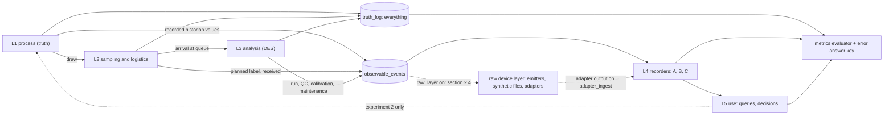
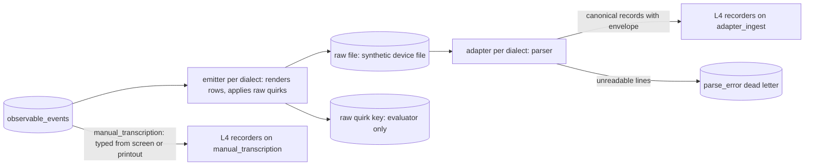
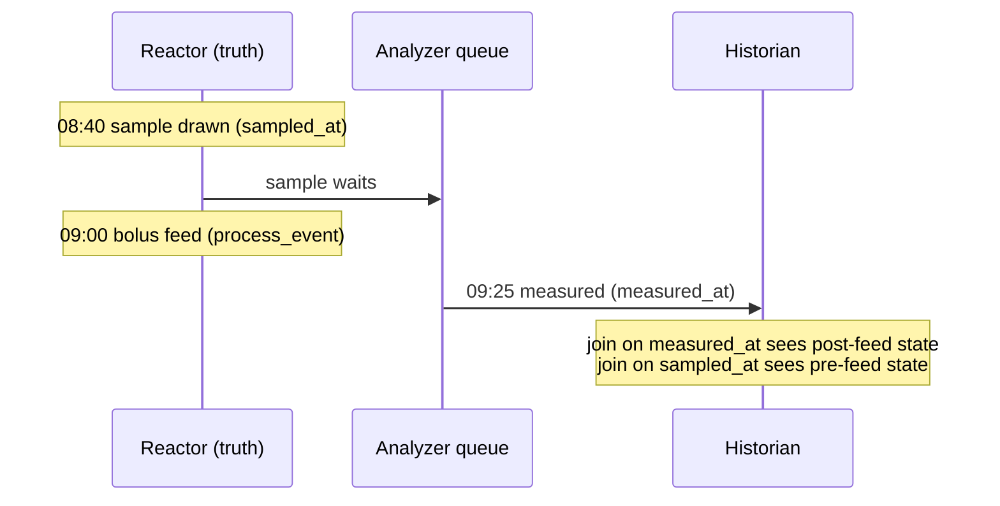
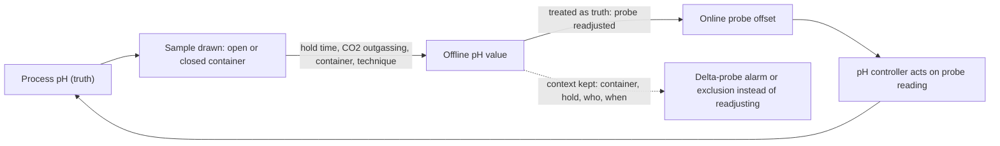
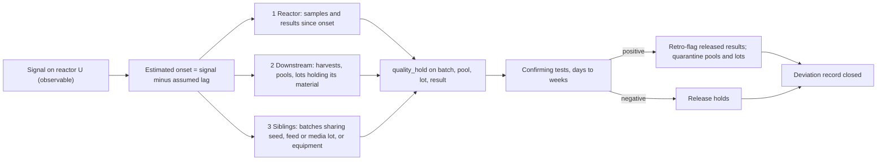

# Simulation specification

Status: design draft, no simulation result exists yet. Synthetic scenario built from public sources and labelled assumptions (ADR-0001). Nothing here predicts a real laboratory. Extensions (cell-line profiles, operating modes, break-out events such as contamination) are designed in section 11 under ADR-0013 and are not built before S2. The raw device layer (synthetic equipment output files and their adapters, section 2.4, ADR-0014) is a scope extension of S2 itself.

How to read the numbers: every number carries a ledger id (`S###` source, `A###` assumption; grades S, P, D, A are explained in `docs/research/README.md`). A number without an id is a defect, not a placeholder. Figures that rest on a source below `main-reread` are provisional and may not appear on the public README or infographic. Table, column and time-field names, and the derived quantities `hold_time` and `turnaround`, are defined once in `docs/design/data_model.md` (sections 2 and 5); this file uses them and does not redefine them.

## 1. Purpose

N bench-scale bioreactors in a process-development (PD) laboratory send in-process samples to M shared at-line analyzers. One synthetic "truth" run is recorded under several data architectures, so the only thing that changes is how data is captured and stored. The simulator shows how an analysis result loses its process context (which reactor, which moment, which instrument state) and what each architecture preserves.

Default: 24 reactors in two bays of 12, 2 analyzers; N from 5 to 100 and M from 1 to 6 (A001, A022; ADR-0009). Average load is low, so waiting comes from bursts, not capacity: 12.6 to 14.4 percent of two analyzers per 10 h staffed window (the default window, A098), 5.2 to 6.0 percent per 24 h clock (A074, grade A). Utilisation is always stated for both windows.

## 2. Five layers

| Layer | Contents | Events emitted | Entities |
|---|---|---|---|
| L1 process (truth) | staggered inoculation, simple kinetics for cells, metabolites and titer (A011), online sensor series at a 60 s cadence (A100), scheduled events | `inoculation`, `process_event` (feed, temperature shift, alarm, harvest), `sensor_tick` | Site/Area/Unit, Batch, ProcessEvent, historian tag |
| L2 sampling and logistics | planned window, actual draw, label, transport, aliquot by storage condition, stability effects while waiting | `sample_planned`, `sample_drawn`, `label_bound`, `sample_received`, `aliquot_created`, `draw_skipped_volume_budget` | Operator, Sample, Aliquot, label method |
| L3 analysis (discrete-event) | queue policy, QC and maintenance windows, reruns, dilution, instrument state, multi-visit routing, setup time | `request_queued`, `visit_started`, `visit_finished`, `run_started`, `qc_result`, `calibration_recorded`, `maintenance_started`, `maintenance_ended`, `result_measured`, `rerun_requested`, `dilution_applied` | Analyzer, InstrumentState, Run, Method |
| L4 recording (the comparison axis) | one recorder per architecture, error injector, event log | `record_written`, `record_corrected`, `flag_raised`, `ingest_received` | Recorder, ErrorInjector |
| L5 use | feed decision, batch comparison, analyst queries, optional model; truth-oracle arm | `query_answered`, `feed_decision`, `probe_restandardised` (experiment 2) | DecisionRule, AnalystQuery |



Between L3 and L4 sits the raw device layer (section 2.4). It is not a numbered layer, so L4 and L5 keep their names. It is off by default.

Time is an integer number of seconds everywhere in the engine. ISA-88 vocabulary is used for the physical model (Site, Area, Unit, Batch).

### 2.1 L1 process

Fed-batch is the default mode (A003): production culture 13 to 17 d (A004, S017; default 14, and the ledger range's 12 d low end comes from a different study, S019), preceded by an N-1 seed of 2 to 5 d (A005), inoculated at 0.5 to 1.5 million cells/mL (A007). Glucose is kept above 1.0 g/L by discrete feeds (A010, S017), so a feed can fall between a draw and its measurement. Peak viable cell density in fed-batch is typically 10 to 30 million cells/mL (A008, S053; the default is a pick inside that range); the perfusion default of 60 million cells/mL rests on one published worked illustration, not a measured run, and is graded P with an unsourced lower range end (A009, S080, S079; provisional). Harvest follows a simulator rule (A013). Perfusion (A006, only one duration sourced) is deferred to session S4.

Kinetics are nutrient-limited growth with first-order death, nutrient use proportional to viable cells and product proportional to integrated viable cells (A011). The constants are ledger entries: growth and death rates (A080, A081), per-cell uptake and production rates (A082, A083, A084), the lactate switch (A085), specific productivity (A086) and the glucose half-saturation constant (A109). They come from a few CHO studies and are provisional.

### 2.2 L2 sampling and logistics

- Sampling pattern: one sample per reactor per day, a second in the feed window on a share of reactor-days (A014, A015); shift-start burst (A016) and shift pattern (A017) are assumptions; transport and preparation time (A018) and draw delay spread (A063) are assumptions.
- Labelling method (handwritten, pre-printed barcode, issued at draw) is an L2 setting, independent of the L4 flags.
- Container model: closed syringe for pH and gases, open cup for cell count and metabolites (A037, proxy). A held-sample effect is applied only as a scenario knob: viability slope default 0 for neat samples (A040), with the observed value kept separately and valid only to 55 min (A038, A039, S012); open-sample pH offset (A041) and relaxation (A042) and closed-sample drift (A043) follow their ledger grades; settling bias and in-tube glucose and lactate change are assumptions (A044, A045); the 30 min maximum hold is a blood-gas proxy (A046).
- Volume budget: each draw consumes a share of the culture (A057, derived). An over-budget draw is skipped and logged, and still counts in every metric denominator.
- Aliquot storage policy by analyte class (A021, assumption).

### 2.3 L3 analysis

Queue policy defaults to first-in-first-out, with priority, earliest-deadline-first and SLA variants (A035). QC time per analyzer per day and maintenance windows are scenario settings (A031); the QC failure probability per QC run is A087 and the maintenance window length is A096. A measurement is repeated with probability A088 for reasons other than range; a result above the over-range limit (A089) is repeated at a higher dilution (A090). Instrument behaviour is assumed and switched on per scenario (A033): the analyzer recalibrates on a fixed interval (A091), a drift random walk accumulates between recalibrations and resets at each one (A092), and a reagent lot change adds a step (A093); inter-instrument bias and habitual assignment are A032 and A034. Result noise follows the analyzer's specification limits for within-run and day-to-day precision (A077, A078) and the counter's repeatability (A079); these are limits, not typical performance. Service times come from the analyzer profile (section 4). A run may not overlap a QC or maintenance window, and a window is checked over the whole run, not only at its start.

### 2.4 Raw device layer (between L3 and L4)

Status: scope extension of S2 under ADR-0014 (Proposed). Off by default (scenario setting `raw_layer`): with it off, recorders consume `observable_events` as before and every earlier scenario keeps a byte-identical event log. It is not a ninth flag (ADR-0005 stays at eight). The raw files are synthetic formats modeled on public documentation; the project does not claim to read any real instrument's files. Every figure here rests on S084 to S103, none of which is `main-reread`, so all of it is provisional. Entities and the field-level mapping are in `data_model.md` section 16; this section owns the emitters, the quirks, the error classes and the metrics.

#### 2.4.1 Path and rules



1. **Emitters read observable data only.** They consume `observable_events` and plain data supplied by the assembly (an instrument's clock offset, its date order, quirk opportunities). They never read truth. The calendar anchor (a synthetic start date) and each instrument's zone offset are scenario data; the engine's integer seconds become wall-clock text only inside an emitter.
2. **Belief and actual are separate.** What the device writes (its date order, units, zone) is scenario data used by the emitter. What the parser assumes is the adapter entry (`data_model.md` section 16.1). A mismatch between them is an injected error, not a parser fault.
3. **Round trip.** With every quirk switch off, parsing an emitted file returns the events it was rendered from, on the mapped fields and within the dialect's time resolution. This is an EDD fixture typed by hand.
4. **Fair by construction.** Quirk opportunities are drawn once per row or file with the canonical key tuple of section 3 and purpose `raw:<quirk id>` (a file-level draw uses the export id in place of the sample). They do not depend on the architecture or on detection. The same raw files reach every architecture; detection only raises flags.
5. **Capture path.** What happens to a file is the `capture_path` setting (section 5, "Capture path"), not a property of a preset. On `adapter_ingest` (the default of B and C) the adapters parse the files. On `manual_transcription` (the default of A) a person types the result from the instrument screen or printout, no adapter runs, and the raw-layer metrics read "not applicable". Any preset may take either path. The files are emitted either way, from the same draws.
6. **Raw quirk key.** The emitters return the realised quirks as plain data (file, row, quirk id, intended value or instant); the assembly writes them to the answer-key file, and only the evaluator reads it (section 3, rule 2).
7. **ADR-0014 rules.** Every emitted file starts with the line "synthetic, modeled on public documentation; not a real instrument file". A dialect lists the `S###` ids it is modeled on, uses its own short field names, and copies no manual text. Dialect, profile and file-name prefixes are vendor-neutral.

#### 2.4.2 Dialects

Dialects are profile data (ADR-0012): analyzer dialects under `scenarios/profiles/dialect/`, controller families under `scenarios/profiles/controller/`. There is one generic emitter and one generic parser; the engine never branches on a dialect id. No ledger bundle exists yet for a dialect, so the grade shown is the weakest of the entries cited, and parts that no source shows are marked assumed.

| Dialect | Used by | Shape of the synthetic file | Modeled on | Weakest cited grade |
|---|---|---|---|---|
| `allinone_csv` | `allinone_atline`; the chemistry side of `split_cellcounter_metabolite` (the stand-in of A070) | one CSV per operator export, named with a neutral prefix and the export time (A159); quoted header row, optional units row, one row per analysis, trailing comma, blank cell where a value is absent (A160); local stamp with no zone, date order, separator and 12 or 24 h per instrument (A161); units per analyte (A162); record fields (A165); the over-range note form is assumed (A163) | S003, S038, S086 | A (A161 default and A163 form are assumed) |
| `counter_csv` | the counter side of `split_cellcounter_metabolite` | one CSV per sample set; units in the column headers; stamp month, day, year, 24 h, to the minute, no zone (A166); optional append mode that repeats earlier rows (A167) | S084, S085, S086 | P |
| `cds_table` | `hplc` | a user-designed result table: columns and their order come from a template (A168); one row per injection or per peak; retention time in seconds and area in mAU*s (A168); the titer amount column is assumed (A168); a new result id per processing run (A169) | S088, S089, S090, S091 | P |
| `ctrl_neutral` | controller family 1 | three logs: tag log (UTC stamp with offset, tag, value, quality), alarm log, batch-phase log; tag name is unit tag, signal and role (A171); ISA-88 hierarchy and phase states (A170); ISA-18.2 alarm states (A174) | S093, S094, S095, S097, S101 | P |
| `ctrl_bench` | controller family 2 | five record types as separate CSV exports: process data, user events, alarms, recipe steps, errors; each variable logged by deadband and maximum log interval (A172); the unit sits in parentheses in the variable name (A171); alarm rows carry the acknowledging user and time (A174, S099); the CSV column layout is not in the text read, so it is assumed | S099 | P (layout assumed) |

| Analyzer profile (section 4.2) | Dialect or dialects |
|---|---|
| `allinone_atline` | `allinone_csv` |
| `split_cellcounter_metabolite` | `counter_csv` for the counter visit and `allinone_csv`, chemistry columns only, for the metabolite visit (A070) |
| `hplc` | `cds_table` |

A bay uses one controller profile. The default raw-layer scenario puts one bay on each family, which is a design choice and no claim about any site. Analyzer exports run once per instrument at the end of each staffed window (A098, assumed); controller logs are cut one file per record type per day. Neither schedule has a source. The OPC-style tag records of the all-in-one analyzer (UTC stamp and a separate local offset, A165, S004) are not emitted; they are the contrast case for the stamp without a zone and are parked (YAGNI).

#### 2.4.3 Raw quirks

Each quirk is a behaviour of the raw file that a parser must handle. The test of each is a Given-When-Then in the S2 brief named after its id.

| Id | Quirk | Emitted by | What the adapter does | Ids |
|---|---|---|---|---|
| RQ1 | Stamp with no zone: local wall-clock text, no offset | `allinone_csv`, `counter_csv`; `cds_table` and `ctrl_bench` by assumption | the zone comes from the adapter entry (the instrument's configured zone); the UTC instant is stored beside the source zone (K14); a missing zone in the entry makes the stamp unresolved (VR-024) | A161, A166, A168, S099, S029 |
| RQ2 | Date order, separator and clock style are user settings: 3 orders, 3 separators, 12 or 24 h; default year first, '-', 24 h. A day of 12 or less reads validly under two orders; a 12 h clock without a day-part marker is ambiguous | `allinone_csv`, `ctrl_bench` | the entry pins the order. If it says unknown, one row with a day above 12 pins it for the whole file (resolved); if none does, the stamp is unresolved and the row is quarantined (VR-024). If the entry pins the wrong order, the stamp is read as a valid but wrong instant (resolved wrongly) and the adapter cannot know | A161 |
| RQ3 | Stamp truncated to the minute | `counter_csv` | `measured_at` carries a resolution of one minute (`time_resolution_s`); rows in one minute keep file order | A166 |
| RQ4 | Repeated rows: append mode repeats earlier rows; overlapping operator exports repeat selected rows; a transfer retry drops a file twice (scenario switch, any dialect) | `counter_csv` (append), `allinone_csv` (overlap), any dialect (replay) | `source_event_id` is the dialect's natural key (instrument, row stamp, sample id); same key and content is a no-op where `ingest_idempotency` is on (VR-008), same key and different content is quarantined (VR-008b), and with the flag off every copy loads | A167, A159 |
| RQ5 | Reanalysis: a new row with a new row time while the original sample time stays in its own field; a processing run in the data system gets a new result id. Scenario-scripted, no random rate (no source) | `allinone_csv`, `cds_table` | result version n+1 of the same measurement: `measured_at` keeps the original sample time and the new row time is the envelope's `event_time`; version n absent from the store is VR-019 | A164, A169 |
| RQ6 | Range and error marking: an analytical-range breach is a blank value plus an error note naming analyte and direction; a process-range breach is a status only; a blank cell also means an analyte not measured | `allinone_csv` | blank value with a range note becomes a null value with a `range_flag`; a blank value for an analyte the method requires, with no note, is held (VR-026). The CSV form of the note is assumed | A163, A160 |
| RQ7 | Units row absent: units are implied by the instrument's settings | `allinone_csv` (optional row); `counter_csv` and `cds_table` state units in the header and do not emit it | units come from the adapter entry; if the instrument's setting differs, the value is read in the wrong unit without notice; only VR-005 (dimension) or VR-006 (implausible value) can catch it | A160, A162 |
| RQ8 | Template-defined columns: the user chooses the column set and order | `cds_table` | columns are mapped by role through the template map in the entry, never by position; an unknown column is an information finding; a required role missing rejects the file (VR-023) | A168 |
| RQ9 | Deadband and maximum-interval logging: a value is logged when it moves by its deadband or the maximum log interval has passed; the series is irregular. An optional historian exception stage is off by default | `ctrl_neutral`, `ctrl_bench` | rows load as received, never interpolated; context at a time uses the last row at or before it (`data_model.md` section 16.4) | A172, A173 |
| RQ10 | Alarm state changes: one row per transition, acknowledge and return-to-normal as separate events; the bench family records the acknowledging user and time | `ctrl_neutral`, `ctrl_bench` | one `alarm_event` per row, never merged; a transition the state model does not allow is held (VR-025) | A174, S099 |
| RQ11 | Batch phase transitions: ISA-88 procedure, unit procedure, operation and phase, with the 13 phase states | `ctrl_neutral`, `ctrl_bench` (recipe steps) | one `batch_phase_record` per row; a transition the model does not allow is VR-025 | A170, S099 |

The clock offset of an instrument (A049, example +5 h) is not a quirk but an injected error: the emitter shifts every stamp of that instrument, and RQ1 makes the shift undetectable from the file alone. Alarm limits with a deadband and an on-delay (A175) are kept for a later limit-based alarm rule; S2 renders the scenario's scheduled `alarm` events only (YAGNI).

Events emitted by the layer. Observable: `export_written` (file name, export instant on the instrument clock, row count), `reanalysis_done` (L3, scenario-scripted), `raw_file_received` (host clock), `record_parsed`, `parse_error_raised`. Nothing here adds a truth event.

#### 2.4.4 Controller signals

| Signal (canonical name) | Roles logged | Series in L1 today | Note |
|---|---|---|---|
| `pH` | PV, SP, OUT | yes (A100) | control deadband around the set point is A095 |
| `DO` | PV, SP, OUT | yes (A100) | |
| `temperature` | PV, SP, OUT | yes (A100) | the set point changes at the scheduled temperature shift |
| `agitation` | PV, SP | no | the default log deadband of the agitation PV is 0.5 rpm (A172) |
| `gas_flow_<gas>` | PV, OUT | no | gas names are scenario data |
| `feed_pump`, `base_pump` | OUT | no | the feed pump follows the scheduled feed events (A010) |
| `offgas_CO2` | PV | no | |

L1 produces the series named in A100 only. The other signals must come from L1 as new `sensor_tick` signals when `raw_layer` is on (they depend on hidden process state, which an emitter may not read) and are absent otherwise, so layer-off logs stay byte-identical. SP and OUT are computed by a generic controller rule from the observable PV and the scenario's set points; they add no truth quantity. No ledger parameters exist yet for these signals (section 2.4.8).

#### 2.4.5 Adapter output

Entity-level mapping; the field-level mapping, keys and states are in `data_model.md` section 16.

| Dialect | Raw record | Becomes |
|---|---|---|
| `allinone_csv` | one analysis row | a `run` and one `result` per analyte; a reanalysis row is result version n+1 |
| `counter_csv` | one analysis row | a `run` and the `result` rows for count, viability and size |
| `cds_table` | one injection or peak row | a `run` per injection and a titer `result` from the amount column |
| tag log or process data | one tag value | a `historian_value` |
| alarm log | one transition | an `alarm_event` |
| phase log or recipe steps | one transition | a `batch_phase_record` |

Every file becomes a `raw_file`, every data line a `raw_record`, every unreadable line a `parse_error`, and every loaded row carries the ingestion envelope of `data_model.md` section 7 with `raw_ref` pointing at its line.

#### 2.4.6 Error classes that now start in the raw file

| Existing error class (section 5 matrix) | Raw-level origin |
|---|---|
| label or transcription error | the sample-id text the operator typed at the analyzer; the file carries it unchanged and the adapter passes it through (VR-014 still applies). This holds on both capture paths; the copy step of `manual_transcription` adds result transcription errors (section 5, "Capture path") |
| clock or time-zone error (A049) | the instrument's clock offset in every stamp (RQ1), plus the unpinned or wrong date order (RQ2) |
| duplicate or replayed file | repeated rows and replayed files (RQ4) |
| lost rerun or silent overwrite | reanalysis rows (RQ5): with `append_only_versions` off, version n+1 overwrites version n |

Two classes are new and appear as rows of the section 5 matrix: timestamp misread (RQ2, RQ3) and a unit implied by instrument settings that changed (RQ7). The other classes (feed in the gap, unit or batch re-keyed, instrument or lot effect, late correction, unattributable record, sampling technique) do not arise in a file and are unchanged.

#### 2.4.7 Metrics

Same rules as section 8: reported with the seed count and spread, never gated, no composite score. They read the raw quirk key and are reported for every run whose capture path is `adapter_ingest` (by default B, C and the ablations of C). A run on `manual_transcription` shows "not applicable", never zero. Denominators are fixed.

| Metric | Definition | Denominator |
|---|---|---|
| Parse failure rate | raw data rows rejected as unreadable (VR-023); every row of a rejected file counts | all raw data rows the emitters wrote, including repeated rows and rows of replayed files |
| Ambiguous timestamps | three shares: resolved correctly (the parsed instant equals the intended instant in the key), resolved wrongly (another valid instant), unresolved (quarantined, VR-024) | all raw rows whose stamp text is ambiguous under the formats in play, by the key; if none, "none occurred" is printed and no share |
| Duplicate rows suppressed | repeated rows (second and later copies) that were no-ops (VR-008); the share loaded twice and the share quarantined (VR-008b) are printed beside it | all repeated rows written; if none, "none occurred" |
| Records quarantined or held at ingest | rows with action quarantine and rows with action hold from the ingest-stage rules (VR-005, VR-006, VR-008b, VR-019, VR-024, VR-025, VR-026), counted separately | all raw data rows received. Always shown with the share of clean rows (no realised quirk or error in the key) that were quarantined or held, over all clean rows, and with the exact reconstruction rate of section 8, so that quarantining everything cannot look good |

#### 2.4.8 Gaps to close before building

The research role adds these ledger entries (graded A where unsourced) before the step that needs them starts; an executor never invents a number.

- Log deadband and maximum interval for tags other than the agitation PV (A172 gives one default and one worked example only).
- Signal parameters for gas flows, pumps and off-gas CO2 (A100 covers pH, DO and temperature) and the controller rule that computes OUT.
- Acknowledge and return-to-normal times of a scheduled alarm (A174 has no timing); alarm deadband and delay for pH and DO (A175).
- The meaning of an analyzer row stamp (start or end of the run) is not in the ledger; the dialect declares it and the default, end of run, is an assumption (A161, A166, S003).
- The CSV form of the over-range note (A163), the titer amount column (A168), the column layout of the bench controller (S099) and the zone convention of the data system (A168) are assumed and printed as assumed.
- Summer-time changes in device stamps and any random reanalysis rate have no source and are not modelled.
- Manual-path entry errors: a typed result value, a unit slip and the delay between a result and its entry have no ledger entry of their own. A047 and A061 are labelling entries (a clinical proxy), and whether A047 may also stand for a typed value is a judgement for the research role; A048 covers the manual dilution factor. Until entries exist, a manual-path run reports these classes as "not modelled" and builds the sample-id, clock and dilution classes only.
- Whether a dialect's dilution field carries a manual pre-dilution factor (A165, A090, A048) is not settled. Until it is, that factor is typed by hand on both capture paths, and the limit "dilution factor typed by hand" of preset B stands.

#### 2.4.9 Where it sits in S2

It is built after the flags, the injector, the evaluator and the structural gate (Steps 1 to 4 of `prompts/20_S2_capture_metrics.md`), as Steps 5 to 8 of that brief. Its gate is structural: the round-trip fixture, one Given-When-Then test per quirk (RQ1 to RQ11), idempotent re-ingest, the forced-error cells of the matrix rows that depend on the raw layer or on the capture path, one cell per path, and the three-rules checklist. No scenario id is added; SC1 and SC6 are re-run with the layer on, each preset on its default capture path, and SC6's clock offset then lives in the file stamps (on `manual_transcription`, in the stamp read from the printout). The capture-path contrast of section 5 runs on SC1 with the layer on. Stochastic raw-layer metrics are reported over at least 20 seeds (A103) and are never gated.

## 3. Truth, recorded world and the observation contract

The engine emits two streams.

- `truth_log`: everything, including hidden quantities (true analyte values at draw, true pH, true instrument bias) and the true time of every event.
- `observable_events`: what a person or an instrument could see: sample drawn with its planned label, received, run started with instrument and QC lot, QC result, calibration record, maintenance log, recorded historian values. Times here are recorded stamps. The error injector can skew an instrument clock (A049, example offset +5 h), so a recorded `measured_at` can differ from the truth event.

Rules (invariants, tested):

1. Recorders (L4) consume `observable_events` only (with the raw layer on, a run on `adapter_ingest` consumes the adapter output, which is `observable_events` rendered through a synthetic device file, section 2.4, and a run on `manual_transcription` consumes the typed results, which are `observable_events` after the transcription step of section 5) and never read truth. Hidden fields are annotated `"x-visibility": "hidden"` in the schemas. Test: change hidden-only fields and the recorder output must be byte-identical.
2. Who may read truth. The metrics evaluator reads truth, because it must in order to score, and it is the only reader of the error answer key (the record of which errors the injector materialised where). Experiment assembly (drawing the shared truth run and the error opportunities) and the oracle arm of experiment 2 may also read truth. Recorders and L5 (analyst queries and decisions) never do.
3. Same `(scenario, seed, engine_version)` gives a byte-identical event log. Randomness comes from a keyed integer generator with key (physical sample, analyte, attempt, purpose); experiment 2 adds `seed` and `reactor`. A rerun or an added sample never changes another sample's draws.
4. Every export and shareable URL carries `schema_version`, `engine_version` and `seed`.
5. As-of: a decision or query at time t uses, per logical key, the latest result version with `available_at` at or before t, and historian rows with `ingested_at` at or before t (data_model section 5). An architecture without the flag `available_at` sees rows as of now instead.

## 4. Profiles

Scenarios pick profiles. Profiles are data under `scenarios/profiles/{bioreactor,analyzer,staff}/`; each numeric parameter is `{value, unit, ref}` with `ref` resolving to a ledger id (ADR-0012). A bundle takes the grade of its weakest component, in the order S, P, D, A, so a bundle with a derived part is D, not S, and one with an unsourced part is A. The bundle grades in the tables below are those of the ledger bundles A065 to A073.

### 4.1 Bioreactor

| Profile (default first) | How samples are taken | Sample as share of culture | Bundle grade | Ids |
|---|---|---|---|---|
| `bench_manual`: 2 to 5 L glass or single-use | operator draws into a closed container or syringe | 0.014 percent | D (volume share derived, A057; the closed-container model is a proxy, A037) | A067, A002, A057 |
| `micro_mini_parallel`: micro-scale 10 to 15 mL, 24 or 48 vessels; mini-scale 100 to 250 mL, 12 or 24 vessels | automated liquid handler into a cup | micro 4.8 percent; mini 0.31 percent (0.16 to 0.7) | D (volume share derived, A057) | A065, A066, A057, S009, S011 |
| `pilot`: 50 to 250 L single-use (class boundary assumed, A104) | sterile syringe from a sampling line | 0.00055 percent, analyzer volume only | A (boundary and purge volumes unsourced) | A068, A057, A104, S036 |

On micro-scale systems the number of samples consumes the culture: 14 daily samples would draw 67 percent of the vessel (A057, derived), which is why the source calls sampling a burden there (S011). Pilot line purge and discard volumes are not sourced and are not modelled (A105). Automation also changes who creates the label, whether an operator is present, whether draws burst at shift start, and the delivery order (a vessel-order autosampler makes high-numbered vessels wait longest).

### 4.2 Analyzer

| Profile (default first) | Service and volume | Consequence | Bundle grade | Ids |
|---|---|---|---|---|
| `allinone_atline` (FLEX2 class) | 4.5 min stand-alone (270 s on the distributor page, 275 s in manual mode per the instruction manual), 6 to 8 min coupled to a parallel system; 275 uL on the distributor page against 265 to 350 uL in the manual, or 400 to 700 uL coupled; ceiling about 13.3 samples/h | one queue, one file, one clock | D (the capacity ceiling is derived) | A069 (its components include A019, A020, A023, A075), S001, S003, S007 |
| `split_cellcounter_metabolite` | 130 s plus 120 s = 250 s (4.2 min) of instrument time over two visits, plus a hand-off between them (A106); 200 + 135 = 335 uL | two queues; the two results can be measured at different times and carry different clocks | A (hand-off unsourced) | A070 (its components include A025, A026, A106, A107), S005, S006 |
| `hplc` (titer) | 1 min run, 5 to 50 uL injection; column changeover and system-suitability time is assumed | shared column is the contested resource | A | A071, A028, A029, A030, S026 |

The 250 s and 335 uL figures are sums of stand-alone sourced numbers (derived). On the same analyte scope (cells, viability, metabolites, electrolytes) the all-in-one panel takes 235 s and 135 to 220 uL, so the split path needs about 1.06 times the instrument time and 52 to 148 percent more sample (A107, derived). The full 16-analyte menu (A116) is a different scope and is not compared. The metabolite side uses the FLEX2 chemistry module as a stand-in (A070). Interface: shared-folder CSV drop by default; a vendor OPC server is a separately licensed alternative (A036). With the raw layer on, each profile writes a synthetic file in the dialect of section 2.4.2. Calibration behaviour (drift, resets, lot change) is assumed (A033).

### 4.3 Staff

| Profile | Count variability | Label errors | Delay and technique | Bundle grade | Ids |
|---|---|---|---|---|---|
| `experienced` | manual 2.81 percent CV between operators, automated 0.46 percent (bead study); counting-statistics floor 5 percent (range 3.3 to 7.1) | 6.1 per 1000 (clinical proxy) | delay spread 5 min, technique error 0.02 (assumed) | A | A072, A058, A059, A060, A047, A063, A064 |
| `trainee` | manual CV times 2 (assumed), automated unchanged | 6.1 per 1000 times 2 (assumed) | delay spread 12 min, technique error 0.10 (assumed) | A | A073, A076, A062, A063, A064 |

What is sourced is narrow (A058, A059, A060, A047). The effect of training on label errors could not be established, and standardised labelling protocols are the lever with evidence (A061, S024, proxy). Roster and fatigue are assumptions: the staffed window is 10 h per day with two operators per shift and a trainee share of zero as a scenario knob (A098; shift pattern A017), and the fatigue multiplier on delay spread and technique error late in a shift is off by default (A099). Operator hands-on time per sample at the analyzer is A101. Operator id and qualification reference ride on the `audit_trail` flag.

### 4.4 Generic engine mechanisms

Multi-visit routing, sequence-dependent setup, volume budget, rate multipliers and delivery order. The extensions add a per-reactor parameter draw, material-lot consumption and an event script (section 11.1). Nothing in the engine branches on a profile id, scenario id or architecture id.

## 5. Data architecture = feature flags

The flag definitions and the expected outcome per flag are owned by ADR-0005; this section repeats the table so the spec reads on its own and must say the same.

| Flag | On | Off | Error it targets |
|---|---|---|---|
| `system_issued_id` | key issued by the system at label creation | key typed or handwritten | label and transcription errors (A047, A061) |
| `two_clocks` | `sampled_at` and `measured_at` stored separately | one time stored, the measured time; `sampled_at` is not stored | alignment error, feed-in-the-gap mis-join |
| `available_at` | each row carries when it became knowable | queries see rows as of now | time-travel leakage |
| `instrument_state_snapshot` | run links instrument, calibration, reagent lot | free-text analyzer name at most | instrument effect read as process effect (A032, A033) |
| `append_only_versions` | correction, rerun, reprocess create versions | overwrite in place | lost reruns, silent edits |
| `write_time_keys` | `sample_id`, `unit_id`, `batch_id` fixed at write time and never re-keyed; it does not own `sampled_at` | unit and batch attached later by a time join against the historian and batch record, using the stored time | misattribution, mis-joined context |
| `ingest_idempotency` | source event id and key; duplicates and replays are no-ops | duplicates double count | duplicate or replayed files |
| `audit_trail` | who, when, what changed; operator id and qualification | no history | unattributable records |

Planned time is separate from `two_clocks`. A sampling plan that issues the label (`system_issued_id`) gives the sample a `planned_at`; keeping it, and not the actual draw time, is a limit of preset B that comes from the L2 labelling setting and the L4 recorder, not from the definition of `two_clocks` off. With `two_clocks` off the single stored time is always the measured time.

| Preset | Flags on | Labelling default | Capture path default (layer on) | Realistic limits kept |
|---|---|---|---|---|
| A manual/Excel | none | handwritten | `manual_transcription` | transcription, one stored time (the measured time), overwrite, no instrument id |
| B LIMS-lite | `system_issued_id`, `ingest_idempotency`, `audit_trail` | pre-printed barcode | `adapter_ingest` | records the planned time (from the plan that issues the label), not the actual draw time; reagent lot and calibration not linked; dilution factor typed by hand; joined to the historian by the one stored time, the measured time. B is not a straw man: barcodes, automatic capture and an audit trail exist |
| C context-preserving | all eight | issued at draw | `adapter_ingest` | keys fixed at write time; process context as a versioned as-of projection joined with `AS OF`; residual error remains, such as a correct barcode stuck on the wrong tube |

- Labelling method is set independently of the flags; scenarios may cross them.
- Capture path is a second setting, also independent of the flags and the labelling method: any preset may override its default (A with `adapter_ingest`, C with `manual_transcription`). It is defined under "Capture path" below.
- Ablation: C with exactly one flag off, for each flag (eight runs). The expected outcome per flag is stated in ADR-0005.
- The system of record for routine in-process results (MES/EBR or LIMS) differs by site and is a setting (A056, SC11); only release-relevant tests get state-machine and Part 11-grade control.

Hypothesis matrix (a design hypothesis to be tested in session S2 by forced-error fixtures, section 6; not a result). Rule ids are in data_model section 8.

| Error type | Prevented by | Detected by | Invisible when |
|---|---|---|---|
| label or transcription error | `system_issued_id` | duplicate and plausibility rules (VR-009, VR-014) | handwritten, no checks |
| feed in the gap (wrong time for the join) | `two_clocks` (the join uses `sampled_at`) | hold-time rule on `hold_time` (VR-010), which needs both clocks | one time stored, joined by measured time |
| unit or batch re-keyed or mis-joined after write | `write_time_keys` | no-open-batch rule for gross cases (VR-020) | keys attached later by a time join |
| clock or time-zone error (A049) | none | `two_clocks` plus clock rule (VR-004; S029, S030) | one time stored |
| duplicate or replayed file | `ingest_idempotency` | idempotency log | no keys |
| lost rerun or silent overwrite | `append_only_versions` | `audit_trail` | overwrite in place, no history |
| instrument or lot effect | none | `instrument_state_snapshot` with a bridging study (`control_id`) | no instrument link |
| late correction leaking into an earlier decision | `available_at` | as-of query (section 3, rule 5) | queries see rows as of now |
| unattributable record | `audit_trail` | qualification check (VR-015) | operator free text or absent |
| sampling technique error (A064) | none | recorded container and hold context | context not recorded |
| timestamp misread (date order or 12/24 h, RQ2; minute-truncated stamp, RQ3) (raw) | none; the adapter entry's setting is not an architecture flag | VR-024 when the order cannot be pinned; VR-003 when the misread instant lies later than receipt; VR-002 with `two_clocks` when it lies before `sampled_at` | the misread instant still lies between the draw and receipt; it then shows only as alignment error |
| unit implied by instrument settings, changed (RQ7) (raw) | none | VR-005 on a dimension mismatch; VR-006 on an implausible value | same dimension and a plausible magnitude |
| result transcription error: a wrong digit, unit or dilution factor typed from the screen or printout (manual) | none among the flags; `adapter_ingest` removes the copy step, which is a path and not a flag | VR-005 on a dimension mismatch; VR-006 on an impossible value; VR-013 on a missing or implausible dilution factor | the typed value is plausible, in the right dimension, with a plausible dilution factor |

Rows marked (raw) exist only with `raw_layer` on and `capture_path` `adapter_ingest`, because they arise in a file. Rows marked (manual) exist only with the layer on and `manual_transcription`. On the other path such a row reads "not applicable", never zero. The origin of four earlier rows moves into the raw file with the layer on (section 2.4.6), and "duplicate or replayed file" then also needs a file to parse, so it arises only on `adapter_ingest`.

### Detection rules and the flags they need

A rule can only fire on fields that are stored. For every detection mechanism named in the matrix above, the table lists the flags that must be on for the rule to have the fields it reads, the other data it reads, and when it cannot fire. It is derived from the rule definitions in `data_model.md` sections 5 and 8, and it is a design hypothesis for the forced-error fixtures of section 6, not a result. Flag names are exactly those of the flag table above. Rows marked (ext) belong to the extensions (section 11) and are checked from S5.

| Rule or mechanism | Flags that must be on | Other data it reads | Cannot fire when | Matrix row |
|---|---|---|---|---|
| VR-009 possible double label | `two_clocks` | `unit_id`, `sample_id` and analyte of two samples | `sampled_at` is not stored (only the measured time is kept) | label or transcription error |
| VR-014 label matches no open request | `system_issued_id` | the list of open `analysis_request` rows (the registry of issued keys) | keys are typed or handwritten, so there is no registry to compare with; a typo that matches another open request passes | label or transcription error |
| VR-010 hold time above the limit (A046, A039) | `two_clocks` | `run_started_at` | only the measured time is stored; unreliable while an instrument clock is skewed | feed in the gap |
| VR-020 no open batch at sampling time | `two_clocks` | `unit_id` and the batch open interval | `sampled_at` is not stored; a mis-key onto another unit that has an open batch passes (gross cases only) | unit or batch re-keyed or mis-joined |
| VR-004 clock or time-zone mismatch (S029, S030) | `two_clocks` | the instrument's configured zone (master data); `ingested_at` against `measured_at`; the skew shows against `sampled_at` | one time stored; `ingested_at` not stored (data_model open question 7) | clock or time-zone error |
| Idempotency log (VR-008, VR-008b) | `ingest_idempotency` | `source_system`, `source_event_id`, `idempotency_key`, content | the flag is off: no keys, duplicates double count | duplicate or replayed file |
| Audit review (the `audit_event` history) | `audit_trail` | who, when, what changed, old and new version | the flag is off: no history of the change | lost rerun or silent overwrite |
| Bridging comparison (requests sharing a `control_id`) | `instrument_state_snapshot` | `control_id`, `instrument_state_id` on `run`, bridging samples in the plan | no instrument link, or no bridging samples planned | instrument or lot effect |
| As-of query (section 3, rule 5) | `available_at`, `append_only_versions` | `available_at` of each result version; `ingested_at` of historian rows | `available_at` off: queries see rows as of now; `append_only_versions` off: the earlier version no longer exists | late correction leaking into an earlier decision |
| VR-015 qualification check | `audit_trail` | `operator_id`, qualification validity dates | the operator is free text or absent | unattributable record |
| Container and hold context check | `two_clocks` (for the hold part) | recorded container (L2 setting), `hold_time` | the container is not recorded; one time stored | sampling technique error |
| VR-023 (raw) line or file cannot be read into the canonical fields | none; adapter stage, every parsing architecture | the dialect and the adapter entry (template map, unit map); the raw text | the run is on `manual_transcription` (no adapter) | not in the matrix (a load failure; the line goes to `parse_error`) |
| VR-024 (raw) stamp ambiguous and not resolvable | none; adapter stage | the entry's date-order setting (unknown) or a 12 h clock without a day-part marker; the other rows of the file | the entry pins an order, right or wrong: the stamp is then never ambiguous to the adapter (a wrong pin is the invisible case of the matrix row) | timestamp misread |
| VR-025 (raw) alarm or phase transition not allowed by the state model | none; adapter stage | the previous `alarm_event` or `batch_phase_record` of the same instance | the log starts mid-instance (the first row seen is accepted); a skipped intermediate state in a truncated log looks like an illegal transition | not in the matrix |
| VR-026 (raw) blank value with no range or error note | none; adapter stage | the method's list of required analytes; the note column | the method lists the analyte as optional | not in the matrix (feeds the exact reconstruction rate) |
| VR-005, VR-006, VR-013 (manual) on a typed entry | none; recorder stage, every architecture on `manual_transcription` | the method's expected unit and dimension, the plausible range of the analyte, the dilution rule (data_model section 8) | the typed value is plausible, in the right dimension, with a plausible dilution factor | result transcription error |
| VR-021 (ext) lot recorded as used, no consumption edge | `write_time_keys` | `process_event` lot reference against `lineage_edge` relation `consumed_in` | the lot is free text only (subset schemas) | not in the matrix |
| VR-022 (ext) result still released under an open hold | `available_at`, `append_only_versions`, `audit_trail` | `quality_hold` target and placement time, lineage from the target to the result | no lineage edge from the held target to the result; it fires late by design, after the release | not in the matrix |

### Capture path (a setting, not a flag)

`capture_path` says how a result that an instrument has produced becomes a record in the architecture's store. It is a scenario setting like the labelling method: independent of the eight flags, never a ninth flag (ADR-0005 stays at eight), with a default per preset (preset table above). It records the author's decision of 2026-10-29 (ADR-0014, Proposed): start from the primitive method, results copied by hand, and offer automatic linkage as an option.

| Value | What happens |
|---|---|
| `manual_transcription` | A person reads the instrument's screen or printout and types the result into a spreadsheet or form. No adapter runs and nothing parses the raw file. |
| `adapter_ingest` | The raw file of the device dialect (section 2.4.2) is parsed into canonical records with the ingestion envelope (section 2.4.5). |

1. **Scope.** The setting is read only with `raw_layer` on. With the layer off no device file exists, neither path is modelled, recorders consume `observable_events` as before and every earlier scenario keeps a byte-identical event log. A scenario that sets `capture_path` with the layer off fails validation, because a silent no-op would mislead.
2. **Independence.** The path decides which error classes can arise at capture (table below). The flags decide what the recorder keeps and what it can detect, as in the flag table; for example `ingest_idempotency` acts on a source event id of a parsed file, and a typed row has none (`data_model.md` section 16.3). Runs of C minus one flag keep C's default path.
3. **Analyzer results only.** A person can copy a result but not a tag log. Controller logs are machine files: on `adapter_ingest` they are parsed (RQ9 to RQ11); on `manual_transcription` the historian values reach the recorder as observable events, as with the layer off, and no alarm or phase records exist.
4. **The transcription step.** On `manual_transcription` the typed value is the observable result after the error injector has materialised the entry-error opportunities (S2 Step 2). No emitter or adapter is involved, and the raw files are still emitted from the same draws, as what the person reads.
5. **Fair by construction.** Entry-error opportunities (purpose `error:<type>`) and raw quirk opportunities (purpose `raw:<quirk id>`) are drawn once per sample or row from the canonical key tuple of section 3, independent of the path, the architecture and detection. The path only decides which of them materialise, with the monotone coupling of S2 Step 2. The truth-log hash is identical across paths.

| Item | `manual_transcription` | `adapter_ingest` |
|---|---|---|
| Result value, unit, dilution factor and sample id as copied | typed from the screen or printout: result transcription error, unit slip, dilution slip, wrong row or sample (rates and gaps: section 2.4.8) | read by the parser; there is no copy step, so none of these |
| Late entry | the row is typed after the result was produced; `ingested_at` is the entry time, and so is `available_at` where that flag is on | `ingested_at` is the file's `received_at` |
| Sample-id text typed at the analyzer (section 2.4.6) | present | present, passed through |
| Instrument clock offset (A049) | present: the printout carries the wrong stamp | present: in the file stamps (RQ1) |
| File quirks RQ1 to RQ8 | none; no file is parsed | present |
| Controller quirks RQ9 to RQ11, alarm and phase records | none; no log is parsed | present |
| Ingest metrics of section 2.4.7 | "not applicable" | reported |
| Raw tables of `data_model.md` section 16 | not stored | stored for any architecture on this path; the flags still decide what the recorder keeps |
| Provenance of a result | `capture_path`, `entered_by`, entry time as `ingested_at` | `capture_path`, `raw_file_id` and line, adapter id and version through the raw file |

**Automatic linkage alone (capture-path contrast).** For one scenario and one seed list, run a preset on each path with the truth run, the flags and the labelling method unchanged. A on `manual_transcription` against A on `adapter_ingest` shows what automatic linkage does by itself, ablation-style: one setting changes, as in the runs of C minus one flag. C on `manual_transcription` against C shows what the flags cannot repair when capture is by hand; B likewise. Pair by seed (common random numbers), and report per section 8 metric the median and interval of the paired difference with the seed count (at least 20, A103) and the section 8 denominators. The ingest metrics of section 2.4.7 exist on one side only, so they are shown as "not applicable" on the other and never as a difference. The contrast is a stochastic comparison: it is reported and never gated, and no test asserts a sign, a size or an ordering of the two paths.

**What is gated is structural.** For each matrix row and rule that depends on the path ("(raw)" and "(manual)" above), one forced-error cell per path with the expected outcome (prevented, detected, invisible or "not applicable") typed by hand, and one hand-built sample taken through both paths with the expected record under each typed by hand. The fixtures and tests are in `prompts/20_S2_capture_metrics.md`.

## 6. Experiments

**How experiments are judged.** The gate for the recorders (session S2) is structural. Each flag has a forced-error fixture: one hand-built sample with one forced error of a known type, recorded under C, under C with that flag off, and under A and B. The expected outcome of every case (prevented, detected or invisible) is typed by hand before any run, from the matrix in section 5 and ADR-0005; the engine does not produce it. Stochastic comparisons between architectures run over at least 20 seeds (A103) and are reported with intervals. They are never gated, and no test requires an ordering such as "C must win" or "recall higher on every seed". Residual failures of C are reported.

### 6.1 Experiment 1 (primary, open loop)

One truth run per `(scenario, seed)` is shared by every architecture. Step durations are identical across architectures. Error opportunities (label error, dilution transcription, clock misconfiguration, technique error and similar) are drawn once per sample, independent of architecture, then materialised per architecture. Detection only raises flags; it never triggers a re-draw or a re-measure. The truth-log hash is identical across architectures. With the raw layer on, the entry-error opportunities of the manual path are drawn the same way, once per sample, and materialise only on `manual_transcription`; the capture-path contrast is defined in section 5.

**Flagship 1: feed in the gap (SC3).** Illustrative times (A102): a sample is drawn at 08:40 (`sampled_at`), a bolus feed happens at 09:00 (feed rule A050), and the sample is measured at 09:25 (`measured_at`). The draw-to-measurement span is 45 min (A102, derived). `hold_time` ends when the run starts, so it is the span minus the run itself: if the run takes the full panel cycle of 4.5 min (A023), it is 40.5 min, which still exceeds the 30 min blood-gas rule (A046, proxy; SLA threshold A097). Joining to the historian by `measured_at` pairs a pre-feed value with post-feed process state, which contaminates anything trained on it. Joining by `sampled_at` pairs it correctly.



Same family: an autosampler that loads in vessel order makes the high-numbered vessels wait longest.

### 6.2 Experiment 2 (closed loop, SC8)

**Flagship 2: offline pH used to re-standardise the online probe.** The practice exists (S013, A051): the offline value is treated as the source of truth, and sampling, hold time, temperature and CO2 degassing add offsets. Offsets depend on equipment and local procedure (S013). The ledger default (A041) is a cell-free, liquid-handler case, so scenarios sweep its range and report sensitivity; no single offset is presented as general.



The context-preserving story follows the alternative described in the same source: avoid readjusting onto offline values, using a CO2-based reference and delta-probe alarms (S013; the exhaust-CO2 note S045 is snippet-level). A record that keeps how the sample was taken and held lets the offset be modelled or excluded.

Design: arms are an oracle that decides with truth (experiment assembly may read truth, section 3), versus A, B and C. Common random numbers keyed by (seed, reactor, sample, purpose). Paired difference against the oracle over at least 20 seeds (A103) with intervals, reported and never gated. The probe model uses in-line probe drift (A094), the controller deadband around the set point (A095) and readjustment onto the offline value at a set interval when A051 is on (A108). Outputs: probe offset, control excursion, paired difference. Wording is always "model-internal effect under assumptions A###, not a prediction". Feedback is off in every other scenario (default `feedback: false`, tested).

## 7. Scenario catalogue

Each scenario asks one question. Scenarios live in `scenarios/*.json`.

| ID | Question | Settings (ids) | Main metrics | Session |
|---|---|---|---|---|
| SC1 Ordinary Tuesday | What disappears on an ordinary day? | defaults (A001, A014, A015, A016), architecture toggle | exact reconstruction, misattribution, alignment error | S2 |
| SC2 Shift-start burst | Why wait when mean utilisation is low? | shift burst (A016) versus staggered sampling window | `hold_time` median and p90, SLA exceedance (A097), utilisation (both windows stated, A074) | S1 |
| SC3 Feed in the gap | Which timestamp should the join use? | a feed between draw and measurement (A010, A050; times A102) | alignment error with context mismatch, phantom effect size | S2 |
| SC4 New lot on AN-2 | When does an instrument effect look like a process effect? | inter-instrument bias on (A032), habitual assignment (A034), lot-change step (A033, A093), drift (A092), bridging samples (`control_id`) | phantom effect size, detection precision and recall | S2 |
| SC5 One analyzer down | Whom does the priority rule hand the cost? | maintenance window (length A096, schedule A031), FIFO versus earliest-deadline-first (A035) | `hold_time` p90, SLA exceedance, availability before decision deadline (A050), delay by bay | S1 |
| SC6 Wrong clock | What if one clock is wrong? | one analyzer with a clock offset, example +5 h (A049; control need in S029, S030) | alignment error, detection recall, false-alarm rate | S2 |
| SC7 Re-run and dilution | How are reruns and dilutions recorded? | QC failure probability (A087), rerun probability (A088), over-range limits and dilution factors (A089, A090), manual dilution factor (A048, A031) | rerun traceability, exact reconstruction | S2 |
| SC8 pH re-standardisation | How does a record error reach control? | experiment 2 (A051, A041, A042, A043, A064, A037; probe A094, A095, A108) | probe offset, control excursion, paired difference | S2 |
| SC9 Perfusion campaign | What if the context unit is not the batch? | long perfusion with harvest intervals (A006, A003, A009) | exact reconstruction by harvest interval | S4 |
| SC10 Pool genealogy | What happens at merges across batch boundaries? | cross-batch pool (A052, A053, A054; turnaround unset, A055) | lineage-query exact reconstruction | S4 |
| SC11 GMP preset | Same model, different control strength? | source-of-record setting (A056); clock and audit expectations (S029, S030) | attributable rate, exact reconstruction, availability | S3 |

Scenarios SC12 to SC14 belong to the extensions and are catalogued with the same columns in section 11.5; they are built after S2.

No numeric claim is made for any scenario until its session has produced results.

## 8. Metrics

No composite score. Every table reports the seed count and the spread across seeds. A metric without a stated denominator is a defect. Metrics are reported, not gated; the only gates are the structural fixtures of section 6. The extension metrics (containment, identification, re-flagging) are defined in section 11.6 under the same rules; the raw-layer metrics (parse failures, ambiguous timestamps, duplicate rows suppressed, records quarantined or held at ingest) are defined in section 2.4.7. `hold_time` and `turnaround` are defined in data_model section 5, and metrics use their truth values.

| Metric | Definition | Denominator |
|---|---|---|
| Holding time | `hold_time` (`run_started_at` minus true `sampled_at`); median, p90, SLA exceedance share (threshold A097) | all analysis requests; requests never started count as SLA exceedances; median and p90 are over started requests with the started share printed beside them |
| Turnaround | `turnaround` (`available_at` minus true `sampled_at`); median, p90 | all analysis requests; requests never released count as not available; median and p90 are over released requests with the released share printed beside them |
| Utilisation | analyzer busy time over available time, stated twice: per staffed window (default 10 h, A098) and per 24 h (A074); state whether setup counts | analyzer-time in the stated window |
| Availability before a decision deadline | share of requests whose result `available_at` is at or before the decision time (A050), by the as-of rule of section 3 | all analysis requests |
| Misattribution rate | recorded reactor or batch differs from truth; unattributed reported separately | all analysis requests |
| Detection recall | per error type e: flagged realised opportunities of type e over all realised opportunities of type e | realised opportunities of type e |
| Detection precision | per error type e: raised flags of type e that sit on a realised opportunity of type e over all raised flags of type e | raised flags of type e |
| False-alarm rate | per error type e: requests with no realised opportunity of type e that carry a flag of type e over all requests with no realised opportunity of type e. Unlike precision it does not depend on how common errors are | requests clean for type e |
| Exact reconstruction rate | share of requests whose analyst-query answer equals truth on reactor, batch, `sampled_at`, process context as of (the rule of section 3), and instrument state; unanswerable counts as wrong | all analysis requests |
| Alignment error | seconds between the time the join used and true `sampled_at` (median, p90), plus the resulting context mismatch | all analysis requests |
| Phantom effect size | absolute difference between recorded and true group effect, over the pooled truth SD, for a group contrast whose true effect is zero | requests in the contrast |
| Rerun traceability rate | reruns whose original, reason and link are recoverable | all rerun requests |
| Attributable rate | operator and qualification present and correct | all analysis requests |
| Experiment 2 | probe offset, control excursion, paired difference versus oracle with intervals | reactors over the seeds (at least 20, A103) |

Anti-gaming rules:

1. The denominator is fixed to all analysis requests, including missing, rejected, skipped (volume budget) and delayed ones; no metric may improve by dropping a hard request.
2. Only the evaluator reads the error answer key.
3. Detection metrics are always shown together: recall with precision, detection with false-alarm rate.
4. Detection never causes a re-draw or re-measure, so it cannot improve operational metrics.
5. Golden files are never regenerated by a script or a test; a change needs the author's recorded approval.
6. Each metric is shown as a distribution over seeds, with sensitivity to grade-A inputs; residual failures of the best architecture are shown, not hidden.
7. No result is stated for a stage that has not run, and extrapolation beyond a source's range (for example holds beyond 55 min, A039) carries a warning.
8. No gate on a stochastic comparison: a test never requires an ordering between architectures across seeds (section 6).

## 9. Verification ladder

1. **Invariants** (property-style loops over many seeds): no double occupancy of an analyzer, sample conservation, results immutable once released, time monotone, truth never visible to recorders, no run overlapping a window, queue discipline.
2. **M/M/c-only mode** (engine unit test only). Input: Poisson arrivals, exponential service times and identical servers, first-in-first-out, with transport, windows, shifts, noise and reruns off. The analytic Erlang C values are calculated by hand and fixed before the run, never taken from the engine. The analytic mean waiting time must lie inside the 99 percent confidence interval of the simulated mean over independent replications. If it does not, stop and escalate to the orchestrator: do not tune the engine, the seeds or the tolerances until the check passes, because the fault may be in the engine, the target or the test. The real scenarios are closer to deterministic service with bursty arrivals, so this mode explains them and does not validate them.
3. **Hand-calculated fixtures:** arrival reversal (queue admission must follow arrival at the analyzer, not draw order, because transport can reverse them), window boundary (a run must not straddle a QC or maintenance window), rerun, tandem visit, setup change, rack burst, earliest-deadline-first.
4. **SimPy trace-driven parity:** same input file, integer seconds, exact equality on event times; golden files read-only (the author's gate, ADR-0010).
5. **Scenario sanity:** qualitative relations only (sign, ordering, structural zero), not magnitudes.

The recorders' gate in S2 is separate from this ladder: the forced-error fixtures of section 6.

## 10. Deliberately out of scope

- Predicting any real laboratory; compliance claims (Part 11, Annex 11, ASM, SiLA, OPC UA) — describe, never claim.
- Real data, verbatim vendor file formats, any LIMS or MES product. The raw device layer (section 2.4) emits synthetic formats modeled on public documentation; it reads no real instrument's files and never claims to, and it adds no vendor OPC server, SiLA 2 or OPC UA LADS interface, no summer-time handling and no Allotrope schema file (ADR-0014).
- A single summary score; a server, accounts or a database service.
- A PAT or soft-sensor model (optional, only on explicit request); downstream processing and perfusion before session S4.
- Pyodide; DuckDB-WASM in the default bundle (ADR-0003).
- Making architecture C win by construction.
- Viability loss in a held neat sample as a central effect (A040 default 0).
- Pilot-scale purge and discard volume (A105), downstream assay turnaround (A055), instrument-to-instrument bias magnitudes (A032) — unsourced, so not modelled.
- CFD, mechanistic mixing or transport, and organism growth beyond the signal curve (ADR-0013); events other than contamination; assay sensitivity (confirming tests report the truth).
- Any extension before S2 ends (section 11).

## 11. Extensions (designed, not built)

Status: designed in ADR-0013 (Proposed); built after S2 (cell lines and modes in S4, break-out events in S5). Nothing here changes S0 to S2. Every figure in this section rests on sources S057 to S083, none of which is `main-reread`, so every figure here is provisional and may not appear on a public page. Table, column and state names for the new entities are defined once in `data_model.md` section 15.

### 11.1 Scope and invariants

| Extension | Layers touched | Built in | Ledger bundles |
|---|---|---|---|
| Cell-line profiles | L1 (per-reactor kinetics); batch master data (seed lot) | S4 | A150, A151, A152 |
| Operating-mode profiles | L1 (duration, feeds, streams), L2 (cadence, context unit) | S4 | A153, A154, A155, A156 |
| Break-out events | L1 (hidden onset and signature), L2 (confirming draws), L3 (long-turnaround tests), L4 (holds, deviation, retro-flag), L5 (investigation walk-back) | S5 | A157, A158 |

1. **Off by default.** With no extension selected, every S0 to S2 scenario produces the same event log as before. This is a regression check against the existing goldens and never regenerates them.
2. **Data, not code.** Cell lines, modes and event types are data under `scenarios/`, each numeric parameter `{value, unit, ref}` with `ref` resolving to a ledger id (ADR-0012). The engine gains generic mechanisms only: a per-reactor parameter draw, material-lot consumption, and an event script with onset, signal and test times. Nothing branches on a profile, mode or event id.
3. **Truth and recorded world.** The onset time, the origin and the organism are hidden truth (`"x-visibility": "hidden"`). Recorders see signals in the historian, confirming-test results, deviation records and holds. Only the evaluator reads the set of truly affected items (section 3, rule 2).
4. **Open loop.** Break-out events run as a variant of experiment 1 (section 6.1). The truth run, including the scripted response (unit stopped, confirming samples drawn), is shared by all architectures, and holds change recorded-world state only. Detection never causes a re-draw or re-measure of a routine sample (section 8, rule 4).
5. **Determinism.** New random draws use the canonical key of section 3 with new purposes (clone, event type, event onset); a draw never shifts another sample's draws.
6. **Grades stay visible.** The UI shows the bundle grade and the unsourced parts, as for the ADR-0012 profiles. A bundle takes the weakest component grade.

### 11.2 Cell-line profiles

Each reactor draws a clone at inoculation. The clone changes these L1 parameters and no others.

| Parameter varied | Platform value | Per-reactor spread | Ids | Grade |
|---|---|---|---|---|
| Maximum growth rate | A080 | SD 6.5 percent of the mean (3 to 15 percent) | A119 | D (range ends A) |
| Specific productivity | A086 | highest over lowest clone 2.5 (2.4 to 15.5) | A120 | A (range D) |
| Peak viable cell density | A008 (fed-batch), A009 (perfusion) | highest over lowest clone 2.5 (1.6 to 5.3) | A121 | A (range D) |
| Lactate production rate | A084 | multiplier 1.0 (0.44 to 1.25) | A122 | P |
| Lactate consumption | global switch off (A085) | only clones flagged as consumers; net consumption starts when glucose falls below about 0.6 g/L (A123) | A123 | A |

Not varied, for lack of a spread source: death rate (A081), glucose half-saturation (A109), per-cell glucose and glutamine uptake (A082, A083). Well-scale productivity and density spreads (A120, A121) are applied to bioreactors as an assumption.

| Profile (default first) | Meaning | Bundle | Grade |
|---|---|---|---|
| `platform` | every reactor uses the platform kinetics, spread zero; the S0 to S2 behaviour | existing defaults A080, A084, A086 | as those entries |
| `clone_panel` | per-reactor clone drawn around the platform kinetics | A150 | A |
| `lactate_consumer` | clone that turns to net lactate consumption late in the run | A151 | A |
| `high_lactate_producer` | clone at the upper lactate multiplier (1.25 times A084) | A152 | P |

The clone is a property of the seed lot (`material_lot.cell_line_id`, data_model section 15). The process context of a result therefore contains the cell line only where the batch-to-seed-lot link is recorded; where it is not, a lactate difference between reactors can only be explained by the analyst's guess (SC13). A scenario can also fix the clone per bay instead of drawing it. Intensified seeds are cell-line dependent (two lines behaved alike on both seed types and the third differed, A126, S079); no interaction term is modelled beyond the spreads above.

### 11.3 Operating-mode profiles

The mode is per reactor, so a bay can hold several. The mode sets duration, feeds, cadence and the context unit.

| Profile (default first) | Duration | Inoculation | Samples per reactor per day | Context unit | Streams and harvest | Bundle (grade) |
|---|---|---|---|---|---|---|
| `fed_batch` | 14 d (A004) | A007 | A014, A015 | batch | bolus feeds (A010, A050); harvest rule A013 | A154 (A) |
| `batch` | 5 d (3 to 7, A125) | A007 | A014, A015 | batch | no feed and no glucose floor; harvest at the end | A153 (A) |
| `intensified_fed_batch` | 10 d (7 to 14, A127) | 5 million cells/mL (2 to 20, A126) from a perfused or enriched-batch N-1 seed | 1 in production (A131); 2 in a perfused N-1 (A130) | batch plus a `seeded_from` link to the N-1 batch | like fed-batch | A155 (A) |
| `perfusion` | 40 d (30 to 90, A006) | batch phase first, then perfusion (S080) | 2 (A130) | harvest window, default 24 h (8 to 168 h, A132), inside one campaign batch | medium in at 1 rising to 3 vessel volumes per day (A128), bleed 0.3 vessel volumes per day (A129), permeate harvest and bleed as separate streams (A133), peak density 60 million cells/mL (A009) | A156 (A) |

Consequences for records, not only for kinetics:

- **Context unit.** In perfusion there is no batch boundary; the unit is the harvest window (A132, SC9). Results and samples carry the window, and the permeate pool of a window is the item downstream lineage attaches to (`harvested_from` from the batch to a harvest window, data_model section 15). The unit of an intensified run is still the batch, but it gains a parent: the N-1 seed batch, whose own samples follow A130.
- **Sampling hygiene.** A 40 d perfusion at 2 draws per day is 80 draws against the validated 50 draws of a single-use port connection (A134, A130, A006; derived), so the run needs a second port or a closed sampling device. The engine counts draws per port connection and emits a `port_change` process event when the scenario schedules one. No hazard multiplier is applied beyond the limit (no source); the count of draws beyond it is a reported metric (section 11.6).
- **Load.** Cadence differs by mode (A014, A015, A130, A131), so arrivals at the analyzers and utilisation (both windows, A098, A074) are restated per mode.
- **Peak density.** The perfusion default of 60 million cells/mL rests on one published worked illustration, not a measured run, and is graded P; the lower range end has no source, while perfusion is quoted above 100 million cells/mL in general (A009, S080, S079).

### 11.4 Break-out events

A break-out event is a scripted, rare, hidden-truth occurrence. Contamination and sterility failure come first; no other event type is designed here (YAGNI, ADR-0013).

**Event script (scenario data).** `type` (bacterial, fungal, mycoplasma or viral; the weights of A137 are used only when a scenario asks for a random draw), `origin`, the affected unit or lot, `onset_at` (hidden), and the scripted response: a signal is observed, the unit is stopped, confirming samples are drawn, a deviation is opened. The response times are scenario inputs without defaults (section 11.7) and are identical across architectures. The tests report the truth: no assay sensitivity or false positive is modelled (no source), except that a nucleic-acid test reports a positive only when the scenario marks its target as covering the organism (A146).

Events emitted. Truth only: `contamination_onset`. Observable: `signal_observed`, `unit_stopped`, `deviation_opened`, `confirm_sample_drawn` (a draw that exceeds the volume budget is skipped and logged as `draw_skipped_volume_budget`), `confirm_result`, `hold_placed`, `hold_released`, `result_reflagged`, `deviation_closed`.

**Types and signatures.**

| Type | Signal in the process data (direction, A140) | Lag from onset to first signal | Confirming tests (turnaround) | Weight if drawn |
|---|---|---|---|---|
| Bacterial | DO falls, then pH falls; nutrient use, growth or viability deviate from history. Magnitudes are scenario knobs: DO reaches its low alarm within 6 h after the lag, pH falls 0.3 below the set point before base addition catches up (A141; the controller deadband for comparison is A095) | 12 h (4 to 36 h, A139, grade A) | bioburden 5 d (A142), sterility 14 d (A143) | 0.70 (A137) |
| Fungal | same signature as bacterial (A140) | A139 applies (no separate source) | as bacterial | 0.20 (A137) |
| Mycoplasma | growth plateau, then viability fall; glucose and glutamine uptake fall with growth; ammonia rises; arginine is consumed; DO rises and CO2 in the gas mix rises with little base needed | 2 d (2 to 6 d, A138; one species, one line, perfusion) | culture 28 d (A144), indicator cells 8 d (A145), nucleic-acid test 1 d (A146) | 0.08 (A137) |
| Viral | possibly no process change, or a growth or viability change; often found by required tests (A140) | none modelled: the signal may never appear (no source) | nucleic-acid test 1 d (sequence-specific, A146), in-vitro assay 28 d (A147) | 0.02 (A137) |

**Origins and probabilities, with honest grades.**

| Origin | How it enters the run | Probability | Grade | Ids |
|---|---|---|---|---|
| All routes except sampling (background) | one draw per batch at inoculation | the survey rate 0.0077 per batch (up to 0.023) minus the sampling share below; a 2008 self-reported survey, not cell-line specific; about 0.18 events per 24 reactors per cycle at the default (derived) | D | A135, S066, A001 |
| Sampling event | a hazard at each draw; a draw can introduce the organism into the unit | 0.0002 per draw (0 to 0.001); no measured rate exists; ceiling derived as the per-batch rate over about 22 draws, 0.00035 to 0.001 | A (range D) | A136 |
| Seed (cell bank or N-1) | the scenario names a contaminated seed lot; every reactor inoculated from it is affected from inoculation | no rate; scenario choice | A | A149, A155 |
| Medium or feed lot | the scenario names a contaminated lot; every unit that consumes it after the lot became contaminated is affected | no rate; scenario choice | A | A149 |
| Equipment (sterilisation or connection failure, shared equipment) | scenario names the unit or the shared item | no rate; scenario choice | A | A149 |
| Draws beyond a port's validated count | counted and reported, no hazard multiplier | no source | not modelled | A134 |

For the reference fed-batch, the non-sampling share is the survey rate minus the sampling share: about 22 draws times 0.0002 is 0.0044, leaving 0.0033 (derived from A135, A136, A004, A014, A015), so the total equals the survey rate when the sampling hazard is at its default. For other modes the sampling part scales with the number of draws (A130, A131) and the non-sampling part is not scaled with duration (no source). The upper survey rate pairs with the upper sampling hazard (derived in A136). Because the origin split is mostly unsourced, scenarios inject a named event rather than wait for chance, and a random-draw mode is labelled assumed.

**Signals before tests.** Between the onset and the first signal every sample drawn from the unit is measured normally and its result may be released; the at-line analyzers keep returning results for days or weeks after the unit was already contaminated (A158). Confirming tests then take days to weeks.

```mermaid
sequenceDiagram
  participant R as Reactor (truth)
  participant A as At-line analyzers
  participant H as Historian
  participant Q as Quality records
  participant T as Test lab
  Note over R: onset_at (hidden truth)
  R->>A: samples keep being drawn and measured
  A->>Q: results released as usual
  R->>H: first process signal after the lag (A139, A138)
  H->>Q: signal_observed, deviation_opened
  Q->>R: scripted response, unit_stopped (time is a scenario input)
  Q->>T: confirm_sample_drawn (volume budget A057, A148)
  Q->>Q: hold_placed on batch, pools, lots (walk-back below)
  T-->>Q: confirm_result after the turnaround (A142 to A147)
  Q->>Q: positive, retro-flag released results; negative, hold_released
```

**Confirming tests.**

| Test | Turnaround | Sample volume | Ids | Note |
|---|---|---|---|---|
| Bioburden (plate count) | 5 d (3 to 7) | none found | A142 | grade P: the source scope is non-sterile products |
| Sterility | 14 d | 20 mL per medium for a container above 40 mL, two media | A143, A148 | time from a 2008 draft; volume is a scale proxy |
| Mycoplasma, culture | 28 d (14 to 28) | 10.5 mL culture plus 1 mL indicator cell, 11.5 mL | A144, A148 | grade S |
| Mycoplasma, indicator cells | 8 d (6 to 10) | 11.5 mL | A145, A148 | grade D |
| Nucleic-acid test | 1 d (0.33 to 3) | none found | A146 | grade A; finds only what its target covers |
| Adventitious virus, in-vitro assay | 28 d (14 to 28) | none found | A147 | grade S |

Confirming draws obey the volume budget (A057). The mycoplasma set is 77 to 115 percent of a micro-parallel vessel (A148, A110; derived), so on that profile the draw is skipped and the unit cannot be confirmed from its own culture; it is 4.6 to 11.5 percent of a mini-parallel vessel (A148, A114) and 0.23 to 0.58 percent of a bench vessel (A148, A002).

**Investigation walk-back (L5).** A signal opens a deviation. The investigation estimates the onset as the first signal minus an assumed lag (a decision setting, not truth; default the ledger default for the suspected type, A139 or A138, swept over the ledger range in SC12; onset estimation from the DO drop and growth rate, A149, S064, S065) and walks in three directions, then closes with a written deviation record (A149, S071).



| Direction | Question | Reads | Where it over- or under-shoots |
|---|---|---|---|
| 1 Reactor | which samples and results from this reactor are suspect? | the batch's samples with `sampled_at` at or after the estimated onset (the measured time where `sampled_at` is not stored), their aliquots, requests and results | a window that is too wide flags clean results (precision); too narrow misses affected ones (recall) |
| 2 Downstream | which harvests, pools and lots hold this reactor's material? | forward over derivation edges (`harvested_from`, `split_into`, `pooled_into`, `drawn_as`) and the samples and results drawn from what it reaches | a pool that merges a clean batch with the affected one is held whole (A052, A053); the continuous-harvest unit is the window (A132) |
| 3 Siblings | which other batches share a seed, feed lot, media lot or equipment? | backward one step from the batch to its lots and seed parent (`consumed_in`, `seeded_from`), then forward from those to other batches and from those over derivation edges | every sibling is a candidate; if the origin was a sampling event the siblings are clean, a precision cost |

The walk-back is a recursive traversal over material and derivation edges as of the decision time (data_model section 15.4); the SQL is the author's task. Hypothesis, to be tested in S5 and not a result: direction 1 needs `write_time_keys` and `two_clocks`; directions 2 and 3 need derivation and lot edges, which no flag covers today (ADR-0013 open question); reproducing what was released when needs `available_at` and `append_only_versions`; who held what and why needs `audit_trail`.

### 11.5 Scenarios SC12 to SC14

Same columns as the catalogue in section 7. Given-When-Then tests named after the scenario ids are written when the scenarios are built; `prompts/PRINCIPLES.md` section 2 covers SC1 to SC14.

| ID | Question | Settings (ids) | Main metrics | Session |
|---|---|---|---|---|
| SC12 Contamination break-out and walk-back | After one reactor shows a contamination signal, how fast and how completely can each architecture find everything the event touched? | a bacterial event injected through a shared medium lot, then again through a sampling event and through a seed lot (A157, A135, A136, A137); signal lag and magnitudes (A139, A140, A141); investigation scope (A149) with the assumed lag swept (A139 range); confirming tests (A142 to A147, volumes A148, budget A057); mycoplasma variant (A138, A144 to A146); lot topology and response delays are scenario inputs without defaults (section 11.7) | time to containment; identification recall, precision and false-alarm rate by direction; released-before-containment share and retro-flag completeness | S5 |
| SC13 Cell line or instrument? | When two groups of reactors differ in lactate, does the record let an analyst tell a clone difference from an analyzer bias? | two bays, one `platform` and one `high_lactate_producer` (A152, A122, A084) crossed with an analyzer bias and a lot-change step (A032, A034, A033, A093, A092) in a two-by-two design; bridging samples (`control_id`); cells with a true effect of zero are the phantom tests | phantom effect size; detection recall, precision and false-alarm rate for the instrument effect; exact reconstruction (process context now includes the cell line) | S4 |
| SC14 Mode switch | What happens to the records when part of a fleet moves from fed-batch to perfusion? | a share of reactors changes from `fed_batch` to `perfusion` (A154, A156), cadence from A014 and A015 to A130, context unit from batch to harvest window (A132), port limit (A134), duration and peak density (A006, A009); builds on SC9 | exact reconstruction by context-unit kind; `hold_time` median, p90 and SLA exceedance (A097) before and after the switch; utilisation in both windows (A098, A074); draws beyond the port limit; misattribution at window boundaries | S4 |

### 11.6 Extension metrics

Same rules as section 8: no composite score, the seed count and the spread over seeds are reported, a metric without a denominator is a defect, and anti-gaming rules 1 to 8 apply. The set of truly affected items `T` is computed by the evaluator from the truth log: results and samples drawn from an affected unit at or after the true onset; harvests, pools and lots that physically contain material from an affected unit after the onset; batches that consumed a contaminated lot after it became contaminated, and what derives from them. Each item of `T` belongs to one direction: samples and results of the affected reactor (1), material downstream of the affected unit (2), or other batches and what derives from them (3).

| Metric | Definition | Denominator |
|---|---|---|
| Time to containment | for each item of `T` still in hand at `signal_at` (not yet consumed, discarded or released onward), the time from `signal_at`, the first observable signal, to its first `quality_hold`; median and p90 per item kind | all items of `T` still in hand at `signal_at`; an item never held counts as not contained; median and p90 are over held items with the contained share printed beside them |
| Identification recall | per direction: items of `T` in that direction that the walk-back returned | all items of `T` in that direction; an item the records cannot link counts as missed |
| Identification precision | per direction: returned items that are in `T` | all items returned in that direction |
| Identification false-alarm rate | per direction: returned items not in `T` | all items in the search universe (the kinds searched, over the run horizon) that are not in `T` |
| Released-before-containment share | results in `T` that stood `released` before containment | all results in `T` |
| Retro-flag completeness | results in `T` released before containment that later carry a quarantined version with the hold reference, the person and the reason (data_model section 15.3) | all results in `T` released before containment |
| Draws beyond the port limit | draws taken on a port connection after its validated count (A134) without a recorded `port_change` | all draws in perfusion reactors |

Recall is always shown with precision, and detection with the false-alarm rate. A confirming draw skipped for the volume budget stays in every denominator.

### 11.7 Gaps to close before building

- The delay between the first signal and the scripted response, and from a confirmed positive to a hold, is ledger entry A176, and the shared-lot topology (how many reactors share a seed, media or feed lot) is A177. Both are graded A and have no default, so they stay scenario inputs printed with every result. The lot withdrawal schedule after a recall decision is A187 (graded P, from public recall-class guidance); the time from a confirmed positive to that decision has no source and stays inside A176.
- No source for a viral signal lag, for assay sensitivity, for a per-origin split of contamination, or for a hazard change beyond a port's validated draw count (A137, A134, A146).
- Batch length and intensified run length are choices (A125, A127). The cell-line spreads for productivity and density come from well-scale data (A120, A121).
- The open flag question (lot and derivation links) is recorded in ADR-0013 and in data_model section 14.
