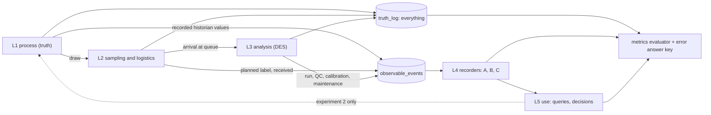
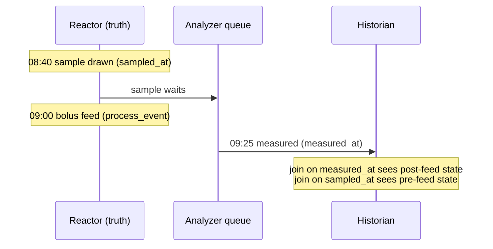
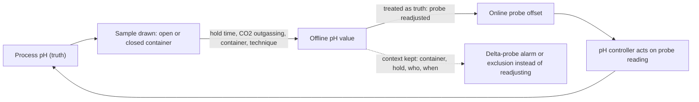

# Simulation specification

Status: design draft, no simulation result exists yet. Synthetic scenario built from public sources and labelled assumptions (ADR-0001). Nothing here predicts a real laboratory.

How to read the numbers: every number carries a ledger id (`S###` source, `A###` assumption; grades S, P, D, A are explained in `docs/research/README.md`). A number without an id is a defect, not a placeholder. Figures that rest on a source below `main-reread` are provisional and may not appear on the public README or infographic. Table, column and time-field names, and the derived quantities `hold_time` and `turnaround`, are defined once in `docs/design/data_model.md` (sections 2 and 5); this file uses them and does not redefine them.

## 1. Purpose

N bench-scale bioreactors in a process-development (PD) laboratory send in-process samples to M shared at-line analyzers. One synthetic "truth" run is recorded under several data architectures, so the only thing that changes is how data is captured and stored. The simulator shows how an analysis result loses its process context (which reactor, which moment, which instrument state) and what each architecture preserves.

Default: 24 reactors in two bays of 12, 2 analyzers; N from 5 to 100 and M from 1 to 6 (A001, A022; ADR-0009). Average load is low, so waiting comes from bursts, not capacity: 12.6 to 14.4 percent of two analyzers per 10 h staffed window (the default window, A098), 5.2 to 6.0 percent per 24 h clock (A074, grade A). Utilisation is always stated for both windows.

## 2. Five layers

| Layer | Contents | Events emitted | Entities |
|---|---|---|---|
| L1 process (truth) | staggered inoculation, simple kinetics for cells, metabolites and titer (A011), online sensor series at a 60 s cadence (A100), scheduled events | `inoculation`, `process_event` (feed, temperature shift, alarm, harvest), `sensor_tick` | Site/Area/Unit, Batch, ProcessEvent, historian tag |
| L2 sampling and logistics | planned window, actual draw, label, transport, aliquot by storage condition, stability effects while waiting | `sample_planned`, `sample_drawn`, `label_bound`, `sample_received`, `aliquot_created`, `draw_skipped_volume_budget` | Operator, Sample, Aliquot, label method |
| L3 analysis (discrete-event) | queue policy, QC and maintenance windows, reruns, dilution, instrument state, multi-visit routing, setup time | `request_queued`, `visit_started`, `visit_finished`, `run_started`, `qc_result`, `calibration_recorded`, `maintenance_started`, `maintenance_ended`, `result_measured`, `rerun_requested`, `dilution_applied` | Analyzer, InstrumentState, Run, Method |
| L4 recording (the comparison axis) | one recorder per architecture, error injector, event log | `record_written`, `record_corrected`, `flag_raised`, `ingest_received` | Recorder, ErrorInjector |
| L5 use | feed decision, batch comparison, analyst queries, optional model; truth-oracle arm | `query_answered`, `feed_decision`, `probe_restandardised` (experiment 2) | DecisionRule, AnalystQuery |

Time is an integer number of seconds everywhere in the engine. ISA-88 vocabulary is used for the physical model (Site, Area, Unit, Batch).

### 2.1 L1 process

Fed-batch is the default mode (A003): production culture 13 to 17 d (A004, S017; default 14, and the ledger range's 12 d low end comes from a different study, S019), preceded by an N-1 seed of 2 to 5 d (A005), inoculated at 0.5 to 1.5 million cells/mL (A007). Glucose is kept above 1.0 g/L by discrete feeds (A010, S017), so a feed can fall between a draw and its measurement. Peak viable cell density in fed-batch is typically 10 to 30 million cells/mL (A008, S053; the default is a pick inside that range); perfusion has no source and is an assumption (A009, grade A). Harvest follows a simulator rule (A013). Perfusion (A006, only one duration sourced) is deferred to session S4.

Kinetics are nutrient-limited growth with first-order death, nutrient use proportional to viable cells and product proportional to integrated viable cells (A011). The constants are ledger entries: growth and death rates (A080, A081), per-cell uptake and production rates (A082, A083, A084), the lactate switch (A085), specific productivity (A086) and the glucose half-saturation constant (A109). They come from a few CHO studies and are provisional.

### 2.2 L2 sampling and logistics

- Sampling pattern: one sample per reactor per day, a second in the feed window on a share of reactor-days (A014, A015); shift-start burst (A016) and shift pattern (A017) are assumptions; transport and preparation time (A018) and draw delay spread (A063) are assumptions.
- Labelling method (handwritten, pre-printed barcode, issued at draw) is an L2 setting, independent of the L4 flags.
- Container model: closed syringe for pH and gases, open cup for cell count and metabolites (A037, proxy). A held-sample effect is applied only as a scenario knob: viability slope default 0 for neat samples (A040), with the observed value kept separately and valid only to 55 min (A038, A039, S012); open-sample pH offset (A041) and relaxation (A042) and closed-sample drift (A043) follow their ledger grades; settling bias and in-tube glucose and lactate change are assumptions (A044, A045); the 30 min maximum hold is a blood-gas proxy (A046).
- Volume budget: each draw consumes a share of the culture (A057, derived). An over-budget draw is skipped and logged, and still counts in every metric denominator.
- Aliquot storage policy by analyte class (A021, assumption).

### 2.3 L3 analysis

Queue policy defaults to first-in-first-out, with priority, earliest-deadline-first and SLA variants (A035). QC time per analyzer per day and maintenance windows are scenario settings (A031); the QC failure probability per QC run is A087 and the maintenance window length is A096. A measurement is repeated with probability A088 for reasons other than range; a result above the over-range limit (A089) is repeated at a higher dilution (A090). Instrument behaviour is assumed and switched on per scenario (A033): the analyzer recalibrates on a fixed interval (A091), a drift random walk accumulates between recalibrations and resets at each one (A092), and a reagent lot change adds a step (A093); inter-instrument bias and habitual assignment are A032 and A034. Result noise follows the analyzer's specification limits for within-run and day-to-day precision (A077, A078) and the counter's repeatability (A079); these are limits, not typical performance. Service times come from the analyzer profile (section 4). A run may not overlap a QC or maintenance window, and a window is checked over the whole run, not only at its start.

## 3. Truth, recorded world and the observation contract

The engine emits two streams.

- `truth_log`: everything, including hidden quantities (true analyte values at draw, true pH, true instrument bias) and the true time of every event.
- `observable_events`: what a person or an instrument could see: sample drawn with its planned label, received, run started with instrument and QC lot, QC result, calibration record, maintenance log, recorded historian values. Times here are recorded stamps. The error injector can skew an instrument clock (A049, example offset +5 h), so a recorded `measured_at` can differ from the truth event.

Rules (invariants, tested):

1. Recorders (L4) consume `observable_events` only and never read truth. Hidden fields are annotated `"x-visibility": "hidden"` in the schemas. Test: change hidden-only fields and the recorder output must be byte-identical.
2. Who may read truth. The metrics evaluator reads truth, because it must in order to score, and it is the only reader of the error answer key (the record of which errors the injector materialised where). Experiment assembly (drawing the shared truth run and the error opportunities) and the oracle arm of experiment 2 may also read truth. Recorders and L5 (analyst queries and decisions) never do.
3. Same `(scenario, seed, engine_version)` gives a byte-identical event log. Randomness comes from a keyed integer generator with key (physical sample, analyte, attempt, purpose); experiment 2 adds `seed` and `reactor`. A rerun or an added sample never changes another sample's draws.
4. Every export and shareable URL carries `schema_version`, `engine_version` and `seed`.
5. As-of: a decision or query at time t uses, per logical key, the latest result version with `available_at` at or before t, and historian rows with `ingested_at` at or before t (data_model section 5). An architecture without the flag `available_at` sees rows as of now instead.

## 4. Profiles

Scenarios pick profiles. Profiles are data under `scenarios/profiles/{bioreactor,analyzer,staff}/`; each numeric parameter is `{value, unit, ref}` with `ref` resolving to a ledger id (ADR-0012). A bundle takes the grade of its weakest component.

### 4.1 Bioreactor

| Profile (default first) | How samples are taken | Sample as share of culture | Bundle grade | Ids |
|---|---|---|---|---|
| `bench_manual`: 2 to 5 L glass or single-use | operator draws into a closed container or syringe | 0.014 percent | S (with derived part) | A067, A002, A057 |
| `micro_mini_parallel`: micro-scale 10 to 15 mL, 24 or 48 vessels; mini-scale 100 to 250 mL, 12 or 24 vessels | automated liquid handler into a cup | micro 4.8 percent; mini 0.31 percent (0.16 to 0.7) | S (with derived part) | A065, A066, A057, S009, S011 |
| `pilot`: 50 to 250 L single-use (class boundary assumed, A104) | sterile syringe from a sampling line | 0.00055 percent, analyzer volume only | A (boundary and purge volumes unsourced) | A068, A057, A104, S036 |

On micro-scale systems the number of samples consumes the culture: 14 daily samples would draw 67 percent of the vessel (A057, derived), which is why the source calls sampling a burden there (S011). Pilot line purge and discard volumes are not sourced and are not modelled (A105). Automation also changes who creates the label, whether an operator is present, whether draws burst at shift start, and the delivery order (a vessel-order autosampler makes high-numbered vessels wait longest).

### 4.2 Analyzer

| Profile (default first) | Service and volume | Consequence | Bundle grade | Ids |
|---|---|---|---|---|
| `allinone_atline` (FLEX2 class) | 4.5 min stand-alone (270 s on the distributor page, 275 s in manual mode per the instruction manual), 6 to 8 min coupled to a parallel system; 275 uL on the distributor page against 265 to 350 uL in the manual, or 400 to 700 uL coupled; ceiling about 13.3 samples/h | one queue, one file, one clock | D (the capacity ceiling is derived) | A069 (its components include A019, A020, A023, A075), S001, S003, S007 |
| `split_cellcounter_metabolite` | 130 s plus 120 s = 250 s (4.2 min) of instrument time over two visits, plus a hand-off between them (A106); 200 + 135 = 335 uL | two queues; the two results can be measured at different times and carry different clocks | A (hand-off unsourced) | A070 (its components include A025, A026, A106, A107), S005, S006 |
| `hplc` (titer) | 1 min run, 5 to 50 uL injection; column changeover and system-suitability time is assumed | shared column is the contested resource | A | A071, A028, A029, A030, S026 |

The 250 s and 335 uL figures are sums of stand-alone sourced numbers (derived). On the same analyte scope (cells, viability, metabolites, electrolytes) the all-in-one panel takes 235 s and 135 to 220 uL, so the split path needs about 1.06 times the instrument time and 52 to 148 percent more sample (A107, derived). The full 16-analyte menu (A116) is a different scope and is not compared. The metabolite side uses the FLEX2 chemistry module as a stand-in (A070). Interface: shared-folder CSV drop by default; a vendor OPC server is a separately licensed alternative (A036). Calibration behaviour (drift, resets, lot change) is assumed (A033).

### 4.3 Staff

| Profile | Count variability | Label errors | Delay and technique | Bundle grade | Ids |
|---|---|---|---|---|---|
| `experienced` | manual 2.81 percent CV between operators, automated 0.46 percent (bead study); counting-statistics floor 5 percent (range 3.3 to 7.1) | 6.1 per 1000 (clinical proxy) | delay spread 5 min, technique error 0.02 (assumed) | A | A072, A058, A059, A060, A047, A063, A064 |
| `trainee` | manual CV times 2 (assumed), automated unchanged | 6.1 per 1000 times 2 (assumed) | delay spread 12 min, technique error 0.10 (assumed) | A | A073, A076, A062, A063, A064 |

What is sourced is narrow (A058, A059, A060, A047). The effect of training on label errors could not be established, and standardised labelling protocols are the lever with evidence (A061, S024, proxy). Roster and fatigue are assumptions: the staffed window is 10 h per day with two operators per shift and a trainee share of zero as a scenario knob (A098; shift pattern A017), and the fatigue multiplier on delay spread and technique error late in a shift is off by default (A099). Operator hands-on time per sample at the analyzer is A101. Operator id and qualification reference ride on the `audit_trail` flag.

### 4.4 Generic engine mechanisms

Multi-visit routing, sequence-dependent setup, volume budget, rate multipliers and delivery order. Nothing in the engine branches on a profile id, scenario id or architecture id.

## 5. Data architecture = feature flags

The flag definitions and the expected outcome per flag are owned by ADR-0005; this section repeats the table so the spec reads on its own and must say the same.

| Flag | On | Off | Error it targets |
|---|---|---|---|
| `system_issued_id` | key issued by the system at label creation | key typed or handwritten | label and transcription errors (A047, A061) |
| `two_clocks` | `sampled_at` and `measured_at` stored separately | one time stored, the measured time; `sampled_at` is not stored | alignment error, feed-in-the-gap mis-join |
| `available_at` | each row carries when it became knowable | queries see rows as of now | time-travel leakage |
| `instrument_state_snapshot` | run links instrument, calibration, reagent lot | free-text analyzer name at most | instrument effect read as process effect (A032, A033) |
| `append_only_versions` | correction, rerun, reprocess create versions | overwrite in place | lost reruns, silent edits |
| `write_time_keys` | `sample_id`, `unit_id`, `batch_id` fixed at write time and never re-keyed; it does not own `sampled_at` | unit and batch attached later by a time join against the historian and batch record, using the stored time | misattribution, mis-joined context |
| `ingest_idempotency` | source event id and key; duplicates and replays are no-ops | duplicates double count | duplicate or replayed files |
| `audit_trail` | who, when, what changed; operator id and qualification | no history | unattributable records |

Planned time is separate from `two_clocks`. A sampling plan that issues the label (`system_issued_id`) gives the sample a `planned_at`; keeping it, and not the actual draw time, is a limit of preset B that comes from the L2 labelling setting and the L4 recorder, not from the definition of `two_clocks` off. With `two_clocks` off the single stored time is always the measured time.

| Preset | Flags on | Labelling default | Realistic limits kept |
|---|---|---|---|
| A manual/Excel | none | handwritten | transcription, one stored time (the measured time), overwrite, no instrument id |
| B LIMS-lite | `system_issued_id`, `ingest_idempotency`, `audit_trail` | pre-printed barcode | records the planned time (from the plan that issues the label), not the actual draw time; reagent lot and calibration not linked; dilution factor typed by hand; joined to the historian by the one stored time, the measured time. B is not a straw man: barcodes, automatic capture and an audit trail exist |
| C context-preserving | all eight | issued at draw | keys fixed at write time; process context as a versioned as-of projection joined with `AS OF`; residual error remains, such as a correct barcode stuck on the wrong tube |

- Labelling method is set independently of the flags; scenarios may cross them.
- Ablation: C with exactly one flag off, for each flag (eight runs). The expected outcome per flag is stated in ADR-0005.
- The system of record for routine in-process results (MES/EBR or LIMS) differs by site and is a setting (A056, SC11); only release-relevant tests get state-machine and Part 11-grade control.

Hypothesis matrix (a design hypothesis to be tested in session S2 by forced-error fixtures, section 6; not a result). Rule ids are in data_model section 8.

| Error type | Prevented by | Detected by | Invisible when |
|---|---|---|---|
| label or transcription error | `system_issued_id` | duplicate and plausibility rules (VR-009, VR-014) | handwritten, no checks |
| feed in the gap (wrong time for the join) | `two_clocks` (the join uses `sampled_at`) | hold-time rule on `hold_time` (VR-010), which needs both clocks | one time stored, joined by measured time |
| unit or batch re-keyed or mis-joined after write | `write_time_keys` | no-open-batch rule for gross cases (VR-020) | keys attached later by a time join |
| clock or time-zone error (A049) | none | `two_clocks` plus clock rule (VR-004; S029, S030) | one time stored |
| duplicate or replayed file | `ingest_idempotency` | idempotency log | no keys |
| lost rerun or silent overwrite | `append_only_versions` | `audit_trail` | overwrite in place, no history |
| instrument or lot effect | none | `instrument_state_snapshot` with a bridging study (`control_id`) | no instrument link |
| late correction leaking into an earlier decision | `available_at` | as-of query (section 3, rule 5) | queries see rows as of now |
| unattributable record | `audit_trail` | qualification check (VR-015) | operator free text or absent |
| sampling technique error (A064) | none | recorded container and hold context | context not recorded |

## 6. Experiments

**How experiments are judged.** The gate for the recorders (session S2) is structural. Each flag has a forced-error fixture: one hand-built sample with one forced error of a known type, recorded under C, under C with that flag off, and under A and B. The expected outcome of every case (prevented, detected or invisible) is typed by hand before any run, from the matrix in section 5 and ADR-0005; the engine does not produce it. Stochastic comparisons between architectures run over at least 20 seeds (A103) and are reported with intervals. They are never gated, and no test requires an ordering such as "C must win" or "recall higher on every seed". Residual failures of C are reported.

### 6.1 Experiment 1 (primary, open loop)

One truth run per `(scenario, seed)` is shared by every architecture. Step durations are identical across architectures. Error opportunities (label error, dilution transcription, clock misconfiguration, technique error and similar) are drawn once per sample, independent of architecture, then materialised per architecture. Detection only raises flags; it never triggers a re-draw or a re-measure. The truth-log hash is identical across architectures.

**Flagship 1: feed in the gap (SC3).** Illustrative times (A102): a sample is drawn at 08:40 (`sampled_at`), a bolus feed happens at 09:00 (feed rule A050), and the sample is measured at 09:25 (`measured_at`). The draw-to-measurement span is 45 min (A102, derived). `hold_time` ends when the run starts, so it is the span minus the run itself: if the run takes the full panel cycle of 4.5 min (A023), it is 40.5 min, which still exceeds the 30 min blood-gas rule (A046, proxy; SLA threshold A097). Joining to the historian by `measured_at` pairs a pre-feed value with post-feed process state, which contaminates anything trained on it. Joining by `sampled_at` pairs it correctly.

Same family: an autosampler that loads in vessel order makes the high-numbered vessels wait longest.

### 6.2 Experiment 2 (closed loop, SC8)

**Flagship 2: offline pH used to re-standardise the online probe.** The practice exists (S013, A051): the offline value is treated as the source of truth, and sampling, hold time, temperature and CO2 degassing add offsets. Offsets depend on equipment and local procedure (S013). The ledger default (A041) is a cell-free, liquid-handler case, so scenarios sweep its range and report sensitivity; no single offset is presented as general.

The context-preserving story follows the alternative described in the same source: avoid readjusting onto offline values, using a CO2-based reference and delta-probe alarms (S013; the exhaust-CO2 note S045 is snippet-level). A record that keeps how the sample was taken and held lets the offset be modelled or excluded.

Design: arms are an oracle that decides with truth (experiment assembly may read truth, section 3), versus A, B and C. Common random numbers keyed by (seed, reactor, sample, purpose). Paired difference against the oracle over at least 20 seeds (A103) with intervals, reported and never gated. The probe model uses in-line probe drift (A094), the controller deadband around the set point (A095) and readjustment onto the offline value at a set interval when A051 is on (A108). Outputs: probe offset, control excursion, paired difference. Wording is always "model-internal effect under assumptions A###, not a prediction". Feedback is off in every other scenario (default `feedback: false`, tested).

## 7. Scenario catalogue

Each scenario asks one question. Scenarios live in `scenarios/*.json`.

| ID | Question | Settings (ids) | Main metrics | Session |
|---|---|---|---|---|
| SC1 Ordinary Tuesday | What disappears on an ordinary day? | defaults (A001, A014, A015, A016), architecture toggle | exact reconstruction, misattribution, alignment error | S2 |
| SC2 Shift-start burst | Why wait when mean utilisation is low? | shift burst (A016) versus staggered sampling window | `hold_time` median and p90, SLA exceedance (A097), utilisation (both windows stated, A074) | S1 |
| SC3 Feed in the gap | Which timestamp should the join use? | a feed between draw and measurement (A010, A050; times A102) | alignment error with context mismatch, phantom effect size | S2 |
| SC4 New lot on AN-2 | When does an instrument effect look like a process effect? | inter-instrument bias on (A032), habitual assignment (A034), lot-change step (A033, A093), drift (A092), bridging samples (`control_id`) | phantom effect size, detection precision and recall | S2 |
| SC5 One analyzer down | Whom does the priority rule hand the cost? | maintenance window (length A096, schedule A031), FIFO versus earliest-deadline-first (A035) | `hold_time` p90, SLA exceedance, availability before decision deadline (A050), delay by bay | S1 |
| SC6 Wrong clock | What if one clock is wrong? | one analyzer with a clock offset, example +5 h (A049; control need in S029, S030) | alignment error, detection recall, false-alarm rate | S2 |
| SC7 Re-run and dilution | How are reruns and dilutions recorded? | QC failure probability (A087), rerun probability (A088), over-range limits and dilution factors (A089, A090), manual dilution factor (A048, A031) | rerun traceability, exact reconstruction | S2 |
| SC8 pH re-standardisation | How does a record error reach control? | experiment 2 (A051, A041, A042, A043, A064, A037; probe A094, A095, A108) | probe offset, control excursion, paired difference | S2 |
| SC9 Perfusion campaign | What if the context unit is not the batch? | long perfusion with harvest intervals (A006, A003, A009) | exact reconstruction by harvest interval | S4 |
| SC10 Pool genealogy | What happens at merges across batch boundaries? | cross-batch pool (A052, A053, A054; turnaround unset, A055) | lineage-query exact reconstruction | S4 |
| SC11 GMP preset | Same model, different control strength? | source-of-record setting (A056); clock and audit expectations (S029, S030) | attributable rate, exact reconstruction, availability | S3 |

No numeric claim is made for any scenario until its session has produced results.

## 8. Metrics

No composite score. Every table reports the seed count and the spread across seeds. A metric without a stated denominator is a defect. Metrics are reported, not gated; the only gates are the structural fixtures of section 6. `hold_time` and `turnaround` are defined in data_model section 5, and metrics use their truth values.

| Metric | Definition | Denominator |
|---|---|---|
| Holding time | `hold_time` (`run_started_at` minus true `sampled_at`); median, p90, SLA exceedance share (threshold A097) | all analysis requests; requests never started count as SLA exceedances; median and p90 are over started requests with the started share printed beside them |
| Turnaround | `turnaround` (`available_at` minus true `sampled_at`); median, p90 | all analysis requests; requests never released count as not available; median and p90 are over released requests with the released share printed beside them |
| Utilisation | analyzer busy time over available time, stated twice: per staffed window (default 10 h, A098) and per 24 h (A074); state whether setup counts | analyzer-time in the stated window |
| Availability before a decision deadline | share of requests whose result `available_at` is at or before the decision time (A050), by the as-of rule of section 3 | all analysis requests |
| Misattribution rate | recorded reactor or batch differs from truth; unattributed reported separately | all analysis requests |
| Detection recall | per error type e: flagged realised opportunities of type e over all realised opportunities of type e | realised opportunities of type e |
| Detection precision | per error type e: raised flags of type e that sit on a realised opportunity of type e over all raised flags of type e | raised flags of type e |
| False-alarm rate | per error type e: requests with no realised opportunity of type e that carry a flag of type e over all requests with no realised opportunity of type e. Unlike precision it does not depend on how common errors are | requests clean for type e |
| Exact reconstruction rate | share of requests whose analyst-query answer equals truth on reactor, batch, `sampled_at`, process context as of (the rule of section 3), and instrument state; unanswerable counts as wrong | all analysis requests |
| Alignment error | seconds between the time the join used and true `sampled_at` (median, p90), plus the resulting context mismatch | all analysis requests |
| Phantom effect size | absolute difference between recorded and true group effect, over the pooled truth SD, for a group contrast whose true effect is zero | requests in the contrast |
| Rerun traceability rate | reruns whose original, reason and link are recoverable | all rerun requests |
| Attributable rate | operator and qualification present and correct | all analysis requests |
| Experiment 2 | probe offset, control excursion, paired difference versus oracle with intervals | reactors over the seeds (at least 20, A103) |

Anti-gaming rules:

1. The denominator is fixed to all analysis requests, including missing, rejected, skipped (volume budget) and delayed ones; no metric may improve by dropping a hard request.
2. Only the evaluator reads the error answer key.
3. Detection metrics are always shown together: recall with precision, detection with false-alarm rate.
4. Detection never causes a re-draw or re-measure, so it cannot improve operational metrics.
5. Golden files are never regenerated by a script or a test; a change needs the author's recorded approval.
6. Each metric is shown as a distribution over seeds, with sensitivity to grade-A inputs; residual failures of the best architecture are shown, not hidden.
7. No result is stated for a stage that has not run, and extrapolation beyond a source's range (for example holds beyond 55 min, A039) carries a warning.
8. No gate on a stochastic comparison: a test never requires an ordering between architectures across seeds (section 6).

## 9. Verification ladder

1. **Invariants** (property-style loops over many seeds): no double occupancy of an analyzer, sample conservation, results immutable once released, time monotone, truth never visible to recorders, no run overlapping a window, queue discipline.
2. **M/M/c-only mode** (engine unit test only). Input: Poisson arrivals, exponential service times and identical servers, first-in-first-out, with transport, windows, shifts, noise and reruns off. The analytic Erlang C values are calculated by hand and fixed before the run, never taken from the engine. The analytic mean waiting time must lie inside the 99 percent confidence interval of the simulated mean over independent replications. If it does not, stop and escalate to the orchestrator: do not tune the engine, the seeds or the tolerances until the check passes, because the fault may be in the engine, the target or the test. The real scenarios are closer to deterministic service with bursty arrivals, so this mode explains them and does not validate them.
3. **Hand-calculated fixtures:** arrival reversal (queue admission must follow arrival at the analyzer, not draw order, because transport can reverse them), window boundary (a run must not straddle a QC or maintenance window), rerun, tandem visit, setup change, rack burst, earliest-deadline-first.
4. **SimPy trace-driven parity:** same input file, integer seconds, exact equality on event times; golden files read-only (the author's gate, ADR-0010).
5. **Scenario sanity:** qualitative relations only (sign, ordering, structural zero), not magnitudes.

The recorders' gate in S2 is separate from this ladder: the forced-error fixtures of section 6.

## 10. Deliberately out of scope

- Predicting any real laboratory; compliance claims (Part 11, Annex 11, ASM, SiLA, OPC UA) — describe, never claim.
- Real data, verbatim vendor file formats, any LIMS or MES product.
- A single summary score; a server, accounts or a database service.
- A PAT or soft-sensor model (optional, only on explicit request); downstream processing and perfusion before session S4.
- Pyodide; DuckDB-WASM in the default bundle (ADR-0003).
- Making architecture C win by construction.
- Viability loss in a held neat sample as a central effect (A040 default 0).
- Pilot-scale purge and discard volume (A105), downstream assay turnaround (A055), instrument-to-instrument bias magnitudes (A032) — unsourced, so not modelled.
